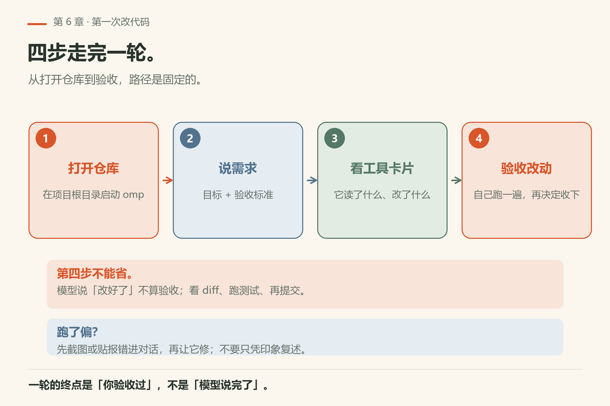
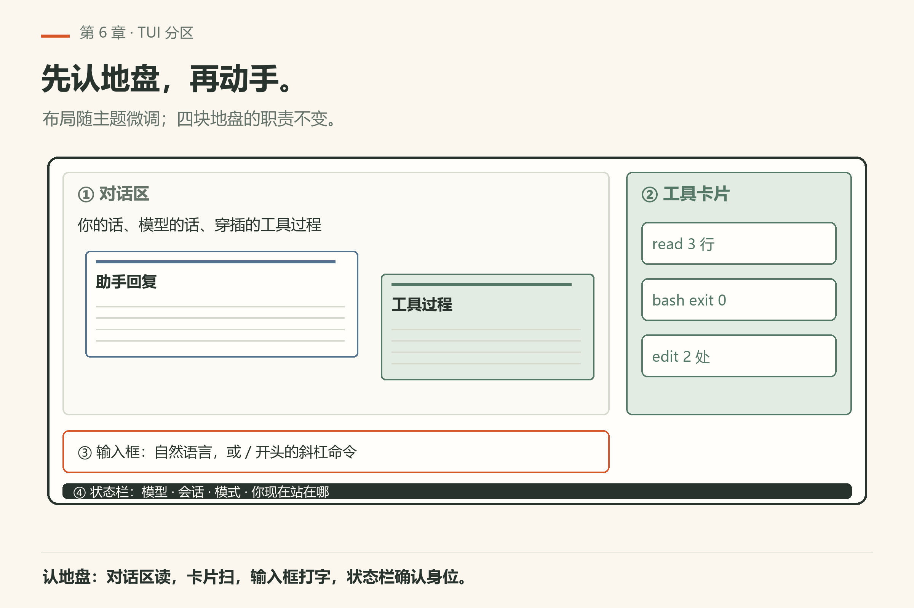
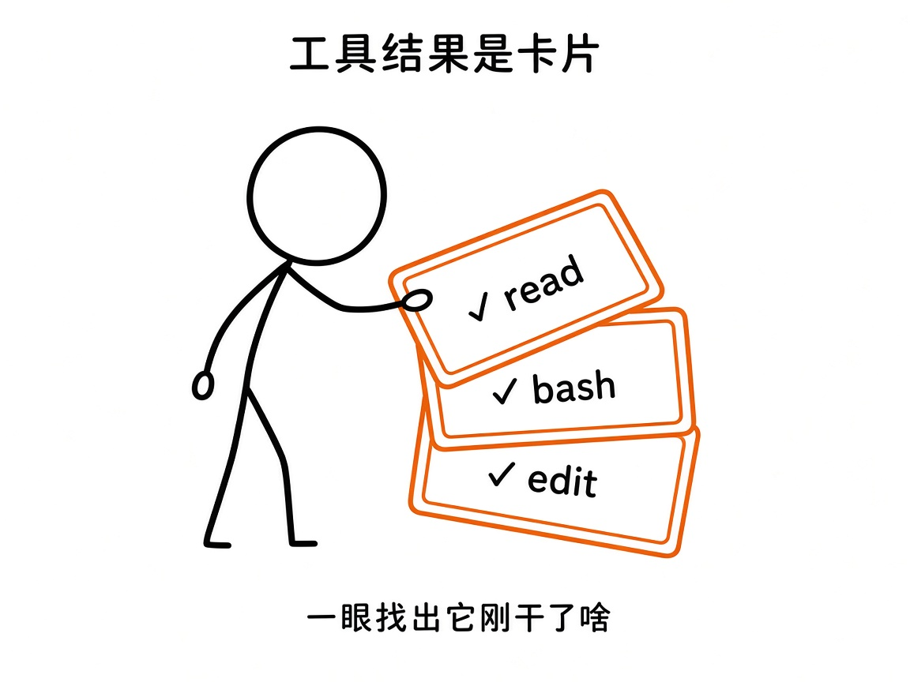
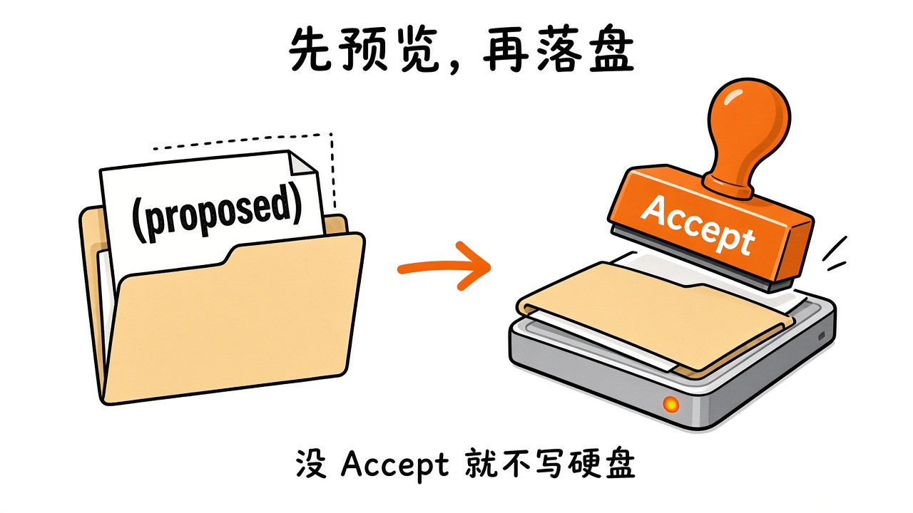
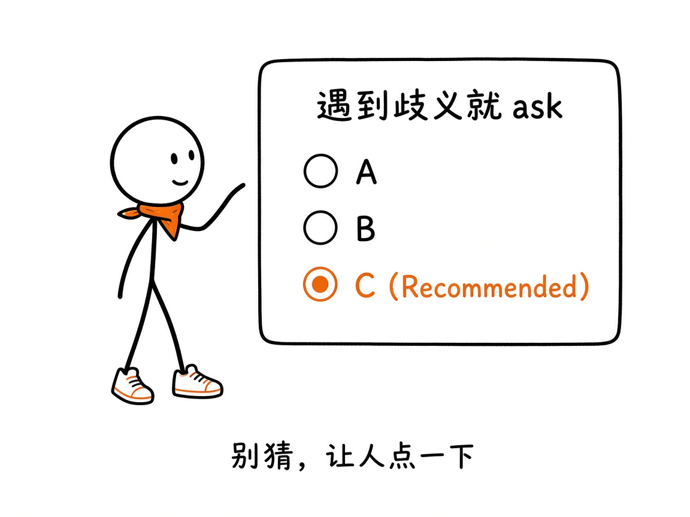
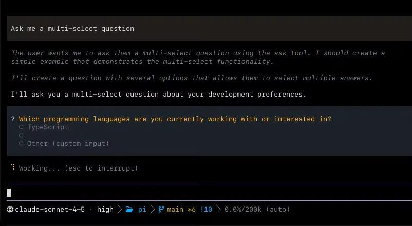
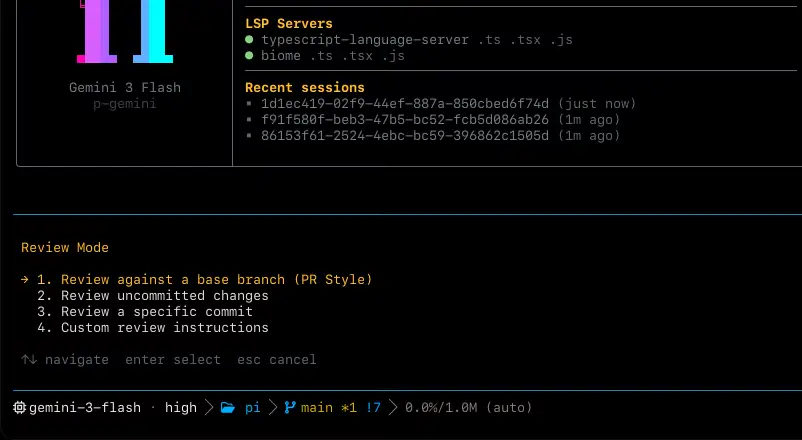

# 第6章 第一次对话

你第一次进 omp 的 TUI，说：「给 `src/mathutil.py` 加一个 `clamp` 函数，再补个测试。」它读完文件，弹出一张编辑卡片，你盯着 **Accept** 两秒钟没敢按——万一它改错了呢？你按了，跑测试，过了。

> **开门一句话：**第一次对话只要能跑通一条命令，就知道整条链路是活的。

这一章就把这一圈走顺：**说需求 → 看它动手 → 验收改动**。不要求你第一次就重构半个仓库。目标是**小任务，走完一整圈**，让手记住界面在哪、卡片长什么样、编辑什么时候才真正写进磁盘。



*图6-5：打开仓库 → 说需求 → 看工具卡片 → 验收改动。*

## 6.1 进门

在一个你有写权限的小项目目录里：

```sh
cd /path/to/your/tiny-project
omp
```

（还想指定模型：`omp --model provider/model-id`。）

第一次进交互界面，状态栏附近通常能看到当前模型等信息。若提示未登录，回到第 5 章把 `/login` 做完再来。

TUI 是 README 说的默认界面：**工具调用渲染为卡片**；**编辑在写入磁盘前可预览**；遇到歧义走 **`ask`** 结构化选项。其余大多靠键盘。

## 6.2 TUI 四块地盘（心智模型）

真实布局会随主题/版本微调，先建立四块地盘的心智模型，比死记像素坐标有用：

1. **对话区** — 你的话、模型的话、穿插其中的工具过程。
2. **工具卡片** — 每一次 `read` / `bash` / `edit` … 的结果，做成可扫读的卡片，而不是一整屏原始 JSON。
3. **底部输入框** — 普通自然语言；以 `/` 开头是斜杠命令（`/model`、`/help`、`/resume` …）。
4. **状态栏** — 模型、会话、模式之类的「你现在站在哪」。



*图6-1：先认地盘再动手。具体像素以你本机主题为准；概念分区稳定。*

斜杠命令记不住时，先试 `/help`（若你的版本提供帮助入口），或查附录 B（全书后部的斜杠速查）。第 7 章会专门讲会话相关命令。

## 6.3 工具结果是卡片

agent 不是只回一段散文。它要读文件、跑命令、改代码时，TUI 把每次工具调用收成卡片：成功打勾、失败给错误摘要，必要时还能展开细节。



*图6-2：一眼扫过「它刚读了啥、跑了啥、改了啥」。*

这对新手有两层好处：

- **可审计**：别只看最后一句「我改好了」，往上翻卡片核对路径和命令。
- **可打断**：跑偏了就停（ Esc / 中止类快捷键以你主题的绑定为准），改口再说——agent 循环允许你中途转向。

第三篇会按工具拆开做实验。这一章只要养成「说话之前先扫卡片」的习惯。


## 6.3a 一轮对话里你肉眼该看到的顺序

结合第 1 章的 agent 循环，TUI 上常见时间线是：

1. 你的用户消息出现在对话区；
2. 模型开始「想」（若开启 thinking，可能看到推理片段——视模型与设置而定）；
3. 一张或多张**工具卡片**依次出现（read → grep → edit → bash … 顺序不固定，取决于任务）；
4. 如有编辑预览，你处理 Accept / 拒绝；
5. 如有 `ask`，你点选项；
6. 助手用自然语言收束：「我改了什么、测试结果如何」。

如果第 6 步说得很好听，但第 3 步卡片里路径根本不对——信卡片。

## 6.3b print mode 为什么不适合「第一次」

`omp -p "…"` 会跑同一套引擎，但：

- 没有卡片可供你中途纠偏；
- `ask` 没有人点（交互假设不成立）；
- 计划类默认启动行为在 print mode 会被忽略（见第 3 章对 `plan.defaultOnStartup` 的说明）。

把它留给脚本和 CI。手感课请留在 TUI。

## 6.4 先预览，再落盘

改代码最容易让人紧张：模型一冲动，文件就没了？

omp 的设计方向是：**危险的写入可以被看见，再被接受。** README 用 `ast_edit` 讲得很形象——先出一张带「（proposed）」的卡片，改动处于暂存；随后出现 **Accept**，通过后才真正写磁盘，并且按原子语义处理（要么一起成功，要么不做）。

普通的 `edit`（默认 **hashline** 模式）在引擎侧也强调流式预览与应用会话（`pi-edit`：行锚点 patch、流式预览、原子化应用）。你作为用户，在 TUI 里抓住这句话就够：

> **没 Accept / 没确认的预览，就不要当成已经写进磁盘。**



*图6-3：proposed → Accept → 磁盘。中间你可以反对。*

hashline 本身的锚点、过期恢复、和 `write` 整文件覆盖的分工，是第 9 章的主题。第一次对话：完成一次「提出修改 → 你看过 → 落地」即可。

> 说明：README 海报级演示偏向 `ast_edit` 的 proposed/Accept。不同编辑工具、不同设置下，预览 UI 的文案可能略有差别。以你屏幕上实际卡片为准；原理都是「先看见，再持久化」。

## 6.5 遇到歧义：`ask`

模型拿不准时（选 A 方案还是 B 方案、要不要动测试、目录结构有两种习惯……），可以调用内置工具 **`ask`**：弹出选项选择器（单选 / 多选），而不是在散文里猜你的心思。

文档里的能力包括：

- 一个或多个问题（`questions[]`）；
- 选项可带说明；丰富对话框还可带 preview；
- `recommended` 标记推荐项；
- 超时策略（与 `ask.timeout` 等设置有关；计划模式开启时超时会被关掉）；
- 取消则工具失败，而不是假装你选了。



*图6-4：别让模型瞎猜——让人点一下。*

你的动作很简单：读选项 → 选一个（或 Other 自己说）→ 继续。



*图6-6：上游 README 的 ask 演示（`assets/ask.webp`）；选项带说明，推荐项会标出来。*

若总是跳过 ask、模型却频繁选错方向，回头检查是不是非交互模式（`omp -p`）——那边没有人点选项，行为会收紧或换策略。

## 6.6 实战：给小项目加一个函数和测试

下面是一套「刻意练手」的剧本。把路径和语言换成你仓库里真实的即可。

### 准备

- 一个很小的仓库或练习目录（有测试框架更好：pytest / vitest / go test …）。
- 已登录模型，`omp` 能进 TUI。
- git 干净或至少你知道怎么 `git diff` / `git checkout --`。

### 步骤

**1. 打开仓库并启动**

```sh
cd your-tiny-project
omp
```

**2. 说清楚需求（一次说完约束）**

示例（Python）：

```text
在 src/mathutil.py 里新增函数 clamp(x, lo, hi)，返回把 x 限制在 [lo, hi] 的值。
再补一个测试文件 tests/test_mathutil.py，覆盖低于下界、高于上界、落在中间三种情况。
先读现有测试风格再写；不要改无关文件。
```

要点：

- **点名文件**（或明确「没有就创建」）；
- **验收标准**（三种边界）；
- **范围**（别改无关文件）。

**3. 盯卡片，不要只盯最后一句**

你应该陆续看到类似：

- `read` 某些文件 / 目录；
- 可能 `grep` / `glob` 找测试约定；
- `edit` 或 `write` 提出修改；
- `bash` 跑测试。

任何一张卡片路径不对，马上打断重说。

**4. 预览与验收**

- 对 proposed / diff / Accept：看清楚再接受。
- 终端里自己再跑一遍测试（即使 agent 跑过）：

```sh
# 示例，按项目替换
pytest -q
# 或
npm test
```

- `git diff`：是否只有你要的文件？

**5. 收工**

满意就留着改动；不满意就回滚文件，用第 7 章的 `/fork` 或 `/branch`（`/rewind`）另开一条会话思路——不必在同一条说糊了的线程上硬刚。


## 6.6a 输入框里还能干什么（第一天够用的）

除了自然语言，底部输入框还吃这些常见前缀（完整表见附录 B，以你版本 `/help` 为准）。敲下 `/` 时先出候选，方向键选，回车执行：



*图6-7：上游 README 的斜杠命令演示（`assets/slash.webp`）；命令名与说明并排，选项随输入过滤。*

| 你输入 | 大致作用 |
|---|---|
| `/model` | 换模型 |
| `/login` | 登录供应商 |
| `/help` | 帮助（若提供） |
| `/new` `/clear` `/fresh` | 会话重置家族（第 7 章） |
| `/resume` `/fork` | 接上旧会话 / 分叉（第 7 章） |
| `/tree` `/branch` | 会话树导航（第 7 章） |

图片、粘贴、多行编辑的具体键位跟终端和主题有关。第一天不必背快捷键表：先保证「能说话、能看卡片、能接受编辑」。

## 6.6b 失败了怎么收场

第一天一定会失败几次；重要的是失败后第一句话说什么。

- **测没过**：把失败日志贴回对话，要求「只改测试失败相关的最小 diff」。
- **改多了**：`git checkout -- <file>` 或 `git restore`，再在对话里说「刚才那次范围太大，重来，只动这两个文件」。
- **模型胡扯路径**：立刻打断，用绝对或仓库相对路径重申。
- **一直不调用工具、只给建议**：明确写「请直接改仓库里的文件并跑测试，不要只给补丁文本」。

这些收场动作比「换一个更贵的模型」往往更有效——至少在你还没学会写 AGENTS.md、技能和钩子之前是这样。

## 6.7 第一天建议记住的快捷习惯

不求多，只求这五条变成肌肉记忆——它们每天都会用到。

| 习惯 | 为什么 |
|---|---|
| 需求里写清路径与验收 | 减少漫游式 `read` 全家桶 |
| 先扫工具卡片再信总结 | 总结会美化，卡片更硬 |
| 编辑先看预览 | 磁盘是最后一步 |
| 歧义等 `ask`，或自己用 `/` 命令澄清 | 比事后返工便宜 |
| 小步提交 git | agent 大胆，你的安全网是版本控制 |

## 6.8 和另外三种入口的差别（提醒）

同一个引擎有四种入口；学手感只用其中一种。

- **`omp -p "..."`**：同一引擎，但无 TUI、无点选；适合脚本。第一天学习界面请用交互 `omp`。
- **SDK / RPC / ACP**：给程序和编辑器用。你还在「上手」篇，先把 TUI 肌肉记忆练出来。

## 6.9 本章小实验

**实验一：先用 print mode 确认引擎通不通**（不用进 TUI，不花一次交互）。

```sh
omp -p "只回复两个字：在线" --no-session
```

本机已验（18.16.0）：stdout 只有一行 `在线`，退出码 0（`omp/facts/live-18.16.0/print-mode-online.txt`）。**算成功**：看到「在线」且退出码 0。看不到就是模型没接好，回第 5 章。

**实验二**：完成 6.6 的「一函数 + 一测试」全流程，保存一份 `git diff` 输出。

**实验三**：故意说一句含糊需求（「把性能优化一下」），看它会不会 `ask` 或先大范围探索——然后用更硬的约束重来一次，对比卡片数量。

**实验四**：在一次 `edit`/`ast_edit` 预览时拒绝或改口，确认磁盘上没有留下你以为「已经改好」的内容。

下一章：会话不是聊完就扔——树、fork、resume、export。

## 6.10 翻车对照：第一天会撞上的五件事

这五件事几乎人人撞上，撞上不丢人，认不出来才丢人。

| 翻车做法 | 会看到什么 | 正确做法 |
|---|---|---|
| 把 `omp -p "..."` 当 TUI 的替代品来学界面 | 没有卡片、没有 Accept、`ask` 没人点；计划类默认启动行为在 print mode 被忽略 | 手感课留在交互 `omp`；print mode 只留给脚本和 CI |
| 说「把性能优化一下」就等它动手 | 它要么大范围 `read` 全家桶，要么弹 `ask` 让你选；方向容易跑偏 | 点名文件、写验收标准、划范围（6.6 的三点） |
| 看到最后一句「我改好了」就信 | 往上翻卡片，路径根本不对 | 信卡片：`edit`/`write` 真跑过才算数 |
| 预览时直接按 Enter，没看清 diff | 改多了或改错处 | 先看 proposed/diff，再 Accept；不满意就 `git checkout -- <file>` |
| 命令拼错，以为 omp 会报错 | 子命令不存在时不报错，整句被当提示词进模型，屏幕停在 `Working...`（本机 18.16.0 实测挂到 90 秒被 timeout 掐断，exit 124，`fail/bad-command.txt`） | 先 `omp --help` 数 COMMANDS；未知**旗标**才会明确报错（exit 2） |

## 6.11 与御舆同构点

参见御舆第 2 章《对话循环》。两边讲的是同一件事：**一问一跑一拍，任务了结才停**。omp 的「说需求 → 看卡片 → 验收」在御舆那章换了别的叫法，但每一格问的问题一样——这一轮谁在决定、谁在执行、什么时候算完。跨书只搬这张循环图，别搬对方的命令名和界面布局：两套装配边界不同。

---
**版本核对清单**（写作钉 v18.15.0；用户本机验证 v18.16.0，见 VERIFY.md）：TUI 默认行为与「卡片 / 预览 / ask」见 README 产品叙述与「先预览，再接受」节；`ask` 字段与流程见 `docs/tools/ask.md`；`edit` / hashline / 预览引擎见 `docs/tools/edit.md` 与 README `pi-edit` 描述；`ast_edit` proposed→Accept 以 README 演示为准。快捷键与主题绑定随配置变化，以本机 `/help` 或设置文档为准。本章实战剧本是教学设计，不是仓库自带示例项目。

- [ ] `omp -p "只回复两个字：在线" --no-session`：本机 18.16.0 回「在线」且退出码 0
- [ ] `omp --help` 的 COMMANDS 表条数，和你对「有没有这个子命令」的判断一致（本机 51）
- [ ] `omp notasubcommand`：本机 18.16.0 不报错而进 `Working...`；上游若加了未知子命令校验，6.10 表要重写
