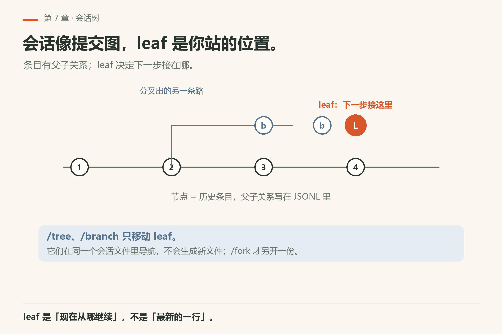
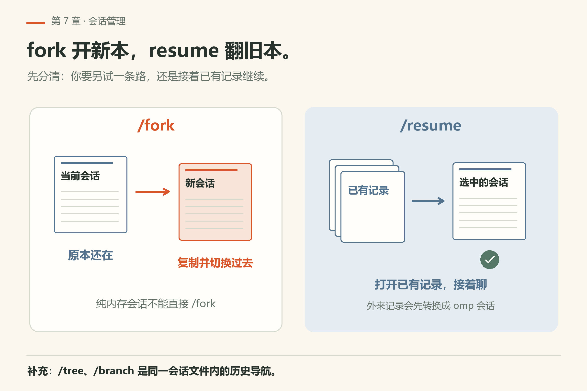
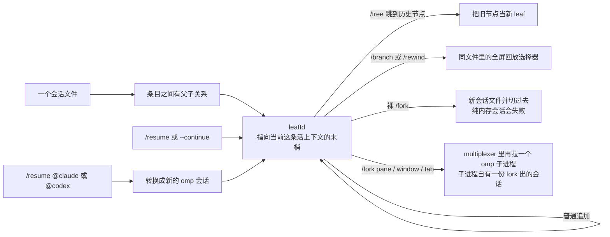
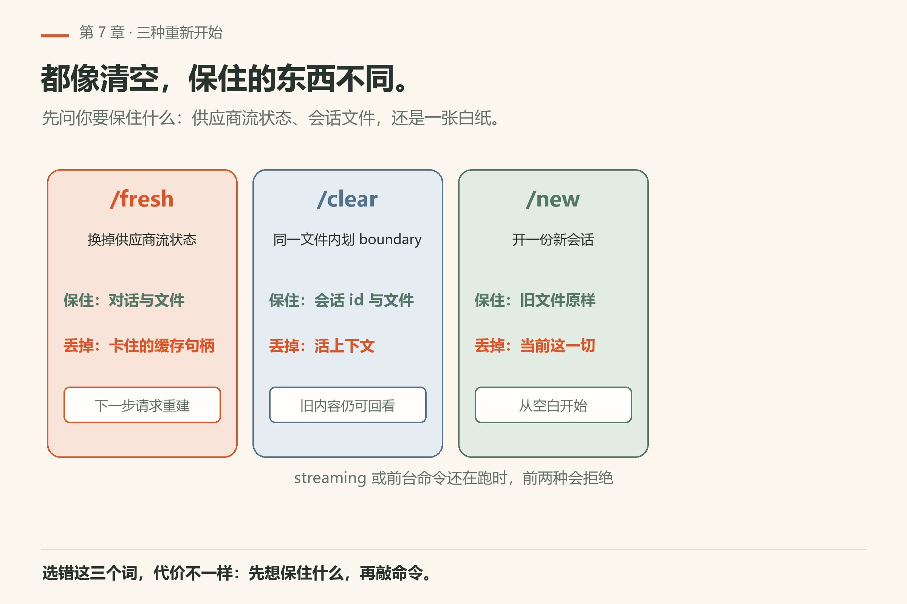
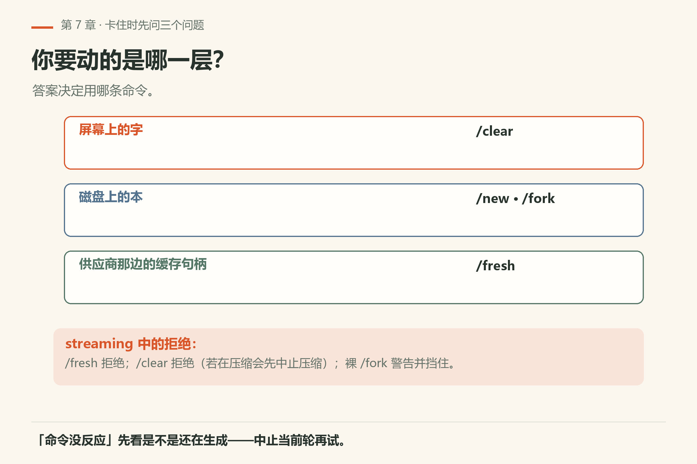

# 第7章 会话管理

你昨天改到一半下班，今天回到同一个仓库，想接着改。打开 omp，它开了一条全新会话——昨天那次讨论、那个走歪的分支、那份改了一半的 diff，全都不在。你只好从头说一遍。

会话机制就是为这件事准备的：把对话存成磁盘上的 **JSONL**，让你能分叉、续聊、打包带走。omp 把这些收成**会话（session）**机制，交互上是一组斜杠命令和 CLI 旗标。先记一句比喻：

> **会话树 ≈ git 的提交图；你现在站的位置叫 leaf。**



*图7-1：分支上的节点是历史条目；橙色的 leaf 是「下一步会接在哪」。*

细节以 `docs/session.md`、`docs/session-operations-export-share-fork-resume.md`、`docs/session-tree-plan.md` 为准。下面按「上手会用到的」厚度展开。

## 7.1 会话文件放在哪

默认（可被 `PI_CODING_AGENT_DIR` 等改写）大致是：

```text
~/.omp/agent/sessions/<encoded-cwd>/<timestamp>_<sessionId>.jsonl
```

相关邻居：

| 路径 | 用途（摘要） |
|---|---|
| `~/.omp/agent/sessions/.../*.jsonl` | 会话正文（树状条目追加） |
| `~/.omp/agent/blobs/<sha256>` | 大块内容寻址 |
| `~/.omp/agent/history.db` | 含标题索引等 |
| `~/.omp/agent/terminal-sessions/...` | 终端会话相关 |
| `~/.omp/run/session-owners/...` | 跨进程写租约（实现细节） |

文件是 **一行一个 JSON**。较新的文件物理上可能以固定宽度的 `title` 槽开头，再跟 header 与条目；加载器会处理新旧格式差异。日常你不必手改 JSONL——用斜杠命令和官方导出即可。

每个项目目录（cwd）下会攒出多份会话。`encoded-cwd` 让「同一个仓库路径」的会话归在一起；文档还提到同文件系统 rename 后的自动 re-root 等细节。

## 7.2 树、leaf、`/tree`、`/branch`

会话不是一条只能向前的磁带。条目之间有父子关系，内存里有一个 **`leafId`**：指向「当前这条活上下文的末梢」。

- 普通追加：新条目挂在当前 leaf 下，然后 leaf 前进。
- **`/tree`**：打开条目树选择器，跳到某个历史节点当新的 leaf（可带摘要等行为，见 tree 文档）。
- **`/branch`**（别名 **`/rewind`**）：全屏回放式选择器，在**同一会话文件**里导航。
- 空编辑器连按 Esc 的默认动作由 `doubleEscapeAction` 控制：`rewind`（默认）、`tree`、或 `none`——只影响快捷键，不改变 `/branch` 路由。

扩展 API 里的 `branch(entryId)` 还可能**新建一份会话文件**（只保留根到所选 leaf 的路径）；这和 TUI 里「同文件导航」要分开想。上手阶段：把 `/tree` / `/branch` 当成「时光机」，把下一节的 `/fork` 当成「复印一本新笔记本」。

## 7.3 `/fork` 与 `/resume`：开新本 vs 翻旧本



*图7-2：`/fork` 复印出新会话并切过去；`/resume` 打开已有（或外来）会话。*



### `/fork`

- **裸 `/fork`**：从当前会话复制出**新会话文件**，并切换过去（需要持久化模式；纯内存会话会失败）。
- 流式输出进行中时，交互裸 fork 会被挡住——先等结束或中止。
- 有 artifact 目录时，fork 会拷到新会话命名空间（文档：`copyArtifacts`）。
- **`/fork pane|window|tab`**：不切换父会话身份，而是在 tmux / Zellij / 其它 multiplexer 里再拉一个 omp 子进程（子进程自有一份 fork 出的会话）。无效参数会报错；`/fork auto` **不是**合法子命令。

### `/resume`

- 交互：`/resume` 打开选择器；`/resume <id>` 按 id/文件名前缀解析（先本地再全局）。
- **`/resume @claude`**、**`/resume @codex`**：打开外来会话选择器，选中后转换成新的 omp 会话再切换。
- CLI：`--resume <value>` 与交互解析对齐；还有 `--restore`、`--continue` 等启动期恢复策略（失败时的回退、模型不可用时是否开新会话等，见 operations 文档「Resume and continue」）。

口诀：

| 你想要 | 用 |
|---|---|
| 从当前点另开一条，旧的也留着 | `/fork` |
| 回到某个旧 omp 会话 | `/resume` / `--resume` / `--continue` |
| 把 Claude/Codex 记录变成 omp 会话 | `/resume @claude` / `@codex` |
| 同一文件里跳到某条历史当 leaf | `/tree` 或 `/branch` |

## 7.4 `/fresh`、`/clear`、`/new`：三种「重新开始」

名字都像「清空」，保住的东西完全不同。



*图7-3：看你想保住什么——流状态、会话文件，还是只要一张白纸。*

### `/fresh`

- 重置**面向供应商的流状态**（卡住的 prompt cache、漂移的 server-side conversation id 等）。
- **不碰**本地 transcript、会话文件、header。
- 可见对话还在；下一次请求用新的 provider session 身份重建。
- 正在 streaming 时拒绝——先等或中止。

### `/clear`

- 清空**当前对话上下文**（消息、排队、待定工具调用等），会话 id / 标题 / cwd / 模型 / 设置 / 文件还在。
- 追加 `reset_boundary`；持久化历史上仍能看到 reset 前内容，但活上下文从 boundary 之后开始。
- TUI 成功后会清掉屏幕上的渲染 transcript。
- streaming 或前台 bash/Python 跑着时会拒绝。

### `/new`

- 开始一个**新的空会话身份**（新 header / 新文件，持久化模式下）。
- 跟「清空当前本」不是一回事——是换本新本。

### （相关）`/delete`

文档矩阵里还有删除当前会话并尝试开新会话的路径；删除失败时仍可能开新。比 `/new` 更具破坏性——上手期慎用。

对照表：

| 命令 | 本地对话内容 | 会话文件 / 身份 | 供应商流状态 |
|---|---|---|---|
| `/fresh` | 保留 | 保留 | 重置 |
| `/clear` | 清空（留 boundary） | 保留同一文件 | 一并轮换/重建相关状态 |
| `/new` | 新空对话 | 新身份 / 新文件 | 新会话自带 |
| `/fork` | 拷到新会话 | 新文件并切换 | 按 fork 实现（与 branch 路径有关） |

供应商抽风、本地对话还想续：优先想 `/fresh`。话题结束但想留在同文件记账：`/clear`。彻底换题：`/new`。


## 7.4a 操作矩阵（摘自官方文档的语义）

`docs/session-operations-export-share-fork-resume.md` 用一张矩阵区分「改不改内存里的对话身份」和「改不改磁盘文件」。上手够用的摘要：

| 操作 | 对话/内存身份 | 磁盘会话文件 |
|---|---|---|
| `/new` | 换到新空对话 | 持久化模式下写新 header |
| `/fresh` | 供应商侧 id/状态更新；**可见对话保留** | 不换文件、不改 header |
| `/clear` | 清空活上下文 | 保留身份与文件；追加 `reset_boundary` |
| `/fork` | 切换到 fork 出的新身份 | 新文件（持久化必需） |
| `/fork pane|window|tab` | 父会话保留 | 子进程另有 fork 会话 |
| `/resume …` | 换成目标会话的内存状态 | 打开已有或导入后的新文件 |

卡住时先问自己：我要动的是**屏幕上的字**、**磁盘上的本**，还是**供应商那边的缓存句柄**？三个答案分别偏向 `/clear`、`/new`·`/fork`、`/fresh`。

## 7.4b 正在 streaming 时哪些命令会拒绝你

文档明确写了若干「agent 正在吐字 / 前台命令还在跑」时的拒绝：

- `/fresh`：streaming 中拒绝。
- `/clear`：streaming 或前台 bash/Python 执行中拒绝；若在压缩（compaction）会先中止压缩再清。
- 裸 `/fork`：streaming 中警告并挡住。

感觉「命令没反应」时，先看是不是还在生成——中止当前轮再试，往往比砸键盘有用。



*图7-5：动屏幕上的字用 `/clear`，动磁盘上的本用 `/new`·`/fork`，动供应商句柄用 `/fresh`。*

## 7.5 导出与分享：`/export`、`/share`


*图7-4：会话可以打包出门——导出是行李，分享是明信片。*

### 导出

文档描述：导出嵌入 session header / entries / leaf，以及当前 agent 状态里的 `systemPrompt` 与工具描述等；`previousSessionFiles` 不会进导出的 header。用途：备份、迁机器、当教材附件、给 issue 附上下文。

CLI 侧还有 `--export` 一类入口（与 operations 文档「Export and dump」对齐）。导出是只读友好操作：文档提到某些只读打开路径**不会**去抢 session 写租约。

### 分享

`/share` 走分享流程（构建快照、上传或生成可分发形态——具体后端以当前文档「Share」节为准）。分享前先问自己：会话里有没有密钥、内网 URL、客户代码？**默认假设 transcript 里什么都有，分享前自己过一遍。**

## 7.5a 把别人拉进同一个会话：`/collab` 与 `omp join`

前面的 `/share` 是发一份快照，`/collab` 是开一扇窗：会话仍留在你的机器上，画面经中继递出去。

- 宿主侧：TUI 里 `/collab` 启动共享，返回 `omp join` 命令、浏览器链接和二维码；`/collab view` 发只读链接——看的人能看到画面，不能替 agent 发提示。
- 队友侧：`omp join LINK`（等价于 `/join`）。`LINK` 形如 `relay.example.sh/abc123#key`。
- 找回链接：`omp collab list` 列出本机活动会话（不含 URL），`omp collab link <instanceId|pid>` 取控制链接，加 `--view` 取只读链接；`--json` 给脚本用。

安全边界：README 说帧在客户端密封，中继看不到密钥；但链接本身是门票，`#key` 片段等同口令，别贴进公开频道。只读链接适合围观和教学，不适合把「能改代码的 agent」交给不受信任的人。

翻车预防：链接贴错群，等于把可写会话送人。先 `omp collab list` 确认实例，再决定要控制还是 `--view`。

事实来源：本机 `omp collab --help` / `omp join --help`（v18.16.0）；上游 README 第 07 节（写作钉 omp/18.15.0）。

## 7.6 CLI 续聊：`--continue` / `--resume`

不必先进入 TUI 再 `/resume`：

- **`--continue`**：按「最近会话」策略续（与 breadcrumb、cwd 等有关；失败时可能警告并开新会话，取决于模型回退策略）。
- **`--resume <id>`**：点名恢复。

隐式自动 resume 若因模型策略耗尽而失败，启动可能关掉跳过的会话并警告，然后开**没有**那段历史的新会话——显式 `--continue`/`--resume` 在同样策略下反而更「失败即停」。细节很多，写进排错章更合适；上手记住：**续昨天的活，优先显式 `--resume` 或进 TUI 再选。**

## 7.7 非持久化（内存）会话要注意什么

`SessionManager.inMemory()` 或未落盘的懒会话：

- **`/fork` 会失败**（fork 需要持久化）。
- 其它「切换身份 / 新文件」类操作也可能受限。
- SDK 里若只是临时 `prompt` 一下，本来就不该指望磁盘树。

TUI 日常默认是持久化的——你能在 `~/.omp/agent/sessions` 下看到文件，就说明走的是可 fork/resume 的那条路。

## 7.8 一张「我想…」决策表

| 我想… | 先试 |
|---|---|
| 供应商流卡死，对话还要 | `/fresh` |
| 清空话题但留在同会话文件 | `/clear` |
| 换一张白纸 | `/new` |
| 从当前点分出平行宇宙 | `/fork` |
| 在 multiplexer 再开一个 omp | `/fork pane` 等 |
| 打开旧会话 | `/resume` / `--resume` |
| 同文件跳到历史节点 | `/tree` 或 `/branch` |
| 打包备份 | 导出 / `--export` |
| 发给别人看 | `/share`（先脱敏） |
| 让别人实时围观或一起开 | `/collab`；只读用 `/collab view`，队友 `omp join LINK` |
| 昨天工作目录接着干 | `cd` 回去后 `--continue` 或 resume 选择器 |

## 7.9 本章小实验

**实验一：找到你的会话文件**。

```sh
omp config path
```

本机已验（18.16.0）回 `%USERPROFILE%\.omp\agent`（`omp/facts/live-18.16.0/config-path.txt`——那份 capture 里的账户名已就地脱敏为 `<用户名>`，真值本机重跑 `omp config path` 即得）。**算成功**：打印出一个存在的目录路径。会话文件就在这个目录下的 `sessions/<encoded-cwd>/` 里。

**实验二**：开 TUI 随便聊两轮，退出后到 `~/.omp/agent/sessions/` 找到对应 JSONL，用 `wc -l` 看行数增长（只看，别手改）。

**实验三**：再进同一项目：`/fork` 一次，确认会话身份变了；在 fork 出的会话里说一句新话，回到原会话（`/resume`）看旧话是否还在。

**实验四**：故意制造「想重置供应商状态但留对话」的场景（或脑内演练），对照 7.4 选出 `/fresh` 而不是 `/clear`。

**实验五（可选）**：导出当前会话到一个文件，打开看 header / entries 是否都在；不要把含密钥的导出上传到任何公开地方。

## 7.10 翻车对照：会话操作的五种误用

| 翻车做法 | 会看到什么 | 正确做法 |
|---|---|---|
| 把 `/clear` 当 `/fresh` 用 | 屏幕清空了，但供应商那边的流状态还卡着；下一轮请求仍可能挂在旧 server-side conversation id 上 | 供应商抽风、对话还要：`/fresh`；话题结束但留在同文件：`/clear` |
| 在 streaming 时敲 `/fresh` `/clear` `/fork` | 命令被拒绝，像没反应一样 | 先中止当前轮，等结束再试 |
| 在内存会话里 `/fork` | 失败——fork 需要持久化模式 | 确认 `~/.omp/agent/sessions/` 下有文件；TUI 日常默认是持久化的 |
| 想「清空话题但留在同一本」却敲了 `/new` | 换了新的空会话身份和新文件，旧文件还在磁盘上 | 留同文件用 `/clear`；换本新本用 `/new` |
| 用 `omp session lease` 不带 session id | 本机已验（18.16.0）：`error: Missing session id`，退出码 1（`omp/facts/live-18.16.0/session-lease-no-id.txt`） | 语法是 `omp session lease --json -- <id> <id>`；先看 `omp session --help` |
| 把含密钥的 `/share` 链接发给别人 | transcript 里的密钥、内网 URL、客户代码跟着出去 | 分享前过一遍；或用 `omp anonymize` 写一份脱敏副本 |

## 7.11 与御舆同构点

参见御舆第 7 章《上下文管理》与第 9 章《子智能体与 Fork 模式》。两边拆的是同一组操作：**会话是树，fork 与 resume 是同一组操作**——一个从当前点另开一条，一个回到已有节点。omp 这边的 `/fork` `/resume` `/tree` 和御舆那章的 fork/resume 语义对得上，但命令名、存储格式、leaf 的实现各写各的，不要互抄。

---

第二篇到这里收束：你已经能安装、接模型、在 TUI 里改一处代码，并管理会话的分叉与续聊。下一篇进入**工具箱**——从 `read` / `grep` 开始，把每只手的关节拆开练。

---
**版本核对清单**：路径与 JSONL 布局见 `docs/session.md`；命令矩阵与 `/fresh` `/clear` `/new` `/fork` `/resume` `/export` `/share` 语义见 `docs/session-operations-export-share-fork-resume.md`；`/tree` `/branch` leaf 语义见 `docs/session-tree-plan.md`；CLI `--continue`/`--resume`/`--restore` 的失败策略以 operations 文档「Resume and continue」为准。Multiplexer 子命令依赖本机是否安装 tmux 等；未安装时行为以命令返回的警告为准。写作钉 omp v18.15.0 文档树；用户本机验证 v18.16.0（见 VERIFY.md）；发版后以仓库 docs 与本机二进制为准。

- [ ] `omp config path` 回一个存在的目录路径（本机已验）
- [ ] `omp session --help` 的四个 ACTION（pack/unpack/moved/lease）与你这版文档一致
- [ ] `omp session lease` 不带 id 时本机 18.16.0 回 `Missing session id`，退出码 1
- [ ] `/fresh` `/clear` `/new` 三者的「保住什么」你各写得出一条
