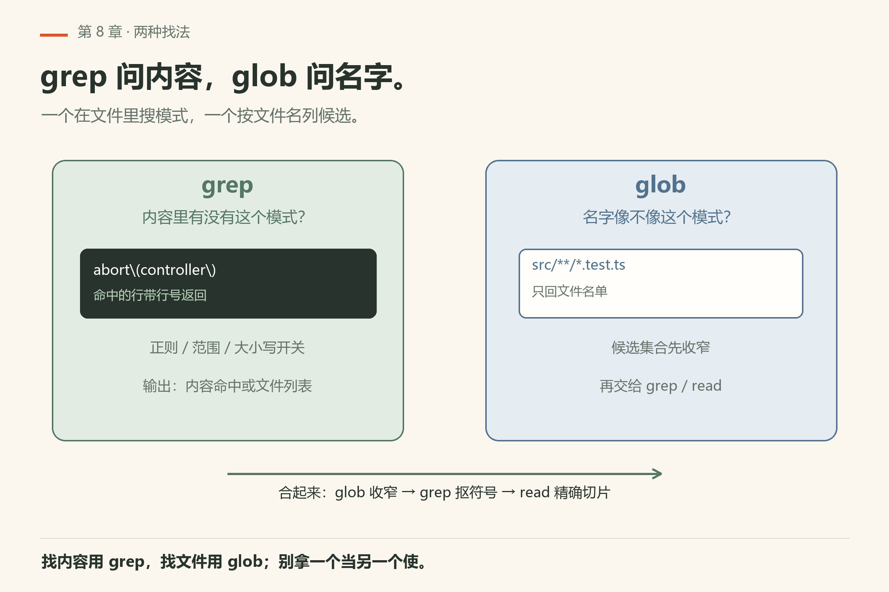

# 第8章 读与找

你让 agent「去仓库里弄清楚 X」，它张嘴就 `read` 了二十个文件，然后把整个 `node_modules` 扫了一遍。你想问的只是「这个包的公开 API 从哪导出」——三个文件就够。

> **开门一句话：**读文件先读结构再读内容；找东西用 grep，别让模型瞎翻。

问题不在模型笨，在它没有「先窄后宽」的习惯。这一章练四只手：

- **`read`**：打开一个路径（文件、目录、压缩包、PDF、URL、`ssh://`……）
- **`grep`**：按内容搜
- **`glob`**：按文件名模式列
- **`ast_grep`**：按语法结构搜（不是纯文本）

四只手共用一个习惯：**结果尽量给后续的 `edit` 留锚**。读到的文本常带 hashline 标记；搜到的命中也尽量带着可核对的位置。细节以 `docs/tools/read.md`、`grep.md`、`glob.md`、`ast-grep.md` 为准。


*图8-1：同一个 `path` 字符串，可能落成文件、目录树、归档内路径、网页或内部资源。*

## 8.1 `read`：一个 path 字段走天下

模型侧 schema 很窄：主要就是一个必填的 **`path`**。真正复杂的是 **后缀选择器**——路径末尾可以挂 `:50-100`、`:raw`、`:img` 这类尾巴。

### 选择器怎么拆

解析走 `splitPathAndSel()` 一类逻辑：只有尾巴长得像合法选择器时才切开。常见形态：

| 后缀 | 意思 |
|---|---|
| `:raw` | 原样输出，关掉结构化摘要和行前缀 |
| `:img` | 把本地 `.svg`/`.svgz` 栅格化成图，喂给视觉输入 |
| `:conflicts` | 扫未解决的 Git 冲突区，给出紧凑索引 |
| `:N` / `:N-` / `:N..` | 从第 N 行读到末尾（1-indexed） |
| `:A-B` / `:A..B` | 闭区间行范围 |
| `:A+C` | 从 A 起读 C 行 |
| `:-N` | 最后 N 行 |
| `:R1,R2,...` | 多段范围，会先排序合并 |

注意：

- 行号从 **1** 起；`:0` 会报错。
- 真有个文件名碰巧长得像选择器时，**字面路径优先**——已存在的文件名赢。
- URL 的端口也带 `:`。主机带端口时，选择器前先写个尾斜杠，例如 `https://example.com/:80`（文档示例）。
- 归档、SQLite 会吃自己的冒号语法，不要和普通行选择器硬套。


*图8-2：raw / img / conflicts 与四种行范围；行号从 1 起，字面路径优先。*

### 它还能读什么

`read` 不是「只能 cat 文本」：

- **目录**：渲染工作区树（workspace-tree）
- **归档**：`archive.ext:inner/path` 走统一归档注册表
- **SQLite**：识别库文件，按选择器渲染表
- **PDF / 二进制 / 图片**：有专门 reader；PDF 截图等路径的审批档位可能升到 `"exec"`
- **URL**：`fetch` 管线，带缓存/artifact
- **内部资源**：`ssh://`、`xd://` 等由 internal-urls 路由；MCP 还可能广告更多 scheme
- **notebook**：`.ipynb` 可转成可编辑的单元格文本
- **profiler 报告**：识别到的会做摘要

工具元数据上，`read` 是 **essential**、**strict**；普通读走 scheme 的 read 审批档，特殊路径另说。

输出通常是一个文本块；读图可能是 `[text, image]`。`details` 会带路径相关字段（例如 URL 读常见 `kind: "url"`）。

### 小实验

1. 在一个小仓库里让 agent：`read` 某个源文件的 `:1-40`，再 `:-20`，对比两次拿到的上下文。
2. 对一个真实存在的、名字里带冒号味道的文件（若有）验证「字面路径优先」。
3. 若环境允许：`read` 一个 `https://…` 文档首页，看返回是否走 URL 分支。

## 8.2 `grep`：内容搜查



*图8-3：grep 问「内容里有没有」；glob 问「名字像不像」。*

`grep` 在仓库里按正则/模式扫内容。实现上大量工作落在 **natives** 文本搜索管线（见 `docs/natives-text-search-pipeline.md`），避免每次都 fork 出系统 `rg`/`grep`。

模型侧常见输入维度（以工具文档 Inputs 表为准）：

- 搜索模式本身
- 路径/范围限制
- 大小写、多行等开关
- 输出形态（内容命中 vs 文件列表等变体）

结果会尽量带着行号与可二次定位的上下文，方便下一手 `read` 精确切片，或 `edit` 用 hashline 锚。

使用习惯：

- 先窄后宽：已知目录就限定目录，别一上来扫整个 monorepo。
- 模式写错时，空结果不等于「仓库没有」——先用 `glob` 确认文件在不在。
- 二进制、超大生成物目录通常该被忽略规则挡掉；若你看到奇怪命中，先查 ignore。

## 8.3 `glob`：按名字找文件

`glob` 回答的是文件名模式问题：`**/*.ts`、`src/**/test_*.py` 这类。同样走进程内实现与缓存友好的扫描（`docs/fs-scan-cache-architecture.md` 一类文档描述背景）。

和 shell `find` 比，agent 用 `glob` 的好处是：

- 结果格式稳定，便于模型继续规划；
- 与工作区根、ignore 规则对齐；
- 不必为「列文件」单独开 shell 审批故事。

典型组合拳：

1. `glob` 锁定候选文件集合；
2. `grep` 在集合里抠符号/字符串；
3. `read` 打开真正要改的那几段。

## 8.4 `ast_grep`：按 AST 找，而不是按字符串


*图8-4：字符串 grep 会误伤注释和字符串字面量；AST 规则盯的是语法节点。*

纯文本 `grep` 分不清「代码里的 `foo(`」和「注释里的 `foo(`」。**`ast_grep`** 用语法树规则匹配，适合：

- 找某种调用形态、某种 import 写法；
- 为后面的 **`ast_edit`**（第9章）准备结构级改动目标。

文档入口：`docs/tools/ast-grep.md`。规则语言与支持的语言集合以该页和实现为准——不要凭印象把任意 tree-sitter 查询方言写进去。

口诀：

| 你想… | 优先 |
|---|---|
| 某个字符串出现过吗 | `grep` |
| 哪些文件名匹配 | `glob` |
| 某种语法结构在哪 | `ast_grep` |
| 打开并看清一段 | `read` + 选择器 |

## 8.5 读找组合：一次「摸清模块」的最小剧本

假设任务是「这个包的公开 API 从哪导出」：

1. `glob`：`**/index.ts`、`**/mod.rs`、`**/__init__.py` 等（按语言选）。
2. `grep`：`export `、`pub use`、`__all__` 等关键词，限制在上一步命中目录。
3. `read`：对 2–3 个核心文件读 `:1-80`，需要时再补范围。
4. 若要批量找「所有 `createX(` 调用」：上 `ast_grep`，别用脆弱正则。

中间任何一步空结果，先怀疑模式/路径，再怀疑「真的没有」。


*图8-5：glob 找入口、grep 定关键词、read 核心文件、ast_grep 批量——空结果先怀疑模式与路径。*

## 8.6 本章小实验

**实验一：用 `omp read` 看行选择器**。

```sh
omp read omp/ch09.md:1-3
```

本机已验（18.16.0）：回 `[omp/ch09.md#B048]` 加第 1–3 行，末尾提示 `[Showing lines 1-6 of 229. Use :7 to continue]`（`omp/facts/live-18.16.0/read-ch06-1-3.txt` 是同形态）。**算成功**：看到 `#TAG` 头和行号。

**实验二：故意读第 0 行**。

```sh
omp read omp/ch09.md:0
```

本机已验（18.16.0）：`Line selector 0 is invalid; lines are 1-indexed. Use :1.`，退出码 1（`omp/facts/live-18.16.0/read-line0-error.txt`）。**算成功**：报错且退出码 1，不是静默回空。

**实验三：用 `omp grep` 的三种输出形态**。

```sh
omp grep "hashline" omp/ch09.md -c
omp grep "hashline" omp/ch09.md -f
```

本机已验（18.16.0）：`-c` 回 `Total matches: 11`；`-f` 只回文件名（`omp/facts/live-18.16.0/grep-count.txt`、`grep-files.txt`）。**算成功**：两种形态的输出明显不同。

**实验四**：选一个你熟悉的小仓库，只用 `glob`+`grep`+`read`（不要 `bash find`）画出「入口文件 → 核心类型」三条路径，写在纸上。

**实验五**：故意用 `grep` 搜一个只出现在注释里的词，再用 `ast_grep`（若语言支持）搜同名调用，对比差异。

## 8.7 翻车对照：读找的四种误用

读和找看着像，账单长得不一样；四种误用都是混淆的代价。

| 翻车做法 | 会看到什么 | 正确做法 |
|---|---|---|
| 一上来让 agent「把仓库摸一遍」 | 大范围 `read` 全家桶，上下文被无关文件占满 | 先 `glob` 锁定候选文件集合，再 `grep` 抠符号，最后 `read` 打开那几段 |
| `grep` 模式写错，以为「仓库里没有」 | 空结果不等于没有；可能只是正则写窄了或路径限定错了 | 先用 `glob` 确认文件在不在，再调模式 |
| 用 `bash rg` / `bash find` 代替专用工具 | 审批故事更重、输出没有 hashline 锚，下游 `edit` 要重新 `read` 拿 TAG | 搜文本用 `grep`，列文件用 `glob`，读内容用 `read` |
| 对 `:0` 行选择器以为会回第一行 | 本机已验（18.16.0）：`Line selector 0 is invalid; lines are 1-indexed. Use :1.`，退出码 1 | 行号从 1 起；读尾部用 `:-N` |
| 把 URL 端口当成行选择器 | `https://example.com:80` 的 `:80` 被当端口；要选行得写成 `https://example.com/:80` | 主机带端口时，选择器前先写个尾斜杠 |
| 用 `omp read` 读一个不存在的路径，以为会静默回空 | 报错退出；`omp read` 是「预览 read 工具会返回什么」，不是「读了再说」 | 先 `omp read --help` 看 EXAMPLES；路径拿不准先用 `omp grep` 或 `glob` |

## 8.8 与御舆同构点

参见御舆第 3 章《工具系统》。两边把工具分成两半：**读类工具是无副作用的那一半**。omp 的 `read`/`grep`/`glob`/`ast_grep` 和御舆那章的读类工具问的是同一组问题——怎么把仓库里的信息稳定地喂给模型、怎么给下游编辑留锚。命令名、选择器语法、AST 规则方言各写各的，不要互抄。

---

下一章进入**改代码**：`edit` 的 hashline 为什么比「字符串替换」稳，以及 `ast_edit` 的预览-接受流。

---
**版本核对清单**：`read` 选择器与特殊目标见 `docs/tools/read.md`；`grep`/`glob`/`ast_grep` 以各自 `docs/tools/*.md` 为准；natives 搜索与扫描背景见 `docs/natives-text-search-pipeline.md`、`docs/fs-scan-cache-architecture.md`。URL 选择器与端口冒号陷阱以 read/fetch 文档为准。写作钉 omp v18.15.0 文档树；用户本机验证 v18.16.0（见 VERIFY.md）。

- [ ] `omp read omp/ch09.md:1-3` 回 `#TAG` 头和行号（本机已验）
- [ ] `omp read omp/ch09.md:0` 回 `Line selector 0 is invalid`，退出码 1
- [ ] `omp grep "hashline" omp/ch09.md -c` 与 `-f` 两种形态的输出你各跑过一次
- [ ] `ast_grep` 在你常用的语言上可用（默认关闭，`astGrep.enabled = false`，文档所述）
