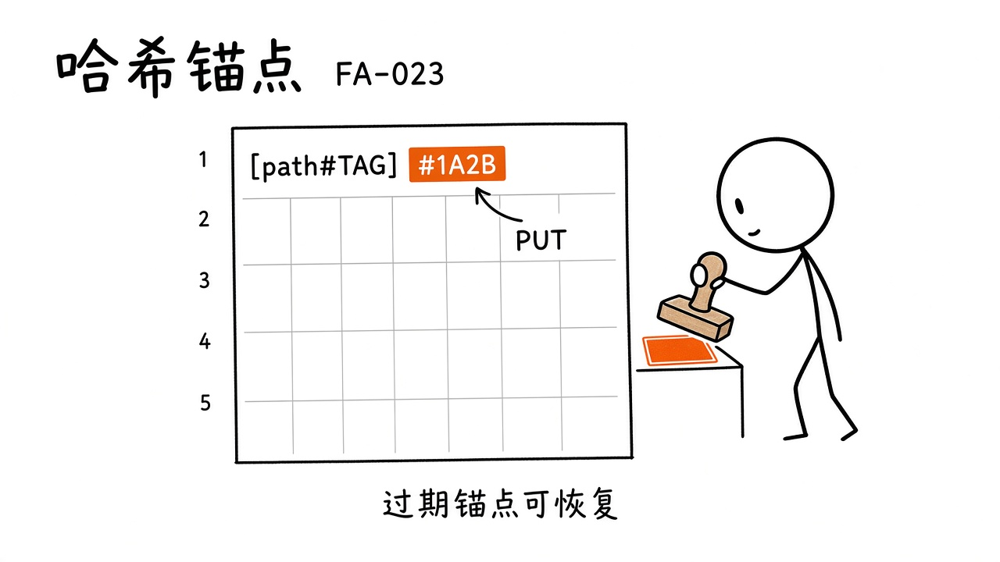
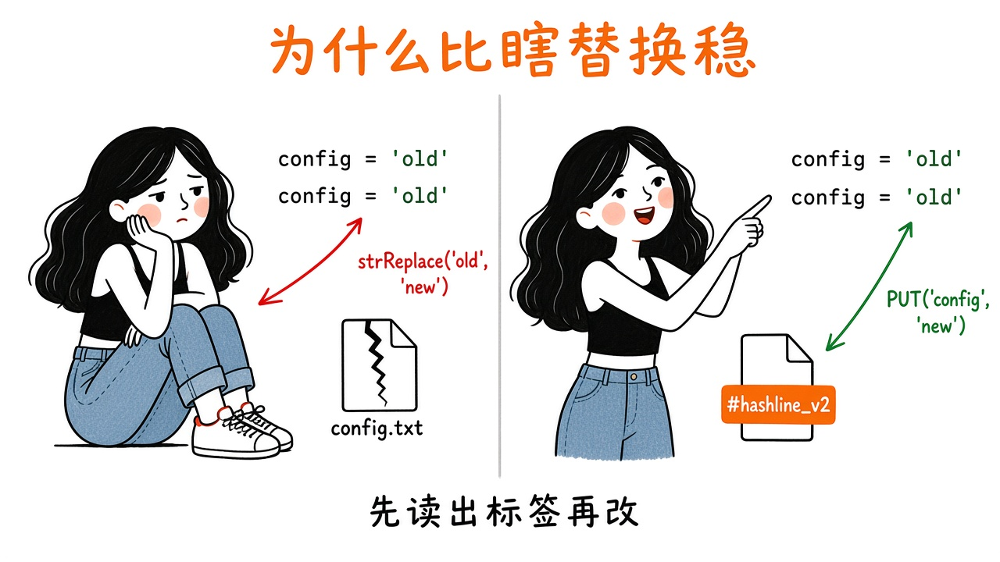
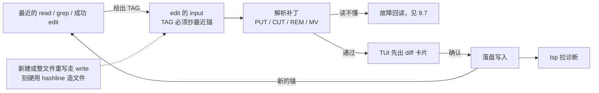

# 第9章 改代码

你让 agent 把一个函数改异步。它说「好的」，然后回了一段代码让你自己粘贴。你粘贴、运行、报错；贴回报错，它又回一段。来回五次，你改了五处，最后发现它每次都在猜同一段已经改过的字符串。

omp 不这么干。它默认编辑模式叫 **hashline**：用「快照标签 + 原始行号」锚定，而不是让模型猜一段可能已经漂移的字符串。

配套还有：

- **`write`**：新建或整文件覆盖
- **`ast_edit`**：按 AST 提案修改，预览后再 Accept

细节以 `docs/tools/edit.md`、`write.md`、`ast-edit.md` 以及 `crates/pi-edit` 相关说明为准。



*图9-1：`[PATH#TAG]` 里的四位十六进制 TAG 来自最近一次锚定的 read/grep/成功 edit。*

## 9.1 为什么不爱 str_replace

字符串替换听起来简单：找到旧片段，换成新片段。实际写 agent 时它会在这些地方翻车：

- 同一段代码出现两次，替错处；
- 模型记错空白/换行，匹配失败或匹配到注释；
- 并行或上一轮 edit 已经改过文件，旧字符串不存在了，却还在硬替。

hashline 的思路是：**编辑针对的是某次读到的快照**。快照有一个短 TAG（文档示例形态像 `1A2B` 这种四位大写十六进制）。模型写出的补丁必须带上这个 TAG；应用时核对「文件是否仍是那份快照」。对不上就拒绝或走恢复路径，而不是静默改错地方。



*图9-2：左边是「凭记忆找字符串」；右边是「凭快照标签 + 原始行号下刀」。*

## 9.2 模式怎么选

`edit` 是 essential 内置工具。`resolveEditMode()` 选激活的线协议，顺序大致是：

1. 模型相关的配置变体；
2. 环境变量 `PI_EDIT_VARIANT`；
3. 设置项 `edit.mode`；
4. 默认 **`hashline`**。

文档列出的模式包括：`hashline`、`apply_patch`、`patch`、`replace`、`sloppy`。不同模式会切换 schema、提示词、示例、渲染器，有的还带约束解码语法（Lark）。有的模型族在设置推导为 hashline 时，可能回退到 `replace`；`PI_STRICT_EDIT_MODE` 可以关掉这类回退（文档点名了若干模型族）。日常你记住：**默认按 hashline 读文档就对了**；若团队强制某种模式，去查 `edit.mode` / `PI_EDIT_VARIANT`。

工具是 strict、essential，并且使用**排他并发**——同一时刻不要指望两个 edit 抢着写同一工作区而不排队。

## 9.3 补丁长什么样

输入字段主要是一个大字符串 `input`：一段或多段

```text
[src/example.ts#1A2B]
PUT 4.=4:
+const value = 2;
```

要点：

- 每个 section 改**一个已存在的文件**；
- TAG 必须抄自最近锚定的 `read` / `grep` / 成功 `edit`；
- 新建或整文件重写用 **`write`**，别硬用 hashline 造文件；
- 严格自定义工具语法可能包在 `*** Begin Patch` / `*** End Patch` 里；普通解析也接受未包装载荷。

### 规范操作（行号相对**原始快照**）

| 形态 | 效果 |
|---|---|
| `PUT N.=M:` | 用随后的 `+TEXT` 行替换原文件闭区间 N..M |
| `PUT N*:` | 替换从 N 行开始的语法块 |
| `PUT <N:` / `PUT >N:` | 在第 N 行前/后插入；`PUT <1:` 是文件头 |
| `PUT >$:` | 追加到文件尾 |
| `PUT >N*:` | 在 N 起始语法块之后插入 |
| `CUT N.=M` / `CUT N*` | 删除并捕获；可加 `@name` 写入命名寄存器 |
| 无 body 的 `PUT <N` 等 | 粘贴匿名寄存器 |
| `PUT ... @name` | 粘贴命名寄存器 |
| `REM` | 删除该 section 对应文件 |
| `MV DEST` | 改完写到目标路径并删源；目标已存在可被覆盖 |

寄存器名：ASCII 字母数字 `_` `-`。匿名寄存器每次调用开始为空；命名寄存器在会话内、写入落地后才发布。多个 section 从上到下执行，前面的 CUT 可以喂给后面的粘贴。

带 body 的 `PUT ...:` 每一行 body 都是 `+TEXT`；单独一个 `+` 表示空行。正文是最终内容，不是 unified diff 的前后对。字面量若以 `-`/`+` 开头，写成 `+-...` / `++...`。

### 块锚点

`N*` 类形态从开括号/开节点解析到 tree-sitter 节点末尾。要锚在构造的**开头行**，不要锚闭合括号或空白行。单行节点会拒绝并提示改用显式行操作。

## 9.4 落盘、预览与 LSP

宿主侧写入、LSP 联动、解析回退等在 `packages/coding-agent/src/edit/index.ts` 一带完成。TUI 里你常见到：**先预览 diff/补丁卡片，再确认落盘**（具体交互以 TUI 与审批模式为准，见后文审批章）。改完后用第11章的 `lsp` 拉诊断，是「改完立刻体检」的正经路径。



## 9.5 `write`：新建与整文件覆盖

`write` 负责创建新文件或整体重写。当你要「从零生成配置文件」「脚手架一个模块」时走它；对已有大文件的局部手术优先 hashline `edit`，避免模型重写整文件时丢掉你没提的细节。

输入/输出与审批档位见 `docs/tools/write.md`。和 edit 一样，成功写入后应让后续 `read` 拿到新的锚，再继续改。

## 9.6 `ast_edit`：结构级提案


*图9-3：先提案，再 Accept——结构改动不要盲打。*

`ast_edit` 面向「按 AST 规则改」的场景：批量改调用形态、改 import 结构等。文档强调提案 → 预览 → 接受的流程（见 `docs/tools/ast-edit.md`）。和 `ast_grep` 配对：先搜到结构，再生成结构级补丁。

适合：

- 一次改很多处相同结构；
- 纯行级 hashline 会漏掉或写崩语法平衡的情况。

不适合：

- 只改一个明确行号的小补丁（hashline 更直接）；
- 语言/规则不被当前 ast 管线支持时硬上。

## 9.7 故障怎么读

常见拒绝原因（概念层）：

- TAG 过期：文件已变，先 `read` 再编补丁；
- 行号相对错了快照：记住行号不随同一次调用里前面的 hunk 重算；
- 块锚锚错行：锚 opener；
- 想创建文件却走了 edit：改用 `write`。

## 9.8 本章小实验

**实验一：看 hashline 的锚长什么样**。

```sh
omp read omp/ch09.md:1-5
```

本机已验（18.16.0）：第一行是 `[omp/ch09.md#B048]`，后面跟 `1:` 到 `5:` 的行（`omp/facts/live-18.16.0/read-ch06-1-3.txt` 是同形态）。**算成功**：看到 `[PATH#TAG]` 头——这个四位 TAG 就是模型 `edit` 时要抄的锚。

**实验二**：`read` 一个小文件前 30 行，抄 TAG，在 TUI 里让 agent 写一个只改一行的 `PUT N.=N:`，看预览与落盘。

**实验三**：落盘后再不 `read` 直接用旧 TAG 改第二次，观察是否被拒绝。

**实验四（可选）**：对同一重构目标，分别设计「行级 edit」与「ast_edit 提案」两条路径，比较哪条更少手工善后。

## 9.9 翻车对照：hashline 的五种撞墙

| 翻车做法 | 会看到什么 | 正确做法 |
|---|---|---|
| 让模型「把这段代码换成那段」 | 它在猜字符串；同一段代码出现两次就替错处 | 先 `read` 拿到 TAG，再让它用 `PUT N.=M:` 下刀 |
| 新建文件却用 `edit` | 被拒绝——hashline 只改已存在的文件 | 新建或整文件覆盖用 `write` |
| 落盘后用旧 TAG 再改一次 | TAG 过期，被拒绝或走恢复路径 | 改完重新 `read`，拿新锚再编补丁 |
| 块锚锚在闭合括号或空白行上 | 拒绝并提示改用显式行操作 | 锚构造的**开头行**（opener） |
| 同一调用里多个 hunk，行号写重算后的 | 改错行——行号始终相对**原始快照**，不随同一次调用里前面的 hunk 重算 | 每个 section 的行号都按最初 `read` 的快照算 |
| 把 `PUT N.=M:` 的 body 写成 unified diff 的前后对 | 内容不对——body 每行都是 `+TEXT`，是最终内容 | 只写改后的行；字面量以 `-`/`+` 开头就写成 `+-...` / `++...` |

## 9.10 与御舆同构点

参见御舆第 3 章《工具系统》与第 4 章《权限管线》。两边问的是同一件事：**写操作必须过一道闸**。omp 的 hashline 把「改哪一行」钉在快照上，预览-接受把「落不落盘」交给用户；御舆那章讲的写类工具与审批管线是同一层抽象。锚点语法、预览 UI、审批档位各写各的，不要互抄。

---

下一章让程序**跑起来**：`bash` 的进程内 coreutils / PTY / 后台，以及 `eval` 的持久 Python/JS 内核。

---
**版本核对清单**：hashline 语法与模式解析见 `docs/tools/edit.md`；`write`/`ast_edit` 见对应工具文档；`PI_EDIT_VARIANT`、`PI_STRICT_EDIT_MODE`、`edit.mode` 以 edit 文档 Mode selection 节为准。写作钉 omp v18.15.0；用户本机验证 v18.16.0（见 VERIFY.md）。

- [ ] `omp read omp/ch09.md:1-5` 回 `[PATH#TAG]` 头（本机已验）
- [ ] `edit.mode` / `PI_EDIT_VARIANT` / `PI_STRICT_EDIT_MODE` 三个键你各查过一次
- [ ] `omp read omp/ch09.md:raw` 的输出不带行前缀（本机已验，`read-ch09-raw.txt`）
- [ ] `write` 与 `edit` 的分工你写得出一条：整文件覆盖用哪个、局部手术用哪个
