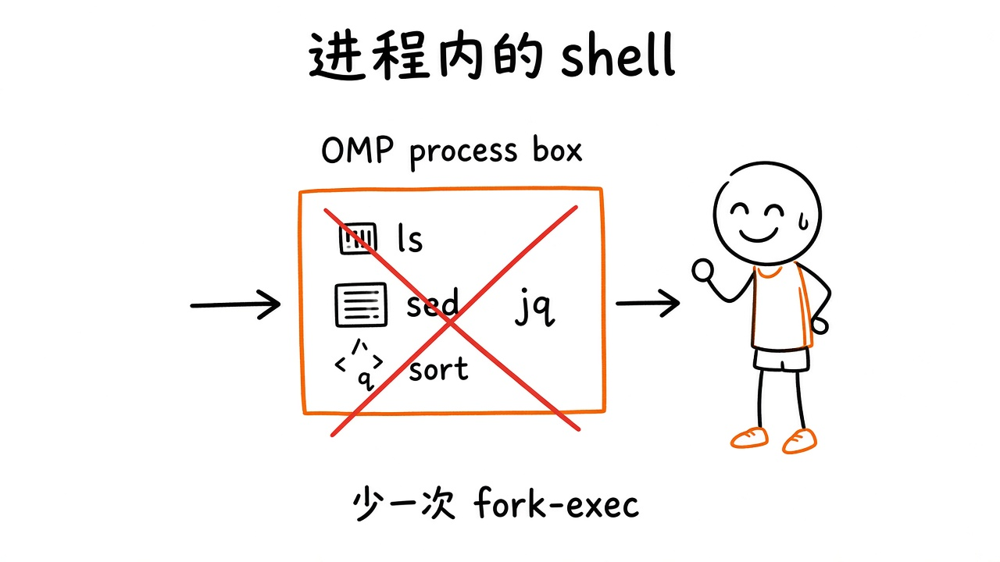
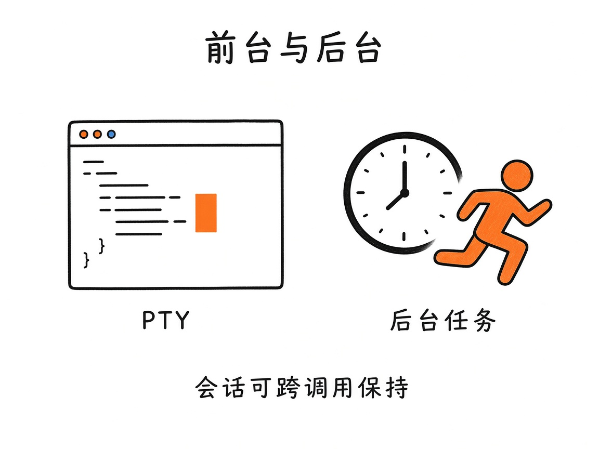
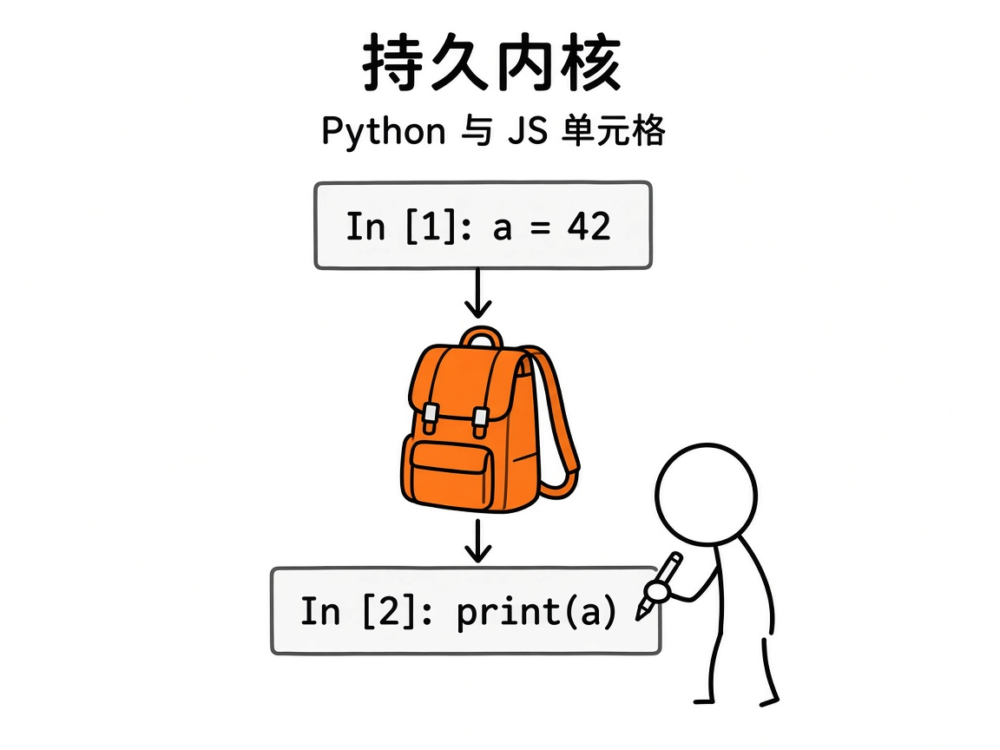

# 第10章 跑起来

你让 agent 跑测试。它回了一句「测试通过」，可你一看终端，进程还在后台跑，日志还在往外吐。它说的「通过」只是命令返回时那一行 stdout，不是测试真的跑完了。

omp 把「执行」收成两只主力手：

- **`bash`**：在工作区跑 shell；大量常用命令走**进程内 coreutils**，少 fork
- **`eval`**：持久的 Python / JavaScript **单元格内核**，状态跨调用保留

细节：`docs/tools/bash.md`、`docs/bash-tool-runtime.md`、`docs/tools/eval.md`、`docs/notebook-tool-runtime.md`、`docs/python-repl.md`。



*图10-1：ls/sed/jq/sort 一类能力尽量留在 omp 进程内，少一次 fork-exec。*

## 10.1 `bash` 在干什么

一句话：在会话工作区执行一条 shell 命令，可选 PTY、后台任务、或受监督的服务模式。

实现上，natives 提供 shell/PTY/进程控制（`docs/natives-shell-pty-process.md`）。

模型能给的只有这几个字段。你给哪个，就落到哪条分支：

| 字段 | 你写什么 | 落到哪条分支 |
|---|---|---|
| `command` | 一段 shell 文本 | 必填。前导 `cd <path> && …` 只在你**没**给 `cwd` 时被改写成 `cwd` |
| `timeout` | 秒，默认 `300` | `0` 关掉期限；非零先被 `tools.maxTimeout` 压，再夹进 `1..3600` |
| `cwd` | 相对会话根解析 | 必须已存在且是目录，进 shell 之前就失败 |
| `pty` | `true`/`false` | 有限命令默认 `false`；带 `name` 的服务默认 `true` |
| `async` | `true` | 立刻回 job id，**不**延长或缩短上面那条期限 |
| `name` | 1–48 位项目内唯一名 | 走进**受监督服务**分支；与 `async` 或任何 `timeout` 互斥 |
| `ready` | `{ log?, port?, host?, timeout? }` | 只在服务启动时用：日志正则与 TCP 端口全都通过才算就绪；没 `name` 时被忽略并留一条 notice |

本机 `omp config get tools.maxTimeout` 回 `0`（`config-get-tools-maxtimeout.txt`），意思是没有额外全局上限，期限就是默认 300 秒。

没有 `env` 字段。每次调用自带 `PI_SESSION_ID`、`PI_SESSION_FILE`（不落盘时为空）、`PI_TOOL_CALL_ID`。想按调用分日志就用它们，别在命令里手拼时间戳。

四种跑法：不填字段就是普通前台；`pty` 给需要真终端语义的交互程序；`async` 把长任务变成 job；`name` 把命令交给 launch broker 当服务管。还有一种平台相关的细节：不给 `name`、不给 `pty`、也没有客户端终端时，命令跑在 omp 内嵌的 brush shell 里——即使 `shellPath` 指向 PowerShell。要用 PowerShell 语法得显式 `pwsh -Command '…'` 并自己把 `$` 引好。



*图10-2：PTY 管交互语义；后台任务让长跑不堵住下一轮工具调用。*

输出会回到模型侧，通常包括退出状态与截断后的输出（具体 caps 见工具 Limits）。侧效应很真实：它会改你的文件系统、占端口、留子进程——审批模式（第18/31章）对此敏感。

### 小实验

1. 让 agent 用 `bash` 跑 `pwd` 与一次测试命令，确认 cwd 是你的项目根。
2. 起一个短睡后台任务，再发下一句对话，看是否还能查询任务状态（以 wait/task 文档与 bash 后台语义为准）。
3. 对比：用 `bash` 调 `rg` vs 直接 `grep` 工具——观察审批提示与结果形态差异（若有）。

## 10.2 `eval`：笔记本式的持久内核



*图10-3：单元格之间可以共用变量背包——一次调用一格，状态留下。*

`eval`：**一次工具调用 = 一个 Python 或 JS 单元格**；后面的调用还能看见前面的绑定（同一运行时）。适合：

- 探查数据、算指标、画个小图（若环境支持）；
- 在 JS/Python API 里驱动 **browser** / **computer** 的高层封装（见第12章）；
- 反复试错时不想每次冷启动解释器。

后端可用性、依赖安装、自动转后台等见 eval 文档的 Backend / Auto-backgrounding 节。某语言运行时没装好时，工具会按文档报错——不要假想「永远双语言齐备」。

和 `bash` 的分工：

- 系统级、管道、调用 CLI → `bash`
- 结构化计算、保留变量、脚本式驱动 API → `eval`

## 10.3 安全与习惯

- 别用 `bash` 把密钥 echo 到会进会话日志的地方；
- 长跑服务记得最后拆掉，避免脏端口；
- 需要「等后台结束」时看第13章 `wait`；
- 审批模式为 ask/strict 时，高风险命令会停下来问你。

## 10.4 本章小实验

**实验一：看 omp 的后台进程面**。

```sh
omp ps --plain
```

本机已验（18.16.0）：回 `project <cwd> — broker not running` / `no processes`（`omp/facts/live-18.16.0/ps-plain.txt`）。**算成功**：看到 `no processes` 或一份进程列表；有进程时用 `omp ps logs <name>` 看日志。

**失败长什么样**：`omp ps logs nope-zzz` 回 `Unknown daemon nope-zzz`、exit **1**（`fail-ps-unknown-daemon.txt`）——名字对不上时不列候选，所以先 `omp ps --plain` 拿真名再查。想要本会话的后台清单，用 `omp read proc://`：空的时候一句 `No background jobs or services.`、exit **0**（`read-proc-root.txt`）。退出码 0 配一句「没有」才是正常空态；忽然变 1 就该去 `omp ps --all` 里找别的项目。

**实验二**：`eval` 里设 `x = 1`，下一轮再 `print(x)`（或 JS 等价），确认持久性。

**实验三**：用 `bash` 跑项目已有的测试命令；失败时只读输出，先不要急着改测试本身。

**实验四（可选）**：在 PTY 需求场景（如需要 raw terminal 的程序）对照文档 Modes 节，确认你的 omp 版本是否暴露该变体。

**实验五**：`omp shell` 起一个交互式 shell console，跑两条命令确认 cwd 是你的项目根（`-C` 可改）。

---

下一章把 IDE 的眼睛借过来：`lsp` 与 `debug`（DAP）。

## 10.5 命令策略：别用 bash 冒充专用工具

`bash` 前面站着两道闸。位置不同，结果也不同。

第一道是**改道**（`bashInterceptor.patterns`）：命中后命令不执行，直接回一个 bash 工具错误，让模型改用指定工具。本机 `omp config list` 里默认就挂着这些规则（原文见 `config-list-full.txt`）：

| 你敲的写法 | 被改道到 | 默认理由 |
|---|---|---|
| `cat` / `head` / `tail` / `less` | `read` | 上下文更好，能处理二进制 |
| `grep` / `rg` / `ag` / `ack` | `grep` | 尊重 `.gitignore`，输出结构化 |
| `find` / `fd` / `locate` 带 `-name`/`-type` | `glob` | 更快 |
| `sed -i` / `perl -i` / `awk -i inplace` | `edit` | 有 diff 预览与模糊匹配 |
| `nohup` / 裸 `&` / `npm run dev` / `tail -f` | `bash` 的 `name` | 服务要可观察、可管理，用 `read proc://<name>` 看 |

第二道是**权限**（`bash.patterns`）：规则按顺序比，第一条命中就赢，每条是 `allow` / `prompt` / `deny` 三选一。`deny` 在 `BashTool.execute()` 之前就拦住，连 `yolo` 模式也拦；`prompt` 弹审批；`allow` 默认只能给**简单命令**降档，压不住复合命令——`git *` 不会替 `git status && rm -rf build` 背书，要按 `&&` 分段判得先开 `bash.allowCompoundCommands`（默认 `false`）。

反例可以保留：真正的构建脚本、`docker`、项目自定义 CLI——这些本来就该进 shell。

## 10.6 输出截断与副作用

Limits & Caps 节会限制回传体积。截断不是感觉，是能读出来的字段：`details.meta.truncation` 在内存里截了，溢出到 artifact 时还带 `artifactId`；超时是 `details.timedOut: true`；非零退出在文本末尾接 `Command exited with code <n>` 并把结果标 `isError`。

看到这些字段就让 agent 改命令（加过滤、降日志级别、写到文件再 `read`），而不是假定模型看见了全量日志。

副作用清单（心里过一遍再允许高风险命令）：

- 改文件、装包、移数据库；
- 监听端口、拉容器、写 systemd用户单元；
- 对远程主机的 `ssh`（若策略允许）。

## 10.7 eval 的依赖与后台

Scripts and dependencies / Auto-backgrounding：单元格里装依赖、跑太久的计算，可能按策略转后台。转后台后要用 `wait` 或文档给出的查询面回收结果，别以为调用返回了就等于算完。

## 10.8 翻车对照：执行工具的六种误用

| 翻车做法 | 会看到什么 | 正确做法 |
|---|---|---|
| 看到「测试通过」就信 | 后台任务还在跑，那句话只是命令返回时的 stdout | 用 `omp ps --plain` 看进程面；`omp ps logs <name>` 看日志 |
| 用 `bash` 跑 `rg` / `find` / `cat` | 审批故事更重、输出没锚，下游 `edit` 要重新 `read` | 搜文本用 `grep`，列文件用 `glob`，读内容用 `read` |
| 用 `bash python -c` 做临时计算 | 每次冷启动，变量不保留 | 用 `eval` 的持久内核；一次调用一个单元格 |
| 把密钥 `echo` 进命令 | 密钥进会话日志，分享/导出时跟着出去 | 密钥走环境变量或配置，别出现在命令文本里 |
| 长跑服务不拆 | 脏端口、僵尸进程 | 用完 `omp ps stop <name>` 或 `omp ps kill <name>` |
| 以为 `eval` 双语言永远齐备 | 某语言运行时没装好时按文档报错 | 先确认后端可用；`omp setup python` 之类的依赖安装路径见文档 |

## 10.9 与御舆同构点

参见御舆第 3 章《工具系统》与第 4 章《权限管线》。两边问的是同一件事：**执行工具是 agent 的手，也是最危险的手**。omp 的 `bash`/`eval` 把「跑什么」和「跑在哪」钉在工作区，审批管线决定「要不要停下来问」；御舆那章讲的执行工具与权限管线是同一层抽象。命令名、coreutils 集合、后台任务模型各写各的，不要互抄。

---
**版本核对清单**：`docs/tools/bash.md`、`docs/bash-tool-runtime.md`、`docs/natives-shell-pty-process.md`；`docs/tools/eval.md`、`docs/notebook-tool-runtime.md`、`docs/python-repl.md`。进程内 coreutils 集合与 caps 以当版文档/实现为准。写作钉 omp v18.15.0；用户本机验证 v18.16.0（见 VERIFY.md）。

- [ ] `omp ps --plain` 回 `no processes` 或一份进程列表（本机已验）
- [ ] `omp ps --help` 的六个 ACTION（list/info/logs/stop/kill/restart）与你这版文档一致
- [ ] `omp shell --help` 的 `-C` / `-t` / `--no-snapshot` 三个旗标你各查过一次
- [ ] `bash` 的 `name` / `ready` / `async` 字段你写得出各自什么时候用
