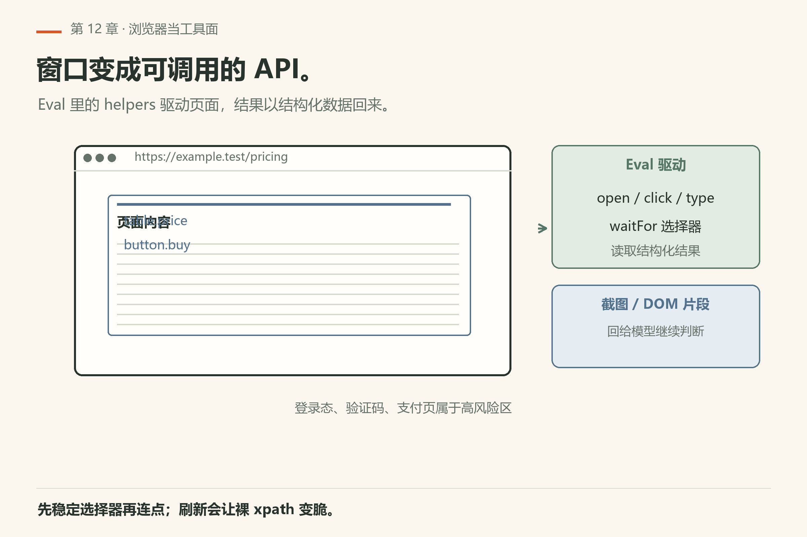
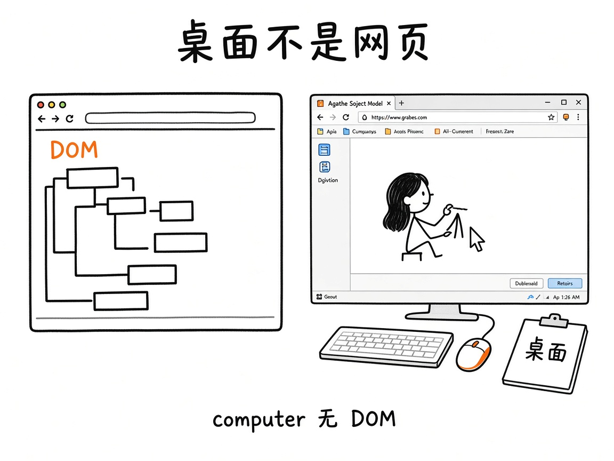
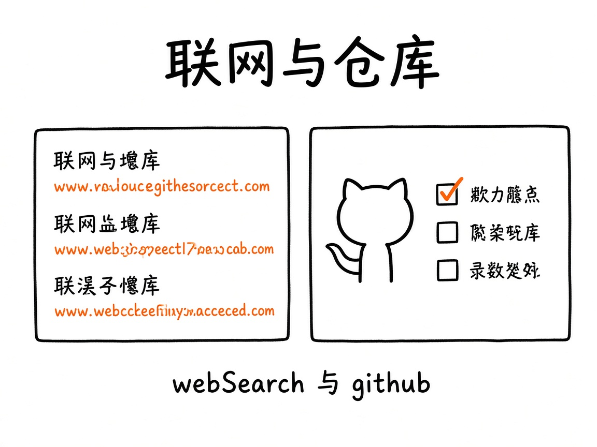
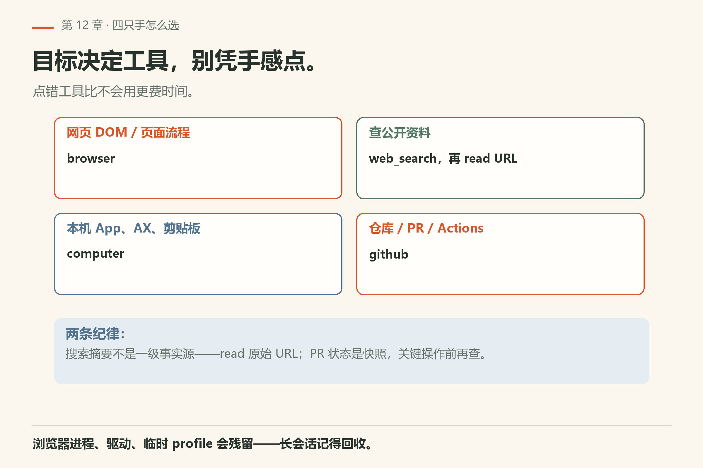

# 第12章 浏览器、桌面与联网

你让 agent 去「看一下这个页面上的报错」。它回了一句「页面上显示 500」——可你刷新后发现，那是它从一次旧搜索结果里抄来的。你没看到它打开过任何浏览器。

终端里改代码只是战场的一半。另一半是：打开页面点一点、驱动本机窗口、搜文档、跟 GitHub 打交道。对应工具：

- **`browser`**：在 Eval 里驱动浏览器（有 DOM）
- **`computer`**：驱动**真实主机桌面**（无 DOM）
- **`web_search`**：走配置好的搜索链
- **`github`**：派发 GitHub CLI 类操作

细节：`docs/tools/browser.md`、`computer.md`、`web_search.md`、`github.md`，以及 `docs/computer-use.md`。



*图12-1：浏览器窗口变成可调用的工具面——常从 Eval API 驱动。*

## 12.1 `browser`：页面上的手

Browser Eval prelude 提供 JS/Python API，用来导航、点选、填表、截图等（具体方法名以工具文档 JavaScript API / Python API 节为准）。有多种 browser modes；截图与输出格式、安全与生命周期、常见恢复路径文档里都有专节。

三个前提先记牢：prelude 只在 Eval 开着且 `browser.enabled` 为真时存在；它**不是** AgentTool，所以不会出现在工具列表里；所有 host 操作都要 exec 层审批，连看一眼元素也算。

调用形状决定走哪条路：

| 你写的 | 落到哪条分支 | 典型症状 |
|---|---|---|
| `browser.open({ name, url })` | 开新标签或复用同名标签 | 导航超时会在错误里点名标签，并把它留在已加载的那一页；用 `browser.tab(name)` 接回去 |
| `tab.observe()` → `tab.id(n).click()` | 先扫可交互元素，再按数字 id 点 | 导航或重渲染会作废句柄——**re-observe 和动作要写在同一个 Eval 格里** |
| `tab.ariaSnapshot()` → `tab.ref("e5")` | 无障碍树取 `[ref=eN]` | 与 `observe` 的 id 不通用，两套别混 |
| `tab.fill` / `tab.select` | 文本框 / `<select>` | `<select>` 用 `fill` 不管用，得 `select` |
| `app.allowed_domains: [...]` | 拦截其他 host 的 HTTP(S)/WS(S) | 它不是沙箱，只是把请求 abort；空列表等于不限制 |

`open` / `close` / `run` 的 `timeout` 都是秒，默认 30，先被 `tools.maxTimeout` 压，再夹进 `1..300`。首次装 Chromium 的时间不算在 `open` 的期限里。

想驱动**你自己**的 Chrome 标签，先装一次扩展再起 relay（本机 `--help` 原文见 `help-browser-relay.txt`）：

```sh
omp browser-relay install
omp browser-relay -p 9333 --token <token>
```

使用习惯：

- 先稳定选择器再连点——页面一刷新，裸 xpath 易碎；
- 登录态、验证码、支付页属于高风险区，配合审批与人工；
- 崩溃或浏览器进程僵死时，走文档 Common recovery，不要盲重启整台机器。

## 12.2 `computer`：桌面不是网页



*图12-2：左边 DOM 树；右边窗口/键鼠/剪贴板——`computer` 不暴露 DOM。*

`computer` 通过 Eval 的 `computer` helpers、窗口/元素句柄，或持久 JS 的 `computer.run` 驱动**真实桌面**：枚举窗口与显示器、截屏、原生输入、系统无障碍（AX）、剪贴板等。文档写明：**这不是 browser prelude，不暴露 DOM**。

可用性取决于平台与设置（Availability / Settings 节）。能控桌面意味着权限面更大——团队环境先读安全章，再决定是否启用。

三条硬约束：

- 一次只允许一个 run。并发调用会回 `Computer worker is busy`，不是在排队。
- 审批按**末端方法**分：`windows`/`screenshot`/`ax`/`bounds` 这类查看算 read；`click`/`press`/`setValue`/`clipboard.write` 算 exec。`computer.run` 只有显式传 `read_only: true` 才是 read，漏传就是 exec。
- `computer.run` 的 `timeout` 默认 120 秒，夹进 `1..300`；`computer.display` 默认 `active`，也就是「最近聚焦的那块屏」。多屏机器上截错屏，先看这个键。

## 12.3 `web_search` 与 `github`



*图12-3：搜索链给出可引用的结果；github 工具站在仓库/PR/Actions 一侧。*

**`web_search`**：跑一次网页查询，经配置的搜索链返回第一份可用答案/来源，可带 citations。Provider 与密钥如何配，以工具文档与设置/环境变量文档为准——没配好时会按 Errors 节失败，而不是「假装搜到」。

注意它的失败形状：provider 全挂时工具**不抛**，而是回一段以 `Error: ...` 开头的文本，同时在 `details.response.provider` 里写最后尝试的那家（一家都没试就是 `none`），`details.error` 写原因。所以看到 `Error:` 先读 `provider` 字段：是 `none` 就是没配链，是个真名字就是那一家挂了。

单家 provider 的传输超时由 `providers.webSearchTimeoutSeconds` 控制，默认 `60`、上限 `300`（本机 `omp config get providers.webSearchTimeoutSeconds` 回 `60`，见 `config-get-providers-websearchtimeoutseconds.txt`）。它是**单家**上限而不是整条链的期限：一家超时就记一笔失败、换下一家。搜索后端慢就把它调大，例如：

```sh
omp config set providers.webSearchTimeoutSeconds 180
```

**`github`**：对仓库、文件、PR、搜索、Actions run 观察等做派发；可用性与审批见 Availability and approval。本机需要可用的 GitHub CLI/认证上下文时，先保证 `gh auth` 一类状态正常（具体以文档为准）。

它的创建条件是 `gh` 在 `PATH` 上。没有 `gh`，工具根本不出现，`github.enabled` 开成 `true` 也没用。审批分两档：`repo_view`、`file_read`、所有 `search_*`、`run_watch` 走 read；`pr_create`、`pr_checkout`、`pr_push` 走 exec。搜索的 `limit` 默认 `10`、上限 `50`；看 run 日志的 `tail` 默认 `15`、上限 `200`。

## 12.4 怎么选

| 目标 | 工具 |
|---|---|
| 操作网页 DOM / 页面流程 | `browser` |
| 点本机 App、AX、剪贴板 | `computer` |
| 查公开资料 | `web_search`（再 `read` URL） |
| 仓库/PR/Actions | `github` |



*图12-4：目标决定工具——网页、桌面、公开资料、仓库各一只手。*

## 12.5 本章小实验

**实验一：看本机这四只手各是什么状态**。

```sh
omp config get browser.enabled
omp config get computer.enabled
omp config get github.enabled
```

本机已验（18.16.0）：`browser.enabled` 回 `true`，`computer.enabled` 回 `false`，`github.enabled` 回 `false`（`config-get-browser-enabled.txt` / `config-get-computer-enabled.txt` / `config-get-github-enabled.txt`）。**算成功**：三个值都打印出来；`false` 的那个工具在 TUI 里不会被注册。

想从另一头对一遍，看 `omp --help` 的 Available Tools 段：那里 `browser` 的说明带 `(Puppeteer)`，`computer` 带着 `(disabled by default)`，而 `github` 根本不在默认工具表里（`help-top.txt`）。**算失败**：三个键里有任何一个回 `Unknown setting`——说明你这版把开关换了名字，后面整章的实验都得按新名字重做。

**实验二**：`omp search --help` 看搜索链的旗标（本机已验，`help-search.txt`）。**算成功**：看到 `--model` / `--recency` / `--limit` / `--compact` 四个旗标。

**实验三**：若环境启用了 browser，打开一个静态文档站，截一张图并抽出标题文本。**算成功**：拿到截图与标题。

**实验四**：配好搜索后，用 `web_search` 查某个 omp 文档关键词，再 `read` 返回的官方 URL。

**实验五（可选）**：`github` 列出当前仓库的 open PR——需本机已登录；失败则记录错误原文，勿编造成功步骤。

## 12.6 生命周期与恢复

browser 文档的 Safety and lifecycle / Common recovery：浏览器进程、驱动、临时 profile 都可能残留。长会话里反复开页，记得按文档回收。computer 同理——原生输入若卡在半截快捷键状态，先恢复再继续自动化。

## 12.7 引用与幻觉

`web_search` 带 citations 时，让 agent **`read` 原始 URL** 再下结论。搜索摘要不是一级事实源；omp 自己的行为仍以 `omp-src/docs` 为准。

`github` 返回的 PR/Actions 状态是快照：看完到你合并之间，CI 可能已经变红——关键操作前再查一次。

## 12.8 翻车对照：出网四件套的九种误用

| 翻车做法 | 会看到什么 | 正确做法 |
|---|---|---|
| 让 agent「看一下这个页面」 | 它可能从旧搜索结果里抄，根本没打开浏览器 | 要真开页面就用 `browser`；要静态 URL 用 `read` |
| 用 `browser` 抓整站 HTML 当知识库 | 上下文被灌爆 | 先缩小范围：开具体页面、抽标题或表格 |
| 在 `computer` 上跑无人值守的输入 | 键鼠被抢走，你的光标乱飞 | `computer` 默认 `false`；团队环境先读 `docs/computer-use.md` 再启用 |
| 把 `web_search` 摘要当一级事实 | 引用到过期或错的内容 | 带 citations 就 `read` 原始 URL 核对 |
| `github` 返回的 PR 状态当最新 | 你看完到合并之间 CI 已经变红 | 关键操作前再 `github` 查一次 |
| 在 `observe()` 里拿到的 id 拖到下一格再点 | 句柄已被导航作废，动作落到空处 | re-observe 与点击写在同一个 Eval 格 |
| 把 `computer` 当浏览器用 | 它没有 DOM，只有窗口、AX 和键鼠 | 要 DOM 用 `browser`；要其他桌面 App 才动 `computer` |
| 以为 `allowed_domains` 是沙箱 | 它只 abort 其他 host 的请求，页面本身照跑 | 当网络限制用，当安全边界用错地方 |
| 没配 `gh` 就派 `github` 的活 | 工具不注册或认证失败 | 先 `gh auth status`；`github.enabled` 默认 `false`，本机已验 |

## 12.9 与御舆同构点

参见御舆第 3 章《工具系统》与第 12 章《MCP 集成与外部协议》。两边问的是同一件事：**外部能力都要经边界进入**。omp 的 `browser`/`computer`/`web_search`/`github` 各有审批档与启用开关，御舆那章讲的外部工具与协议接入是同一层抽象。命令名、provider 链、审批档位各写各的，不要互抄。

---
**版本核对清单**：四工具页 + `docs/computer-use.md`；搜索链与 GitHub 认证依赖本机配置。写作钉 omp v18.15.0；用户本机验证 v18.16.0（见 VERIFY.md）。

- [ ] `omp config get browser.enabled` / `computer.enabled` / `github.enabled` 本机 18.16.0 分别回 true / false / false
- [ ] `omp search --help` 的四个旗标（`--model` / `--recency` / `--limit` / `--compact`）你各查过一次
- [ ] `browser.enabled` 默认 true，`computer.enabled` 默认 false——以 `docs/tools/*.md` 的 Availability 节为准
- [ ] `github.enabled` 默认 false，启用前先在 Settings → Tools 打开（文档所述）
