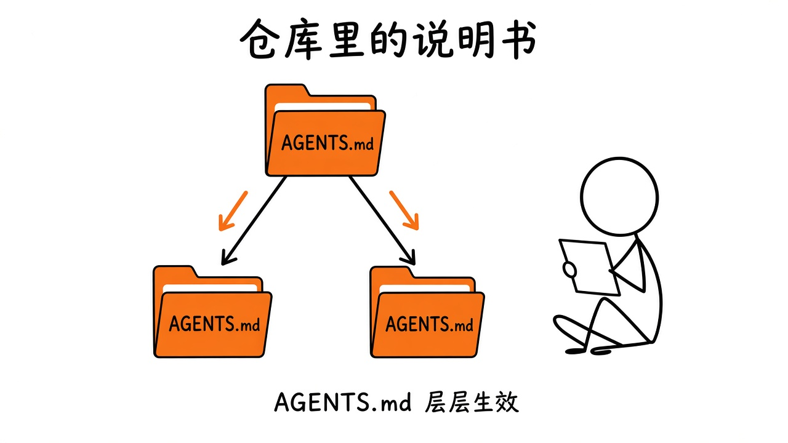
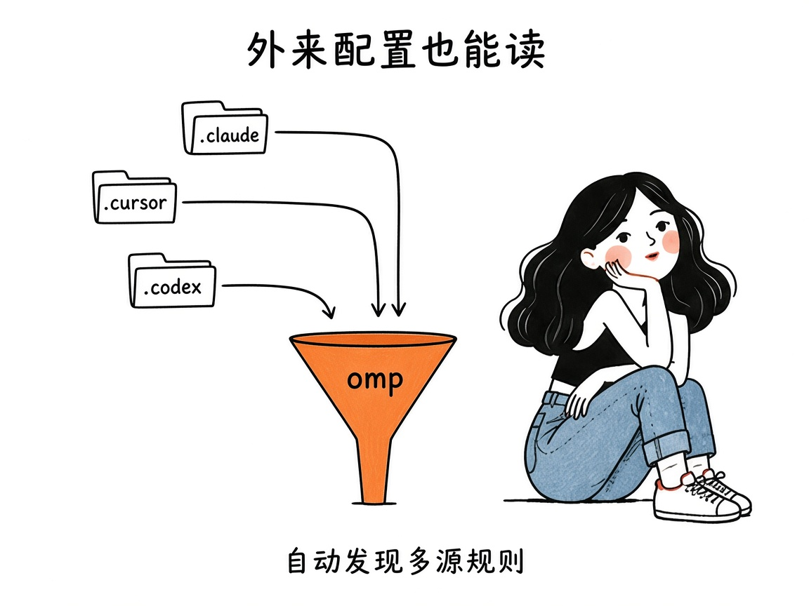

# 第14章 上下文文件与规则

你一打开某仓库的 omp 会话，agent 往往「已经知道」测试怎么跑、目录约定是什么——不是它玄学预知，而是 **上下文文件（context files）** 在会话开始前就被发现并注入了。

你不必说「先读一下 AGENTS.md」：相关文件会进项目说明（默认提示模板里落在 `<repo-rules>` 一带）。细节以 `docs/context-files.md` 为准。



*图14-1：各层 AGENTS.md 在发现规则下生效——不是你想象的「所有祖先文件无脑叠加」。*

## 14.1 四个容易混的名字

| 概念 | 是什么 |
|---|---|
| **Context files** | 普通 Markdown 说明，开会话时注入，当仓库背景 |
| **Sticky rules** | 顶层原生 `RULES.md` 转成的 always-apply 规则，请求里一直带着 |
| **Discovery providers** | 知道各工具把文件放哪的适配器（`native`、`claude`、`cursor`……） |
| **Model providers** | 推理后端（anthropic、openai……）；跟上下文文件无关，但共享 `disabledProviders` 名单 |

skills / 普通 rule 文件的写法见第19章；`SYSTEM.md` 定制系统提示见系统提示文档。

## 14.2 原生 `.omp`：推荐写法

新项目优先用 **native** provider：用户级在 agent 目录，项目级在 `.omp/`。同作用域下 native **优先级最高**。

| 文件 | 范围 | 行为摘要 |
|---|---|---|
| `~/.omp/agent/AGENTS.md` | 用户 | 主会话与 advisor 会收到；**task 子代理不会** |
| 最近非空祖先 `.omp/AGENTS.md` | 项目 | 从 cwd 向仓库根走，找到**第一个非空 `.omp/`** 就停；只读那里的 AGENTS.md |
| `~/.omp/agent/RULES.md` | 用户 | sticky，不是普通 context file |
| 同上目录的 `.omp/RULES.md` | 项目 | 同样只认「最近非空 `.omp/`」 |

两个细节：

1. **最近非空 `.omp/` 独占原生项目发现**。缺文件不会继续向上找另一个 `.omp/` 补。
2. **空目录/空文件贡献为零**。空 `.omp/` 在 walk 时被跳过。

`PI_CODING_AGENT_DIR` 可挪用户 agent 目录；`--profile` / `OMP_PROFILE` / `PI_PROFILE` 默认用 `~/.omp/profiles/<name>/agent`。外来工具的用户基（如 `~/.claude`）**不**按 profile 隔离。

### Monorepo 例子

```text
repo/
  .omp/
    AGENTS.md
    RULES.md
  packages/api/
    .omp/
      AGENTS.md
```

在 `repo/packages/api` 开会话：

- 原生 context 是 `packages/api/.omp/AGENTS.md`，**不会**再并入 `repo/.omp/AGENTS.md`；
- sticky 也只可能来自 `packages/api/.omp/RULES.md`；没有的话，**不会**退回用 `repo/.omp/RULES.md`。

写法建议：宽泛背景进 `AGENTS.md`；短而硬、长对话也必须看见的要求进 `RULES.md`。Task 子代理会丢掉名为 `AGENTS.md` 的 context，但仍拿得到 `RULES.md`——助手必须遵守的东西放 RULES。过滤按**文件名**；经 `@` 导入进别的文件的 AGENTS 文本、以及 `contextFiles.extra`（如 `AGENTS.local.md`）仍可能到达子代理。

## 14.3 外来约定：不用迁也能用



*图14-2：`.claude` / `.cursor` / `.codex` 等发现源可汇入 omp。*

omp 会发现其他 agent 工具的 context/rules，让旧项目不用先迁移。外来**用户级**源（文档表中的 claude、codex、gemini、opencode、github 等）默认要经 `enabledProviders` 选择加入；其**项目级**文件默认仍启用。native 与 `.agent`/`.agents` 用户源默认开。`disabledProviders` 压过 opt-in。

文档表格里还有：`agents-md`（独立 `AGENTS.md` 向上 walk）、`claude-md`、`github` 的 copilot-instructions、`custom-context` 等。每家的 walk 规则不同——有的只认 cwd 一层、有的向上走——以 `docs/context-files.md` 表为准，不要凭记忆统一成一种。

三家的 walk 差距会直接咬人：`claude` 只认 `<cwd>/.claude/CLAUDE.md`，**不**向上找；`codex` 只有用户级 `~/.codex/AGENTS.md`，项目级得靠 `agents-md` 去发现裸 `AGENTS.md`；`opencode` 也只有 `~/.config/opencode/AGENTS.md`。把根目录的 `.claude/CLAUDE.md` 放在子包里启动，它读不到。

## 14.4 加载顺序与遮蔽

同深度冲突时，发现优先级决定谁活。文档给的完整序（高→低）是：`native` 100、`omp-plugins` 90、`claude` 80、`agent-plugins` 75、`agents`/`claude-plugins`/`codex` 70、`gemini` 60、`opencode` 55、`cursor`/`windsurf` 50、`cline` 40、`github` 30、`vscode` 20、`agents-md`/`claude-md` 10、`custom-context` 9、`mcp-json`/`ssh-json` 5、`builtin-defaults` 1。

去重规则比优先级更容易记错，四条：

- **用户级只留一份**。`native` 最高，所以 `~/.omp/agent/AGENTS.md` 能遮住其他工具的用户级文件。
- **项目级按目录深度算，每层一份**。cwd 是深度 0，父目录是 1，依此类推；祖先目录下的 `.claude/`、`.github/` 这类配置子目录算同一层。
- **同层高优先级遮住其余；跨层多份都活**。monorepo 里祖先的 `AGENTS.md` 和包目录里那份不同层，两份都进。
- **包含关系会被折叠**。更远的祖先文件如果整段段落序列被更近的文件原样包含，就丢掉；改写过的、交错的段落不算重复。

最终拼进来的顺序是：用户级那一份在前，然后远端祖先，最后是靠近 cwd 的项目文件——**越靠后越显眼**。

落到手上就三句：

- 新内容写进 `.omp/`，少在多工具之间复制粘贴五份；
- 调试「它怎么还念旧规矩」时，先确认 cwd、最近非空 `.omp/`、以及 `enabledProviders`；
- 用 `/settings` 或配置查看当前生效的发现源，而不是猜。

`contextFiles.extra` 有两条硬规矩，写错了是在加载时报错，不是静默忽略：只写**文件名**不写路径（`../AGENTS.local.md` 会被拒），也不能列内置名（`AGENTS.md`、`CLAUDE.md`、`GEMINI.md`、`copilot-instructions.md` 都已有自己的 provider）。额外的文件不吃「每层一份」那个名额，也不被同层赢家遮住，它紧跟在层赢家后面注入，所以反而更显眼。

只关一个文件，用 `disabledExtensions` 带全名：`context-file:project:AGENTS.local.md` 或 `context-file:user:AGENTS.local.md`。关一整个发现源，用 `disabledProviders: [custom-context]`。数组类设置是**替换**不是追加，高层写一遍就把低层那张表换掉了。

## 14.5 本章小实验

**实验一：看本机上下文文件开关**。

```sh
omp config get contextPromotion.enabled
omp config get contextFiles.extra
```

本机已验（18.16.0）：`contextPromotion.enabled` 回 `true`，`contextFiles.extra` 回 `[]`（`config-get-contextpromotion-enabled.txt` / `config-get-contextfiles-extra.txt`）。**算成功**：两个值都打印出来；空数组说明没有额外文件名。

再确认你没把外来用户源全打开：`omp config get enabledProviders` 本机回 `[]`（`config-get-enabledproviders.txt`）——一个外部工具的用户级文件都不读。**算失败**：它回一串名字但你还在问「为什么 `~/.claude/CLAUDE.md` 没生效」——那就不是没生效，是被 `disabledProviders` 压住了。

**实验二**：在玩具仓库建 `.omp/AGENTS.md`，写一条可观察的约定（例如「测试命令是 pytest -q」），新开会话看它是否不经你提醒就遵守。**算成功**：agent 第一次跑测试就用 `pytest -q`。

**实验三**：在子目录再放一层 `.omp/AGENTS.md`，从子目录启动，确认根目录那份**不会**同时出现（native 规则）。

**实验四**：写一句必须子代理也遵守的硬约束进 `RULES.md`，派一个只读 `task`，看它是否仍受约束。

## 14.6 翻车对照：上下文文件的七种误用

| 翻车做法 | 会看到什么 | 正确做法 |
|---|---|---|
| 把密钥写进 AGENTS.md | 每个会话都广播；分享会话时跟着出去 | 密钥走环境变量或配置，别进上下文文件 |
| 写「代码要优雅」这类空话 | agent 不知道具体做什么 | 写可执行约定：「错误用 Result 返回，禁止吞异常」 |
| 在 monorepo 子包放 `.omp/` 却指望根目录也生效 | 子包那份独占，根目录不并入 | 要根目录也生效就放根目录；子包只放子包专属 |
| 改完上下文文件不重开会话 | 旧会话里争论「怎么没读到」 | 新开会话验证；半条旧会话的快照已固定 |
| 把必须子代理也遵守的要求写进 AGENTS.md | task 子代理丢名为 `AGENTS.md` 的 context | 硬约束放 `RULES.md`；AGENTS.md 只放背景 |
| 在 `contextFiles.extra` 里写路径 | 加载时报错；它只收文件名 | 只写 `AGENTS.local.md` 这种裸名 |
| 把内置名列进 `extra` | 被拒——它们已有自己的 provider | 内置名靠默认发现，不要重复列 |

## 14.7 与御舆同构点

参见御舆第 7 章《上下文管理》。两边问的是同一件事：**长期约定如何进入每轮提示**。omp 用发现优先级与遮蔽规则决定哪份 AGENTS.md 生效，御舆那章用同类机制管理仓库约定与系统提示。文件命名、walk 规则、优先级表各写各的，不要互抄。

---
**版本核对清单**：全文以 `docs/context-files.md` 为准；与 system prompt 输入矩阵交叉见 `docs/system-prompt-customization.md`。写作钉 omp v18.15.0；用户本机验证 v18.16.0（见 VERIFY.md）。

- [ ] `omp config get contextPromotion.enabled` 本机 18.16.0 回 `true`
- [ ] `omp config get contextFiles.extra` 本机 18.16.0 回 `[]`
- [ ] `omp --help` 的 `--no-context-files` 旗标你查过一次
- [ ] native 的「最近非空 `.omp/` 独占」规则你写得出一条
- [ ] AGENTS.md 与 RULES.md 的分工（背景 vs 硬约束）你写得出一条
