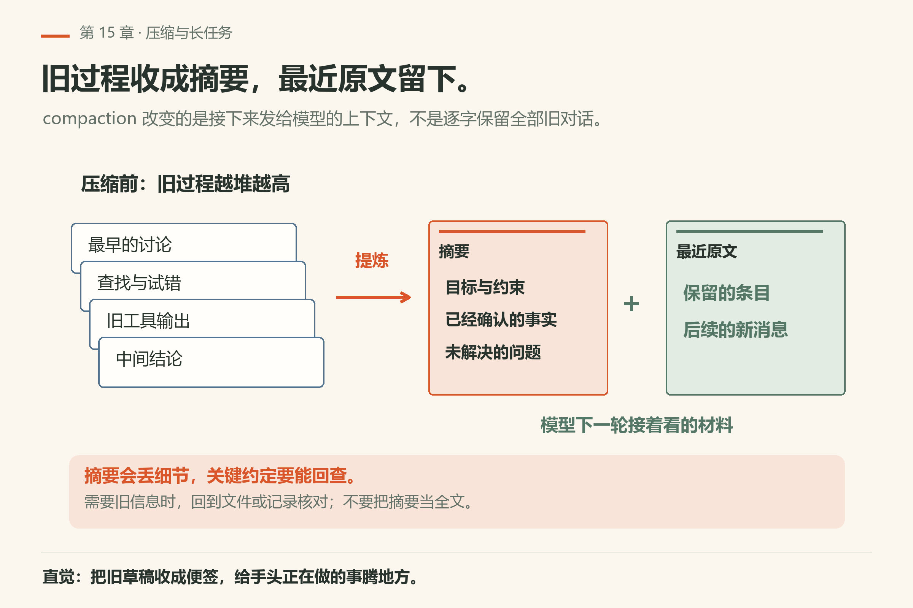
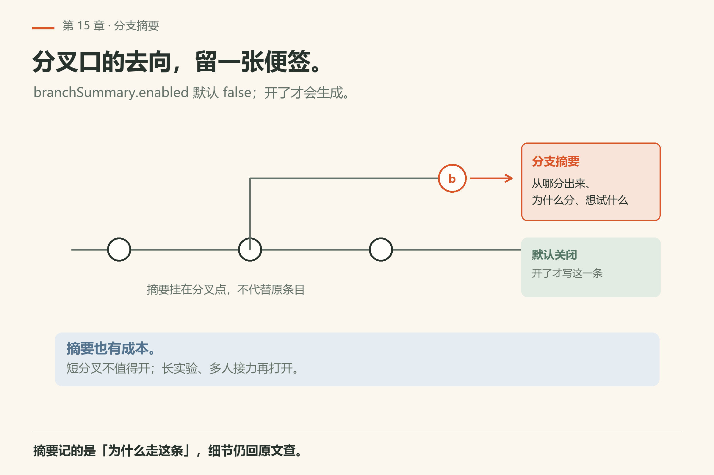
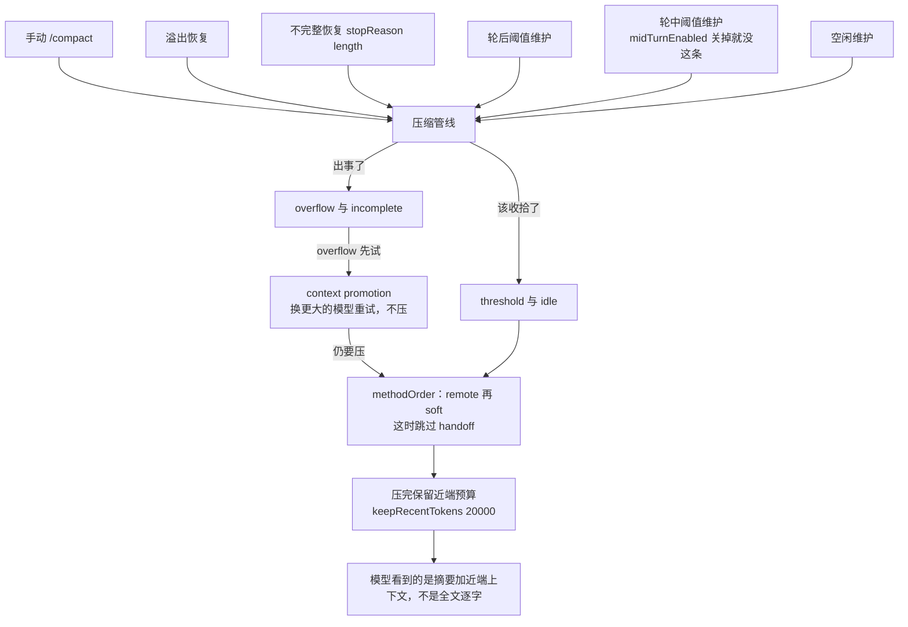

<!-- block: omp-ch15.b-30631f43 -->
# 第15章 压缩（compaction）与长任务

<!-- block: omp-ch15.b-42ce823b -->
你开了一个长会话改重构。到第三轮，agent 突然「忘了」早先约定的接口契约，开始往回改。你往上翻，会话记录还在，但它看到的是摘要，不是全文。

上下文窗口是一张有限的书桌（第2章）。长任务里工具输出、对话、diff 会把桌子堆满。omp 的应对是 **compaction（压缩）** 与 **branch summaries（分支摘要）**：把旧对话收成仍可续聊的摘要形态，而不是让模型突然失忆或硬截断到不可用。

细节：`docs/compaction.md`。



*图15-1：旧过程收成摘要，最近的原文与后续消息继续保留。摘要会丢细节，重要约定需要能回查。*

## 15.1 会话条目模型

压缩挂在会话树条目模型上：不是另存一份神秘缓存，而是与 session entry、leaf、分支导航同一套账本协作（实现文件列表见文档 Key implementation files）。

压缩写完就是一条 `type: "compaction"` 的条目，带这些字段：

| 字段 | 作用 |
|---|---|
| `summary` / `shortSummary` | 摘要正文与短版 |
| `firstKeptEntryId` | 边界：从这里往后的原文保留，之前的不再发给模型 |
| `tokensBefore` | 压之前多大，用来看省了多少 |
| `method` / `tokensAfter` / `warning` | 走的哪条方法、压完多大、有没有告警 |
| `providerReplayThroughEntryId` | 原生重放快照覆盖到第几条 |

分支摘要另算一类：`type: "branch_summary"`，只带 `fromId` 与 `summary`。

重建上下文时（`buildSessionContext`）按固定顺序拼：取活动路径上**最新**那条 compaction 转成一条摘要消息；从 `firstKeptEntryId` 到压缩点的保留条目重新放回；路径上更晚的条目追加；`branch_summary` 转成分支摘要消息；`custom_message` 转成自定义消息。最后 `convertToLlm()` 把两类摘要变成 **user 消息**、套静态模板——所以你看到的不是「系统注记」，而是一段像你口述的背景交代。

例如早先测试返回了非零退出码，摘要里只剩“已处理测试问题”，下一轮就可能把未通过误读成已通过。压缩前应保留失败命令、关键输出、已排除的原因和下一步，而不是只留结论。压缩后先回读证据再续改；摘要里一句“测试已绿”没有对应运行记录，就仍是待核对的历史描述。

一个容易被忽略的默认值：本机 `omp config get branchSummary.enabled` 回 `false`（`config-get-branchsummary-enabled.txt`），也就是默认**不生成**分支摘要。你在别人机器上看到的摘要气泡，是那台把它打开过。



*图15-2：长任务换分支续聊时，摘要让历史不断档。*

## 15.2 管线何时启动

文档 Compaction pipeline 列了**六种**入口：

1. 手动：`/compact [instructions]`；
2. 溢出恢复：同模型的 assistant 报错被判为上下文溢出；
3. 不完整恢复：assistant 以 `stopReason === "length"` 结束（OpenAI/Codex 的 `response.incomplete` 也算）；
4. 轮后阈值维护：一轮成功后，调整过的上下文 token 超过阈值；
5. 轮中阈值维护：工具循环里跨过阈值，在下次请求前动手（`compaction.midTurnEnabled` 关掉就没这条）；
6. 空闲维护：`runIdleCompaction()`，理由记 `idle`。



前三种是「出事了」，后三种是「该收拾了」。排障时分清你撞的是哪条：

| 你撞上的 | 走哪条 | 关键差别 |
|---|---|---|
| 报错说上下文溢出 | overflow 恢复 | 先试 context promotion（换更大的模型重试，不压）；真压时**跳过** handoff，因为 handoff 的请求会把溢出输入再发一遍 |
| 回复被截断（`length`） | incomplete 恢复 | 低于阈值且这轮有文本或工具调用，就保留截断轮、只提示输出上限；高于阈值才压，这时 handoff 可以跑 |
| 一轮顺利结束但 token 涨到线 | threshold 维护 | `willRetry: false`，不自动续跑 |
| 闲着 | idle 维护 | 走同一条 auto-maintenance，理由写 `idle` |

incomplete 还有一层兜底：连续三次既没文本也没工具调用就停手、报一个能照着做的错，等你给新输入或拿出有用输出才重置计数。日志里看 `reason`：`overflow`、`incomplete`、`threshold`、`idle` 是四条路，别混成一件事。

### 十个键，各管一段

本机 `omp config list` 的 `[context]` 与 `[internal]` 段里，跟压缩相关的键和默认值如下（`config-get-compaction-*.txt`）：

| 键 | 本机值 | 它管的那一段 |
|---|---|---|
| `compaction.enabled` | `true` | 总开关 |
| `compaction.thresholdPercent` | `-1` | 不按百分比写死 |
| `compaction.thresholdTokens` | `-1` | 也不按固定 token 写死；实际阈值由窗口与 `compaction.modelThresholds` 推 |
| `compaction.methodOrder` | `["remote","soft"]` | 依次试的方法顺序 |
| `compaction.keepRecentTokens` | `20000` | 压完仍保留的近端预算 |
| `compaction.midTurnEnabled` | `true` | 轮中做不做阈值检查 |
| `compaction.idleEnabled` | `true` | 空闲维护开关 |
| `compaction.idleThresholdTokens` | `200000` | 多满才考虑空闲维护 |
| `compaction.idleTimeoutSeconds` | `300` | 闲多久才考虑 |
| `branchSummary.enabled` | `false` | 分支摘要默认不生成 |

两个 `-1` 容易被误读成「关掉了」。不是：它们是「这一项不写死」，阈值改由每个模型的窗口与阈值表算；本机 `compaction.modelThresholds` 是空 `{}`，所以走的就是窗口推导那条路。

## 15.3 对你意味着什么

- 压缩后模型看到的是**摘要 + 仍保留的近端上下文**，不是全文逐字；关键约束应写入 `RULES.md` / 记忆 / 文件，别只活在早被压掉的闲聊里。
- 长重构前主动把决策落到仓库文档或 todo，压缩就少误伤。
- 子代理与主会话的压缩边界以文档为准——不要假设子代理共享你屏幕上的全部未压缩历史。

## 15.4 和 `/fresh`、记忆的边界

- `/fresh`（第7章）：重置供应商流状态，对话还在；
- compaction：对话还在，但旧段可能变成摘要；
- memory（第16章）：跨会话的启发式背景，不是当前窗口的压缩算法。

## 15.5 本章小实验

**实验一：看本机压缩配置**。

```sh
omp config get compaction.enabled
omp config get compaction.thresholdPercent
omp config get compaction.idleEnabled
omp config get compaction.keepRecentTokens
omp config get compaction.midTurnEnabled
```

本机已验（18.16.0）：五条依次回 `true`、`-1`、`true`、`20000`、`true`（`config-get-compaction-{enabled,thresholdpercent,idleenabled,keeprecenttokens,midturnenabled}.txt`）。**算成功**：五个值都打印出来；`-1` 表示这一项不按百分比写死，不等于关掉。

第五条 `midTurnEnabled` 最容易漏：它管的是工具循环里那一次检查，关掉以后一个长工具轮可以一直撑到轮后才收拾——「改了半天没反应」多半卡在这里。**算失败**：`compaction.enabled` 是 `false` 但 UI 里还弹压缩——那说明你改的是项目层配置，会话读的是另一层；先 `omp config list --scope project` 看项目层写了什么。

**实验二**：故意进行一轮工具输出很多的探索，观察是否出现压缩相关 UI/日志（版本差异大，记下你看到的原文）。

**实验三**：压缩前后问同一个「早先约定的命令是什么」——若只存在于早聊、未写入文件，可能答不上来；写入 AGENTS/RULES 后再试。

**实验四**：读 `docs/compaction.md` 的 Compaction shape 示意，对照一次真实会话树。

## 15.6 和 ACP 通知

文档提到 ACP notifications：在协议模式下，压缩事件需要通知对端。具体就两条 JSON-RPC 扩展通知：

| 方法 | 携带的字段 |
|---|---|
| `_omp/compaction/start` | `sessionId`、`reason`、`action` |
| `_omp/compaction/end` | `sessionId`、`action`、`aborted`、`willRetry`，可选 `skipped`、`errorMessage`、`tokensBefore` |

只跑 TUI 时这两条跟你无关；嵌 ACP 时它们是「为什么 UI 上写了刚刚压缩过」的唯一来源——客户端的进度条应该挂在这两条上，而不是自己猜。不实现它们的客户端可以直接忽略，不会报协议错。

## 15.7 实践口诀

- 长任务决策写进仓库文件，不写进即将被压掉的闲聊；
- 压缩后发现 agent「忘了约定」，先查 RULES/记忆/文件，再怪模型；
- 溢出抢救与日常维护不是同一条路径——排障时看日志关键词。

## 15.8 翻车对照：压缩的七种误用

| 翻车做法 | 会看到什么 | 正确做法 |
|---|---|---|
| 把关键决策只写在对话里 | 压缩后 agent 忘了约定，往回改 | 写进 RULES.md / AGENTS.md / 仓库文档 |
| 压缩后怪模型「变笨了」 | 其实是摘要丢了细节 | 先查 RULES/记忆/文件，再怪模型 |
| 把溢出抢救当日常维护 | 重试风暴烧钱 | 看日志关键词：overflow 与 threshold 是两条路 |
| 假设子代理共享主会话的未压缩历史 | 子代理看不到你屏幕上的全部上下文 | 以文档为准；派任务时把背景写进 task 说明 |
| 把 `/fresh` 当 compaction 用 | 供应商流状态重置了，旧对话还在 | 要压旧对话用 compaction；`/fresh` 只管流状态 |
| 把 `thresholdPercent: -1` 当关闭开关 | 以为不压了，实际上还在按窗口阈值压 | 真关就改 `compaction.enabled: false`；`-1` 只是不写死 |
| 指望 `/tree` 一定带摘要气泡 | 本机 `branchSummary.enabled` 回 `false`，默认不生成 | 要看就把它打开；否则切分支就是硬切 |

## 15.9 与御舆同构点

参见御舆第 7 章《上下文管理》。两边问的是同一件事：**压缩阶梯是工作记忆的节流阀**。omp 的 compaction 把旧轮次收成摘要、保留近端上下文，御舆那章用同类机制管理长会话的窗口预算。触发阈值、摘要模板、保留策略各写各的，不要互抄。

---
**版本核对清单**：`docs/compaction.md`；与 session tree 交叉见 session 文档。写作钉 omp v18.15.0；用户本机验证 v18.16.0（见 VERIFY.md）。

- [ ] `omp config get compaction.enabled` 本机 18.16.0 回 `true`
- [ ] `omp config get compaction.thresholdPercent` 本机 18.16.0 回 `-1`
- [ ] `omp config get compaction.idleEnabled` 本机 18.16.0 回 `true`
- [ ] `omp config get compaction.keepRecentTokens` 本机 18.16.0 回 `20000`
- [ ] 压缩后 agent「忘了约定」时，先查 RULES/记忆/文件——这一条你写得出
