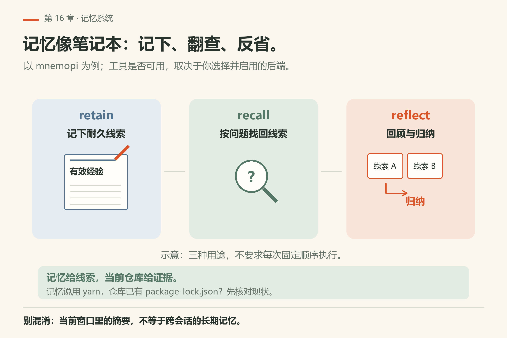
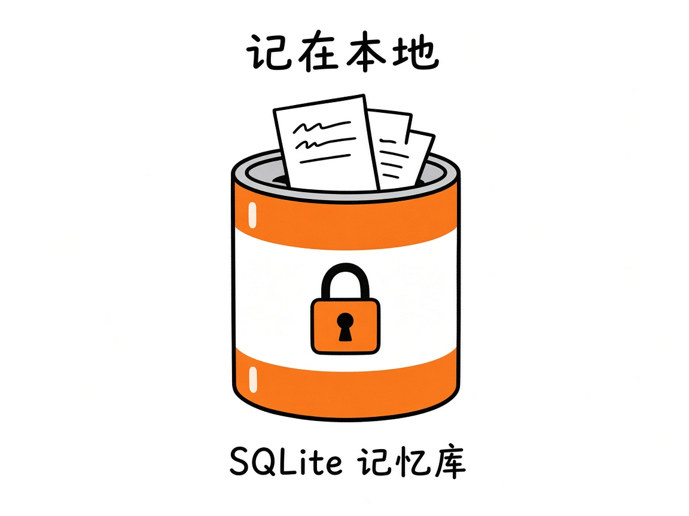
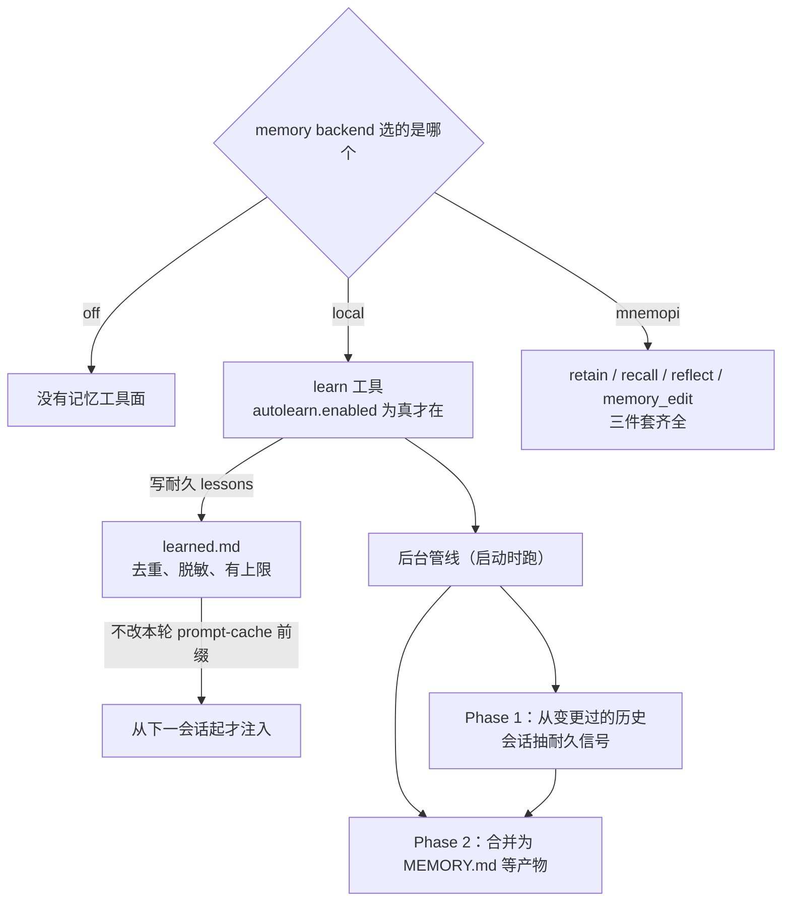

# 第16章 记忆系统

压缩管的是**当前窗口**；记忆管的是**跨会话还想带着的启发式背景**。默认记忆是关的——要在 `/settings` 或 `config.yml` 里选 backend。

文档：`docs/memory.md`、`docs/mnemosyne-memory-backend.md`（Mnemopi）。



*图16-1：retain 记下线索，recall 按问题翻查，reflect 回顾归纳。这是用途示意，不是固定执行顺序；具体工具集随 backend 变化。*

## 16.1 五种 backend

| `memory.backend` | 行为摘要 |
|---|---|
| `off` | 无 |
| `local` | 项目范围摘要与 lessons，从持久会话生成 |
| `hindsight` | 远程 bank 范围的 Hindsight |
| `mnemopi` | 本地 Mnemopi **SQLite** 记忆 |
| `sharpshooter` | 摩擦门控的项目决策文件，后台合并 |

启用本地摘要管线示例：

```yaml
memory:
  backend: local
```



*图16-2：mnemopi 把记忆放在本地 SQLite——不是默认就上传云端。*

## 16.2 注入什么、怎么读

会话开始时，若有合并摘要或手工 lesson，会作为 **Memory Guidance** 注入系统提示，与 lessons 共享 `memories.summaryInjectionTokenLimit`。

文档强调：

- 记忆是**启发式**，对当前仓库状态没有最终解释权；
- 记忆改变计划时，引用 artifact 路径，并配上当前仓库证据；
- 与用户指示或仓库现状冲突时，以现状为准，视记忆为过期。记忆说「这个项目用 yarn」、`package-lock.json` 已经在仓库里躺着，以仓库为准。

`read` 可通过 `memory://` URL 读产物，例如：

| URL | 内容 |
|---|---|
| `memory://root` | 启动注入的紧凑摘要 |
| `memory://root/MEMORY.md` | 长期记忆全文 |
| `memory://root/learned.md` | `learn` 捕获的 lessons |
| `memory://root/skills/<name>/SKILL.md` | 生成的 skill 剧本 |
| `memory://<memory-id>` | Mnemopi 整行（仅 mnemopi backend） |

`memory://root/...` 文件根主要在 `local` backend 下由合并管线写入；hindsight/mnemopi 下根 URL 可能不解析——改用 `recall`/`reflect`（及 mnemopi 的 id 读取）。

这条不是推测。`omp read` 也能吃内部 URI（`omp read PATH`，见 `live-18.16.0/help-read.txt`），所以在 shell 里就能验：本机 `omp/18.16.0` 实跑 `omp read memory://root`，**exit 1**，原文是 `File-backed memory artifacts only exist with memory.backend=local (active backend: mnemopi).`（见 `facts/live-18.16.0/read-memory-root-under-mnemopi.txt`）。根 URL 解析不了的时候，omp 直接告诉你它现在在哪个 backend——比在会话里让模型猜快。

## 16.3 `/memory` 与 learn

斜杠命令子命令包括：`view`、`stats`、`diagnose`、`queue`、`sync`、`clear`/`reset`、`enqueue`/`rebuild`、以及 hindsight 的 `mm …` 等（表见文档）。

`autolearn.enabled: true` 时启用 `learn` 工具：在 local backend 下把耐久 lessons 写入 `learned.md`（去重、脱敏、上限等规则见文档）。`learn` **不会**改当前会话的 prompt-cache 前缀；从**下一会话**起注入。local backend **没有**结构化的 `recall`/`retain`/`reflect`/`memory_edit`——那些属于其他 backend 故事。

## 16.4 本地管线怎么跑（local）

后台管线在启动时跑；`/memory enqueue` 标记工作，下次启动捡起。子代理与未持久化会话会跳过。

- Phase 1：对变更过的历史会话抽取耐久信号；
- Phase 2：合并为 `MEMORY.md` 等产物。

细节与跳过条件（太新、太旧、活跃中……）见 How it works。

## 16.5 mnemopi 的 retain/recall/reflect

大纲里的三件套在 **mnemopi**（及文档所述工具面）上才完整展开：记住、想起、反省。工具页见 `docs/tools/retain.md`、`recall.md`、`reflect.md`、`memory_edit.md`。启用前读 `mnemosyne-memory-backend.md`，别在 `off`/`local` 下假想三件套齐全。



## 16.6 跟做实验：三分钟确认记忆到底开没开

三条命令都不发模型请求，不花钱，也不改你的配置。在你的项目目录里跑：

```sh
omp config get memory.backend      # 我在哪个 backend？
omp config get autolearn.enabled   # learn 工具有没有挂上
omp read memory://root             # 根 URL 现在解析得了吗
```

本机 `omp/18.16.0` 实跑结果：第一条回 `mnemopi`，第二条回 `false`，第三条 **exit 1** 并打印那句「只有 `memory.backend=local` 才有文件根」的提示（三份输出都在 `facts/live-18.16.0/` 下，文件名 `config-get-memory-backend.txt`、`config-get-autolearn-enabled.txt`、`read-memory-root-under-mnemopi.txt`）。

**怎么算成功**：想把 local 管线跑通，就要求 `omp config get memory.backend` 回 `local`、`omp read memory://root` **exit 0** 并吐出一段摘要正文。两者不一致时，以命令的退出码为准，别信你「记得改过」。改法二选一——`omp config set memory.backend local`（写全局 `config.yml`，会覆盖你现在的 backend，改前先记下上一条命令回的值），或在会话里 `/settings` 挑。之后跑几次会话，用 `/memory sync` 立刻触发合并，再 `/memory view` 看注入正文。

第二步看 `learn`：`autolearn.enabled` 回 `true` 才有 `learn` 工具；它写进去的 lesson **从下一会话起**才出现在 Memory Guidance（`docs/memory.md`）。当前会话里看不到，是设计，不是坏。


## 16.7 Hindsight 与 Sharpshooter（点到为止）

远程 Hindsight 与摩擦门控的 Sharpshooter 各有专节。选用前读清：数据出不出本机、bank 范围、后台合并语义。默认推荐先在 `local` 或 `mnemopi` 上建立直觉，再上远程。

远程后端上线前你自己写清三件事：数据驻留何处、谁有 bank 权限、人走了怎么撤销。`hindsight.apiUrl` 默认指向 `http://localhost:8888`，但 `HINDSIGHT_*` 环境变量压在所有 `hindsight.*` 设置之上（`docs/memory.md` 说完整覆盖表有 18 条，见 `docs/environment-variables.md`）。想知道这台机器实际连哪，跑 `omp config get hindsight.apiUrl`；**这条我没有实跑**——回显的值可能是内网地址，不该进书稿，你本地跑一次就行。Sharpshooter 适合「架构/产品/风格」类决策文件，不适合当聊天备份盘。

## 16.8 和 todo 的边界

todo 是**本任务看板**；记忆是**跨会话启发式**。别把「今天第三步跑测试」写进长期记忆，也别指望 todo 在下周新会话里还在。


<!--deepen-v2-->

## 16.9 翻车对照：七种安静失败

| 翻车做法 | 会看到什么 | 正确做法 |
|---|---|---|
| 在 shell 里敲 `omp memory view` | 不报错。界面打出一行 `Working...` 然后一直等——顶层 COMMANDS 表（`facts/live-18.16.0/help-top.txt`）里**没有** `memory` 子命令，整句被当提示词送进模型。同类行为本机已验：`omp bad-command notasubcommand` 挂到 90 s 超时截断，exit 124（`fail/bad-command.txt`） | `/memory` 是会话内的斜杠命令：先 `omp` 进 TUI 再敲 `view`/`stats`/`queue`/`sync` |
| backend 是 `mnemopi`，却去读 `memory://root` | 本机已验：`omp read memory://root` **exit 1**，报 `File-backed memory artifacts only exist with memory.backend=local (active backend: mnemopi).` | 同一句报错已经给了出路：用 `recall`/`reflect` 搜，或 `omp read memory://<memory-id>` 读整行 |
| 只写 `memory.backend: local`，然后指望 `retain`/`recall`/`reflect` 齐全 | 工具面缺——local 后端**没有**结构化的 `recall`/`retain`/`reflect`/`memory_edit`（`docs/memory.md`） | 要三件套就选 `mnemopi`；只想攒项目摘要才用 `local` |
| 用旧键 `memories.enabled: true` 打开记忆 | 只有在你没显式设 backend 时才会被迁移成 `memory.backend: local`（文档所述）；设过就别指望它 | 直接写 `memory.backend`，用 `omp config get memory.backend` 复核 |
| 开了 `autolearn.enabled`，在当前会话里等 lesson 出现 | 看不到。`learn` 不动当前会话的 prompt-cache 前缀，lesson 从**下一会话**起注入（文档所述） | 新开一个会话，再 `/memory view` |
| 把「今天第三步跑测试」写进长期记忆 | 下周新会话它还在，还会作为 Memory Guidance 进提示，被当成启发式读 | 任务看板走 todo；记忆只放跨会话的习惯与决策（16.8） |
| 以为「默认就关着，不会有人把我的项目摘要写盘」 | 默认确实 `off`（文档所述），但这台机器上 `omp config get memory.backend` 回的是 `mnemopi`（本机已验）——别人开过 | 接手任何机器先跑这一条，再决定要不要 `/memory clear` |

<!--deepen-v3-->

## 16.10 与御舆同构点

参见御舆第 6 章《记忆系统》。两边拆的是同一刀：**长期记忆与上下文是两套东西**——写入路径不同（一个是任务内的短期条目，一个是跨会话的合并产物）、注入预算分开算、读到时都只当启发式而非当前仓库的真理，冲突一律以现状为准。御舆那章讲的也是「记忆改了计划时要引产物路径、并配当前证据」这条纪律；具体的后端名、命令、键名两边各写各的，不要互抄。

---
**版本核对清单**：`docs/memory.md`、`docs/mnemosyne-memory-backend.md`；工具页 retain/recall/reflect/memory_edit。默认关闭记忆——以你的 config 为准。写作钉 omp v18.15.0；用户本机验证 v18.16.0（见 VERIFY.md）。

- [ ] `omp config get memory.backend` 回的值，和这一章讲的五种之一对得上
- [ ] `omp config get autolearn.enabled` 的值你确认过
- [ ] `omp read memory://root` 的退出码你亲手跑过（本机 18.16.0 = 1）
- [ ] `/memory` 的子命令表与你这版文档一致，`mm …` 只在 hindsight 下存在
- [ ] 你选的后端会把记忆写到哪个磁盘路径 / 哪个远端，你写得出一行
