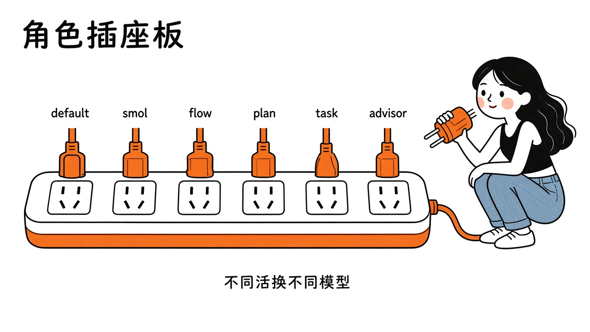
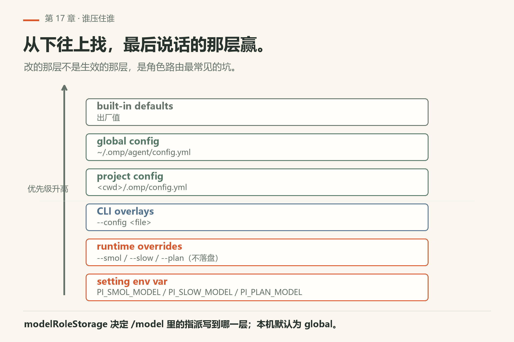
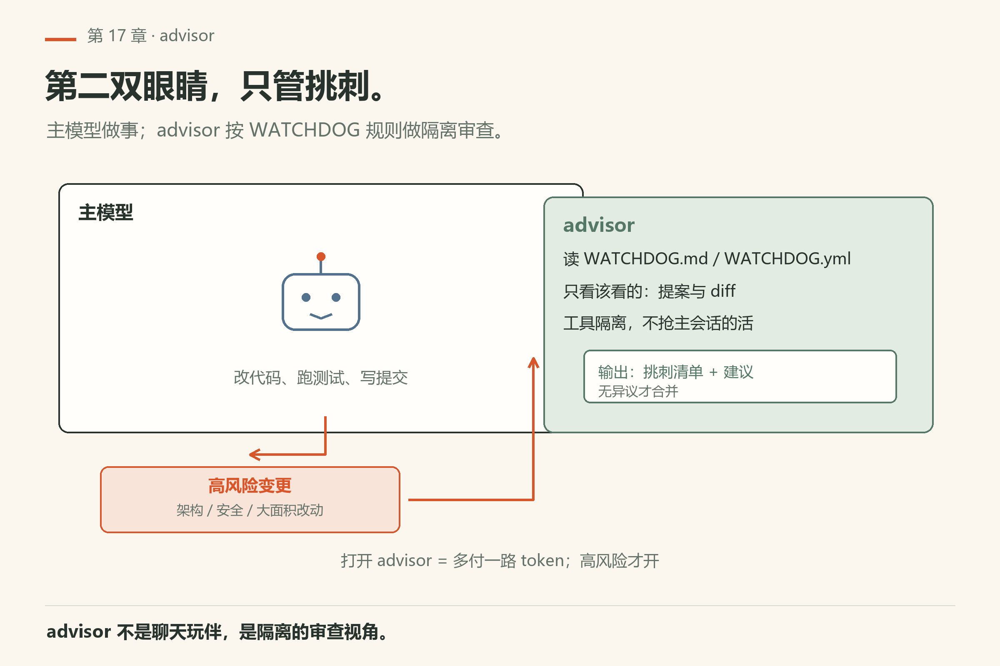
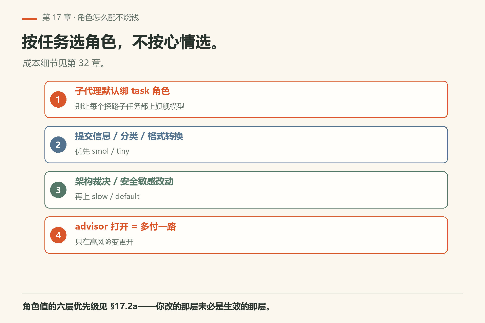
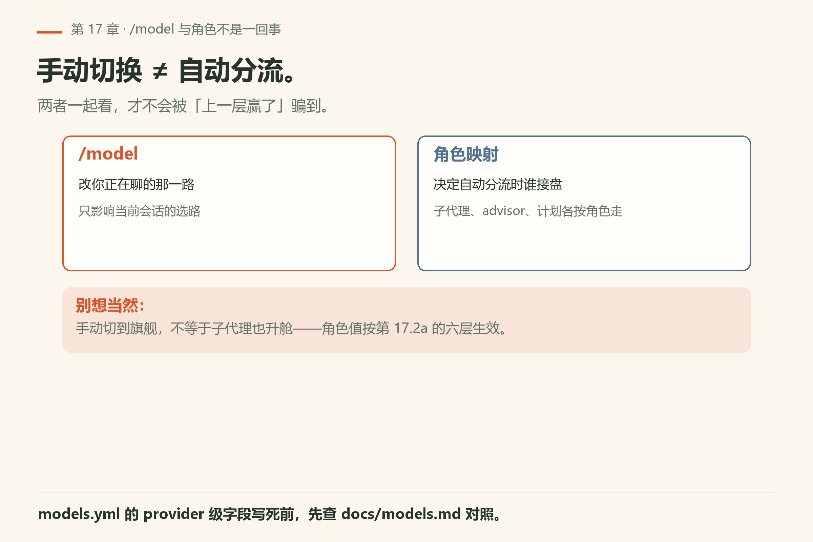

# 第17章 模型角色路由

同一会话里，不是每一刀都该用最贵、最慢的模型。omp 用**角色（roles）**把「这类活用谁」说清楚：默认对话、小活、慢思考、计划、提交、视觉、子任务、顾问监督等。

> **开门一句话：**不同活派不同模型；角色路由配错，账单和延迟一起涨。

配置总入口：`docs/models.md`（`models.yml` / `models.yaml`）。Advisor 专章：`docs/advisor-watchdog.md`。



*图17-1：不同角色插不同模型——小活别占满席。*

## 17.1 角色在解决什么问题

角色不是装饰，是**一张「谁接这类活」的插座表**。`omp config get modelRoles` 会把你机器上这张表原样打出来——本机 18.16.0 实跑，得到 **13 个键**（模型 id 含私有网关名，已脱敏，只留键名，见 `facts/live-18.16.0/config-get-modelroles-keys.txt`）：

| 角色键（本机实测存在） | 典型用途 |
|---|---|
| `default` | 主对话 |
| `smol` / `tiny` | 短、便宜、结构化小活 |
| `slow` | 肯花时间的硬推理 |
| `plan` | 规划阶段 |
| `commit` | 提交信息等窄任务 |
| `vision` | 看图 |
| `task` | 子代理默认 |
| `advisor` | 第二模型监督 |
| `memory` | **用途未验证**：`docs/memory.md` 只说记忆管线用 `default` 抽取、`smol` 合并，没提这个键 |
| `chore_worker` / `scout_worker` / `designer` | **用途未验证**：文档未单列；用 `omp config get modelRoles` 看它们各自绑了哪档模型，倒推分工 |

`docs/models.md` 还点名为 `judge` 角色——`api: typesafe`、`openai-decisions` 那几种「判定 API」的模型由它选中；本机这张表里**没有** `judge` 键，说明角色集合确实会随配置增减。

具体键名与默认映射以你的 `models.yml` 和 `/model` UI 为准——版本间角色集合可能增减，章末清单要求你打开本机文件核对。

## 17.2 `models.yml` 形状

文档描述：文件位置、legacy 行为、provider 级字段、Bedrock/compaction 选项、允许的 `api` 值等。用户级与项目级如何叠加，跟 settings 作用域同一套直觉（见第23章）。

配置文件按活动 agent 目录解析，优先级 `~/.omp/agent/models.yml` 在 `models.yaml` 之前；命名 profile 换到 `~/.omp/profiles/<name>/agent/`（`docs/models.md`）。`providers` 是这张表**唯一被消费的根键**——文档明说未知根键不被 schema 拒绝，但也**不会**配置任何模型行为。写错根键名是最安静的一类失败。

切换模型：TUI 的 `/model`；编程接入见 SDK。订阅制 coding plan、本地 llama.cpp、自定义 OpenAI 兼容端点在第5章已铺过——本章关心的是**同一时刻多角色并存**。

## 17.2a 谁压住谁：角色值的六层

角色路由最容易骗人的地方在于：**你改的那一层，常常不是生效的那一层**。`docs/settings.md` 的 Precedence 节把顺序写死了，从低到高：

```text
built-in defaults  <-  global config  <-  project config  <-  CLI overlays  <-  runtime overrides  <-  setting env var
```

落到角色上，对应四类入口：

- **env**：`PI_SMOL_MODEL` / `PI_SLOW_MODEL` / `PI_PLAN_MODEL`（`omp --help` 的 Environment Variables 段与 `docs/settings.md` 都列了），**最高**；
- **runtime**：`--smol=<value>` / `--slow=<value>` / `--plan=<value>`，以及 `--prewalk-into`、`--plan-yolo-into`（见 `facts/live-18.16.0/help-top.txt`），压过所有写在文件里的值，且不落盘；
- **overlay**：`--config <file>`；
- **文件**：项目 `<cwd>/.omp/config.yml` 压过全局 `~/.omp/agent/config.yml`。

还有一条专治「我在 UI 里改了，怎么没存到我以为的地方」。`modelRoleStorage` 决定 `/model` 里的角色指派写到哪一层：本机 `omp config get modelRoleStorage` 回 `global`（`facts/live-18.16.0/config-get-modelRoleStorage.txt`）。设成 `project` 时，角色改动只进 `<cwd>/.omp/config.yml` 的 `modelRoles`；项目里没配的角色回落到全局（`docs/settings.md` 的 Where writes go）。



*图17-2：从下往上叠：最后说话的那层才生效。*

## 17.3 Advisor：第二个模型盯着



*图17-3：主模型做事，advisor 按 WATCHDOG 规则挑刺。*

Advisor 读取 `WATCHDOG.md` / `WATCHDOG.yml` 一类约定，对主会话输出做监督（启用方式、backup reviewer、headless、可见内容、工具隔离见 advisor 文档）。它不是聊天玩伴，而是**隔离的审查视角**——该看到什么、能否动工具，以文档 What the advisor sees / Tools and isolation 为准。

Headless / CI 场景下 advisor 行为有单独说明：无人值守时不要假设会弹 UI。

## 17.4 怎么选才不烧钱

角色配错就是烧钱；这节给的是省钱不省力的配法。

- 子代理默认绑 task 角色，避免每个探路子任务都上旗舰模型；
- 提交信息、分类、格式转换优先 smol/tiny；
- 架构裁决、安全敏感改动再上 slow/default；
- advisor 打开时等于多付一路——只在高风险变更开。

成本细节见第32章。



*图17-4：按任务选角色——子代理绑 task，机械活走 smol/tiny，裁决再上 slow/default。*

## 17.5 跟做实验：把角色链走一遍

三条命令都不产生模型费用——第三条在解析阶段就退出了。

```sh
omp config get modelRoles                        # 整张角色表
omp models find flash                            # 确认一个候选模型名真的存在
omp -p hi --model definitely-not-a-model-xyz --no-session   # 名字写错会怎样
```

本机 `omp/18.16.0` 实跑：第一条 **exit 0**，打出一个 JSON 对象，13 个角色键（值含私有网关名，书里只留键名，见 `config-get-modelroles-keys.txt`）；第二条 **exit 0**，按 provider 分组、每组一张 `model / context / max-out / thinking / images` 的表（`models-find-flash-redacted.txt`，输出已脱敏）；第三条 **exit 1**，``Model "definitely-not-a-model-xyz" not found``，底下直接教你 ``Run `omp models find <pattern>` to search, or `omp models` to list all.``（`fail/bad-model.txt`）。

**怎么算成功**：三条的退出码分别是 `0 / 0 / 1`。第二条能回行，说明「角色里写的模型名 → 注册表里真的存在」这条链在你机器上通；第三条报的是 `not found` 而不是别的，说明失败发生在发请求之前。然后做一次真实对比：拿同一个问题，先按 default 跑，再 `omp -p "…" --smol <你表里 smol 那一路的模型名>` 跑一遍，主观记下质量与等待时间。注意 `--smol` 是 runtime override——它只活在这一次进程里，不会把你 config.yml 里的 smol 改掉（`docs/settings.md`）。

角色改动的持久入口有两个：`/model` 里的角色页，或直接编辑 `<cwd>/.omp/config.yml` 的 `modelRoles`。**用 `omp config set modelRoles …` 覆写整张表这条路径本章未验证**——我没跑过，它会覆盖你现有的全局角色表；要试先 `omp config get modelRoles > modelroles-backup.json` 存一份。


## 17.6 models.yml 里还能调什么

文档还列了 provider 级 compaction 选项、Bedrock request options、允许的 `api` 值等。写死「某云厂商特殊字段」前打开 `docs/models.md` 对照——过期字段比错误模型名更难查。

## 17.7 `/model` 与角色

TUI 里 `/model` 常改的是你正在聊的那一路；角色映射决定**自动分流**时谁接盘。两者一起看：手动切到旗舰不等于子代理也升舱。




*图17-5：`/model` 改当前会话的选路，角色映射决定自动分流——手动升舱不等于子代理升舱。*

<!--deepen-v2-->

## 17.8 翻车对照：上一层赢了，你改的那层就白写

角色路由最难查的一类不是报错，是**你改的那一层被上面那层压住了，一句话都不说**。

| 翻车做法 | 会看到什么 | 正确做法 |
|---|---|---|
| 把 `modelRoles.smol` 当成一个可查询的点号键 | 本机已验：`omp config get modelRoles.smol` → `Unknown setting: modelRoles.smol`，**exit 1**（`fail-unknown-dotted-role-key.txt`）。`modelRoles` 在 config CLI 里是一个整体对象键，子路径不是合法查询路径 | 查整张表用 `omp config get modelRoles`；单个角色指派在 `/model` 的角色页里改。`docs/settings.md` 写 `modelRoles.smol` 指的是对象里的字段，不是 CLI 路径 |
| 全局 `config.yml` 里改了 smol，没反应 | 安静无效。env 是最上层：`PI_SMOL_MODEL` 一旦导出就把文件里的值整个盖掉（`docs/settings.md` Precedence） | `omp config set` 在还有别的源提供生效值时会打印是谁提供的（`--json` 里的 `overriddenBy`）；或自己 `echo $env:PI_SMOL_MODEL` 看。**本机未设该变量，这条我未验证** |
| 命令行加了 `--smol=<value>`，又抱怨 config.yml 改了不生效 | runtime override 排在文件之上，且**从不落盘**（文档所述） | 一次性实验用 `--smol`；想长期生效就写进文件，别两个地方各改一半 |
| `/model` 切成旗舰，以为子代理也跟着升舱 | 子代理按 `task` 角色解析，主会话切档不影响它 | 动 `task` 角色或 `task.agentModelOverrides`（`docs/settings.md` 说这两个键的改动对后续子代理启动即时生效，不需重启宿主） |
| `omp --model` 忘了给值 | 不报错，`Working...` 挂住——`--model` 缺值时整句被当提示词进模型。本机 90 s 超时截断，exit 124（`fail/missing-value.txt`） | 写全 `--model=<value>`，或干脆 `--model` 也别留；用 `omp models find <pattern>` 先拿到确切名字 |
| `omp -p hi --model 不存在` | **会**报错：`Model "…" not found` + 教你跑 `omp models find`，exit 1，不发请求（`fail/bad-model.txt`） | 照它给的命令查真名，别猜；provider 前缀写全（`openai/gpt-5.2` 这类）是精确匹配的路子（`omp --help` 对 `--model` 的原话） |
| 给 `commit` / `smol` 角色配了判定 API 的模型 | 该模型「回答判定请求、由 `judge` 角色选中」，不是聊天传输（`docs/models.md`）；当聊天模型用会选不中或行为怪 | 判定 API（`typesafe`、`openrouter-decisions`、`openai-decisions`、`workers-ai-systemone`）只往 `judge` 那一路放 |
| `models.yml` 根键写成 `provider`（少个 s） | 最安静的一种：文档明说未知根键不被 schema 拒绝，但也不配置任何行为——文件在，改动不在 | 根键只有 `providers` 被消费；改完用 `omp models` 看这一路有没有真出现 |
| 想「强模型只规划、动手就降档」，于是打开 `prewalk.enabled`，又习惯带 `--no-prewalk` 启动 | `--no-prewalk` 的原话是「Disable prewalk, including prewalk.auto, even if prewalk.enabled is set」——命令行直接压过设置（`facts/live-18.16.0/help-top.txt`） | 二选一。本机 `omp config get prewalk.enabled` 回 `false`（`config-get-prewalk-enabled.txt`），也就是说这台机器上降档根本没开 |
| `advisor.enabled` 一直开着当质量保险 | 本机回 `true`（`config-get-advisor-enabled.txt`）：每一回合多一路模型审查，`tier.advisor` 还是 `none`（标准档） | 高风险变更才开；成本口径见第 32 章 |

<!--deepen-v3-->

## 17.9 给团队画一张角色表

在项目 README 或 AGENTS.md 写五列：角色名、典型活、建议模型档、可否自动升舱、备注成本。例：commit 角色只允许看 diff 写信息；vision 只在有图附件时启用；advisor 默认关，发布窗口才开。

手测之外还有一件事值得做一遍：`/model` 切换后立刻让子代理做一件小事，确认它有没有意外继承主会话的档位。

## 17.10 与御舆同构点

参见御舆第 5 章《设置与配置》。两边在同一条问题上碰头：**分层配置谁赢**。全局、项目、命令行覆盖、进程内 runtime、环境变量——这套层叠关系是共用的，角色路由只是它的一个消费方。御舆那边同样有「你改了文件，但上一层还在供值」的坑。本章的角色键名、`--smol`/`--slow`/`--plan` 这些旗标是 omp 自己的，不构成对御舆的说明，也别反过来抄。


---
**版本核对清单**：`docs/models.md`、`docs/advisor-watchdog.md`、`docs/providers.md`。角色名以本机配置为准。写作钉 omp v18.15.0；用户本机验证 v18.16.0（见 VERIFY.md）。

- [ ] `omp config get modelRoles` 打出的键集合，和你机器上这一章的表对一遍（本机 13 个）
- [ ] `omp config get modelRoleStorage` 的值你知道角色写进了哪一层
- [ ] `omp config get prewalk.enabled`、`omp config get advisor.enabled` 两个开关的现状你确认过
- [ ] `omp models find <你用的子串>` exit 0 且回行——角色里写的模型名都经得起这一条
- [ ] `docs/models.md` 里 `providers` 之外还有没有新根键，你扫过一眼
