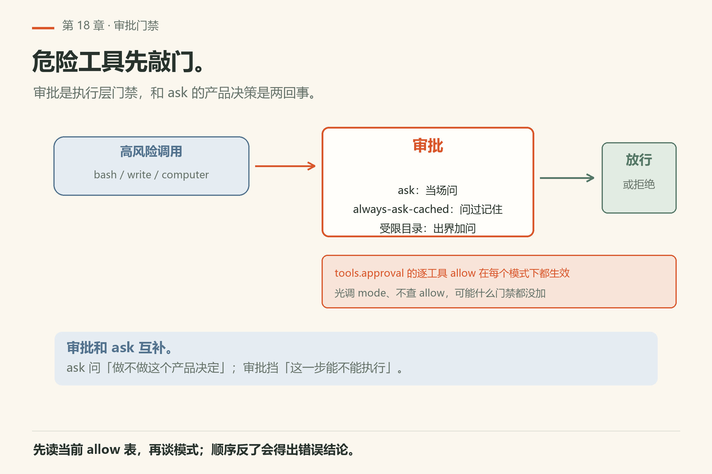

# 第18章 魔法关键词与模式

<!-- block: omp-ch18.b-6320622a -->
有些词不是给读者看的装饰，而是**写进提示里就会注入隐藏说明**的开关。omp 称之为 **magic keywords**。另外还有 vibe / plan / 审批等模式，改变工具门禁与节奏。

文档：`docs/magic-keywords.md`、`docs/approval-mode.md`；plan/vibe 以 settings 与模式相关源码表为准（有疑义标未验证）。


*图18-1：散文里的独立词触发隐藏说明——代码块里的同名字符串不会。*

## 18.1 关键词表

实现表在 `packages/coding-agent/src/modes/magic-keywords.ts`；设置、注入、高亮都从它派生。

| 词 | 效果摘要 |
|---|---|
| `ultrathink` | 多步谨慎推理说明；自动 thinking 开启时，该回合拉到当前模型支持的最高推理强度，绕过 `providers.autoThinkingMaxEffort` |
| `orchestrate` | 多代理编排契约：划界、并行委派、分阶段验证、直到完成；需要 `task` 启用 |
| `workflowz` | 围绕持久 `eval` 内核的 `agent()`/`completion()`/`wait()`/`workpool()` 等辅助的确定性多子代理工作流；需 `eval` 与 `task` |
| `jevify` | 批量判定契约：先冻结问题/量规/预过滤/升级阈值，再 `judge()` 一批，只精读打标项；需 `eval` |

示例（词要出现在提示散文里）：

```text
ultrathink about the failure modes before changing this API
orchestrate the migration described in docs/plan.md
workflowz an adversarial review of the authentication changes
jevify commit a17c3e0 for changes unrelated to the tui refactor
```

## 18.2 匹配规则（故意很严）

<!-- block: omp-ch18.b-e7ccccd8 -->
- 必须**全小写**精确拼写；`Ultrathink` 不触发。
- 必须是**独立散文词**：句读、引号可相邻；但字母数字、`_`、`/`、`\`、`-`、扩展名、符号引用、调用括号粘连则不匹配。`orchestrate,` 可以；`orchestrated`、`orchestrate.ts`、`orchestrate()` 不行。
- 围栏代码块、行内代码、HTML/XML 注释与标签内容忽略。
- 一回合可叠加多个已启用词；可见词留在用户消息里，隐藏 notice 是非展示的、归用户的自定义消息。
- 匹配发生在斜杠命令与提示模板**展开之后**；合成的、agent 发起的提示不触发。
- **只影响含该词的那一回合**。

## 18.3 配置

`/settings` → Interaction → Magic Keywords，或：

```bash
omp config set magicKeywords.enabled false
omp config set magicKeywords.ultrathink false
omp config set magicKeywords.orchestrate false
omp config set magicKeywords.workflow false
omp config set magicKeywords.jevify false
```

注意：`workflowz` 对应设置键是 `magicKeywords.workflow`。全局开关关掉隐藏 notice 与编辑器动画，但静态高亮与拼写豁免仍在——避免 macOS 把 `workflowz`/`jevify` 自动改成词典词。

所以“词被高亮”与“行为契约已注入”不能画等号：全局开关关闭后，静态高亮仍可能保留。验证应先看设置与匹配位置，再看这一回合是否具备所需工具、是否产生实际派发或推理结果。即使契约已注入，它也只是给模型的指令，不是一个替你执行迁移、授权写入或保证任务成功的后台按钮。

上面这五行 `omp config set` 是 `docs/magic-keywords.md` 的原文示例，**我没有实跑**：它们会写进全局 `~/.omp/agent/config.yml`，改掉你机器上的开关。要恢复用 `omp config reset <key>`（`docs/settings.md`：reset 删掉全局键，让别的层或默认值重新生效）。想先确认现状，跑 18.6 那组只读的 `omp config get`。

## 18.4 审批模式



*图18-2：危险工具先敲门——ask / 记住 / 受限目录。*

`docs/approval-mode.md` 描述工具审批：`always-ask-cached` 等模式、受限目录、用户覆盖、computer 安全覆盖、每工具提示。它和 `ask` 工具互补：一个是**执行门禁**，一个是**产品决策问答**。

## 18.5 `/vibe` 与 plan 模式

plan 一侧有实键可查。本机 `omp/18.16.0` 实跑：

```sh
omp config get plan.enabled            # true
omp config get plan.defaultOnStartup   # false
```

（输出 `facts/live-18.16.0/config-get-plan-enabled.txt`、`config-get-plan-defaultOnStartup.txt`。）也就是：计划模式在这台机器上是**可用但默认不自动进**。启动侧另有 `--plan-yolo`（`omp --help` 原话：强制以只读 plan 开场，模型第一次 resolve 时自动批准计划，然后切到 `--plan-yolo-into` 去实现）和 `--goal=<value>`（直接从 goal 模式开场）。

`/vibe` **未验证**。我在手头的证据里找不到它：`omp --help` 全文无 `vibe`，`omp config list --json` 的 582 个键里也没有含 `vibe` 的（`docs/settings.md` 的抽样同样没有）。所以别把 `/vibe` 当既定命令写进你的脚本。自查办法：进会话敲 `/help`（或敲 `/` 看补全列表），再跑 `omp config list` 自己搜一遍 `vibe`——两处都没有，就当它不存在。

## 18.6 跟做实验：一次只验一个变量

先做不花钱的那半——开关状态全部可以在 shell 里读，不用发任何模型请求：

```sh
omp config get magicKeywords.enabled     # 全局开关（本机已验：true）
omp config get magicKeywords.ultrathink  # 单词开关
omp config get magicKeywords.workflow    # 注意：管的是 workflowz 这个词
omp config get tools.approval            # 每工具审批覆盖
```

本机 `omp/18.16.0` 实跑：四条全部 **exit 0**，前三条回 `true`（`facts/live-18.16.0/config-get-magic-keywords-enabled.txt`、`config-get-magic-keywords-ultrathink.txt`、`config-get-magic-keywords-workflow.txt`），第四条回 `{"eval":"allow","task":"allow","bash":"allow","hub":"allow"}`（`config-get-tools-approval.txt`）。**怎么算成功**：四条都 exit 0 且回布尔值/对象，说明这些键在你这版里存在；哪条回 `Unknown setting`、exit 1，就说明本章写的键名对你的版本不适用——`omp config get modelRoles.smol` 在本机就是这么失败的（`fail-unknown-dotted-role-key.txt`），点号子路径不一定能查。

再做要模型的那半，一次一个变量：

1. 发 `ultrathink about the failure modes before changing this API`，看 TUI 有没有把这个词高亮、这一回合是不是明显变长。
2. 同一个词放进代码围栏里再发一次，确认**不**高亮也不注入（`docs/magic-keywords.md` 的匹配规则把围栏、行内代码、HTML 注释都排除在外）。
3. `orchestrate` 只在 `task` 工具启用时才注入 notice（文档所述）。要试门禁，用 `omp --no-tools` 或 `--tools=read,grep` 起一次（两个旗标都在 `omp --help` 里），再发同一句——但请记住这一句会连模型请求一起被吞掉，成本自己权衡。
4. 把 `tools.approvalMode` 调到更严，故意让它 `bash` 一条高风险命令，走一遍同意/拒绝。**这一步先读 18.8 的第二类翻车**：`tools.approval` 里的逐工具 `allow` 在每个审批模式下都有效，光调 mode 可能什么门禁都没加上。


## 18.7 和 orchestrate / workflowz 选型

- 只要「想认真想一轮」：`ultrathink`
- 要委派子代理把大活干完：`orchestrate`（需 task）
- 要在 eval 内核里编排 workpool 等：`workflowz`（需 eval+task）
- 要对齐量规批量判定：`jevify`（需 eval）

词可以叠，但叠多了提示会变吵——一回合一个主意图更清晰。团队公约写进 AGENTS.md 两三行就够：一回合最多一个主魔法词；用 `orchestrate` 必须同时写出「什么算做完」；审批默认级别放 profile，个人不在共享配置里悄悄放宽。


<!--deepen-v2-->

## 18.8 翻车对照：词不触发，门禁也没加上

| 翻车做法 | 会看到什么 | 正确做法 |
|---|---|---|
| 写 `UltraThink`、`Ultrathink` | 不触发。匹配要**全小写精确拼写**（`docs/magic-keywords.md` 逐个点名 `Ultrathink`/`Orchestrate`/`Workflowz`/`Jevify` 都不触发） | 小写；高亮会当场告诉你有没有认上 |
| 写成 `orchestrated`、`orchestrate.ts`、`orchestrate()`、`foo::orchestrate` | 都不匹配——字母数字、`_`、`/`、`\`、`-`、扩展名、符号引用、调用括号粘连都算粘上了 | 让它做独立散文词。`orchestrate,` 是可以的（句读允许相邻） |
| 把词放进代码围栏或行内代码 | 整块被忽略（文档所述：围栏、行内代码、HTML/XML 注释与标签内容都不参与） | 挪到散文里。这是防误触的设计，不是 bug |
| `workflowz` 不起作用，去翻 `magicKeywords.workflowz` | 查不到这个键 | 词是 `workflowz`，键是 **`magicKeywords.workflow`**（本机已验：`omp config get magicKeywords.workflow` exit 0）。别按词名推键名 |
| 发了 `orchestrate`，回话里没有任何编排 | notice 需要 `task` 启用才注入；`workflowz` 要 `eval` 与 `task` 同时活动，`jevify` 要 `eval`（文档所述） | 先确认工具面：`omp --help` 里有 `--tools=<value>` 与 `--no-tools`，启动时被它们掐掉就不会注入 |
| 以为 `ultrathink` 说过一次就一直生效 | 指令只作用于**含该词的那一回合**（文档所述） | 每回合要就每回合写；别在 AGENTS.md 里放一个词指望长期效果 |
| 让子 agent 或提示模板「转述」这个词 | 匹配发生在斜杠命令与提示模板**展开之后**；合成的、agent 发起的提示不触发（文档所述） | 你自己写的模板有效；由模型转述出来的无效 |
| 关掉 `magicKeywords.enabled` 想让编辑器彻底不认这些词 | 隐藏 notice 与动画停了，但**静态高亮和拼写豁免保留**——这是为了让 macOS 不把 `workflowz`/`jevify` 自动改成词典词（文档所述） | 想要视觉上也干净，就单独关对应词的键；别指望全局开关是「抹掉」 |
| 把 `tools.approvalMode` 调到 `always-ask`，以为从此每条 bash 都要敲门 | 本机 `omp config get tools.approval` 回 `{"eval":"allow","task":"allow","bash":"allow","hub":"allow"}`，而该键的说明原话是「Overrides are honored in every approval mode」——被 `allow` 的工具在**任何**模式下都不问 | 逐工具覆盖优先。要真门禁，先把 `tools.approval` 里那几项清掉（`omp config get tools.approval` 看现状，`docs/approval-mode.md` 看语义） |
| 启动时加 `--auto-approve` 试完忘了它是临时的 | 它属于 runtime 覆盖层，只活在这一个进程、从不落盘（`docs/settings.md`）；下次启动又回到文件里的设置 | 别把它写进你的长期 alias 当「省事」；要长期放宽就明确写进 profile |

<!--deepen-v3-->

## 18.9 与御舆同构点

参见御舆第 14 章《Plan 模式》。两边解决的是同一件事：**用极少的词形或开关切换「行为模式」，而不是切换模型能力**。计划模式改的是读写门禁与节奏，魔法词改的是这一回合的提示与编排倾向——都不是让模型变强，而是让它在特定回合按特定契约做事。御舆那边只读探索先于执行的分期思路，和这里 `--plan-yolo` 的「只读开场 → 首次 resolve 自动批准 → 切档实现」是同一个骨架；两边的命令名、旗标、键名互不适用。

---
**版本核对清单**：`docs/magic-keywords.md`、`docs/approval-mode.md`；设置键以 `omp config list` 为准。`/vibe`、plan 以当版帮助为准。写作钉 omp v18.15.0；用户本机验证 v18.16.0（见 VERIFY.md）。

- [ ] `omp config get magicKeywords.enabled` 与四个单词开关都 exit 0（`ultrathink`/`orchestrate`/`workflow`/`jevify`）
- [ ] 关键词表与你这版的 `magic-keywords.md` 一致，没有多出的词
- [ ] `omp config get tools.approvalMode` 与 `omp config get tools.approval` 两个值你都看过，知道谁更硬
- [ ] `omp --help` 里 `--plan-yolo`、`--goal`、`--tools`、`--no-tools` 四条仍然在
- [ ] `/vibe` 的状态：`/help` 与 `omp config list` 两处都搜过，结论写回本页 18.5
