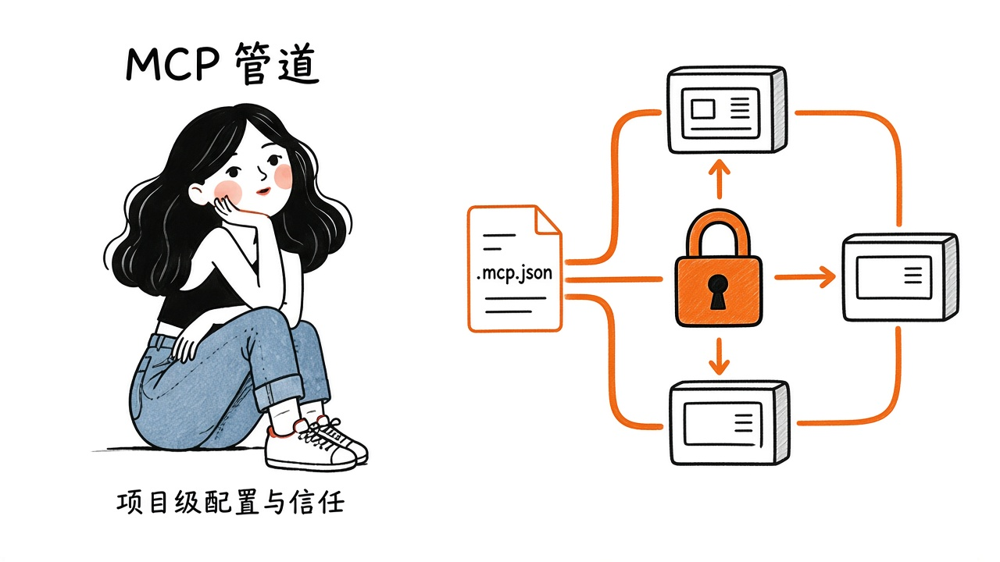
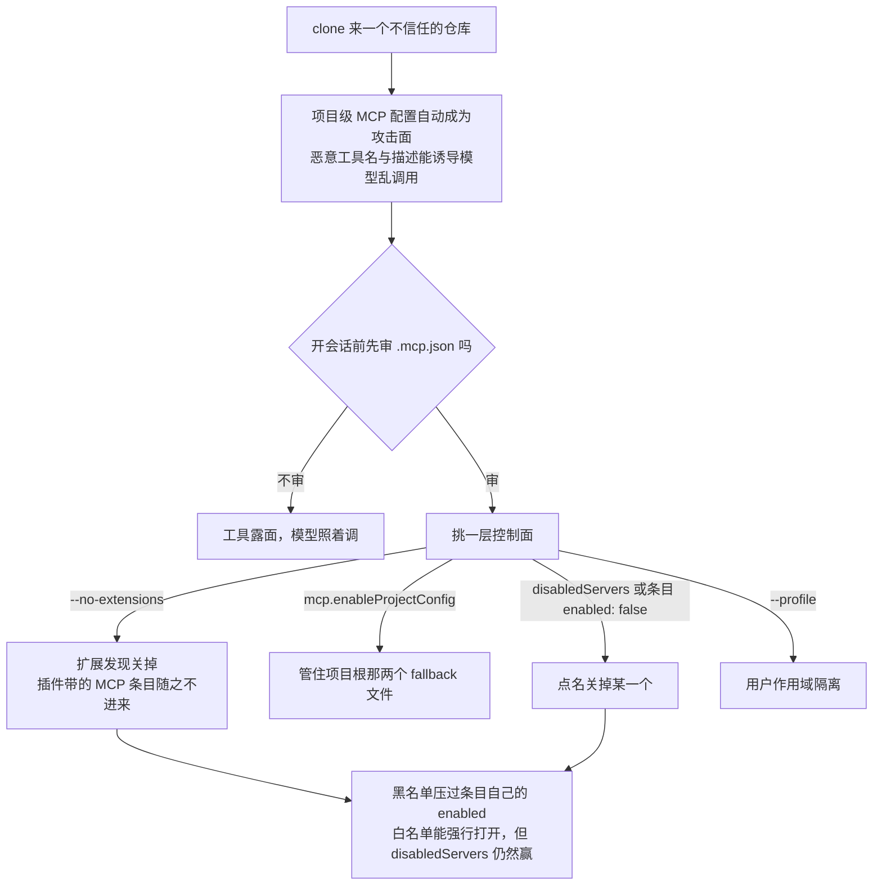

# 第20章 MCP

<!-- block: omp-ch20.b-05fa4e20 -->
MCP（Model Context Protocol）让 omp 接上外部服务器暴露的工具/资源。配置、传输、生命周期分三份文档：`docs/mcp-config.md`、`mcp-protocol-transports.md`、`mcp-runtime-lifecycle.md`；写服务器见 `mcp-server-tool-authoring.md`。



*图20-1：项目级 `.mcp.json` 等配置连到服务器——信任边界要显式。*

## 20.1 配在哪

omp 原生的两个主路径（`docs/mcp-config.md`）：

- **项目**：`.omp/mcp.json`
- **用户**：`~/.omp/agent/mcp.json`；命名 profile 时换成 `~/.omp/profiles/<name>/agent/mcp.json`

根目录的 `mcp.json` / `.mcp.json` 是**可移植的 fallback**，给别的 MCP 客户端也能读的那种场合用；原生 provider 为了兼容也读 `.omp/.mcp.json`，但 **omp 自己只往上面两个主路径写**。所以「项目里常见 `.mcp.json`」这句要改成：想让客户拥有配置，写 `.omp/mcp.json`。

还有一层开关，很多人卡在这里：`mcp.enableProjectConfig` 的说明是「Load .mcp.json/mcp.json from project root」，本机 `omp config get mcp.enableProjectConfig` 回 **`false`**（`facts/live-18.16.0/config-get-mcp-enableProjectConfig.txt`）。也就是说这台机器上，放在项目**根**的那两个文件根本不会被加载——不是配置写错了，是那扇门默认关着。

打开陌生仓库前，先看它声明了哪些 MCP——这等于额外工具面。

## 20.2 传输方式

不是只有一种。`docs/mcp-config.md` 写的规则：直连配置和 config writer 在省略 `type` 时**默认 stdio**；发现阶段给纯 URL 的条目推断 `http`、给命令条目推断 `stdio`——想要可移植、schema 合法，就把 `type` 显式写出来。stdio 必填的只有 `command: string`，可选 `args` / `env` / `cwd`。

本机 stdio 服务器好排障（子进程在你眼前）；远程 HTTP/SSE 端点要额外考虑认证与泄露面，而且文档明说远程传输**不额外施加 socket-idle 超时**——一条安静的连接不能证明对面还活着，得你自己取消或关掉。

顶层键除 `$schema` 外三个：`mcpServers`、`disabledServers`（活动 profile 的用户级黑名单，**压过**条目自己的 `enabled`）、`enabledServers`（白名单，能强行打开同名条目，但 `disabledServers` 仍然赢）。别把凭据写进可提交的 json。

## 20.3 信任

项目级 MCP 配置可能在 clone 后自动成为攻击面：恶意工具名/描述能诱导模型乱调用。实务：

- 不信任的仓库先 `--no-extensions` / 禁用 MCP 发现（具体旗标与设置以安全章与当版 CLI 为准）；
- 审 `.mcp.json` 再开会话；
- 审批模式保持对外部工具敏感。

关于第一条，本机给你一个明确答案：**`omp --help` 里没有任何 MCP 旗标**——全文搜 `mcp` 命中 0 次（`facts/live-18.16.0/help-top.txt`）。所以别去找 `--no-mcp`，它不存在。可用的控制面是：`--no-extensions`（关掉扩展发现，插件带的 MCP 条目随之不进来，文档所述）、`mcp.enableProjectConfig`（项目根那两个 fallback 文件）、`disabledServers` / 条目 `enabled: false`（点名关掉某一个）、以及 `--profile` 隔离出的用户作用域。不信任仓库时**先审配置再开会话**，比事后翻工具调用记录便宜得多。




*图20-2：不同传输只是管子——工具语义仍要你审。*


*图20-3：clone 后先读配置，再让 agent 动手。*

## 20.4 生命周期

服务器起停、工具列表刷新、失败重连见 lifecycle 文档。工具「突然消失」时先查服务器进程与日志，再查 omp 侧发现缓存。

把连通性拆成三问更容易查：配置是否被当前 profile 发现，握手后是否拿到工具列表，选中的工具能否成功完成一次调用。`/mcp list` 能回答前两问的一部分，却证明不了远端数据库权限、请求参数或业务接口正常。工具露面后仍报错，应沿本次调用的输入与服务端结果排查，不必先重装整套 MCP。

## 20.5 跟做实验：先确认哪扇门是开的

四条 shell 探针，都不起服务器、不发模型请求：

```sh
omp config get mcp.enableProjectConfig   # 项目根 fallback 文件加载吗
omp config get mcp.startupTimeoutMs      # 初始发现等多久
omp config get mcp.notifications         # 资源更新要不要注入对话
omp config list --scope project          # 项目 settings 层写了哪些键
```

<!-- block: omp-ch20.b-ef416477 -->
本机 `omp/18.16.0` 实跑：四条全部 **exit 0**，依次回 `false`、`250`、`false`，最后一条只打出标题行 `Settings in the project layer:` 下面没有条目（输出文件同名放在 `facts/live-18.16.0/`：`config-get-mcp-enableProjectConfig.txt`、`config-get-mcp-startupTimeoutMs.txt`、`config-get-mcp-notifications.txt`、`config-list-scope-project.txt`；最后那条是在一个只有 `.omp/mcp.json`、没有 `.omp/config.yml` 的目录里跑的）。两个结论直接可用：**这台机器不加载项目根的 `mcp.json`**；以及**MCP 服务器配置不在 settings 层**，别在 `omp config list` 里找你的 server。

真正的连通判据在会话里，需要你自己跑一次：

1. 在一个空目录写最小 `.omp/mcp.json`，`mcpServers` 里放**一个只读**服务器（`docs/mcp-config.md` 给的例子是 `npx -y @modelcontextprotocol/server-filesystem` 加两个白名单目录）；
2. 进会话敲 `/mcp list`，看它是否列出你的服务器名与工具数；
3. 把该条目的 `enabled` 改成 `false`（或把名字加进 `disabledServers`），`/mcp reload` 后再 `list` 一次，确认工具**消失**。

**怎么算成功**：第 2 步能看到名字、第 3 步能看到它没了。**这三步我没有实跑**——起子进程和进会话都超出本章的证据采集范围，全部标未验证；`/mcp add` / `enable` / `disable` / `reauth` / `reload` / `list` 这组命令名取自 `docs/mcp-config.md`，以你版本 `/help` 为准。

## 20.6 配置从哪来、信任怎么走

除了 omp 原生两个主路径，服务器还能从别家工具的配置**翻译**进来，文档列了一张很长的表：Claude Code 的 `~/.claude.json` 与各 `.claude/mcp.json`、Codex 的 `config.toml`（`[mcp_servers.*]`）、Gemini CLI、OpenCode（`opencode.json`，逐条深合并）、Cursor、Windsurf、VS Code（项目专属 `.vscode/mcp.json` 的 `mcp.servers`），以及已安装插件包里带的 `plugin.json` + 根 `mcp.json`。

这一层有个必须知道的规则：**项目条目排在同名用户条目之前**，所以项目里一句 `enabled: false` 就能压掉同名的用户级服务器（Claude/Codex/Gemini/Cursor/Windsurf 这几家按此处理）。**项目级配置默认涉及信任边界**：打开陌生仓库前，先确认会不会自动拉起外部进程。不信任就按 20.3 那张控制面来——`--no-extensions`、`mcp.enableProjectConfig`、`disabledServers`、`--profile` 隔离（安全章展开）。

选 stdio 时你是在本机起子进程；选远程传输时，密钥与网络策略要一起设计，别把 token 写进可提交的 json。传输细节以 `mcp-protocol-transports.md` 为准。

## 20.7 生命周期与工具露面

服务器起来之后，工具列表会进入与内置工具同一套「能不能被模型看见」的通道。名字冲突、超时、握手失败——看启动日志比看模型胡话有用。作者侧若自己写 MCP server，另读 `mcp-server-tool-authoring.md`；本书只要求会**接**现成服务器。

排障第一步建议是**故意把它弄坏**：把 `command` 改成一个不存在的二进制，起会话，看你这台机器到底把启动失败报在哪、报成什么样，之后再改回来。我在 `/tmp` 造过一个这样的条目（`{"type":"stdio","command":"definitely-not-a-real-binary-xyz"}`），但那次 omp 在 MCP 之前就因为 provider 设置停了（`Provider "openai" is disabled.`，exit 1），所以**失败长什么样我未验证**——你自己跑一次，把它记进你团队的排障笔记。另外注意：`mcp.startupTimeoutMs`、`timeout` 这些截止时间**同样管住子代理**经由父连接发起的 MCP 调用，代理层不加自己的超时（文档所述）。

## 20.8 实践口诀

- 先在空仓库用最小 `.mcp.json` 验证连通，再并进业务仓；
- 每个 server 写清：谁维护、要什么环境变量、失败时人类怎么办；
- 评审 PR 里新增 MCP 配置，当成「引入外部二进制」同一等级。

## 20.9 翻车对照：写了，但被上面那层吃掉

MCP 这一层的失败大多不是报错，是**你写的键被更强的键覆盖**。

| 翻车做法 | 会看到什么 | 正确做法 |
|---|---|---|
| 服务器写进项目根的 `.mcp.json` | 静悄悄没加载。本机已验 `mcp.enableProjectConfig` = `false`，该键说明就是「Load .mcp.json/mcp.json from project root」 | 写 `.omp/mcp.json`（omp 拥有的原生项目路径），或明确把 `mcp.enableProjectConfig` 打开 |
| 在 shell 敲 `omp mcp list` | `omp --help` 的 COMMANDS 表里没有 `mcp` 子命令（已验：全文 0 次命中）。按本机已验的同类行为，整句会被当提示词送进模型——`fail/bad-command.txt` 里 `omp bad-command notasubcommand` 就是 `Working...` 挂到超时 exit 124。**这条具体命令我未跑**，跑了就是真发一次请求 | `/mcp list` 是会话内斜杠命令：先进 `omp`，再敲 |
| 给某个 server 写 `timeout: 5000`，环境里却有 `OMP_MCP_TIMEOUT_MS` | 被完全无视。文档原话：该变量对**每一条** per-server `timeout` 有进程级优先权；设 `0` 关掉客户端超时 | 排障先看清进程级值；要按服务器分别定时，就别留那个环境变量。**本机未设该变量，这条我未验证**，自查 `echo $env:OMP_MCP_TIMEOUT_MS` |
| 在 profile A 里 `/mcp add` → User level，之后不带 `--profile` 启动 | 看不见。用户作用域解析到活动 profile 的 agent 目录，profile「只看见自己那份」，永远看不到默认 profile 的 `~/.omp/agent/mcp.json`（文档所述） | 想跨 profile 都生效就写**项目** `.omp/mcp.json`——它按工作目录走，不按 profile（文档所述） |
| 同时写了 `enabledServers` 和 `disabledServers`，里面有同名条目 | 黑名单赢。文档明说 `disabledServers`「hides a discovered server by name regardless of the source entry's `enabled` value」，且 `enabledServers` 强行打开时 `disabledServers` still wins | 一个服务器只出现在一张名单里 |
| 想「只让它别提 instructions，但工具还能用」，于是设 `enabled: false` | 整个 server 被跳过（工具也没了） | `enabled: false` 是关服务器；提不提指引是另一个键 `instructions: false`（文档所述，默认 `true`） |
| 在从 Claude/Cursor/Codex 等翻译过来的配置里写 `requestIdFormat` 或 `instructions` | 无效。文档说这两个 omp 私有键**只从 omp 原生文件、根 `mcp.json`/`.mcp.json`、omp 扩展包**读取，翻译自别家工具的 config 会忽略它们 | 想用一个端点又想要这两个开关，就把它重写成 omp 原生条目 |
| `-p` 卡着不出字 | print mode 会在第一回合之前等所有已配置 server 加载完或失败，上限 `OMP_MCP_TIMEOUT_MS`（默认 30 秒）；把它设成 `0` 就**没有上限**，一个不响应的 server 能永久堵住（文档所述） | 超时的 server 会打到 stderr；要严格失败改 exit 1 用 `OMP_MCP_REQUIRE_READY=1`（文档所述，我未实跑） |
| 交互会话第一个回合问它「有哪些 MCP 工具」，答案不全 | 初始发现只等 250 ms 就返回（本机已验 `mcp.startupTimeoutMs` = `250`），慢服务器之后才注册；文档还写了首回合最多再等 1.5 s | 慢服务器等 `/mcp reload` 或下一回合；别据此判定「没配上」 |
| 两个不同名字指向同一个端点，`instructions` 设得不一样 | 这个键**不区分连接**：只保留优先级高的那个条目及其 `instructions` 值（文档所述） | 用 `/mcp list` 看哪个条目赢，只在赢的那个上设 |

## 20.10 与御舆同构点

参见御舆第 12 章《MCP 集成与外部协议》。同构的地方在于：**协议是同一份，信任边界各画各的**。外部能力都要经过一道边界才进得来——声明在哪、谁负责拉起进程、工具描述算不算可信输入，两边问的是同一组问题；不同之处在边界的位置：omp 把项目级配置当成 clone 之后就要审的额外攻击面，御舆那章也是按「能力经边界进入」来讲的。两边的配置文件名、profile 规则、超时键名互不适用。


<!--deepen-v2-->

## 深挖：MCP 当外部二进制依赖

每个 server 条目都是供应链。锁定版本、记维护人、写失败手册。传输选 stdio 还是远程，决定攻击面在本机还是网络。工具露面后与内置工具竞争注意力——描述含糊的 MCP 工具更容易被误调用。


<!--deepen-v3-->

## 实操笔记：引入 MCP 的变更单

变更单字段：server 名称与版本、启动命令、所需环境变量、网络是否出网、失败时人类步骤、回滚方式（删配置即可否）。合并前在干净 profile 验证工具列表出现且最小调用成功。

回滚那一条要写准：omp 的 `disabledServers` 是**活动 profile 的用户级黑名单**，删掉它能恢复；而条目里的 `enabled: false` 是配置内容本身，PR 回滚才动得了它。两个路径不同，别在变更单里混写成「删配置即可」。

---
**版本核对清单**：`docs/mcp-config.md`、`mcp-protocol-transports.md`、`mcp-runtime-lifecycle.md`。写作钉 omp v18.15.0；用户本机验证 v18.16.0（见 VERIFY.md）。

- [ ] `omp config get mcp.enableProjectConfig` 的值你跑过（本机 `false`）——它决定项目根那两个 fallback 文件算不算数
- [ ] `omp config get mcp.startupTimeoutMs` 你跑过（本机 `250`），知道首回合为什么会漏工具
- [ ] 你的服务器写在 `.omp/mcp.json` 还是根 `.mcp.json`，你分得清，也写得出为什么
- [ ] `OMP_MCP_TIMEOUT_MS`、`OMP_MCP_STARTUP_TIMEOUT_MS`、`OMP_MCP_REQUIRE_READY` 三个环境变量的现状你查过（**本章均未实跑**）
- [ ] 目标仓库里有没有 `.claude/`、`.cursor/`、`.vscode/mcp.json` 这类会被翻译进来的配置，你扫过一遍
