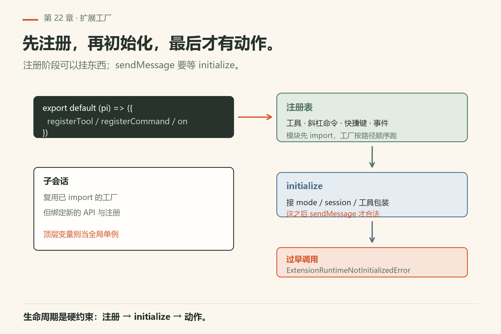
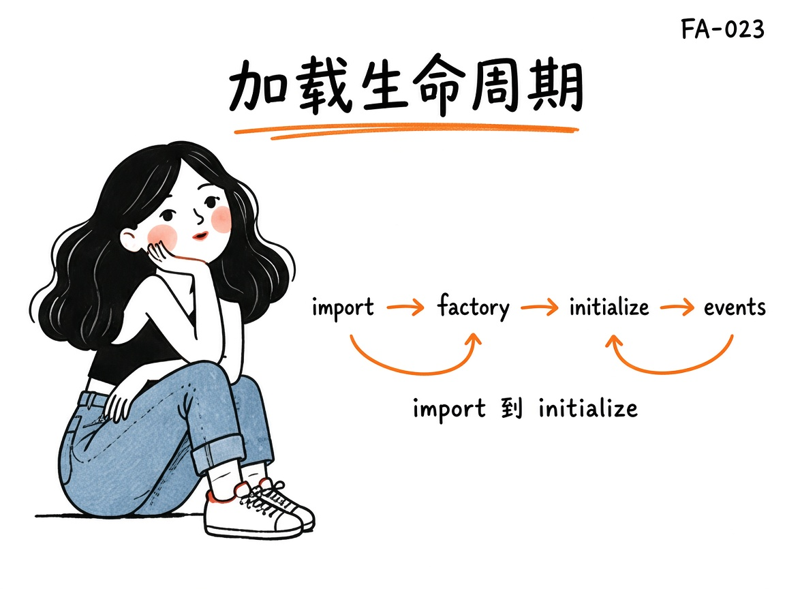
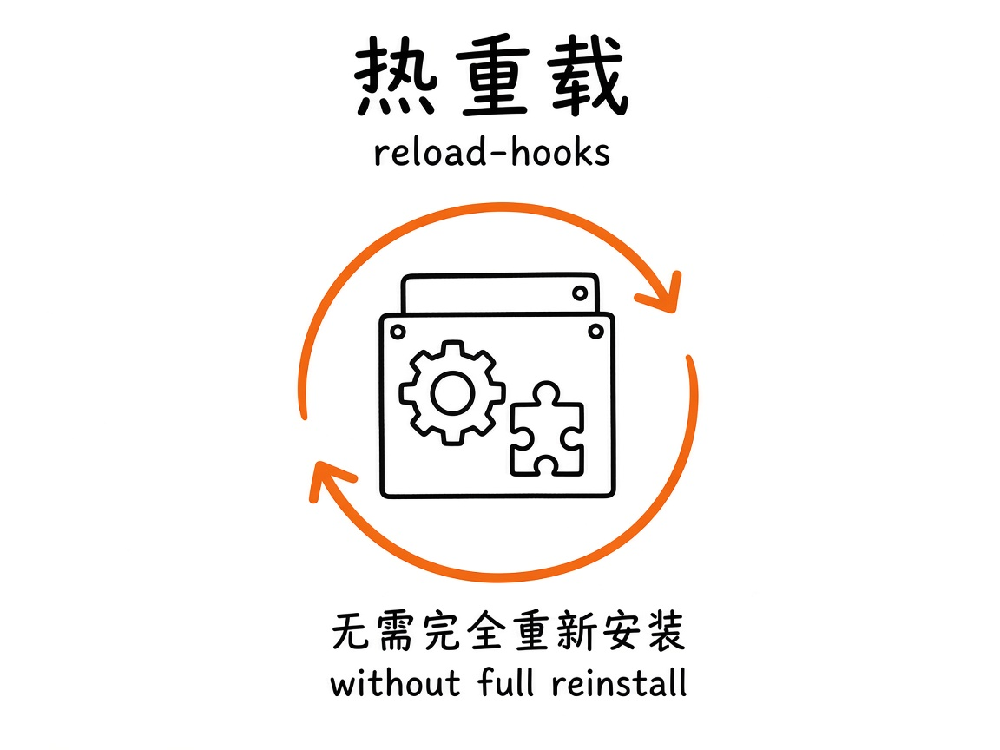

# 第22章 Extensions

<!-- block: omp-ch22.b-9805de9c -->
你写了一个扩展，`registerCommand("hello-ext", ...)`，想让它出现在斜杠列表里。你把它丢进 `.omp/`，起会话，敲 `/help`——列表里什么都没有。你翻文档，才发现扩展不是「丢进 `.omp/` 就会被加载」：**发现规则按 provider 走**，`.omp/extensions/` 只是其中一种落点。

这一章把扩展讲死：一个 TS/JS 模块导出默认工厂，加载时用 `pi` API 注册工具、斜杠命令、快捷键、事件处理、甚至自定义消息渲染。主文档：`docs/extensions.md`；发现与落盘规则另见 `extension-loading.md`。



*图22-1：一个模块里可以同时挂工具、命令、快捷键——工厂先注册，会话就绪后再动真格。*

## 22.1 它到底是什么

最小形态：

```ts
import type { ExtensionAPI } from "@oh-my-pi/pi-coding-agent";

export default function myExtension(pi: ExtensionAPI) {
  // pi.on(...) / pi.registerTool(...) / pi.registerCommand(...)
}
```

工厂可以同步，也可以返回 Promise。加载阶段允许注册；**会话动作**（例如 `pi.sendMessage()`）要等 `ExtensionRunner.initialize(...)` 之后。过早调用会抛 `ExtensionRuntimeNotInitializedError`——这是文档里写死的约束，不是偶发 bug。

运行时简化成：

1. 并发 import 模块，再按路径顺序跑工厂；
2. 绑定注册表（工具/命令/事件）；
3. `initialize` 接上当前 mode / session / 工具包装；
4. 生命周期事件往 handler 冒；工具调用可被 `tool_call` / `tool_result` 拦截。

子会话会复用已 import 的工厂，但绑定**新的** API 与注册——模块顶层变量若当「全局单例状态」用，跨子会话会踩坑。

例如模块顶层放一个 `let lastFile`，父会话写入 `a.ts` 后，子会话 import 的还是那份模块对象；若直接读取这个变量，就可能把父会话的路径当成自己的任务状态。把变量放进工厂内、随本次 API 绑定建立，才把它的寿命对齐到本次注册。共享只读常量没有同一类问题，真正要隔离的是会随任务改变的数据。

## 22.2 你能注册什么

常见能力（名称以当前 `ExtensionAPI` 为准，升级时对照类型定义）：

- **事件**：`pi.on(...)` 听 session/agent/tool 生命周期；
- **工具**：`pi.registerTool(...)`，模型可调用；
- **斜杠命令**：`pi.registerCommand(...)`；
- **快捷键与旗标**；
- **自定义渲染**；
- **注入消息**：`sendMessage` / `sendUserMessage` / `appendEntry` 等（initialize 后）。

`pi.exec()` 在 load 阶段就可用；provider 注册可能排队到 session setup。扩展里的 `api.pi` 惰性解析宿主 SDK——注册回调本身不会单单为了这个把整套交互合成器拉起来。



*图22-2：import → factory → initialize → events；动作方法别抢跑。*

## 22.3 发现、安装与 marketplace

扩展可来自用户目录、项目 `.omp`、插件/marketplace 安装包等。发现路径由 provider 决定，`.omp/extensions/` 是 native provider 的落点之一；Claude/Codex 的目录要 `enabledProviders` 显式打开（文档所述）。

团队若走「可分发包」，读 marketplace / plugin-manager 相关文档，把**无密钥**的能力包进仓库或私有源，密钥留环境变量与 `secrets` 配置。

打开陌生仓库等于可能执行陌生人的 TS——这是第31章的核心恐惧来源。默认策略：不信任则 `--no-extensions` 或干净 profile，确认来源后再开。本机 `omp --help` 里 `--no-extensions` 的原话是「Disable extension discovery (explicit -e paths still work)」（`facts/live-18.16.0/help-top.txt`）：**显式 `-e` 路径不受这个旗标影响**。

## 22.4 `/reload-plugins` 能热到什么程度

TUI 里重载插件能少重启几次，但不是魔法：有的绑定只在 initialize 时建一次；重载后行为怪异，就整进程对比一次。改工厂签名、改工具名冲突规则后，重启更省时间。



*图22-3：热重载省的是来回进出会话；治不好「只在启动绑一次」的逻辑。*

## 22.5 加载失败怎么读

工厂抛错、重复命令名、工具名冲突——看启动日志与 `extension-loading` 文档。把「扩展挂了」和「模型笨」分开：扩展没进注册表，模型再聪明也调用不到你的工具。

## 22.6 和 Hooks / 自定义工具的关系

Hooks 偏拦截与策略；自定义工具偏「新能力」；Extension 是把它们装进同一进程的袋子。新代码统一走工厂，避免历史目录与扩展注册表各写各的。

## 22.7 最小可跟做实验：确认扩展开关在不在

不需要写 TS，先用 shell 探针确认「你机器上的扩展控制面长什么样」：

```sh
omp --help | grep -E "extension|no-extensions|no-skills|no-rules"
omp config get skills.enabled
omp skill list
```

本机 18.16.0 实跑：第一条能看到 `--hook`、`-e, --extension`、`--no-extensions`、`--no-skills`、`--no-rules`、`--no-context-files` 六行（`facts/live-18.16.0/help-top.txt`）；第二条回 `true`（`config-get-skills-enabled.txt`）；第三条 exit 0 列出已有技能（`skill-list.txt`）。**怎么算成功**：第一条至少出现 `--no-extensions` 与 `-e, --extension`，第二条 exit 0 回布尔值。这三条只读，不发请求。

然后才是写最小扩展：一个只 `registerCommand` 打印 hello 的模块，放进 `.omp/extensions/`，重开会话，确认斜杠列表出现。**这一步我未验证**——本机没实跑过扩展加载，`extension-loading.md` 的发现路径节是唯一权威；你要自查：先 `omp --help` 确认 `-e` 在，再按文档把模块放到 native provider 认的目录。

## 22.8 翻车对照：扩展为什么不加载

| 翻车做法 | 会看到什么 | 正确做法 |
|---|---|---|
| 把扩展丢进 `.omp/` 根目录 | 静悄悄没加载。`.omp/extensions/` 才是 native provider 的落点，根目录不是 | 放 `.omp/extensions/` 或用户目录对应位置；读 `extension-loading.md` |
| 在工厂顶层调 `pi.sendMessage()` | 抛 `ExtensionRuntimeNotInitializedError`（文档所述） | 注册归注册；动作方法放进 `pi.on(...)` 回调或命令 handler |
| 模块顶层变量当全局单例用 | 子会话复用已 import 的工厂，模块级状态跨会话共享，互相踩脏（文档所述） | 状态放会话内，或每次 `initialize` 时重建 |
| 加了 `--no-extensions` 想「全关」，但还留着 `-e path` | 显式 `-e` 路径仍然工作（本机 `--help` 原话「explicit -e paths still work」） | 要真全关，把 `-e` 也去掉 |
| 想关技能但关错了开关 | `--no-skills` 关的是技能发现，不是扩展；`--no-rules` 关规则；`--no-context-files` 关上下文文件——四个不同的门 | 先 `omp --help` 看清每个 `--no-*` 的原话，再决定关哪个 |
| 扩展挂了却以为是模型笨 | 工具没进注册表，模型看不见；日志里其实有加载失败 | 先读启动日志，再读模型输出。扩展失败与模型失败是两件事 |
| 用 `omp config set modelRoles ...` 想改扩展行为 | 与扩展无关，但同类点路径错误（见第17章翻车表） | 扩展行为走 `pi.registerXxx`，不走走 config |

## 22.9 与御舆同构点

参见御舆第 11 章《插件架构》。同构的地方在于：**扩展的装载与隔离是同一组问题**——一个模块导出工厂，加载时注册能力，会话就绪后才能动真格；外部代码要过发现与信任边界才进得来。omp 这边把 hook、custom tool、extension 三条路径最终都收进扩展运行器；御舆那章也是按「插件怎么被发现、怎么被加载、怎么被隔离」来讲。两边的目录约定、注册 API、热重载语义各写各的，不互抄。

## 22.10 实践口诀

- 注册归注册，动作归事件/命令/工具回调；
- 名称全局唯一，冲突先改名再怪框架；
- 项目扩展当「可执行依赖」做代码评审。


<!--deepen-v2-->

## 深挖：扩展是可执行依赖

PR 审扩展像审生产服务：依赖了啥、要什么权限、失败怎么办、如何卸载。模块顶层状态跨子会话会脏。名字加团队前缀。marketplace 只装得出来源的包。


<!--deepen-v3-->

## 实操笔记：扩展验收

验收脚本：干净 profile 加载 → 命令列表含新命令 → 工具可调用 → 故意制造重复名看冲突日志 → `/reload-plugins` 后行为可解释 → 卸载后列表消失。全部绿灯才允许进团队默认配置。

---
**版本核对清单**（写作钉 v18.15.0；用户本机验证 v18.16.0，见 VERIFY.md）：`docs/extensions.md`、`extension-loading.md`；API 以类型与写作钉 v18.15.0 为准。`--hook` / `-e` / `--no-extensions` 旗标见本机 `omp --help`（`facts/live-18.16.0/help-top.txt`）。marketplace 字段名以当日文档为准。

- [ ] `omp --help` 里 `--no-extensions` 与 `-e, --extension` 两行你还在
- [ ] `.omp/extensions/` 这个目录名你分得清，不会丢进 `.omp/` 根
- [ ] 你的扩展命令名加了团队前缀，不与内置命令撞
- [ ] 你确认过 `--no-extensions` 不会关掉显式 `-e` 路径
