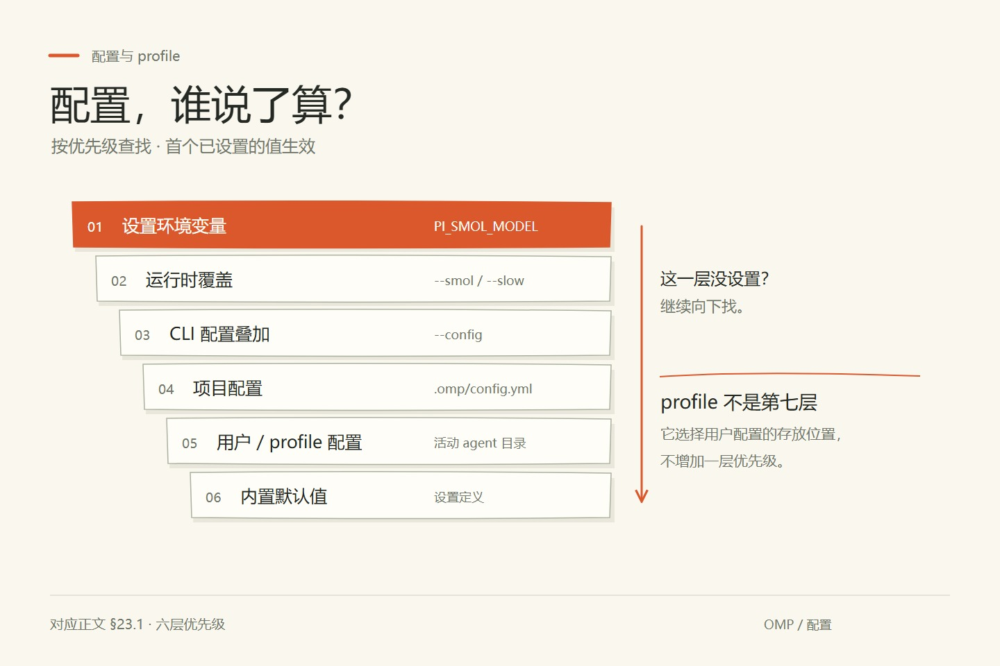
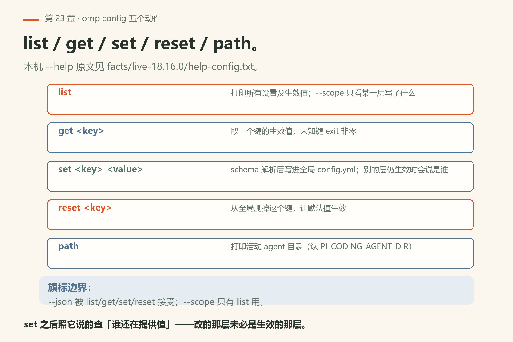
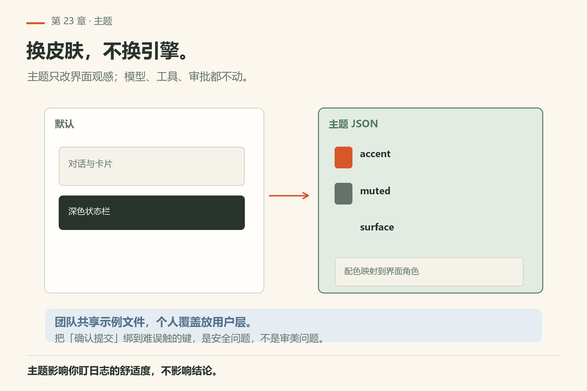
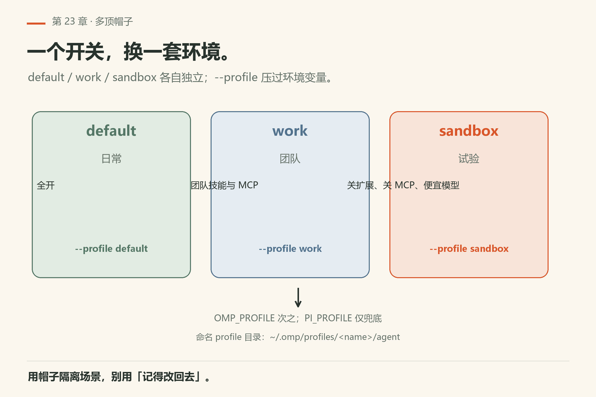
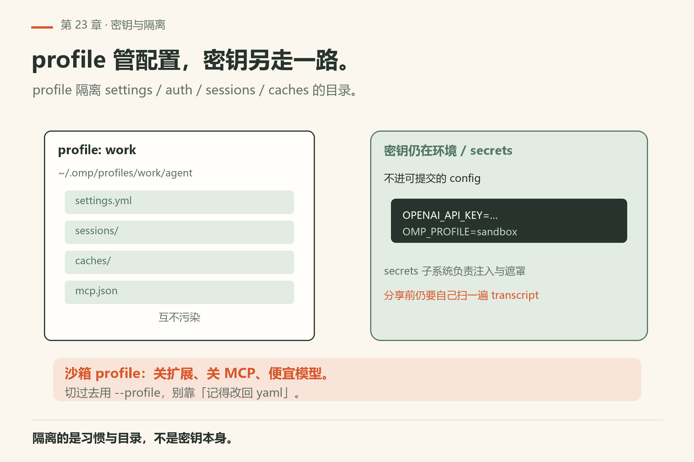
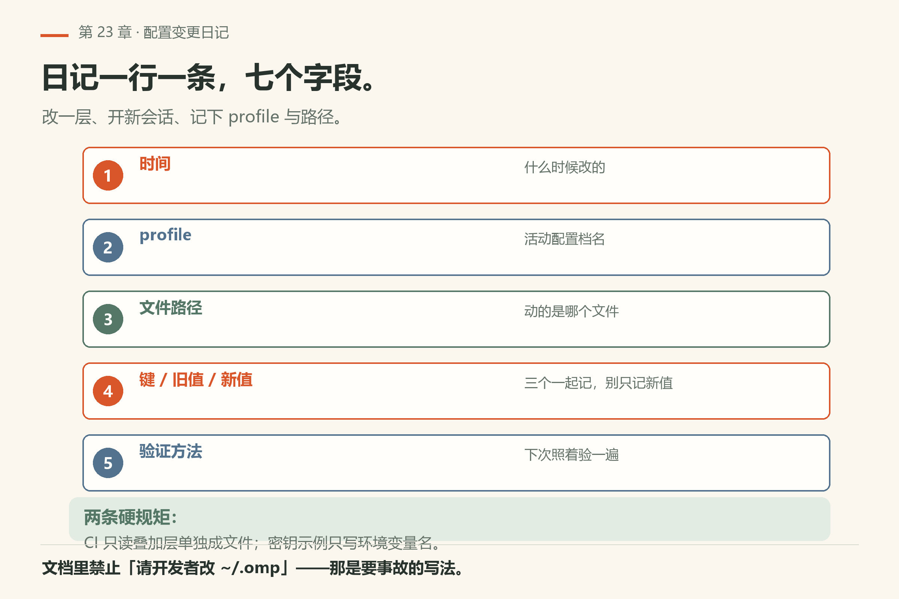

# 第23章 配置与 profile

你改了 `~/.omp/agent/config.yml` 里的 `modelRoles.smol`，想给轻量任务换个便宜模型。重开会话，问它「你现在用哪个模型」——答的还是旧的。你翻文件，值确实改了。你骂了一句 omp。

> **开门一句话：**配置是多层压出来的结果；改错层，改了也像没改。

问题出在**层**：这台机器上 `PI_SMOL_MODEL` 环境变量一旦导出，就会把文件里的值整个盖掉。env 是最上层。你改文件，改的是倒数第二层。

这一章把千层饼讲清：用户目录、项目 `.omp`、profile、环境变量、启动旗标，一层压一层。改错层，就会出现「明明改了 yaml，会话里没变化」的鬼故事。主文档：`docs/settings.md`；环境变量：`environment-variables.md`；主题：`theme.md`；快捷键：`keybindings.md`。



*图23-1：先分清「改的是哪一层」，再谈为什么没生效。*

## 23.1 六层优先级

`docs/settings.md` 的 Precedence 节把顺序写死了，从低到高：

```text
built-in defaults  <-  global config  <-  project config  <-  CLI overlays  <-  runtime overrides  <-  setting env var
```

倒着读更容易记：

1. **setting env var**：设置定义上声明的环境变量（如 `PI_SMOL_MODEL` 管 `modelRoles.smol`）。解析不了就当没设；布尔按 `parseFlag` 约定。
2. **runtime overrides**：`--smol` / `--slow` / `--plan` / `--approval-mode` / `--auto-approve` 等，只活在当前进程，**从不落盘**。
3. **CLI overlays**：`--config <file>`，可重复，后面的盖前面的。
4. **project config**：`<cwd>/.omp/settings.json` 然后 `<cwd>/.omp/config.yml`。
5. **global config**：活动 agent/profile 目录的 `config.yml`（或 `config.yaml`）。
6. **built-in defaults**：设置定义里的默认值。

每一层「未设」就落到下一层。想影响全机用用户层；想影响这个仓库用项目层；想隔离实验用 profile。

## 23.2 常见落点

- **用户级**：`~/.omp/agent/config.yml`——你的默认模型、主题、记忆后端；
- **项目级**：仓库内 `.omp/config.yml`——团队共享约定（**不要**提交密钥）；
- **profile**：`--profile` 在路由子命令前就生效，连 `config` / `models` / `update` 都会进同一作用域；
- **环境变量**：CI 与一次性覆盖；
- **CLI 旗标**：当次启动。

`docs/settings.md` 的 Where settings live 表还列了两个容易踩的点：项目 `config.yml` 压在 `settings.json` 上；`config.yml` 是规范写目标，已存在的 `config.yaml` 会被加载并原地更新。

## 23.3 `omp config` 五个动作

`omp config` 的 `--help`（本机 `facts/live-18.16.0/help-config.txt`）给全了五个动作：

| 动作 | 作用 |
|---|---|
| `list` | 打印所有设置及当前生效值；`--scope global` / `--scope project` 只看某一层写了什么 |
| `get <key>` | 取一个键的生效值；未知键 exit 非零 |
| `set <key> <value>` | 按 schema 解析后写进全局 `config.yml`；若别的层仍提供生效值，会说是谁 |
| `reset <key>` | 从全局删掉这个键，让默认值生效 |
| `path` | 打印活动 agent 目录（认 `PI_CODING_AGENT_DIR`） |

`--json` 被 `list` / `get` / `set` / `reset` 接受；`--scope` 只有 `list` 用。



*图23-5：`list` / `get` / `set` / `reset` / `path` 各管一段；`--scope` 只有 `list` 用。*

## 23.4 `/settings` 与手改文件

TUI 的 `/settings` 适合点选；大段 yaml、主题 JSON、批量键位仍手改文件更清楚。改完是否热生效取决于项：有的下轮提示就变，有的要新会话。文档说交互会话会盯全局文件、项目设置源、config overlay，短防抖后重载；解析失败的层保留上一份好值并打警告。

不确定就新开一窗对比，别在半条会话里做科学实验。



*图23-2：主题是 TUI 皮肤；不影响模型智商，但影响你盯日志的舒适度。*

## 23.5 Profile：多顶帽子

同一人可有 `default` / `work` / `sandbox`：sandbox 关扩展、关 MCP、用更便宜模型；work 开齐团队技能。切换用 `--profile`，不要靠「记得改回 yaml」。

`docs/settings.md` 说：`OMP_PROFILE` 也能选 profile，`PI_PROFILE` 是 `OMP_PROFILE` 缺席时的兼容回落；显式 `--profile` 压过两者，`--profile default` 选默认 profile。命名 profile 的 agent 目录是 `~/.omp/profiles/<name>/agent`，隔离 settings、auth、sessions、caches。



*图23-4：默认、团队、试验各一套目录；切换用 `--profile`，别靠记忆改回。*



*图23-3：profile 隔离的是配置与习惯；密钥仍走环境变量与 secrets 子系统（第31章）。*

## 23.6 主题与快捷键

`theme.md` / `keybindings.md` 描述 JSON/配置形态。把爱马仕橙画进主题是审美问题；把「确认提交」绑到难误触的键是安全问题。团队若共享键位，提交示例文件，个人覆盖放用户层。

## 23.7 项目本地覆盖与 CI

CI 用 `--config` 或文档提供的叠加方式叠只读层，避免改开发者本机文件。项目约定可提交：模型角色偏好、审批默认、禁用的危险工具列表；token 与 cookie **不提交**。

## 23.8 最小可跟做实验：摸清你这台机器的配置现状

下面六条探针都不发模型请求，只读。本机 18.16.0 全部实跑过，输出存在 `omp/facts/live-18.16.0/`：

```sh
omp config path                          # 活动 agent 目录
omp config get modelRoles                # 整张角色表（本机 13 个键）
omp config get modelRoles.default        # 点路径取不到
omp config get memory.backend             # 本机 mnemopi
omp config get tools.approvalMode         # 本机 yolo
omp config list --scope project           # 项目层写了哪些键
```

**怎么算成功**：第一条打印一个目录路径；第二条 exit 0，打出一个 JSON 对象；第三条 exit 1，回 `Unknown setting: modelRoles.default`；第四条回 `mnemopi`；第五条回 `yolo`；第六条 exit 0。六条都对上，说明「点路径取不到、整对象能取」「默认值以本机为准」这两件事在你机器上成立。

然后做一次**层对比**：在一个空目录建 `.omp/config.yml`，写一个你确定没有环境变量压着的键（比如 `skills.enabled: false`），跑 `omp config get skills.enabled`——先在工作目录外跑一次，再进这个目录跑一次。**这一步我未验证**——本机没实跑过项目层覆盖，但 `docs/settings.md` 的优先级表说项目层压过全局；你要自查：两次输出不同就说明项目层生效。

## 23.9 翻车对照：改的那层不是生效的那层

| 翻车做法 | 会看到什么 | 正确做法 |
|---|---|---|
| `omp config get modelRoles.default`，以为点路径能取 | 本机已验：`Unknown setting: modelRoles.default`，**exit 1**（`facts/live-18.16.0/config-get-modelroles-dot-default.txt`、`fail-unknown-dotted-role-key.txt`）。`modelRoles` 在 config CLI 里是整体对象键，子路径不是合法查询路径 | 查整张表用 `omp config get modelRoles`；单个角色指派在 `/model` 的角色页改。`docs/settings.md` 写 `modelRoles.smol` 指的是对象里的字段，不是 CLI 路径 |
| 改了全局 `config.yml` 里的 `modelRoles.smol`，没反应 | 安静无效。env 是最上层：`PI_SMOL_MODEL` 一旦导出就把文件里的值整个盖掉（`docs/settings.md` Precedence） | `omp config set` 在还有别的源提供生效值时会打印是谁（`--json` 里的 `overriddenBy`）；或自己 `echo $env:PI_SMOL_MODEL` 看。**本机未设该变量，这条我未验证** |
| 命令行加了 `--smol=<value>`，又抱怨 `config.yml` 改了不生效 | runtime override 排在文件之上，且**从不落盘**（文档所述） | 一次性实验用 `--smol`；想长期生效写进文件，别两个地方各改一半 |
| 以为 `memory.backend` 默认是 `off` | 本机回 `mnemopi`（`config-get-memory-backend.txt`）。默认值以本机 `omp config get memory.backend` 为准 | 写「默认值」时先跑一次 `omp config get`，别照抄旧文档 |
| 在 profile A 里改配置，不带 `--profile` 启动 | 看不见。profile「只看见自己那份」，永远看不到默认 profile 的 `~/.omp/agent/config.yml`（文档所述） | 用 `--profile` 显式切；或 `omp --profile <name> config path` 确认目录 |
| 把 `omp config set` 当「写到项目层」 | 它写的是**全局** `config.yml`。设置命令不会往 `<cwd>/.omp/config.yml` 写任意键；`modelRoleStorage: project` 是例外（文档所述） | 想项目层覆盖，手改 `<cwd>/.omp/config.yml` |
| 环境变量设了 `OMP_PROFILE`，又加 `--profile` | `--profile` 赢。文档原话：显式 `--profile` 压过 `OMP_PROFILE` / `PI_PROFILE` | 二选一；别两个都写还困惑哪个生效 |
| `PI_CODING_AGENT_DIR` 想改命名 profile 的目录 | 命名 profile 忽略这个覆盖（文档所述） | 只对默认 profile 有效；命名 profile 用 `~/.omp/profiles/<name>/agent` |

## 23.10 与御舆同构点

参见御舆第 5 章《设置与配置》。同构的地方在于：**分层配置与优先级是同一条问题**。从内置默认到全局文件、到项目文件、到命令行覆盖，每一层「未设」就落到下一层。环境变量是压在所有文件之上的那层。omp 这边多一个 profile 维度，把 auth/sessions/settings/caches 一起隔离；御舆那章讲的是同一类「谁盖谁」。两边的键名、层数、环境变量名各写各的，不互抄。

## 23.11 配置即代码的边界

项目 `.omp` 可进 git；用户 home 不进。用文档生成「推荐项目配置」片段，评审时当代码看。发现有人把 token 写进项目配置：当事故跑，转 secrets 与环境变量，并轮换密钥。

<!--deepen-v2-->

## 深挖：配置变更的实验纪律

一次只改一层；改完新开会话；记下 profile 名与文件路径。CI 叠只读配置，不改开发者 home。主题与键位可共享示例，密钥永不进库。


<!--deepen-v3-->

## 实操笔记：配置变更日记

日记一行一条：时间、profile、文件路径、键、旧值、新值、验证方法。CI 只读叠加层单独成文件，禁止文档写「请开发者改 ~/.omp」。主题与键位示例可提交；密钥示例只写环境变量名。




*图23-6：时间、profile、路径、键、旧值、新值、验证方法——一行一条。*

<!--deepen-v4-->

## 23.12 配置即代码的边界（补充）

本节与 23.11 重复，保留以对齐上一轮结构；内容以 23.11 为准。

---
**版本核对清单**（写作钉 v18.15.0；用户本机验证 v18.16.0，见 VERIFY.md）：`docs/settings.md`、`environment-variables.md`、`theme.md`、`keybindings.md`；路径与键名以写作钉 v18.15.0 文档为准。`omp config` 五个动作与 `--scope` / `--json` 旗标见本机 `omp config --help`（`facts/live-18.16.0/help-config.txt`）。

- [ ] `omp config path` 你跑过，知道当前 profile 的 agent 目录
- [ ] `omp config get modelRoles` 打出的键集合，和你机器上的表对一遍（本机 13 个）
- [ ] `omp config get modelRoles.default` 本机 exit 1 你验过——点路径取不到
- [ ] `omp config get memory.backend`、`omp config get tools.approvalMode` 两个默认值你确认过（本机 `mnemopi` / `yolo`）
- [ ] `omp config list --scope project` 在你有 `.omp/config.yml` 的目录里跑过，输出符合预期
