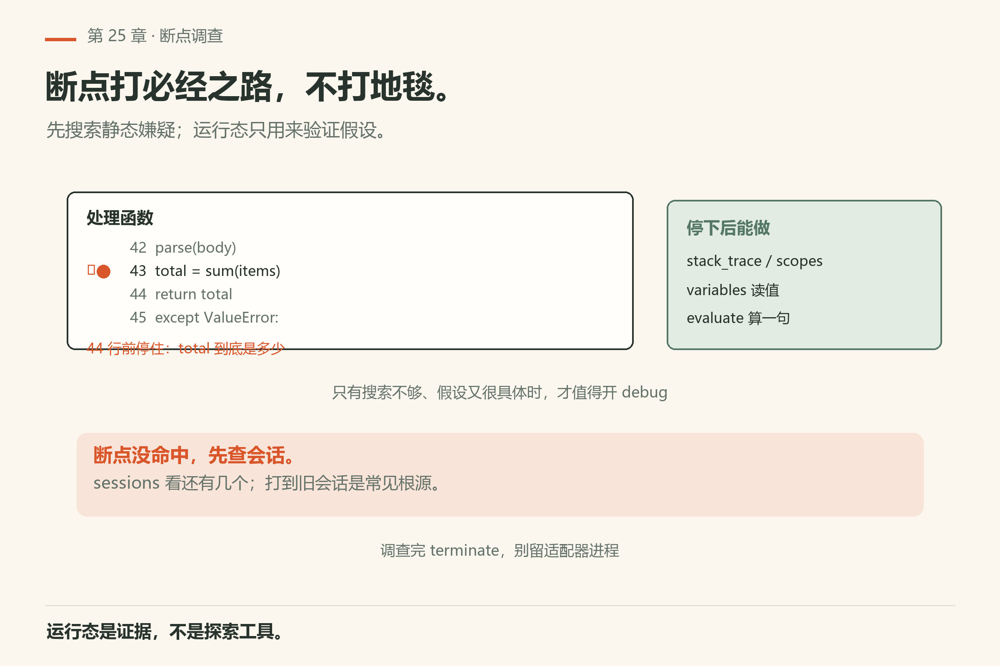
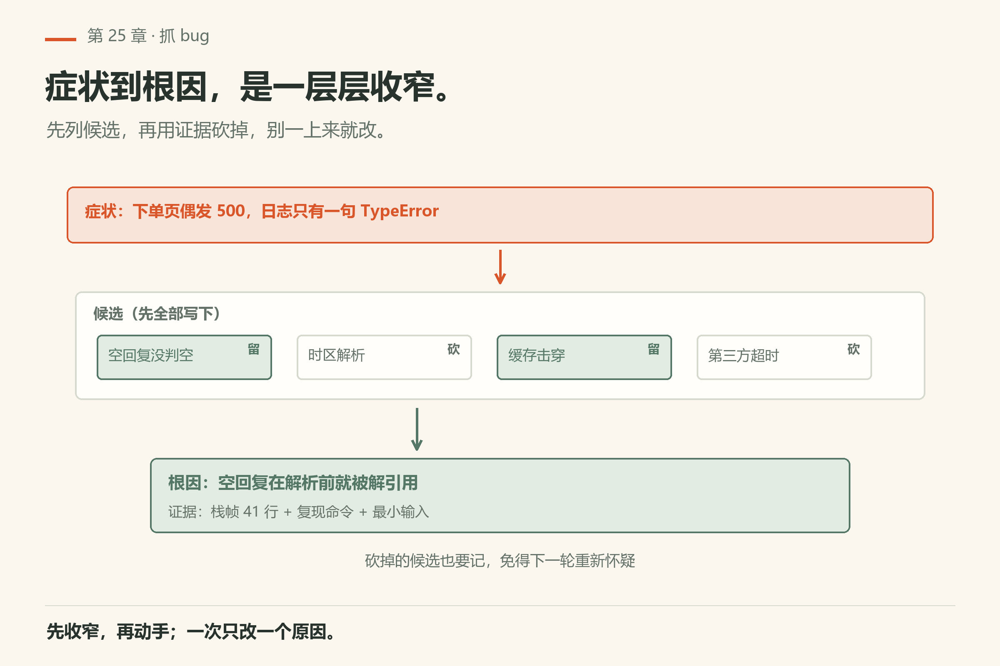
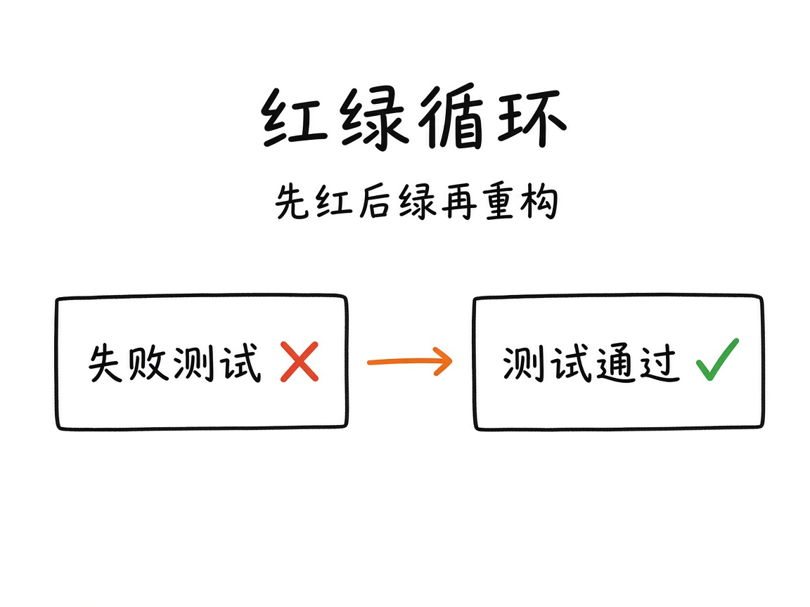
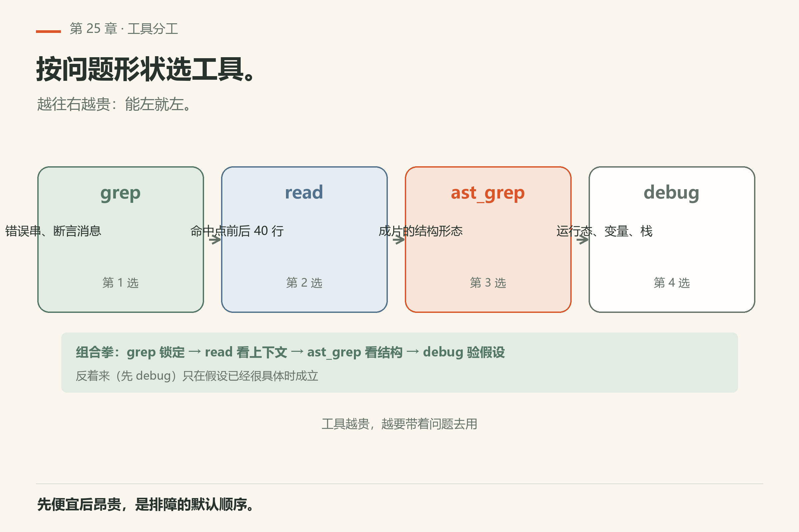
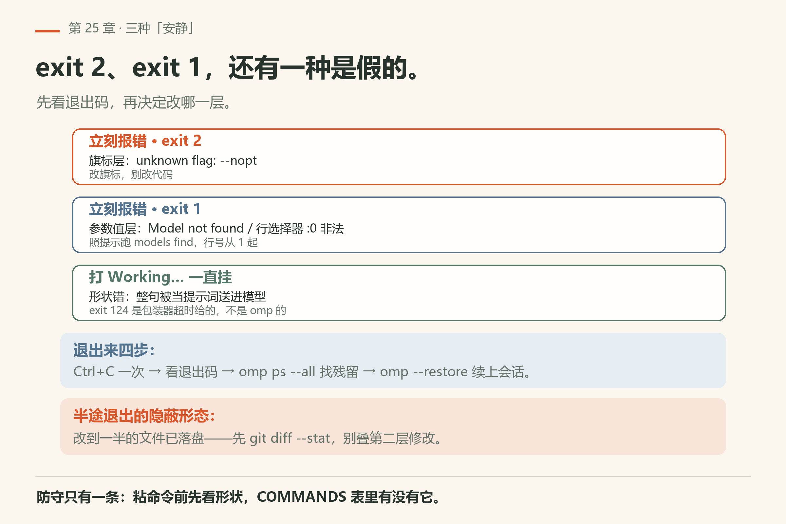

# 第25章 修一个真实 bug

周五下午五点，测试挂了。失败信息只有一句：`AssertionError: expected 200, got 404`。你盯着屏幕，第一反应是「大概是路由没配对」——然后你打开路由文件，改了三个地方，测试还是挂。你开始加 `console.log`，加到第七行时，已经忘了最初怀疑的是哪条。

这是「修 bug 没有复现」的典型死法。omp 再聪明，也救不了「我感觉它坏了」这种票。目标链路只有一句：**复现 → 定位 →（可选）断点 → 修复 → 测试 → 提交**。没有复现，就没有修复。


*图25-1：先把失败命令钉死，再谈优雅。*

## 25.1 复现：把失败变成可粘贴的命令

开场把这些写进 todo（或票里）：

- 失败命令原文；
- 期望；
- 实际输出（完整，不要「报错了」三个字）；
- 相关 commit / 环境（分支、是否有本地脏改动）。

跟做：

```text
先不要改代码。用 bash 跑：<把失败命令粘这里>
把完整输出贴回来。若命令依赖环境变量，先打印关键变量名（不要打印密钥值）。
```

偶发 bug：先记种子、并发数、时间依赖；能稳定到「几乎每次必现」再往下。承认「尚未稳定复现」比假装修好更专业。

## 25.2 定位：搜索 → 阅读 →（可选）调试

顺序固定：

1. `grep` 错误字符串或断言消息；
2. `read` 锚定前后文（大文件用行范围，别整文件灌）；
3. 需要结构扫描时上 `ast_grep`；
4. 仍迷糊再开 `debug`（第11章，DAP）：断点打在**必经之路**，不要地毯式。



*图25-2：DAP 看运行态；搜索看静态嫌疑。*

跟做口令：

> 用 grep 搜断言消息里的关键字，列出文件:行号。然后 read 最可疑的那一段前后各 40 行。先别 edit。用几句话说明你认为的根因，标「有证据」或「推测」。

你批准根因后才允许改。LSP 若在编辑后弹出诊断，优先处理**与本次相关**的；无关警告另开 todo，勿稀释本票。



*图25-4：候选先全列，再按证据砍；砍掉的也记下。*

## 25.3 修复与红绿

小步 `edit`（hashline 锚定，第9章）。改完立刻再跑**同一条**失败命令。



*图25-3：先红后绿再重构——重构是奖励，不是入场券。*

跟做：

> 只改一处逻辑，用 edit。改完再跑同一条测试。若绿，补一个最小回归测试（名字里带票号或错误关键词）。若红，先不要扩大 diff，回到定位。

「顺便重构」是回归的温床。绿了再开第二张票谈结构。

## 25.4 收尾

- 原子提交（第27章）：一次一件事；
- PR 正文写清复现与验证命令原文；
- 秘密与客户数据不要进日志粘贴；需要分享会话时走第31章遮罩。

## 25.5 案例骨架（可套任何仓库）

1. 记录失败命令与期望；
2. `bash` 复现；
3. `grep` 错误字符串；
4. `read` 锚定；
5. 可选 `debug`；
6. `edit` + 看 LSP 诊断；
7. 再跑失败命令；
8. 补测试；
9. 原子提交。

每步产物（命令、文件:行）写进 todo，防止「修着修着忘了复现步骤」。

## 25.6 现场对话节奏（压缩版）

你控节奏，它出手：

1. 「先别改，跑复现」；
2. 「先别改，grep + read」；
3. 「根因是 X，只改 Y」；
4. 「再跑同一条」；
5. 「补测 + 提交说明草稿」。

信卡片里的路径和命令，不信最后一句好听的总结（第6章同一纪律）。

## 25.7 和排错手册的分工

本章是「带着工具修一个具体 bug」的剧本；第30章是症状索引。修到中途发现是鉴权 / 429 / LSP 没起来——跳索引，别在业务代码里空转。

## 25.8 最小可跟做实验：故意种一个失败再拔掉

在玩具仓里写一个必失败的测试（断言 `1 == 2` 或调用一个故意抛错的函数），提交到分支。然后严格按 25.1–25.4 走：

```sh
# 先确认引擎通不通（本机已验：回「在线」，exit 0）
omp -p "只回复两个字：在线" --no-session
```

```text
然后走链路：
1. 把失败命令写入 todo；
2. bash 复现，保存完整输出；
3. grep 断言消息；
4. read 锚定；
5. edit 只改一处让测试绿；
6. 再跑同一条命令；
7. 提交信息写「为何 + 验证命令」。
```

**怎么算成功**：第 2 步能贴出完整输出；第 6 步再跑同一条命令时输出从红变绿；第 7 步的提交信息里验证命令是原文、不是「修了一下」。目的不是练造 bug，是练**不跳步**。许多现场事故来自「我看着眼熟，直接改」。

### 失败了先看什么

- **第 1 步就贴不出命令**：你手上只有「报错了」四个字。回 25.1 抄全，别指望模型猜。
- **第 6 步还是红**：先 `git diff --stat` 数文件。超过一个文件，先怀疑范围，不怀疑测试。
- **命令本身不返回**：那不是修复失败，是命令形状错——跳 25.17 的表。
- **输出里出现 `Model "..." not found`**：与你的修复无关，是模型名（本机形状见 `fail/bad-model.txt`）。环境先修好，再谈红绿。

## 25.9 翻车对照：修 bug 时最常踩的坑

| 翻车做法 | 会看到什么 | 正确做法 |
|---|---|---|
| 「本地偶发，我加了 sleep 就好了」 | 没有稳定复现，也没有根因；下次换个机器又犯 | 先记种子、并发数、时间依赖，能稳定到「几乎每次必现」再往下 |
| 「顺便把邻目录格式化了」 | 审查者看不到真正的修复；范围蔓延（第27章） | 一张票一个意图；重构开第二张票 |
| 「模型说修好了」但失败命令没再跑 | 卡片上没有第二次测试输出 | 再跑同一条失败命令，绿了才算完 |
| 把 API 密钥贴进会话「方便它复现」 | 密钥进聊天记录、进日志、可能被导出 | 遮罩与本地 env（第31章）；只打印变量名，不打印值 |
| 根因陈述是空的，但 diff 已经出现 | 因果关系没建立；改的是「看着像」的地方 | 证据墙（25.10）：根因有文件:行才允许改 |
| 一上来开 `debug` 断点 | 适配器、进程、变量监视都是成本；静态搜索本来能定位 | 优先顺序：稳定复现 → 静态搜索 → 读懂 → 仍不清再断点 |
| 编辑后 LSP 弹一串警告，顺手全清 | 本票 diff 被稀释；无关警告另票 | 本票相关当场修；无关另开 todo 项 |
| 在错层死磕：症状是鉴权 / 429 / LSP 死了 | 业务代码改半天，症状不在那 | 停业务修复，跳第30章症状索引 |

## 25.10 调试工具什么时候才值得开

`debug`（DAP）有成本：要适配器、要进程、要你盯变量。优先顺序永远是：

1. 失败命令稳定复现；
2. 静态搜索命中文件:行；
3. 读懂那一段；
4. 仍不清，再断点。

断点打在**业务必经之路**（请求入口、解析边界、写库前），不要在工具函数里地毯式下断。第11章有 DAP 细节；本章只要求你把「开调试」当成定位链路的一环，不是第一反应。



*图25-5：能 grep 就不上 debug；越往右越贵。*

## 25.11 LSP 诊断怎么用才不稀释注意力

编辑后 LSP 可能弹出一串警告。纪律：

- **本票相关**：当场修或记入本票 todo；
- **无关**：另开 todo 项「另票：……」，不要在同一 diff 里顺手清世界。

否则原子提交（第27章）立刻破产。

## 25.12 输出物：最小修复报告

修完后在 PR 或笔记里留四行就够：

```text
复现：<命令>
根因：<文件:行> — <一句话>
修复：<一句话>
验证：<同一条命令 + 绿>
```

让 agent 起草，你删形容词。秘密与客户数据不要出现在这四行里（第31章）。

## 25.13 证据墙（todo 列表示例）

建议列：复现命令、失败输出链接或粘贴摘要、嫌疑文件:行、根因陈述、修复 diff、回归测试、验证输出。每一列有值才进入下一列。若「根因陈述」是空的，不允许出现「修复 diff」。

这和看板方法论无关——只是防止聊天把因果关系冲垮。

## 25.14 和压缩、导出的关系

长排查会话容易触发压缩（第15章）。关键证据（失败输出、文件:行）要早早写进 todo 或仓库笔记，别只活在即将被折叠的气泡里。需要给同事看时，走导出/分享并配合第31章遮罩，不要把含密钥的原始会话直接丢进群。

## 25.15 现场口令卡（可打印）

把下面几句存成片段，比每次临场发挥稳：

1. 「先不要改代码。用 bash 跑：…… 把完整输出贴回来。」
2. 「用 grep 搜：…… 列出文件:行号。先不要 edit。」
3. 「read 某文件第 a–b 行。根因用一句话写，标有证据或推测。」
4. 「只改一处逻辑。改完再跑同一条测试。」
5. 「补一个最小回归测试，名字带票号。」

口令卡的作用是**锁步骤**，不是限制模型文采。

## 25.16 和第30章症状索引的切换条件

修到一半若症状变成：装不上、鉴权不过、429、LSP 死了、会话卡死——**停业务修复**，跳第30章。在错误的层死磕会浪费整天。

## 25.17 失败路径：命令挂住、半途退出、退出码在说什么

复现命令跑挂时，先分清三种「安静」。它们的处置完全不同。

**第一种：立刻报错，exit 2。** 旗标层。本机 `omp/18.16.0` 实测（证据 `fail/bad-flag.txt`）：

```text
$ omp bad-flag --nopt
Error: unknown flag: --nopt
Run `omp --help` for available flags.
exit=2
```

旗标拼错，或这版没有这个旗标。改旗标，别改代码。

**第二种：立刻报错，exit 1。** 参数值层。本机实测（`fail/bad-model.txt`）：`Model "definitely-not-a-model-xyz" not found`，下一行给的就是命令 `omp models find <pattern>`。照它给的查，别自己猜模型名。同一层还有行选择器：`omp read foo.md:0` 报 `Line selector 0 is invalid; lines are 1-indexed. Use :1.`，exit 1（`read-line0-error.txt`）。你让 agent「读第 0 到 40 行」时，它就是这么挂的。

**第三种：什么都不报，打印 `Working...` 然后一直挂着。** 这是最坑的一种。本机实测（`fail/bad-command.txt`、`fail/missing-value.txt`）：

```text
$ omp bad-command notasubcommand
Working...
exit=124
```

`exit=124` 不是 omp 给的，是本机包装器 90 秒超时截断给的。真相是：**命令形状错了，整句被当成提示词送进模型**。`omp --model`（缺值）是同一个形状——它不报「缺值」，它开始干活。

怎么退出来：

1. 先看有没有退出码。PowerShell 里 `echo $LASTEXITCODE`，bash 里 `echo $?`。停在 `Working...` 且没有退出码，就是第三种。
2. Ctrl+C 一次。提示符没回来，再按一次。
3. 看有没有残留后台进程：`omp ps --all`（`help-ps.txt`：`-a` 是「也列出别的项目与已退出的全局服务」）。有残留再 `omp ps kill <name>`，别去任务管理器乱杀。
4. 会话已经落盘、只是进程死了：`omp --restore <session.jsonl>` 接着走（`omp --help` 的 EXAMPLES 里就是这条，注释写着「after a crash, subagents included」）。

防守动作只有一个：**每粘一条 omp 命令，先看形状**——子命令在不在 `omp --help` 的 COMMANDS 表里，旗标这版有没有，带值的旗标后面跟没跟值。

| 你看到的 | 大概率原因 | 一条命令确认 |
|---|---|---|
| `Working...` 停住，没有退出码 | 命令形状错，整句当提示词进了模型（本机已验） | Ctrl+C 后跑 `omp --help`，逐字对 COMMANDS 表 |
| `Error: unknown flag: --nopt`，exit 2 | 旗标拼错，或这版没有该旗标 | `omp --help`（`fail/bad-flag.txt`） |
| `Model "…" not found`，exit 1 | 模型名不在本机注册表 | `omp models find <片段>`；无匹配时它 exit **0**，只打一行 `No models matching`（`models-find-nomatch.txt`） |
| `Line selector 0 is invalid`，exit 1 | 行号从 1 起，你给了 `:0` | `omp read <file>:1-40`（`read-line0-error.txt`） |
| `error: Missing session id` | 子命令少了位置参数 | 先读 `omp session --help` 的 USAGE 段（`session-lease-no-id.txt`） |
| 进程没了，会话还在 | 会话已落盘，只差重新挂上 | `omp --restore <session.jsonl>`（`help-top.txt` EXAMPLES） |

半途退出还有一个隐蔽形态：agent 改到一半被 Ctrl+C 打断，文件已落一半。判据是 `git diff` 里有你没批准的改动，或 LSP 在你没编辑时弹语法错。看到就先 `git diff --stat`，再决定是接着用还是 `git checkout -- <path>` 退回原文。别在半个 diff 上叠第二层修改。



*图25-6：exit 2 改旗标、exit 1 改参数值、假安静是形状错——退出码先说清是哪一层。*

## 25.18 与御舆同构点

参见御舆第 2 章《对话循环》与第 4 章《权限管线》。同构的地方在于：**定位—验证—最小改动**是三步同构——先把失败钉成可粘贴的命令，再让证据指认根因，再让最小 diff 把红变绿。omp 这边把「复现」当第一道闸，御舆那章讲的是同一类「先证伪再动手」。两边的工具名、断点机制、测试命令各写各的，不互抄。

---
**版本核对清单**（写作钉 omp v18.15.0；用户本机验证 v18.16.0，见 VERIFY.md）：debug/lsp 见第11章与 `docs/lsp-config.md`；编辑见第9章；会话导出见会话章与 `session-operations-export-share-fork-resume.md`。`omp -p "只回复两个字：在线" --no-session` 本机 18.16.0 回「在线」且 exit 0（`facts/live-18.16.0/print-mode-online.txt`）。

- [ ] 你在本机跑过 `omp -p "只回复两个字：在线" --no-session`，确认引擎通
- [ ] 你的失败命令可复现，且完整输出存过（不是「报错了」三个字）
- [ ] 你的根因有文件:行证据，不是「大概」
- [ ] 你的回归测试名字里带票号或错误关键词
- [ ] 提交信息含为何与验证命令原文
