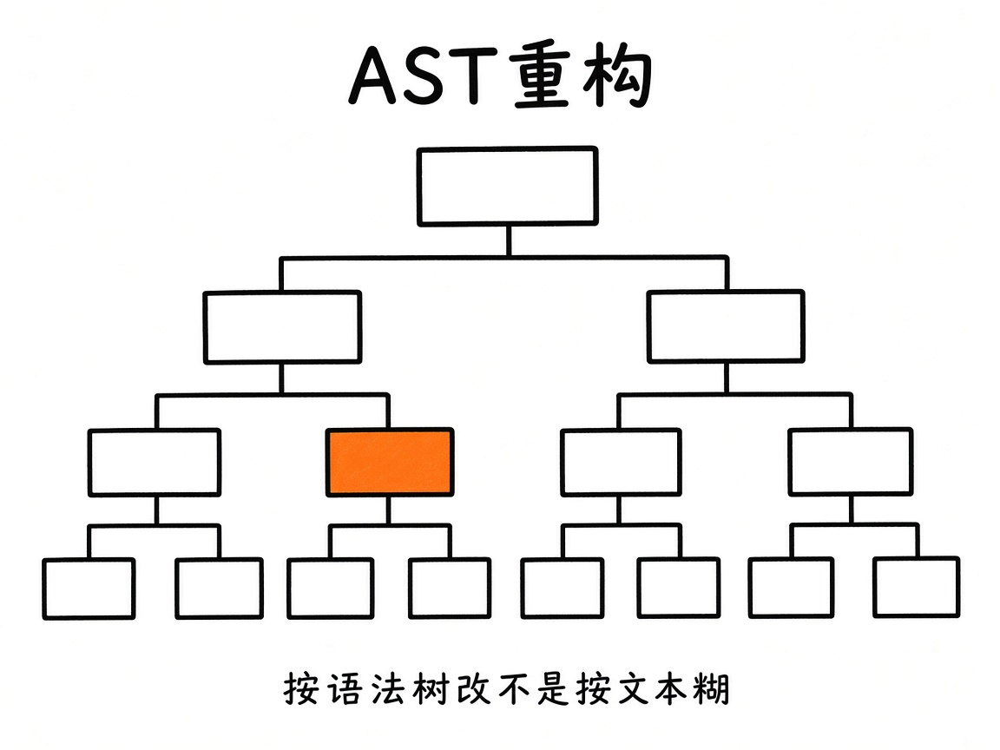
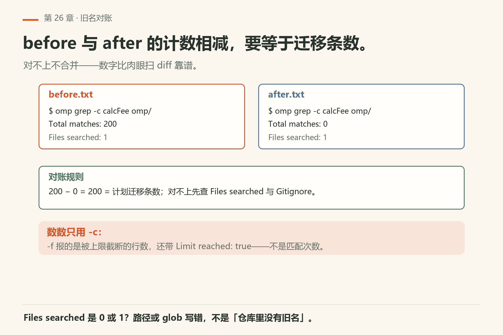
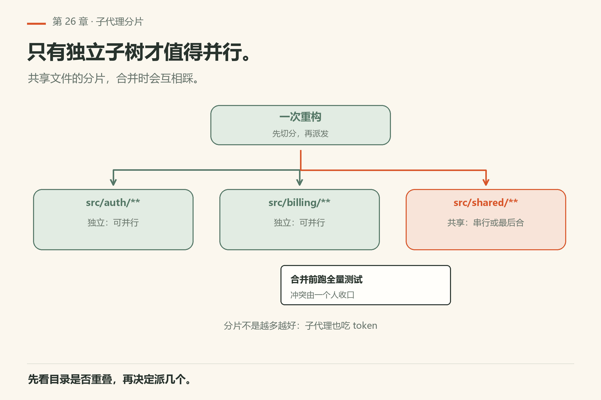
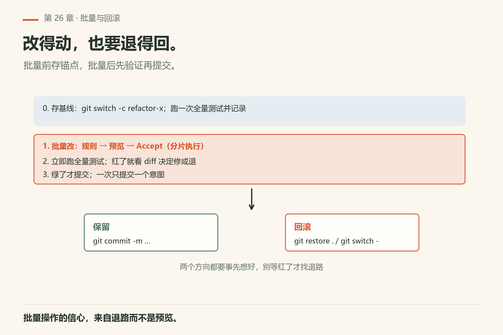

# 第26章 重构与大规模改动

你要把 `calcFee` 重命名成 `calculateFee`，全仓 200 个文件都在用。你跟模型说「帮我重构一下」，它兴冲冲地改完前 20 个文件，然后开始改字符串字面量里的 `calcFee`、注释里的 `calcFee`、还有测试快照里的 `calcFee`。你看着 diff 头皮发麻——这些地方本来就不该改。

> **开门一句话：**大改拆成可回退的小步；一次改到底，出事就全赔。

大规模改动怕两件事：**改漏**，以及**改到无法回滚**。omp 侧三件套是：AST 层工具、子代理分片、测试闸门。文本糊改可以当胶水，不能当主策略。这一章按「说明书 → 预演 → 分片 → 回滚 → 葬礼」写，全部可跟做。



*图26-1：按语法树改，不是按文本糊。*

## 26.1 先写变换说明书，再动手

给自己（和子代理）的说明书固定四段：

1. **目标模式**：AST 规则，或「改前 / 改后」各一段最小示例；
2. **包含路径**；
3. **排除路径**（生成物、vendor、快照）；
4. **验证命令**（每片跑什么算绿）。

少一段就容易改出「风格化大爆炸」。跟做：

> 先不要改代码。根据我们对 XXX 的重命名目标，起草变换说明书四段，并用 ast_grep 在单个包里预演匹配次数（只报告，不改）。

把说明书贴进 todo，后面每片子代理开头都引用同一份——口径漂移是并行重构的隐形杀手。

## 26.2 预演：单包先走通

全仓开跑前，选**一个包**预演：

- 跑通该包测试；
- 看 diff 体积是否可审；
- 估全仓倍数（文件数 × 风险）。

预演失败就改规则，不要「先全量再收尸」。预演通过的标志不是「模型说 OK」，而是：测试绿、diff 你扫得完、排除路径真的没被碰到。

### 数旧名的时候，读这四个字段

预演报「匹配 N 次」，你得知道 N 是怎么来的。本机 `omp grep` 的输出头固定（证据 `grep-count.txt`）：

```text
Searching in: <路径>
Pattern: hashline
Mode: count, Limit: 20, Context: 2, Gitignore: true

Total matches: 11
Files with matches: 1
Files searched: 1

<文件>: 11 matches
```

四个字段各管一件事：

- `Total matches`：这次报的匹配数。它会被 `-l/--limit` 截断。
- `Files searched`：**真正被搜过的文件数**。你在整包上搜，它却是 0 或 1——那是路径或 `-g/--glob` 写错，不是「仓库里没有旧名」。
- `Files with matches`：有命中的文件数。它比 `Files searched` 还大，说明你搜的是多个文件。
- `Gitignore: true`：默认就开着——`.gitignore` 排掉的目录**没进搜索范围**。vendor、生成物通常被 ignore，所以默认搜不到它们是正常的；要覆盖就加 `--no-gitignore`。

还有一个坑在 `-f` 上。本机 `omp grep hashline omp/ch09.md -f`（`grep-files.txt`）报 `Total matches: 2` 并附一行 `Limit reached: true`——**文件列表模式下那个数不是匹配次数**，是被上限截断后的行数。**数数只用 `-c`，不要用 `-f`。**

做法：改前 `omp grep -c <旧名> <包路径> > before.txt`，改后同一条命令 `> after.txt`，两个数相减要等于你计划的迁移条数。对不上不合并。



*图26-2：改前改后各数一次，相减等于迁移条数；数数只用 `-c`，`-f` 是被截断的行数。*

## 26.3 结构优先于文本

能用 `ast_grep` / `ast_edit` 表达的变换，优先走语法树。无语法资源（纯配置、散文、某些模板）再退回 `edit`/`write`。hashline 编辑适合定点；大规模符号迁移更适合 AST。字符串字面量里的同名词、注释里的旧名，要不要改——写进说明书，别临场发挥。

## 26.4 子代理分片



*图26-3：只有独立子树才值得并行。*

用 `task` 把「包 A / 包 B / 文档」切开。父代理写清：

- 成功标准（测试命令原文）；
- 禁止事项（不准改迁移文件、不准推远程……）；
- 交回格式（diff 摘要 + 测试输出）。

共享迁移脚本、数据库 schema、一次性全局改名表——**先串行**出真相源，再并行改调用方。并行省的是墙钟，不是因果。

魔法词 `orchestrate` 会鼓励并行（第18章）——开之前估「最坏起几个子代理」，成本是乘数（第32章）。

子代理提示词骨架：

```text
目标：……
包含路径：……
排除路径：……
成功标准：跑 `<测试命令>` 退出码 0
禁止：改迁移文件；推远程；改无关包
交回：diff 摘要（文件列表）+ 测试输出原文
```

## 26.5 批量与回滚



*图26-4：改得动也要退得回。*

纪律：

- 每片改完跑相关测试，再进下一片；
- git 上保持可 `revert` 的小提交；
- 主代理合并前跑约定冒烟或全量；
- 符号改名后，AGENTS / README / skill 示例一并搜旧名（可另开只读文档 task）。

每完成两片，故意在本地 `git revert` 最新一片提交，确认能干净退回，再恢复继续。若回滚冲突——说明提交不原子，回到第27章拆提交。

## 26.6 重构看板（todo 列）

建议列：变换说明、影响包列表、测试命令、回滚提交、负责人。子代理只领「影响包」里的独立项。父代理保留合并权：默认子代理只提 diff，不直接推远程（除非团队明确授权）。

## 26.7 何时不要并行

并行是乘数也是放大器：这些场景里串行反而更快。

- 逻辑依赖链（B 必须在 A 的 API 稳定后）；
- 全局锁文件 / 单例配置生成器；
- 「先看看再说」的探索阶段——先回到第24章画地图。

## 26.8 变换说明书完整示例（可套）

目标模式：把包 `billing` 内函数名 `calcFee` 重命名为 `calculateFee`（AST 规则，不以文本替换字符串字面量）。

包含路径：`packages/billing/src/**`。

排除路径：`**/*.snap`、`**/generated/**`、`**/vendor/**`。

验证命令：`pnpm --filter billing test`。

预演时先报告匹配次数与文件列表；你点头后再改。改完每片附上测试输出原文。

## 26.9 最小可跟做实验：单包重命名预演

选一个包内符号，目标「旧名 → 新名」，排除测试快照与生成物。

```sh
# 先确认引擎通不通（本机已验：回「在线」，exit 0）
omp -p "只回复两个字：在线" --no-session
```

```text
然后走链路：
1. 起草变换说明书四段；
2. 用 ast_grep 在该包预演匹配次数，只报告不改；
3. 你审列表；
4. 只在该包执行变换；
5. 每改一批跑该包测试（命令用 todo 里那条原文）；
6. 绿了再谈是否推广到全仓。
```

**怎么算成功**：第 2 步 ast_grep 能报出匹配次数与文件列表；第 4 步 diff 只动包含路径里的文件，排除路径一个没碰；第 5 步测试绿。若预演 diff 已经大到不可审——缩小规则或切更细的片，而不是硬推。

### 失败了先看什么

- **第 2 步报 0 匹配**：先 `omp grep -c <旧名> <包路径> --no-gitignore` 复核。默认输出头写着 `Gitignore: true`（`grep-count.txt`），被 ignore 的目录根本没进搜索。
- **第 4 步 diff 里有排除路径的文件**：规则写错了，不是模型不听指令。回 26.8 改 glob，别靠口头叮嘱。
- **第 5 步测试红**：`git diff --name-only` 数文件。文件数对、测试红 = 改坏了逻辑；文件数超 = 范围失控。
- **命令不返回**：多半是命令形状错，不是重构失败——跳第25章 25.17 的表。


*图26-5：三种情况别并行；收尾四条缺一条就还在进行中。*

## 26.10 并行的成本意识

每起一个子代理，大致是在乘上下文与工具开销（第32章）。开 `orchestrate` 前在 todo 写：最坏 N、预计测试次数、是否共用锁文件。若测试套件要独占数据库——并行是假省时间、真抢锁。

## 26.11 合并前的「旧名葬礼」

代码合并前开一条只读任务：grep 旧名于文档与配置（按仓库调整扩展名），排除依赖目录噪音。列出命中，人决定哪些是历史叙事该留、哪些是教人继续用旧名的毒。文档债留在大重构里，是半年后新人踩坑的主因。

## 26.12 何时宣布「重构结束」

清单全绿，且：主路径冒烟通过；旧名在约定目录已清；每片提交可独立 revert；风险区（生成物、厂商 SDK）diff 为空。缺一条就还在进行中——别开庆功 PR。

## 26.13 预演失败的三种长相

预演不是「跑一遍看绿不绿」，是三个数对上：匹配数、文件数、测试退出码。

**第一种：匹配数是 0，但你确定仓库里有旧名。** 先看 `Files searched`。它太小，就是路径或 `--glob` 写错，或者目标在 `.gitignore` 里没被搜（`grep-count.txt` 表头就有 `Gitignore: true`）。别急着宣布「不用改」。

**第二种：匹配数对，测试红。** 那是真改坏了。先 `git diff --stat` 数文件；文件数在预期内、测试红——规则把不该改的（字符串、快照、注释）一起改了。回说明书，把排除路径写细。

**第三种：测试绿，但 diff 里有说明书之外的文件。** 这最危险，因为「绿」让人放松。判据：`git diff --name-only` 与说明书「包含路径」逐行对，多一行都不合。多出来的通常是格式化钩子或 IDE 自动整理，不是模型故意的。

**退出预演的动作**：`git checkout -- <超范围文件>` 逐个退回，或整片重来（本地、未提交、你确认过没有别人的改动才用更重的手段）。不要在超范围的 diff 上再叠第二片。

| 症状 | 大概率原因 | 一条命令确认 |
|---|---|---|
| 报 `Total matches: 0` | 路径或 glob 写错；目标在 `.gitignore` 里 | `omp grep -c <旧名> <包路径> --no-gitignore` |
| `Files searched` 只有 1 | 你把文件当目录传了 | `omp grep -c <旧名> <包的 src 目录>` |
| 用 `-f` 数出个小数 | 列表模式被 `--limit` 截断，那个数不是匹配数 | 换 `omp grep -c <旧名> <路径>`（`grep-files.txt` 对照 `grep-count.txt`） |
| 数对不上预期的迁移量 | 排除了本不该排的（例如整个测试目录） | 改前改后两个计数写进 todo |
| 测试红、diff 在预期内 | 规则改了字符串/快照里的同名词 | `git diff -- <可疑文件>` 逐段看 |
| 测试绿、diff 超范围 | 格式化钩子或 IDE 顺手改了 | `git diff --name-only` 对说明书包含路径 |


*图26-6：匹配数 0、数对但测试红、绿但 diff 超范围——三种长相各有一条确认命令。*

## 26.14 翻车对照：大规模改动的高频事故

大改动的事故有固定形状；先认形状，再动手。

| 翻车做法 | 会看到什么 | 正确做法 |
|---|---|---|
| 用文本替换代替 AST | 字符串字面量、注释、快照里的同名词被一起改；diff 里混进无关改动 | 能 `ast_grep` / `ast_edit` 表达就走语法树；文本替换只当胶水 |
| 没有排除路径就全仓开跑 | vendor / 生成物 / 快照被改；diff 大到不可审 | 说明书四段里的排除路径写死，预演时确认一个没碰 |
| 子代理领了有依赖的包 | B 在 A 的 API 没稳定前就改，接口对不上；合并冲突 | 共享迁移脚本、schema、全局改名表先串行出真相源，再并行改调用方 |
| 并行起太多子代理 | 上下文与工具开销成乘数；测试抢独占数据库的锁 | 开 `orchestrate` 前估最坏 N；独占资源时改串行 |
| 一片改完不跑测试就进下一片 | 错误累积；最后全红时不知道哪片引入 | 每片改完跑相关测试，绿了再进下一片 |
| 提交不原子，回滚冲突 | `git revert` 时冲突；说明一片里混了多个意图 | 回第27章拆提交：一个提交一个意图 |
| 旧名只清代码，不清文档 | 半年后新人照 README 里的旧名继续写 | 合并前开只读 task，grep 旧名于文档与配置 |
| 把「模型说 OK」当预演通过 | 测试没跑、排除路径被碰、diff 没审 | 预演通过标志：测试绿、diff 扫得完、排除路径干净 |

## 26.15 与御舆同构点

参见御舆第 4 章《权限管线》。同构的地方在于：**大批量写操作的风险控制**——改得动也要退得回，每片可 revert，风险区 diff 必须为空。omp 这边把 AST 工具、子代理分片、测试闸门当三件套；御舆那章讲的是同一类「批量改动怎么不失控」。两边的工具名、分片策略、回滚机制各写各的，不互抄。

## 26.16 可勾选实战步骤

每一步都有可检查的产物；勾不上的那步就是欠账。

- [ ] 变换说明书四段齐全
- [ ] 单包预演绿、diff 可审
- [ ] 分片边界与禁止事项写清
- [ ] 每片绿测 + 可 revert 提交
- [ ] 文档与 skill 旧名已清理
- [ ] 合并前冒烟通过
- [ ] 回滚演练做过至少一次

---
**版本核对清单**（写作钉 omp v18.15.0；用户本机验证 v18.16.0，见 VERIFY.md）：ast 工具见第8–9章；task 见第13章；魔法词见 `docs/magic-keywords.md`。`omp -p "只回复两个字：在线" --no-session` 本机 18.16.0 回「在线」且 exit 0（`facts/live-18.16.0/print-mode-online.txt`）。

- [ ] 你在本机跑过 `omp -p "只回复两个字：在线" --no-session`，确认引擎通
- [ ] 你的变换说明书四段齐全，排除路径写的是具体 glob
- [ ] 你在单个包里预演过 ast_grep，匹配次数与文件列表存过
- [ ] 你做过一次 `git revert` 回滚演练，确认能干净退回
- [ ] 你的旧名清理清单里，文档与配置目录也 grep 过
