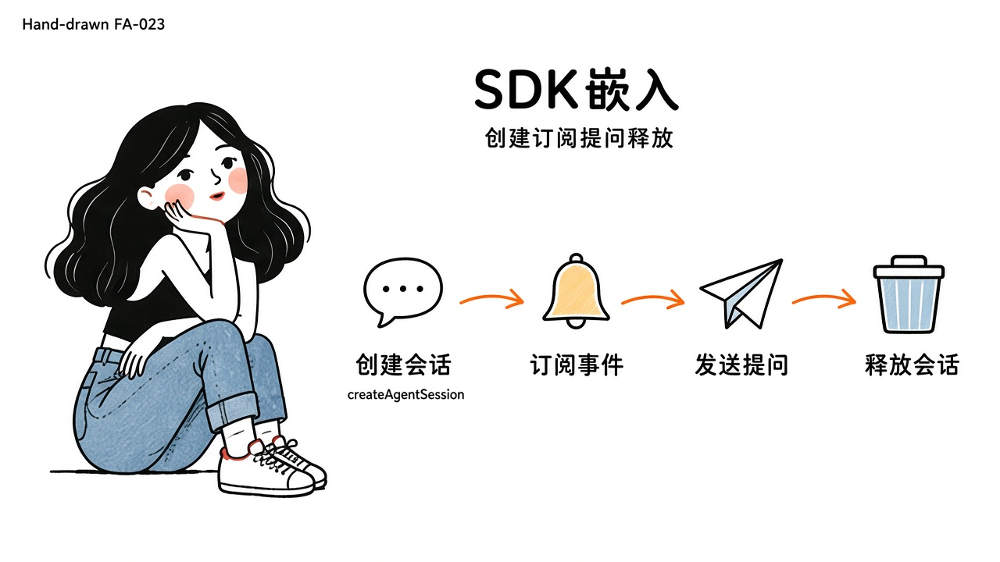
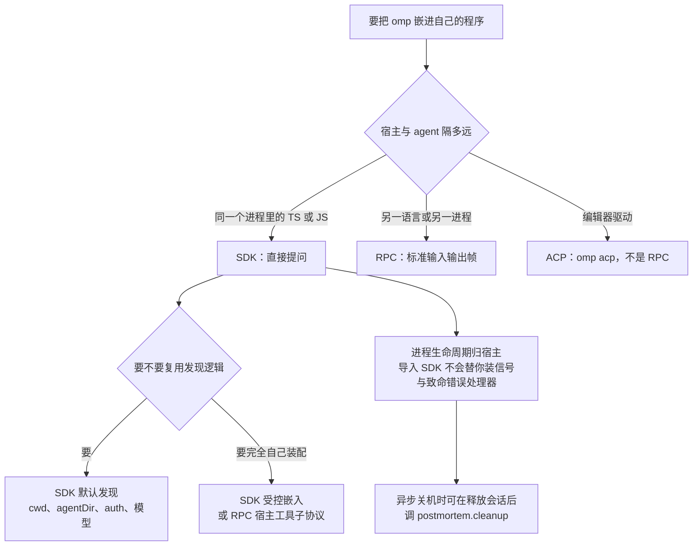
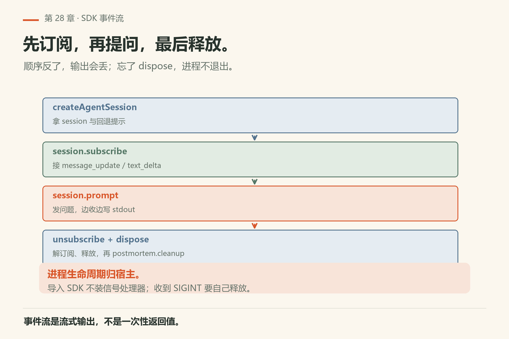
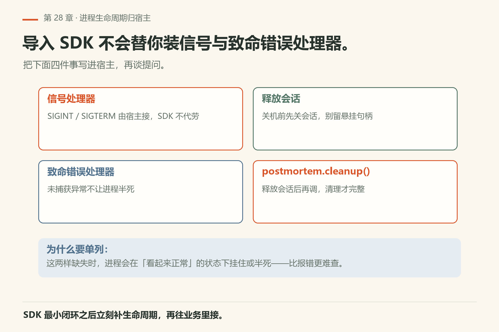
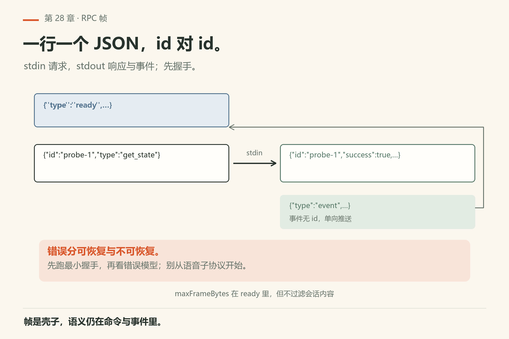
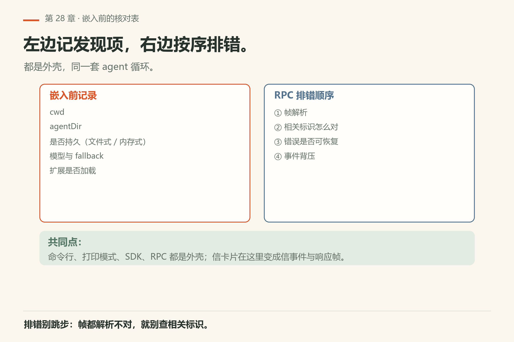

# 第28章 SDK 与 RPC 入门

你在终端里跑 `omp -p "只回复两个字：在线"`，得到「在线」，挺好。然后你想让**自己的**程序也拥有这个能力。一个 CI 脚本要在每次提交后问 agent「这次改动动了哪些公共接口」；或者一个编辑器插件，要在你按下快捷键时把当前文件交给 agent 读。两条路摆在面前：**SDK**（进程内 `createAgentSession`）与 **RPC**（帧协议）。

> **开门一句话：**自己的程序要 agent 能力，走 RPC 或 SDK 两条路。

第一次选错路的代价很具体。你按 SDK 文档写好 TypeScript，`bun run` 之后进程卡住——因为 SDK 不替你装信号处理器，进程生命周期归宿主。或者你给编辑器接了 `--mode rpc`，握手直接失败，因为编辑器要的是 ACP。这一章把两条路的分岔讲清，再各给一个能跑通的最小闭环。事实来源：`docs/sdk.md`、`docs/rpc.md`，冲突以本机二进制为准。



*图28-1：宿主进程内创建会话，订阅事件，提问，释放。*

## 28.1 什么时候用 SDK，什么时候用 RPC

选型一句话：进程内用 SDK，跨进程用 RPC；表里是展开版。

| 场景 | 更合适 |
|------|--------|
| 同进程 TypeScript/JS 宿主，想直接提问 | SDK |
| 另一语言/另一进程，需要标准输入输出帧 | RPC |
| 要复用发现逻辑（cwd、agentDir、auth、模型） | SDK 默认发现 |
| 要自己完全控制工具与扩展装配 | SDK 受控嵌入 或 RPC 宿主工具子协议 |
| 编辑器（Zed 等）要驱动 agent | ACP（`omp acp`），不是 RPC |



SDK 文档写明：导入 SDK **不会**替你装信号/致命错误处理器——**进程生命周期归宿主**。异步关机时可在释放会话后调用 `@oh-my-pi/pi-utils` 的 `postmortem.cleanup()`。

## 28.2 SDK 最小闭环（跟做）

安装与包名以 `docs/sdk.md`「Installation」为准（`bun add @oh-my-pi/pi-coding-agent`，要求 Bun ≥ 1.4.4）。Quick start 形态（键入时对照当前文档）：

```ts
import { createAgentSession } from "@oh-my-pi/pi-coding-agent";

const { session, modelFallbackMessage } = await createAgentSession();

if (modelFallbackMessage) {
  process.stderr.write(`${modelFallbackMessage}\n`);
}

const unsubscribe = session.subscribe(event => {
  if (event.type === "message_update" &&
      event.assistantMessageEvent.type === "text_delta") {
    process.stdout.write(event.assistantMessageEvent.delta);
  }
});

await session.prompt("用三句话概括这个仓库。");
unsubscribe();
await session.dispose();
```

检查点：能打印流式文本；释放后无悬挂句柄；若出现模型回退消息，要读懂它——回退不是静默成功。



*图28-2：订阅收增量；认准「文本增量」与「工具结果」类事件。*



*图28-3：导入 SDK 不装信号与致命错误处理器——这四件事要写进宿主。*

## 28.3 默认发现什么

原则：**提供则覆盖，省略则发现**。省略时通常解析 cwd、agentDir（常为 `~/.omp/agent`）、鉴权存储、模型注册等（详见 sdk.md 列表）。持久会话与纯内存会话行为不同——嵌入短期工具时看 Session manager 节，避免把临时对话写进用户目录：`SessionManager.create(cwd)` 是文件式（`session.sessionFile` 有值），`SessionManager.inMemory()` 是内存式（`sessionFile` 为 `undefined`）。

## 28.4 事件订阅与提问生命周期

尽早订阅；提问返回后按文档处理队列与空闲维护；结束时取消订阅并释放。工具与扩展集成、子代理取向选项、返回值字段——做产品级嵌入时逐节对照文档，不要凭记忆发明选项名。

## 28.5 RPC：帧与相关



*图28-4：请求与响应要对应；事件另走一条流。*

`docs/rpc.md` 覆盖启动、传输与分帧、请求响应相关，以及命令/响应/事件 schema。它还讲提问队列的并发与顺序、扩展界面/宿主工具/语音/听写/宿主 URI 等子协议、错误模型、精简命令流与客户端库。

入门抓住四件事：帧怎么切；相关标识怎么对；事件如何推送；错误是否可恢复。跟做：先跑与你客户端库匹配的最小握手，再扩展到提问。不要从语音子协议开始。

## 28.6 受控嵌入 vs 自动发现

自动发现适合「行为像命令行」。若要锁死工具集、禁用扩展、自带鉴权：读「Minimal controlled embed」与宿主集成选项；明确传入覆盖项。需要无扩展时，与命令行 `--no-extensions` 心智对齐（第31章）。

## 28.7 安全与密钥

接口密钥走环境变量或宿主保险柜；打开秘密遮罩再打日志（第31章）。RPC 跨进程时注意帧载荷是否含敏感字段——本机 18.16.0 的 ready 帧会广播 `maxFrameBytes` 等传输上限，但**不会**替你过滤会话内容里的密钥。

## 28.8 最小可跟做实验：RPC 握手与状态查询

**实验一：RPC ready 帧（不需要可用模型）**。RPC 协议是 stdio 上的 JSONL，握手第一帧就能验证「二进制活着、协议版本对」：

```sh
omp --mode rpc --no-session --no-extensions < /dev/null
```

本机 18.16.0 已验，首行输出（`omp/facts/live-18.16.0/rpc-ready-frame.txt`）：

```json
{"type":"ready","protocolVersion":1,"supportedProtocolVersions":[1,2],"maxFrameBytes":1048576,"maxReassembledFrameBytes":67108864}
```

**算成功**：看到 `type` 为 `ready`、`protocolVersion` 为 1。退出码 0。

**实验二：发一条命令，看相关标识回显**。`get_state` 是只读命令，用它验证「请求-响应」的 id 对应关系：

```sh
printf '%s\n' '{"id":"probe-1","type":"get_state"}' \
  | omp --mode rpc --no-session --no-extensions 2>&1 \
  | grep -m1 '"type":"response"'
```

本机 18.16.0 已验（证据 `rpc-get-state-shape.txt`，已脱敏，只留字段名）：响应形如 `{"id":"probe-1","type":"response","command":"get_state","success":true,"data":{…}}`，`data` 的键包含 `model`、`thinkingLevel`、`isStreaming`、`isSettled`、`contextUsage`、`todoPhases` 等。**算成功**：`id` 回显成 `probe-1`、`success` 为 `true`。

**实验三（要可用模型）：SDK Quick start**。按 `docs/sdk.md` 安装建最小项目；复制 28.2 的 Quick start，提问改为「只回复：pong」；确认输出；打印事件类型列表后删除调试代码；释放并确认进程可干净退出。**算成功**：stdout 出现 `pong`，进程退出码 0，无悬挂句柄。

## 28.9 翻车对照：嵌入与协议的五种死法

嵌入失败死法固定：握手、模式、生命周期三处最常见。

| 翻车做法 | 会看到什么 | 正确做法 |
|---|---|---|
| 用 SDK 却指望它接管进程生命周期 | 异步关机时清理不跑，悬挂句柄；文档明说 SDK 不装信号/致命错误处理器 | 宿主自己管生命周期；释放会话后手动调 `postmortem.cleanup()`（`docs/sdk.md`） |
| 给编辑器接 `--mode rpc` | 握手失败：编辑器说 JSON-RPC（ACP），你的帧是自定义 JSONL，两套协议 | 编辑器走 `omp acp`；程序化控制走 `--mode rpc` / `rpc-ui`（`docs/rpc.md` 开篇「not JSON-RPC 2.0」） |
| 用 `SessionManager.create(cwd)` 做临时任务 | 会话文件写进 `~/.omp/agent/sessions/…`，垃圾越堆越多 | 临时/测试用 `SessionManager.inMemory()`（`sessionFile` 为 `undefined`） |
| 让 RPC 客户端写完 stdin 立刻关掉 stdout 管道 | 退出被无限推迟：文档明说「Clients MUST continue reading stdout after closing stdin」 | 客户端保持读 stdout 直到收到 `session_settled` 或进程退出 |
| 嵌入时把日志直接打到控制台 | 模型上下文里的密钥（尤其宿主工具参数）跟着日志走 | 先开秘密遮罩（第31章），或至少确认 RPC 帧载荷无敏感字段再打日志 |

## 28.10 与御舆同构点

参见御舆第 13 章《流式架构与性能优化》与第 15 章《构建你自己的 Agent Harness》。两边拆的是同一层：**把 harness 当程序接口暴露**——事件流、请求相关、生命周期归谁。omp 的 SDK 是进程内、RPC 是跨进程；御舆那两章讲的是同一组问题在不同装配边界下的答案。跨书只搬「流式事件 + 请求相关 + 宿主拥有生命周期」这三件事，别搬对方的接口名和旗标：两边 schema 对不上。

## 28.11 发现项核对表与 RPC 排错顺序

嵌入前记录：cwd、agentDir、是否持久、模型、扩展是否加载。RPC 排错：先帧解析，再相关标识，再错误可恢复性，再事件背压。同一套 agent 循环：命令行界面、打印模式、SDK、RPC 都是外壳——第6章「信卡片」在这里变成信事件与响应帧。



*图28-5：左边记五项发现项，右边按序排错——帧解析、相关标识、可恢复性、背压。*

## 28.12 可勾选收工

两条过关线：选型讲得出理由，协议跑得通闭环。

- [ ] 说清 SDK 与 RPC 选型理由
- [ ] Quick start 跑通并释放
- [ ] 知道默认发现项与覆盖方式
- [ ] 读过错误模型位置
- [ ] 日志无明文密钥

---
**版本核对清单**：以 `docs/sdk.md`、`docs/rpc.md` 及包版本为准；本书不复制全量 schema。写作钉 omp v18.15.0；用户本机验证 v18.16.0（见 VERIFY.md）。

- [ ] `omp --mode rpc --no-session --no-extensions < /dev/null`：本机 18.16.0 首帧 `type:ready`、`protocolVersion:1`、退出码 0
- [ ] `omp acp` 子命令仍存在（`help-top.txt` 的 COMMANDS 表）；`--mode` 摘要仍只列 text/json/rpc/rpc-ui
- [ ] SDK 的 `SessionManager.inMemory()` 形态与文档一致（`sessionFile` 为 `undefined`）
