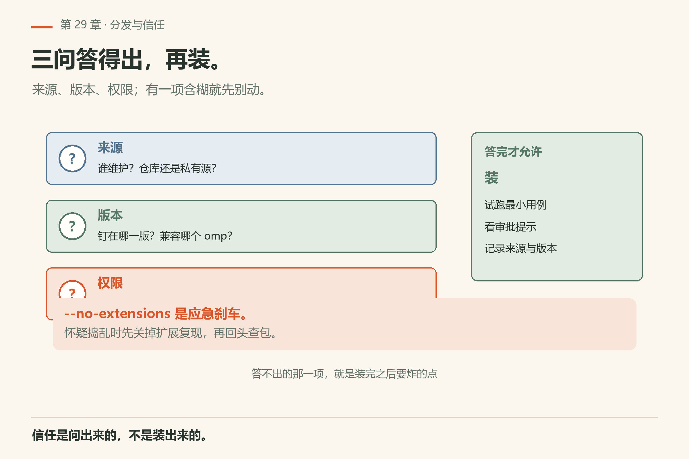
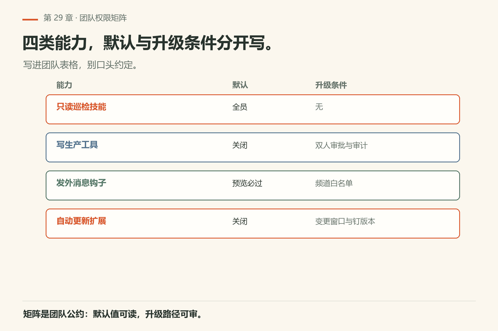
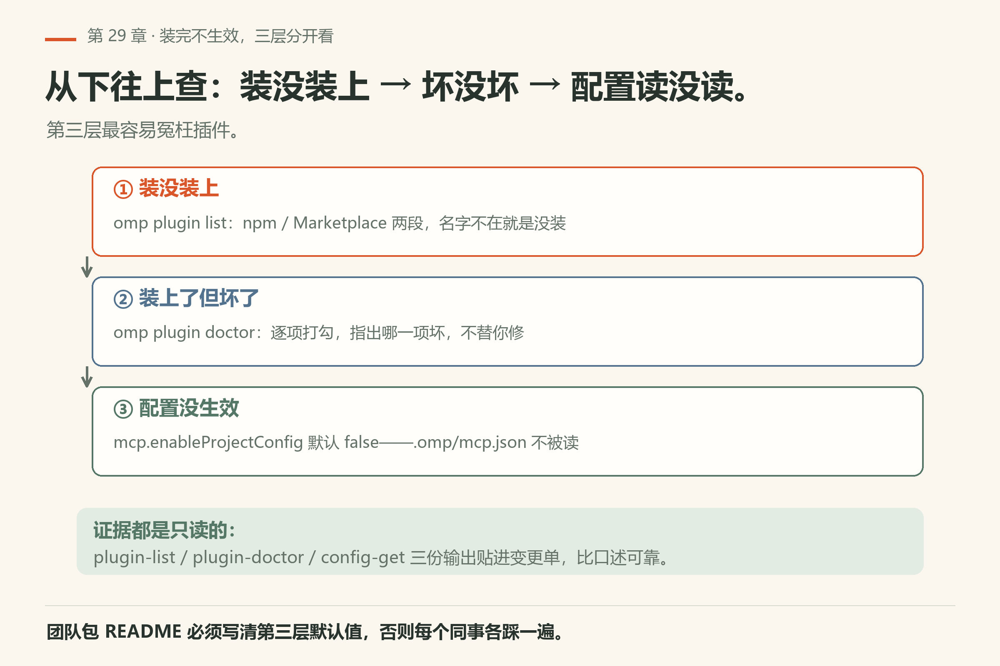

# 第29章 团队扩展包

你把个人技能打磨得挺顺手：一个「只读巡检」技能，每次都能把仓库的 diagnostics 扫一遍，输出固定格式。同事看见了，说「给我也来一份」。你 zip 发过去，他解压、放进 `~/.omp/skills/`，然后跑出来一堆 `ENOENT`——你的技能里写着 `C:\Users\<你的用户名>\...` 这种绝对路径，还硬编码了一个只在你机器上存在的工具名。

> **开门一句话：**团队包把技能、命令、配置打成一份，装完要验它真生效。

团队扩展包就是把这件事做对：**打包、分发、信任、升级**。事实锚点：`docs/extensions.md`、`docs/skills.md`、`docs/custom-tools.md`，以及 `omp plugin --help`。


*图29-1：约定、技能、工具、钩子，捆成可版本化的一包。*

## 29.1 包里通常有什么

常见组成：技能；自定义工具；钩子；扩展工厂；文档与版本钉扎。先写清「解决谁的什么重复劳动」，再堆文件。没有问题陈述的扩展包，只会变成第二个垃圾抽屉。

## 29.2 从单人技能到团队包

个人技能验证有效后：去掉本机绝对路径与个人密钥；秘依赖改成环境变量名并写进文档；加最小试跑一节；用仓库或插件通道分发。

> 审这个技能目录：列出所有本机路径、密钥形状、未声明的外部依赖。只报告。

清理后再谈分发。

## 29.3 自定义工具与钩子


*图29-2：工具要可审批、可审计，不要黑盒脚本。*

明确输入结构、副作用、失败模式。钩子要给人审批出口，避免静默改生产。写生产库默认只读；发外部消息必须预览；拒绝时给出可执行修复建议。

## 29.4 分发与信任



*图29-3：来源、版本、权限，三问都答得出再装。*

装之前问：来源是哪？钉住哪一版？要哪些工具、网络、密钥？`--no-extensions` 是应急刹车（第31章）。

> 列出本仓库或本配置档已加载的扩展与技能来源。标出未知来源项。

## 29.5 版本与兼容

README 写明：支持的 omp 版本范围；破坏性变更；回滚方式。附录 E 的页边核对习惯同样适用于扩展包。

## 29.6 权限矩阵（团队表格）

团队用扩展先立矩阵：谁能开什么，升级条件写明。

| 能力 | 默认 | 升级条件 |
|------|------|----------|
| 只读巡检技能 | 全员 | 无 |
| 写生产工具 | 关闭 | 双人审批与审计 |
| 发外消息钩子 | 预览必过 | 频道白名单 |
| 自动更新扩展 | 关闭 | 变更窗口与钉版本 |



*图29-5：四类能力的默认与升级条件——写进团队表格，别口头约定。*

## 29.7 最小可跟做实验：盘点现有插件与技能

先看清自己机器上已经挂了什么。三条命令，都不改任何东西：

```sh
omp plugin list
omp skill list
omp ps --json
```

本机 18.16.0 已验（证据 `plugin-list.txt` / `skill-list-json.txt` / `ps-json.txt`）。`plugin list` 分两段打印：`npm Plugins:` 下列出形如 `名字@版本` 的条目，`Marketplace Plugins:` 下列出带 `(user)` / `(project)` 作用域标记的条目。`skill list --json` 返回一个 JSON 对象，`skills` 数组每项含 `name` / `description` / `filePath` / `baseDir`。`ps --json` 打印当前项目与 daemon 目录的状态（本机没有后台进程时 `daemons` 为空数组）。

**算成功**：三条命令退出码都是 0，且你能指着 `filePath` 说出「这个技能从哪个目录来」。

想确认「装的插件健康吗」：

```sh
omp plugin doctor
```

本机 18.16.0 已验（证据 `plugin-doctor.txt`）：逐项打勾，末尾一行 `Summary: 6 ok, 0 warnings, 0 errors`。**算成功**：`errors` 为 0。

### 失败了先看什么

- **三条命令有一条非 0**：先修退出码，别看输出好不好看。
- **`ps --json` 的 `daemons` 是空数组**：这是正常状态，不是坏了。本机就是空的（`ps-json.txt`）。
- **`skill list --json` 的 `warnings` 不为空**：先读 `warnings`，再读 `skills`。
- **说不出 `filePath` 从哪来**：看同一项的 `source`。本机见到的取值形如 `agents:user` 与 `claude-plugins:user`，一个来自技能目录，一个来自插件缓存（`skill-list-json.txt`）。

## 29.8 失败路径：同事那边报 `Unknown skill`

最典型的团队包事故。你这里跑得好好的，他 clone 下来第一句话就是 `Unknown skill: <名字>`。

先分清三件事：技能**在不在**、**能不能被读到**、**读到的是不是你那份**。两条命令从粗到细：

```sh
omp skill list --json
omp read skill://<名字>
```

本机 18.16.0 已验（`skill-list-json.txt`）：`skill list --json` 返回一个对象，`skills` 数组每项含 `name` / `description` / `filePath` / `baseDir` / `source` / `hide`，末尾另有一个 `warnings` 数组。`source` 是关键字段——本机见到的取值形如 `agents:user`（来自技能目录）与 `claude-plugins:user`（来自插件缓存目录）。来源不同，加载路径就不同；同事那份放在别的目录，`source` 就不一样。

`omp read skill://<名字>` 是「人肉试读」：本机已验，装好的技能 exit 0，首行打印 `[Skill file: <绝对路径>]`，接着是 SKILL.md 的 frontmatter 与正文（`read-skill-user-installed.txt`）。这一步通了，说明「发现 + 读取」这条链是活的。

失败时的三种长相，本机都采到了：

```text
$ omp read skill://hello
Unknown skill: hello
Available: code-tour, council, e2e-testing, …
exit=1
```

`Available:` 后面那串是这台机器当前认得的全部技能名（`read-skill-unknown-project-skill.txt`）。**同事那台机器上没你的名字，就在这行里确认**，不用去翻他的目录树。

第二种是裸 URI：`omp read skill://` 报 `skill:// URL requires a skill name: skill://<name>`，exit 1（`read-skill-bare-uri.txt`）。空名字不会被当成「列出全部」。

第三种最耗时间：目录里明明有 `.omp/skills/hello/SKILL.md`，`omp read skill://hello` 仍然 `Unknown skill: hello`。本机复现到了这个状态（`read-skill-unknown-project-skill.txt`），**机制未验证**——不要猜成因。先用 `omp skill list --json` 看它在不在列表里：不在，是发现层没扫到，回 `docs/skills.md` 核目录约定；在但读不到，才是读取层的问题。

| 症状 | 大概率原因 | 一条命令确认 |
|---|---|---|
| `Unknown skill: <名字>`，exit 1 | 对方机器没扫到那个目录 | `omp skill list --json`，在 `skills[].name` 里找 |
| `Available:` 里没有你的技能 | 装到了自己 profile，没装到对方能扫到的作用域 | `omp config path` 看活动配置目录 |
| `skill:// URL requires a skill name` | 发了裸 URI | `omp read skill://<名字>` |
| 列表里有、`read` 也通，agent 却不用它 | `description` 没写清何时该用 | 改描述里的触发语，再 `omp read` 看原文 |
| 目录里有文件，列表里没有 | 发现层没扫到；机制本机未验证 | 对 `docs/skills.md` 的目录约定，别猜 |

## 29.9 装完不生效：三层分开看

团队包横跨三层，排查从下往上。

**第一层：插件装没装上。** `omp plugin list`（本机已验，`plugin-list.txt`）分两段：`npm Plugins:` 下列 `名字@版本`，`Marketplace Plugins:` 下列带 `(user)` / `(project)` 作用域的条目。名字不在里面，就是还没装上，后面的都不用查。

**第二层：装上了但坏了。** `omp plugin doctor`（本机已验，`plugin-doctor.txt`）逐项打勾：`plugins_directory`、`package_manifest`、`node_modules`，然后每个插件一行 `plugin:<名字>`。它告诉你「哪一项坏」，不告诉你「怎么修」。`--fix` 确实存在（`help-plugin.txt`），但先读完报告再决定要不要让它动手。

**第三层：装上了、健康，但仓库里的项目级配置没生效。** 这层最容易冤枉插件。本机 18.16.0 实测（`config-get-mcp-enableProjectConfig.txt`）：`omp config get mcp.enableProjectConfig` 返回 **false**。也就是说，你在仓库里提交的 `.omp/mcp.json`，默认配置下**不会被读**。团队包的 README 必须写这一句，否则每个同事各自踩一遍。同一组里还有 `omp config get mcp.startupTimeoutMs`，本机返回 `250`（`config-get-mcp-startupTimeoutMs.txt`）——名字里带 `Ms`，对要拉起子进程的 MCP server 来说很紧，没把握就别压到这个值。

至于「MCP server 拉不起来时长什么样」，本机没采到。我们把 `.omp/mcp.json` 指向一个不存在的二进制想观察启动失败，结果进程在 MCP 发现之前就因为模型 provider 被禁用退出了（exit 1，`mcp-broken-server-probe.txt`）。**这一项标未验证**；自查顺序：先 `omp config get mcp.enableProjectConfig`，再手动跑一遍 mcp.json 里的 `command`，看它能不能起来。



*图29-4：插件三层排查——装没装上、坏没坏、项目级配置读没读。*

## 29.10 把健康检查接进 CI

`omp plugin doctor --json` 输出的是一个数组，每项 `{name, status, message}`（本机已验，`plugin-doctor-json.txt`；同一台机器的人类版是 6 项全 ok）。判据写死两条：

- 任一项 `status` 不是 `ok` → 失败；
- 数组为空 → 失败。一条都没检查到，比「全绿」可疑。

先用文件落盘，别用眼睛盯末尾那行 `Summary`——那是给人读的：

```sh
omp plugin doctor --json > plugin-health.json
```

CI 里就一个判断：`status` 不等于 `ok` 的条数是否为 0。这比「跑一下 doctor、截图贴 PR」可靠，因为它有退出条件，而不是有截图。

## 29.11 装之前 `--dry-run`，装完能退

`omp install` 是 `plugin install` 的别名（`help-install.txt`），本机 18.16.0 的旗标有 `--dry-run`（`Show actions without applying changes`）、`--force`、`--json`、`--scope`（`user` 默认，`project` 仅市场安装）。三个动作固定：

1. `omp install <目标> --dry-run`：先看它打算动哪些文件；
2. `omp install <目标> --scope project`：团队共用就装进仓库作用域，别只装进自己的 `user`；
3. `omp plugin doctor`：装完立刻验，别等到下午。

退回去的路也要先确认存在：`omp plugin` 的 ACTION 里明确有 `uninstall` 与 `link`（`help-plugin.txt`），已装插件升级是 `omp update --plugins`，只查不动是 `omp update --check`（`help-update.txt`）。团队包 README 里该出现的是这两条命令，不是「如果坏了就删掉那个目录」。

## 29.12 翻车对照：把个人技能发出去会踩的坑

分享技能前过一遍这张表：多数坑出在假设别人也有你的环境。

| 翻车做法 | 会看到什么 | 正确做法 |
|---|---|---|
| zip 直接发给同事 | 他那边报 `ENOENT` 或 `command not found`——你的技能里写着本机绝对路径 | 分发前把路径换成 `<repo>`、`~`、环境变量名；在干净目录再跑一遍 |
| 技能里调了一个只有你对的工具 | 同事的 agent 找不到该工具，反复试探 | 在 SKILL.md 里写明前置：需要哪些工具/依赖、怎么自查 |
| 把含密钥的配置一起打包 | 密钥进了同事的仓库，再被推到远端 | 密钥只写环境变量名；包内放 `.env.example` |
| 用 `plugin install` 装来源不明的包 | 装完行为怪，来源不可追溯 | 走第29.4 的三问：来源、版本、权限；`omp plugin doctor` 只能查健康，不能查来源 |
| 以为 `plugin list` 会告诉你「谁装了插件」 | 它只列**本机已安装**的条目与作用域（`user` / `project`），不列安装者 | 团队审计靠仓库里的 `.omp/plugins/` 注册与 lockfile，不靠单台机器的列表 |

## 29.13 与御舆同构点

参见御舆第 11 章《技能系统与插件架构》。两边问的是同一组问题：**能力封装单位怎么被发现、加载、隔离**。omp 这边是技能目录 + 扩展工厂 + `omp plugin` 的 npm/市场双通道；御舆那章讲的是同一层抽象在另一套装配边界下的名字。跨书只搬「发现 → 加载 → 隔离 → 版本」这条链，别搬对方的目录布局与命令：两边对不上。

## 29.14 审查清单

无明文密钥；无本机绝对路径；工具副作用有文档；钩子有拒绝出口；版本与兼容范围写明；干净环境试跑记录附上。

## 29.15 和第五篇的分工

第五篇讲机制怎么工作；本章讲团队怎么托付。机制不懂就回去读扩展与技能章；托付流程不清就停在本章清单。

## 29.16 可勾选收工

团队协作的验收看四样：说清、选对、发稳、收好。

- [ ] 问题陈述写清
- [ ] 去个性化完成
- [ ] 三问可答
- [ ] 第二人跑通
- [ ] 回滚演练有记录

---
**版本核对清单**：`docs/extensions.md`、`docs/skills.md`、`docs/custom-tools.md`；插件命令以帮助为准。写作钉 omp v18.15.0；用户本机验证 v18.16.0（见 VERIFY.md）。

- [ ] `omp plugin list` / `omp plugin doctor` / `omp skill list` 的输出形状与你这版一致（本机 18.16.0 已验）
- [ ] `--scope` 参数仍分 `user` / `project`（`help-plugin.txt`）
- [ ] `omp config get mcp.enableProjectConfig` 在你机器上的值你知道（本机 18.16.0 为 `false`）
