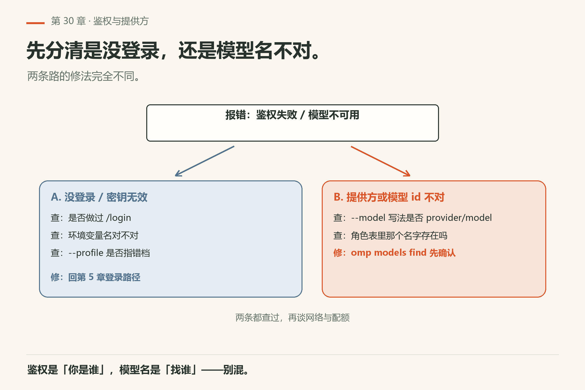
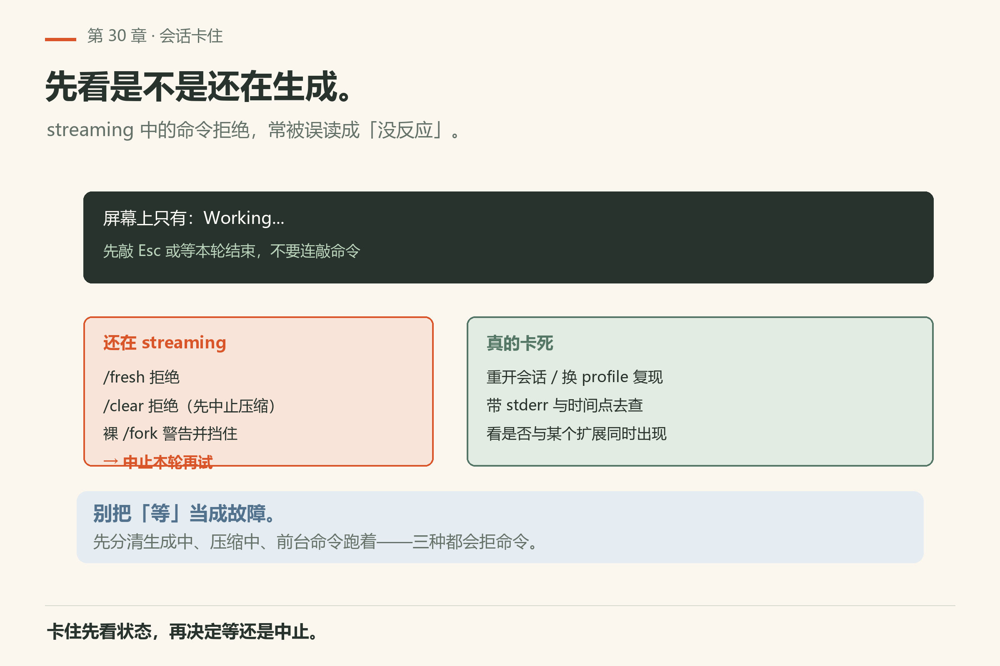
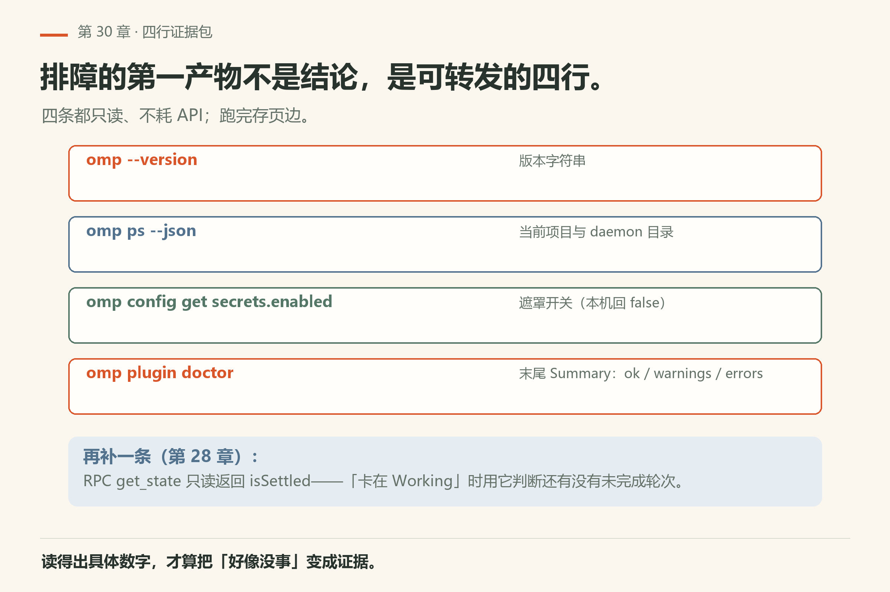
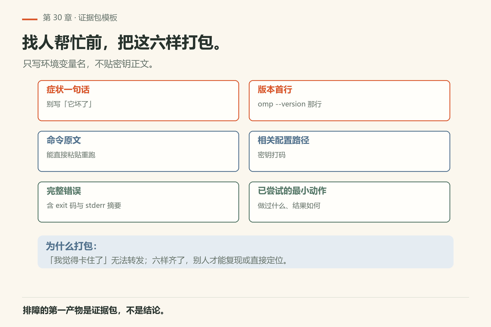

# 第30章 排障症状索引

改到下午四点，agent 突然不说话了。你看着屏幕上的 `Working...`，不知道它是卡在模型、卡在工具，还是卡在某个扩展里。你试着重开一个会话——好了两分钟，又卡住。你开始怀疑是网络，于是反复 `ping` 网关，把业务代码晾在一边。

> **开门一句话：**排障先分类：是没装上、被拦下了，还是模型看不懂。

这一章是**按症状找路**，不是原理课。修到中途发现装不上、鉴权不过、限流、语言服务死了、会话卡死——停业务死磕，先来这里。


*图30-1：按症状找页：安装、鉴权、限流、语言服务、会话卡住。*

## 30.1 怎么用本索引

1. 用一句话描述**可观察症状**（不要一上来猜根因）；
2. 命中下面某一节；
3. 按「先收集 → 再最小动作」做；
4. 仍不明，带着证据去官方文档或 issue，而不是连砸同一命令。

## 30.2 安装与启动失败

症状：命令找不到、装完立刻报错、版本对不上。

收集：`which omp`、`omp --help` 首屏、安装通道（包管理器/脚本）原文、操作系统与架构。

最小动作：核对 PATH；核对帮助是否与本书附录一致（不一致以二进制为准，附录 E）；避免混装多个来源。不要在未确认二进制前改配置文件「碰运气」。

## 30.3 鉴权与模型提供方



*图30-2：先分清「没登录」还是「模型 id 不对」。*

症状：提示未登录、密钥无效、模型列表空、选定模型不可用。

收集：是否做过登录类流程；环境变量名（不要打印密钥值）；`--model` / 角色是否写对；`--profile` 是否指到意外配置档。

最小动作：回到第5章登录路径；核对提供方文档；用帮助确认模型旗标。模糊匹配与「带提供方时必须精确 id」的规则见 `docs/cli-reference.md` 模型节与 `docs/models.md`。

## 30.4 限流与配额（含 429）

症状：频繁 429、突然变慢、部分角色可用部分不可用。

收集：哪一个提供方、哪一个模型、是否刚开并行子代理、是否在循环重试。

最小动作：降并行；换角色模型（快/慢/计划，见角色章与成本章）；避免 tight loop 重试同一失败；检查服务档与缓存键相关旗标是否被误用。成本与缓存见第32章。

## 30.5 语言服务（LSP）异常

症状：诊断不出现、乱报错、卡在索引。

收集：语言、项目根、LSP 配置是否启用（`docs/lsp-config.md`）、最近是否改了生成物目录。

最小动作：确认语言服务进程是否在；缩小到单文件；把无关警告另开票（第25章纪律）。不要为了清警告改半个仓库。

## 30.6 会话卡住



*图30-3：先停，再分是工具挂了还是模型挂了。*

症状：界面无响应、工具卡片一直转、子代理不归还。

收集：最后一张工具卡片内容；是否在审批等待；是否有 `--restore` 适用的崩溃恢复场景（见会话操作文档）。

最小动作：中止当前循环（快捷键以主题为准）；需要时用文档中的恢复旗标；怀疑扩展时用 `--no-extensions` 复现（第31章）。不要同时开三个新会话「试试看」。

## 30.7 上下文与发现怪异

症状：它「知道」了不该知道的约定，或反过来完全不认 AGENTS。

收集：cwd、`--cwd`、`--add-dir`、是否在家目录触发保护、`.omp` 与外来约定目录位置。

最小动作：对照 `docs/context-files.md` 的发现与遮蔽规则；换到正确目录再开会话。

## 30.8 最小可跟做实验：把症状变成证据

排障的第一产物不是结论，是证据包。用下面四条命令把「我觉得卡住了」变成可转发的四行：

```sh
omp --version
omp ps --json
omp config get secrets.enabled
omp plugin doctor
```

本机 18.16.0 已验（证据 `version.txt` / `ps-json.txt` / `config-get-secrets-enabled.txt` / `plugin-doctor.txt`）：`--version` 打一行 `omp/18.16.0`；`ps --json` 打印当前项目与 daemon 目录（无后台进程时 `daemons` 为空数组）；`config get secrets.enabled` 回 `false`；`plugin doctor` 末尾给 `Summary: … ok, … warnings, … errors`。

**算成功**：四行输出里，版本号、daemon 数、插件错误数都读得出具体数字，而不是一句「好像没事」。

想确认「模型侧」的状态，用只读的 RPC 命令（第28章）：

```sh
printf '%s\n' '{"id":"probe-1","type":"get_state"}' \
  | omp --mode rpc --no-session --no-extensions 2>&1 \
  | grep -m1 '"type":"response"'
```

本机 18.16.0 已验：`success` 为 `true`，`data` 里能读到 `isStreaming`、`isSettled`、`contextUsage`、`messageCount`。**算成功**：`isSettled` 与「界面卡在 Working」能对上号——`isSettled: false` 说明还有未完成的轮次。



*图30-4：四条只读命令把「好像卡住」变成可转发的证据。*

## 30.9 翻车对照：排障时最常走的死路

排障的死路都是「跳过观察直接猜」；这张表帮你绕开。

| 翻车做法 | 会看到什么 | 正确做法 |
|---|---|---|
| 连砸同一条命令，指望它这次通 | 同样的错反复出现；时间全烧在重试上 | 先收集一次证据（30.8 四条），再决定动作 |
| 一上来猜「是网络问题」 | 改代理、重启路由器，问题原样 | 先分清层：安装 / 鉴权 / 模型 / 工具 / 扩展（本索引的节序就是分层） |
| 开三个新会话同时试 | 上下文互相污染，更分不清哪个变量起作用 | 一次只改一个变量；用 `--profile` 开干净配置档对照（第23章） |
| 会话卡住时直接杀进程 | 下次 `--resume` 拿到半截状态，或子代理悬空 | 先用 `--restore`（文档：接手中断的轮次与它当时在跑的子代理）；再不行才杀 |
| 怀疑扩展却不隔离 | 「好像好了」又复发，因为扩展还在加载 | `omp --no-extensions` 复现；好了就是扩展层，去 31.2 查 |
| 排障时把密钥贴进 issue 正文 | 凭据泄露 | 只写环境变量**名**；`omp usage --redact` 可给打码截图（`help-usage.txt`） |

## 30.10 证据包模板

把这些打包再找人帮忙：症状一句话；命令原文；完整错误；omp 帮助首行版本信息；相关配置路径（打码密钥）；已尝试的最小动作列表。



*图30-5：六样打包——症状一句话、命令原文、完整错误、版本首行、配置路径、已试动作。*

## 30.11 跟做：给自己的故障簿

每解决一次真实故障，在团队仓库加一条：症状 / 证据 / 根因 / 永久修复 / 相关文档锚点。索引章会越用越短——因为重复症状被故障簿拦截了。

## 30.12 与御舆同构点

参见御舆第 13 章《流式架构与性能优化》与第 7 章《上下文管理》。两边做的是同一张表：**症状 → 子系统的路由**。omp 这边把「装不上 / 鉴权 / 限流 / LSP / 卡住」分开成节，每节先收集再动作；御舆那两章讲的是同一类路由在流式与上下文上的版本。跨书只搬「先描述可观察症状，再进对应子系统」这条纪律，别搬对方的诊断命令：两边命令名不同。

## 30.13 可勾选

排障过关的标志是流程可重复，不是这次蒙对了。

- [ ] 症状可观察且无过早猜因
- [ ] 命中节的收集项齐了
- [ ] 只做了最小动作
- [ ] 证据包可转发
- [ ] 永久修复有记录

---
**版本核对清单**：CLI 见 `docs/cli-reference.md`；上下文见 `docs/context-files.md`；LSP 见 `docs/lsp-config.md`；会话恢复见会话操作文档。写作钉 omp v18.15.0；用户本机验证 v18.16.0（见 VERIFY.md）。

- [ ] `omp --version` 与本机二进制一致（本机 18.16.0）
- [ ] `omp ps --json` 的 `daemons` 字段含义与文档一致（本机无进程时为空数组）
- [ ] `omp usage --redact` 仍能打码（`help-usage.txt` 有该旗标）
