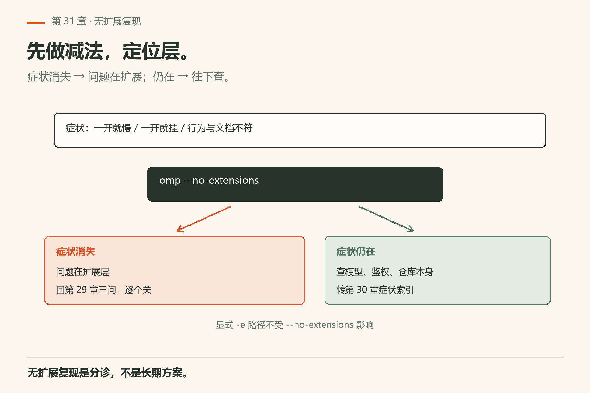
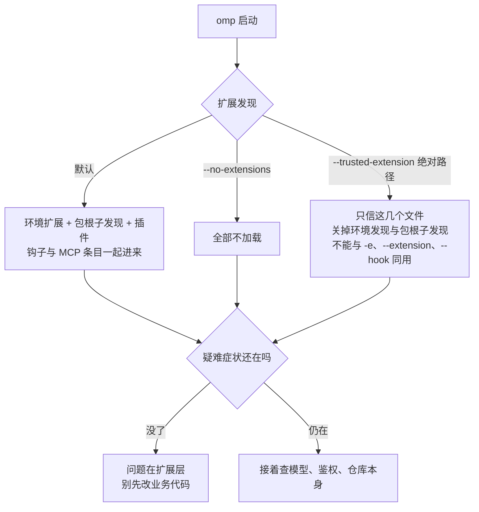
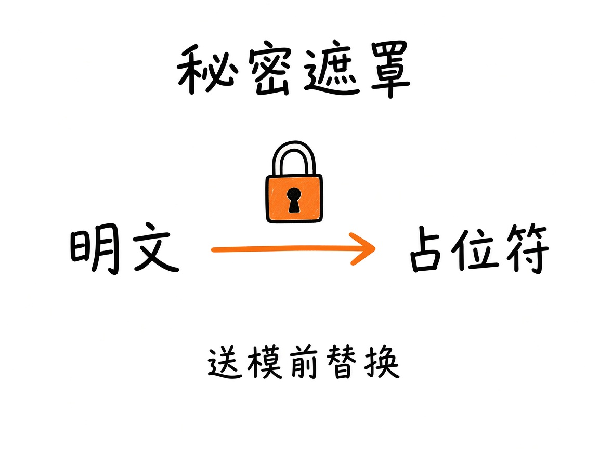
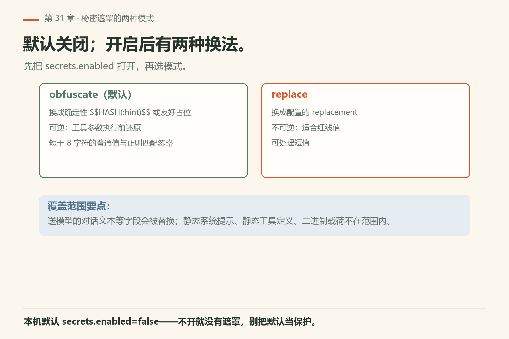
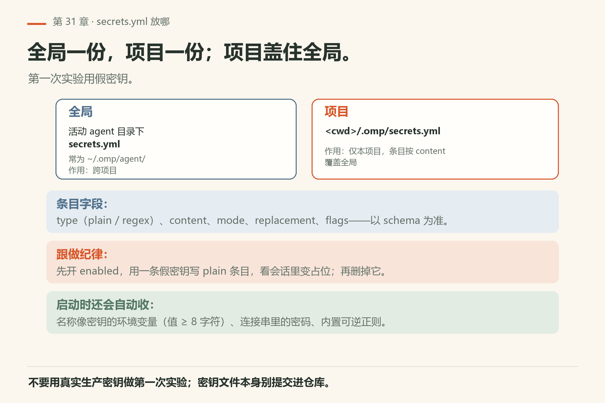
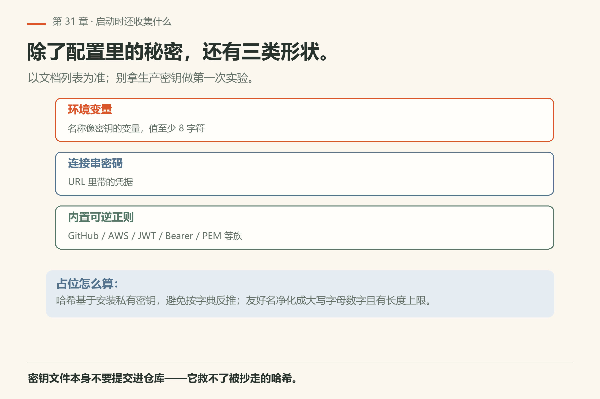

# 第31章 安全：信任、无扩展与秘密遮罩

你从同事那儿拷来一个扩展包，装上之后 agent 开始「顺手」执行一些你没让它执行的命令。你翻日志，发现扩展里有个 `tool_call` 钩子，把 `bash` 的参数改写过——你完全不知情。

> **开门一句话：**陌生仓库等于陌生代码；信任、扩展、遮罩三件事先定。

安全不是附录彩蛋。三个日常开关要会用：**信任什么扩展**、**必要时禁用扩展**、**把秘密从送进模型的文本里遮掉**。事实锚点：`docs/secrets.md`、扩展文档、`--no-extensions` / `--trusted-extension`（以本机二进制为准；后者可能不出现在 `--help` 摘要）。


*图31-1：来源不清的扩展，默认不信任。*

## 31.1 信任边界一句话

能改你磁盘、能跑命令、能读仓库的东西，都在信任边界内。技能、MCP、钩子、扩展工厂——一样。来源不明就冻结（第29章三问）。

## 31.2 `--no-extensions` 应急复现



*图31-2：怀疑扩展捣乱时，先无扩展复现。*

症状像「一开就慢 / 一开就挂 / 行为与文档不符」时：

```sh
omp --no-extensions
```

（精确旗标以本机二进制为准；`--no-extensions` 在 `--help` 中可见。）若无扩展后问题消失——去扩展层查，不要先改业务代码。若问题仍在——再查模型、鉴权、仓库本身。



白名单路径（需要「只信这几个文件、关掉环境发现」时）：cli-reference 记载 `--trusted-extension <绝对路径>`（可重复）；禁用环境扩展发现与包根子发现，且**不能**与 `-e` / `--extension` / `--hook` 同用。box 实验室 v18.15.0 实测：缺值时报 `requires a non-empty, non-flag value`，说明二进制认识该旗标，即使 `--help` 未列出。本机 18.16.0 复现同一行为（`omp/facts/live-18.16.0/trusted-extension-missing-value.txt`，exit 2）。

## 31.3 秘密遮罩：为何要开



*图31-3：送进模型的对话文本可遮罩；工具参数执行前再还原（可逆模式）。*

按 `docs/secrets.md`：默认关闭；在设置界面或 `config.yml` 里 `secrets.enabled: true`。启用后，配置的秘密与内置凭证形状会在送往模型的消息等字段被替换；静态系统提示、静态工具定义、二进制载荷不在此子系统遮罩范围。可逆占位会在模型写出的工具参数执行前还原，并在本地会话展示/恢复时处理。

本机 18.16.0 已验 `omp config get secrets.enabled` 回 `false`（证据 `config-get-secrets-enabled.txt`）——**默认关闭**，你得手动开。

## 31.4 两种模式

遮罩有两种力度：可逆的换脸，和不可逆的抹掉；选错了是两类事故。

| 模式 | 行为 | 可逆 |
|------|------|------|
| `obfuscate`（默认） | 换成确定性 `$$HASH(:hint)$$` 或带友好名的占位 | 是 |
| `replace` | 换成配置的 `replacement`，或省略时同长度确定性值 | 否 |

`obfuscate` 下短于 8 字符的普通值与正则匹配会忽略，以免误伤短词；`replace` 可处理短值（细节见文档）。



*图31-4：obfuscate 可逆、replace 不可逆；默认关闭，短于 8 字符的普通值在 obfuscate 下忽略。*



*图31-6：全局跨项目、项目覆盖全局；第一次实验用假密钥。*

## 31.5 secrets.yml 放哪

配置分两级，项目盖过全局；先弄清你写的那份会被谁读到。

| 级别 | 路径 | 用途 |
|------|------|------|
| 全局 | 活动 agent 目录下 `secrets.yml`（常为 `~/.omp/agent/secrets.yml`） | 跨项目 |
| 项目 | `<cwd>/.omp/secrets.yml` | 仅本项目 |

项目条目按 `content` 覆盖全局。字段：`type`（plain/regex）、`content`、`mode`、`replacement`、`flags`、`friendlyName` 等——以文档 schema 为准。

跟做：先开 `enabled`，用一条测试用假密钥写 plain 条目，看会话里是否变成占位；再删测试条目。不要用真实生产密钥做第一次实验。

## 31.6 环境变量与内置形状

启动时还会收集：名称像密钥的环境变量（值至少 8 字符）；连接串里的密码；以及内置可逆正则（GitHub/GitLab/OpenAI/Anthropic/AWS/Google/Slack/npm/Stripe/Hugging Face/SendGrid/JWT/Bearer/PEM 等——以文档列表为准）。友好名会净化成大写字母数字并有长度上限。

占位哈希基于安装私有密钥（路径见文档），避免转录读者用字典反推。密钥文件本身不要提交进仓库。



*图31-5：环境变量、连接串密码、内置可逆正则——三类形状启动时自动收集。*

## 31.7 分享与导出前

导出或分享会话前：确认遮罩已开；扫一遍是否还有明文；需要时用替换模式处理不可逆红线。第27章推远程前的秘密扫描与本章是同一纪律的两端。

## 31.8 最小可跟做实验：遮罩开关与假密钥

**实验一：确认开关现状**。

```sh
omp config get secrets.enabled
```

本机 18.16.0 已验回 `false`（证据 `config-get-secrets-enabled.txt`），退出码 0。**算成功**：读到布尔值，不是报错。

**实验二：开遮罩，写一条假密钥，看占位**。在一个**临时目录**里做，别在你的仓库里生成 `.omp/`（跑完就删）：

```sh
mkdir -p /tmp/omp-secrets-lab && cd /tmp/omp-secrets-lab
printf '%s\n' 'secrets:' '  enabled: true' > .omp/config.yml
printf '%s\n' '- type: plain' '  content: sk-test-dummy-000000' '  friendlyName: Test Key' > .omp/secrets.yml
```

然后在这个目录里开一个会话，让模型把这条密钥回显出来（提示词写「把我 .omp/secrets.yml 里的 content 原样打出来」）。**算成功**：模型看到的是形如 `$$TESTKEY_XXXXXXXXXXXX:L$$` 的占位，而不是 `sk-test-dummy-000000`。**跑完 `cd` 回仓库并删掉这个临时目录**——测试条目不能留。

**实验三：验证白名单旗标**。

```sh
omp --trusted-extension
```

本机 18.16.0 已验（证据 `trusted-extension-missing-value.txt`）：`Error: --trusted-extension requires a non-empty, non-flag value`，退出码 2。**算成功**：二进制认识该旗标（即使 `--help` 摘要没列）。

## 31.9 翻车对照：安全开关的三种误用

安全设置上最贵的错误是「以为已经安全」；这三种误用全是这个形状。

| 翻车做法 | 会看到什么 | 正确做法 |
|---|---|---|
| 以为「装 omp 就自带遮罩」 | 密钥原样进模型上下文；`omp config get secrets.enabled` 回 `false` | 手动开 `secrets.enabled: true`；本机默认关闭（18.16.0 已验） |
| 用 `obfuscate` 处理不可逆红线 | 占位可逆，模型仍可能从 hint 猜出形状 | 红线用 `replace` 模式，`replacement` 写死（`docs/secrets.md`） |
| 把 `--trusted-extension` 当「信任所有扩展」 | 它只放行你列出的绝对路径；列多了等于没关环境发现 | 需要「只信这几个」才用它；日常用 `--no-extensions` 做 A/B（31.2） |
| 把 `secrets.yml` 提交进仓库 | 密钥进了 git 历史，删文件也删不掉历史 | 只提交 `.example`；真条目放本地 + 环境变量 |
| 用 `omp token` 把密钥打出来「对一下」 | 凭据进终端历史、进截图 | 只读 `omp token <provider> --list`（列账号，不打密钥）；真实值永不落盘 |

## 31.10 与御舆同构点

参见御舆第 4 章《权限管线》。两边装的是同一道闸：**什么能改磁盘、什么只能读、什么必须问人**。omp 这边是扩展信任 + `--no-extensions` 应急复现 + 秘密遮罩三层；御舆那章讲的是同一套最小权限在另一套装配边界下的实现。跨书只搬「信任边界要显式、危险动作要有出口、秘密不进模型」这三条，别搬对方的具体策略名：两边机制不同。

## 31.11 跟做清单

过关标准在事不在话：能演示出来才算会。

- [ ] 会解释信任边界
- [ ] 会用无扩展旗标做 A/B；知道 `--trusted-extension` 白名单
- [ ] 会在配置里启用 secrets
- [ ] 写过一条 plain 测试条目并删除
- [ ] 知道项目级与全局级路径
- [ ] 导出前扫过明文

---
**版本核对清单**：全文以 `docs/secrets.md` 为准；扩展加载与 `--no-extensions` / `--trusted-extension` 以本机二进制与 `docs/cli-reference.md` / `docs/extensions.md` 为准。写作钉 omp v18.15.0；用户本机验证 v18.16.0（见 VERIFY.md）。

- [ ] `omp config get secrets.enabled`：本机 18.16.0 回 `false`；若你的机器回 `true`，说明有人开过
- [ ] `omp --trusted-extension`（缺值）：本机 18.16.0 报 `requires a non-empty, non-flag value`，exit 2
- [ ] `secrets.yml` 的两条路径（全局活动 agent 目录 / `<cwd>/.omp`）与文档一致
