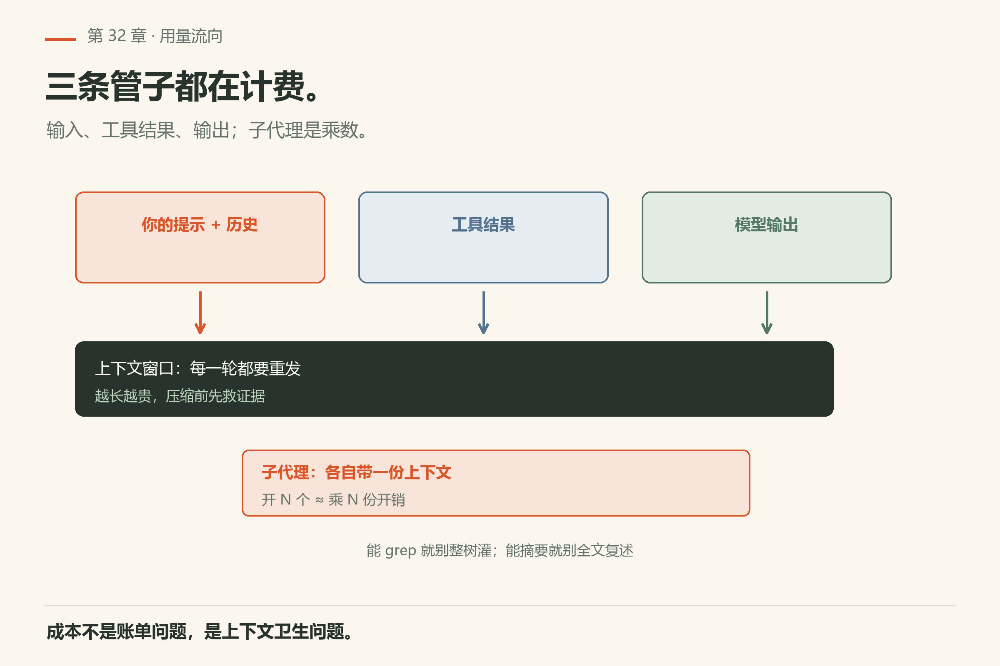
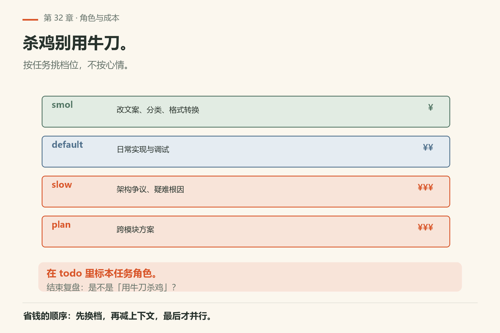
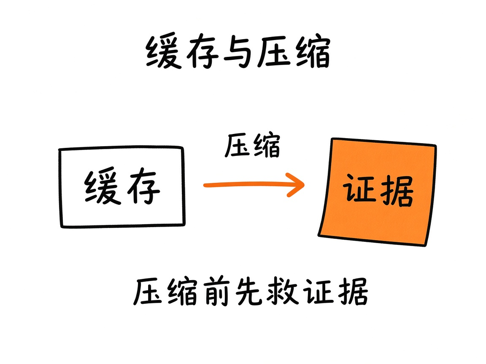
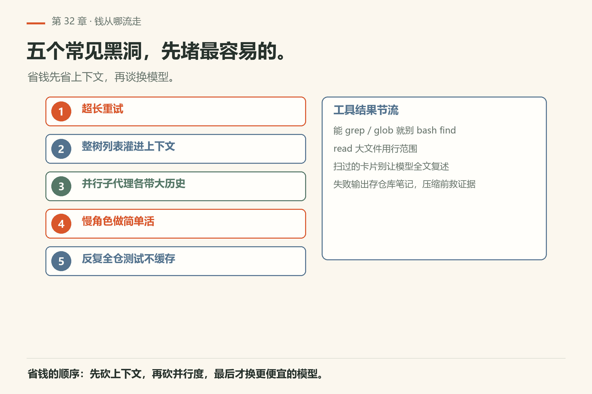
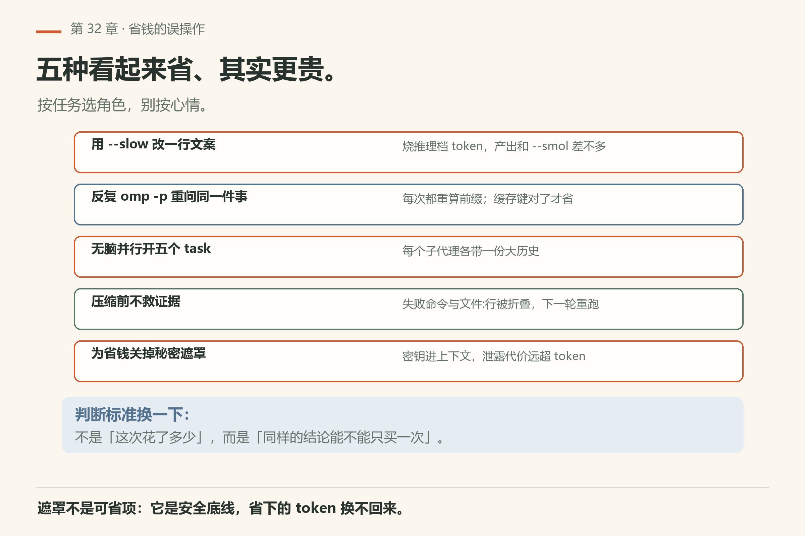
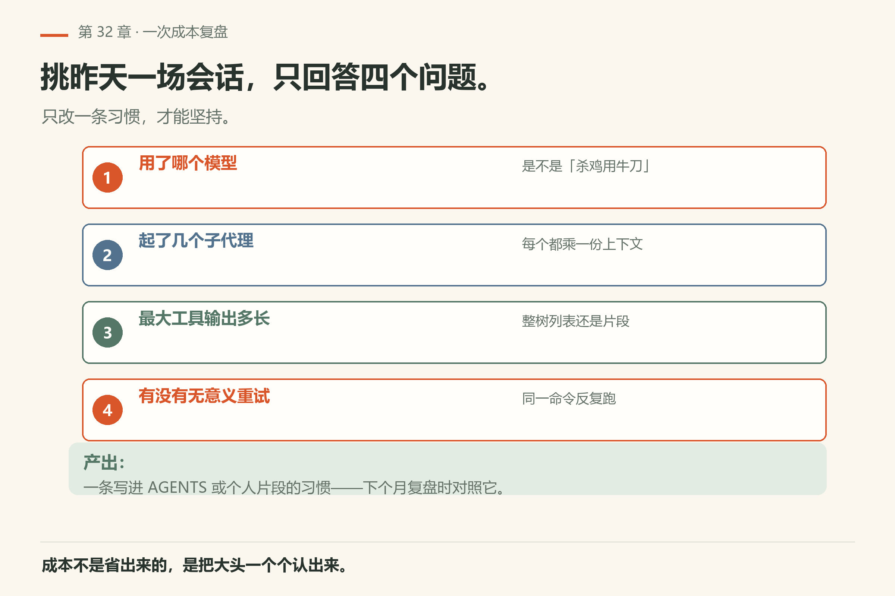

# 第32章 成本、角色与上下文节流

你给 agent 配了个很贵的模型，让它「把整个仓库的测试都跑一遍，然后把失败分类」。它跑了四十分钟，烧掉了你两天配额，最后给你的分类和昨天那次五分钟的结论几乎一样。

> **开门一句话：**成本能算：token 数、角色档、上下文节流三处一起管。

Token 不是无限的。输入、工具结果、输出都可能计价；子代理是乘数；乱压缩会丢掉你刚钉死的证据。本章把成本意识写成可跟做习惯。



*图32-1：用量流向——输入、工具、输出都可能计价。*

## 32.1 钱从哪流走

常见大头：超长重试；把整树列表灌进上下文；并行子代理各带一份大历史；选错「慢」角色做简单活；反复全仓测试却不缓存结果摘要。

## 32.2 角色模型



*图32-2：快/慢/计划——按任务选，不按心情选。*

CLI 支持为轻量任务、深度分析、架构计划配置不同模型（`--smol` / `--slow` / `--plan` 及环境变量，见 `docs/cli-reference.md`）。日常改文案别开最贵推理档；架构争议再上计划角色。

跟做：在 todo 标明本任务角色；结束后看是否「杀鸡用牛刀」。

## 32.3 缓存与压缩



*图32-3：能缓存的提示别重算；压缩前先救证据。*

提供方提示缓存键、服务档等旗标见 CLI 参考——用之前读帮助，误用可能让缓存失效或行为怪异。会话压缩（第15章）会折叠历史：失败命令、文件:行、测试输出要提前进 todo 或仓库笔记。

## 32.4 子代理乘数

每起一个 `task`，大致乘一份上下文与工具开销。开 `orchestrate` 前写最坏 N。测试要独占资源时，并行是假省。

## 32.5 工具结果节流

能 `grep`/`glob` 就别 `bash find` 刷爆；`read` 大文件用行范围；工具卡片扫过就好的内容不要再让模型「全文复述一遍」。



*图32-4：五个常见成本黑洞与工具结果节流；先砍上下文，再砍并行度。*

## 32.6 最小可跟做实验：给一页文本称 token

成本复盘之前，先有个称量工具。`omp toks` 用所有内置离线分词器数一个文件或一段文字：

```sh
omp toks omp/ch32.md
omp toks "The quick brown fox jumps over the lazy dog"
```

本机 18.16.0 已验（证据 `toks-ch32.txt` / `toks-hello.txt`）：第一行给出 `size`（字节/字符/行数），随后一张表列出每个分词器的 token 数与 `vs o200k` 的偏差。本机数 `ch32.md` 得 `o200k_base` 约 1.8k tokens、`claude-v5` 约 2.5k tokens——**同一份文本，不同分词器差三成**。

**算成功**：看到 token 数随分词器变化；知道「上下文快满了」不是模糊感觉，而是能对着数字说话。

想给一次会话装个闸：

```sh
omp -p "只回复两个字：在线" --no-session --warn-cost 0.50
```

`--warn-cost` 的语义见 `docs/cli-reference.md`（达到 USD 阈值时警告一次，含子代理）。**算成功**：命令能解析该旗标（本机 18.16.0 的 `--help` 有 `--warn-cost=<value>`）。



*图32-6：五种看起来省、其实更贵的做法，判断标准换成「同样的结论只买一次」。*

## 32.7 翻车对照：省钱的常见误操作

省钱省出问题，多半是把「少花钱」当成了「省钱」；对表自查。

| 翻车做法 | 会看到什么 | 正确做法 |
|---|---|---|
| 用 `--slow` 改一行文案 | 烧掉推理档的 token，产出和 `--smol` 差不多 | 按任务选角色：轻量活走 `--smol`，架构争议再 `--plan`（`docs/cli-reference.md`） |
| 反复 `omp -p` 重问同一个问题 | 每次都重算前缀，缓存键对了才省 | 先确认 `--prompt-cache-key` / 服务档没被误改（CLI 参考） |
| 无脑并行开五个 `task` | 每个子代理各带一份大历史，成本乘五 | 开 `orchestrate` 前写最坏 N；独占资源的测试别并行 |
| 压缩前不救证据 | 失败命令、文件:行、测试输出被折叠掉，下一轮又得重跑 | 压缩前把关键行写进 todo 或仓库笔记（第15章） |
| 为省钱关掉秘密遮罩 | 密钥进模型上下文，泄露代价远超省下的 token | 遮罩是安全底线，不是可省项（第31章） |

## 32.8 一次成本复盘（跟做）

挑昨天的一场会话，列：用了哪个模型；起了几个子代理；最大的一次工具输出大概多长；有没有无意义重试。改一条习惯写进 AGENTS 或个人片段——只改一条，才能坚持。



*图32-5：模型、子代理数、最大工具输出、无意义重试——只改一条习惯。*

## 32.9 与安全、排障的交界

为省钱关掉遮罩——不允许。为省钱跳过测试——不允许。省的是重复与浪费，不是安全与证据。

## 32.10 与御舆同构点

参见御舆第 7 章《上下文管理》与第 13 章《流式架构与性能优化》。两边记的是同一笔预算：**上下文与吞吐是同一个成本面**。omp 这边是角色档位 + 压缩 + 工具结果节流；御舆那两章讲的是同一组约束在流式与上下文上的版本。跨书只搬「先量再省、压缩前救证据、安全不让位」这三条，别搬对方的预算数字：两边模型与计价不同。

## 32.11 可勾选

成本意识落成四个勾：角色、缓存、并行、复盘。

- [ ] 本任务角色选得合理
- [ ] 并行 N 有上限
- [ ] 大输出有节流
- [ ] 压缩前证据已落盘
- [ ] 做过一次复盘

---
**版本核对清单**：旗标与角色见 `docs/cli-reference.md`、`docs/models.md`；压缩见会话与上下文章节。写作钉 omp v18.15.0；用户本机验证 v18.16.0（见 VERIFY.md）。

- [ ] `omp toks <file>` 的输出形状与本机一致（本机 18.16.0 已验）
- [ ] `--warn-cost` / `--max-cost` 的语义以 `docs/cli-reference.md` 为准（本机 `--help` 有该旗标）
- [ ] `--smol` / `--slow` / `--plan` 的环境变量名（`PI_SMOL_MODEL` 等）与文档一致
