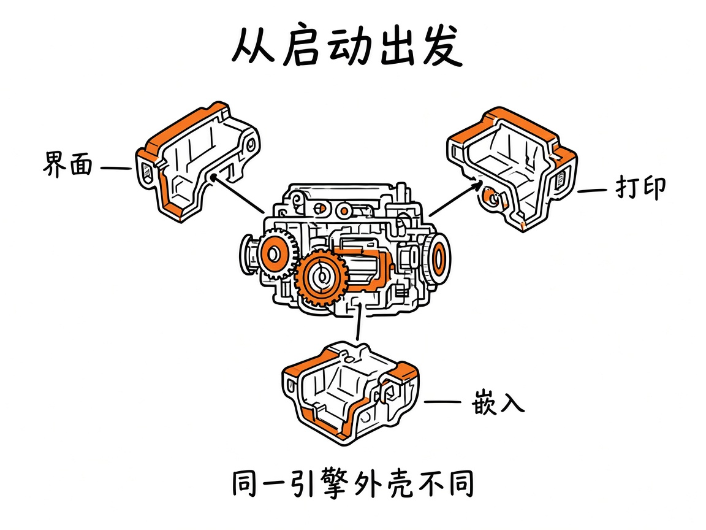
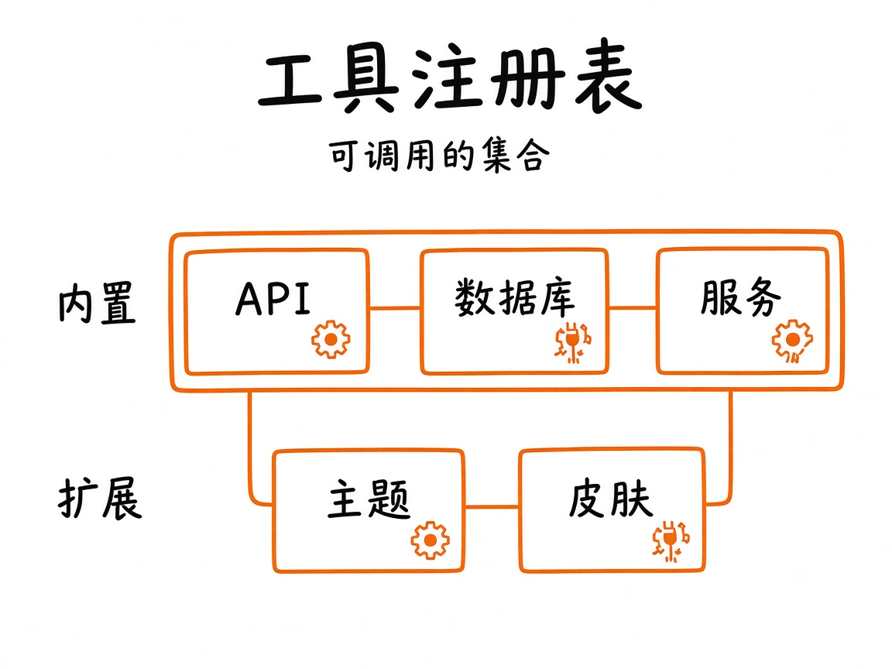

# 第33章 总复习：从启动到工具注册

合上书之前，你做最后一遍自检：能不能不看笔记，把 omp 从「敲下命令」到「模型调到一个工具」的整条链画出来？如果中间断了一格，说明那一格还没变成肌肉记忆。

把全书串成一条可跟做的调用链：你怎么启动 → 会话与上下文如何就位 → 模型与工具如何转起来 → 扩展如何挂上 → 出了事去哪查。不写新功能，只接线路。


*图33-1：启动 → 发现 → 循环 → 工具 → 扩展。*

## 33.1 启动

交互：`omp` 或带初始提示。非交互：`-p` 打印模式。工作目录、`--cwd`、`--add-dir`、`--profile`、`--allow-home` 决定「你站在哪」。细节附录 A 与 `docs/cli-reference.md`。



*图33-2：同一引擎，外壳不同。*

## 33.2 发现与上下文

AGENTS、RULES、外来约定、项目 `.omp`——按 `docs/context-files.md` 进入系统侧。你的纪律是核对，不是盲信（第24章）。

## 33.3 循环与工具

第1章循环 + 第6章卡片：读、搜、改、跑、问、待办、任务、调试……第三篇是肌肉记忆。注册表心智：模型只能调用已注册且策略允许的工具。



*图33-3：扩展与自定义工具最后也要进可调用集合。*

## 33.4 扩展与团队包

第五篇机制 + 第29章托付。出事用第31章无扩展复现。

## 33.5 出了事

第30章症状索引 → 第25章修复剧本 → 第27章评审提交。成本用第32章管。

## 33.6 嵌入与协议

第28章：SDK 同进程；RPC 跨进程。生命周期归宿主。

## 33.7 最小可跟做实验：六十分钟串链

把整条链走一遍，每步留产物：

**第 1 步（5 分钟）：确认二进制**。

```sh
omp --version
```

本机 18.16.0 已验（证据 `version.txt`）：打一行 `omp/18.16.0`，退出码 0。**算成功**：版本号读得出。

**第 2 步（15 分钟）：新配置档启动**。用 `--profile` 开一个干净配置档，确认它不读你日常配置：

```sh
omp --profile review --no-session -p "只回复两个字：在线"
```

**算成功**：回「在线」。若报「无默认模型」，说明这个配置档没接模型——正是隔离的意义。

**第 3 步（20 分钟）：小仓走完第6章一圈**。一个函数 + 一个测试，盯卡片，验收 `git diff`。

**第 4 步（10 分钟）：故意制造失败测试走第25章**。种一个 bug，让它修，看它是否先复现再改。

**第 5 步（5 分钟）：开遮罩做一次假密钥实验**（第31章实验二），跑完删测试条目。

**第 6 步（5 分钟）：写半页架构笔记**（第24章模板），导出会话：

```sh
omp --export ~/.omp/agent/sessions/<project>/<file>.jsonl
```

**算成功**：导出命令退出码 0，得到 HTML 文件。

六步都有产物，才算总复习及格。**本机 18.16.0 已验第 1 步与第 2 步的命令形状**（`version.txt`）；第 3–6 步的产物路径以你自己的仓库为准。

## 33.8 翻车对照：总复习时最常自欺的三处

| 翻车做法 | 会看到什么 | 正确做法 |
|---|---|---|
| 「我懂了」但说不出启动到工具的链 | 被问「模型怎么找到 `bash`」时卡住 | 用 33.7 的六步把每格走一遍；卡住的格子回对应章 |
| 用日常配置档做实验 | 扩展、技能、记忆全在，实验不干净 | `--profile` 开干净档；要复现扩展问题再 `--no-extensions`（31.2） |
| 只跑第 1、2 步就说「串完了」 | 发现层、工具层、扩展层都没碰 | 六步缺一不可；每步产物写进笔记才算数 |

## 33.9 与御舆同构点

参见御舆第 15 章《构建你自己的 Agent Harness》。两边收的是同一个尾：**把整条装配链讲完**——启动、发现、循环、工具、扩展，一层不少。omp 这边按自己的入口与旗标走；御舆那章按自己的装配边界走。跨书只搬「从启动到工具注册的这条链必须能复述」这个要求，别搬对方的装配顺序：两边层次不同。

## 33.10 可勾选路线图

- [ ] 能画出启动到工具的链
- [ ] 能说出发现层核对纪律
- [ ] 能用症状索引分流
- [ ] 能解释无扩展与遮罩
- [ ] 能选角色与节流
- [ ] 六十分钟实验有笔记

---
**版本核对清单**：全书写作钉 omp v18.15.0；用户本机验证 v18.16.0；冲突时以二进制帮助与 `omp-src/docs` 为准（附录 E）。

- [ ] `omp --version` 与本机一致（本机 18.16.0）
- [ ] `--profile` / `--export` 旗标仍存在（本机 `--help` 的 FLAGS 表）
- [ ] 六步实验的产物路径你都写得出来
