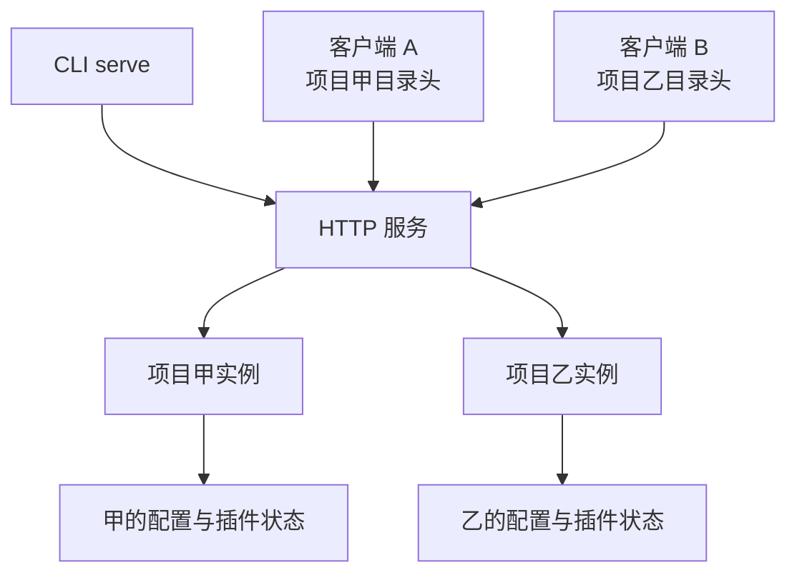

# 第 2 章：从终端到服务端

<!-- block: opencode-ch02.b-opening -->
屏幕上看到的一行工具输出，可能经过客户端、HTTP 服务、会话处理器、工具执行器和事件转换。分清这些层，能解释为什么界面断开后任务状态仍然存在，也能避免把客户端问题误判为模型问题。

## 2.1 serve 启动时并没有选定唯一项目

钉版 `ServeCommand` 将命令标记为 `instance: false`。它先解析网络选项，启动服务，然后保持运行；项目实例在请求到来时才按目录选择。代码注释明确指出使用 `x-opencode-directory`，而不是依赖服务启动时的环境项目。

因此，同一台服务收到两个不同目录的请求，可以进入不同项目实例。端口是服务身份，目录是实例选择的一部分，会话 ID 又是另一个层级。调试时只记录端口和会话标题，常常少了真正影响配置的目录。

图 2-1：服务器与项目实例的关系。图中没有承诺两个实例之间的所有底层资源都互不共享。

## 2.2 项目启动顺序为什么会影响插件

`InstanceBootstrap` 先读取配置，再初始化插件，随后初始化 LSP、格式化、版本控制、快照和项目信息等服务。源码给出的理由是插件能够修改配置，因此插件初始化需要先发生。

这个顺序解释了一类看似矛盾的现象：插件已经完成初始化，某个语言服务却还没准备好。初始化成功并不等于整个项目所有后台工作结束。需要语言诊断的功能，应观察相应服务状态，不能拿插件的 init 日志作为替代。

本书在隔离实验中关闭了语言服务下载和文件监听，减少无关变量。它证明了所测服务链，不证明完整桌面环境已经启动，也不对 TUI 的渲染或输入行为作结论。

## 2.3 请求结果和事件流回答不同问题

一次同步消息请求适合问“这次调用最后返回什么”。事件流则适合观察运行中的文本片段、工具状态或权限请求。它们不是两份完全相同的信息：事件可能需要按 ID 合并，最终查询则通常用来恢复当前状态。

本书驱动使用 `POST /session` 创建会话，随后向 `/session/{id}/message` 提交消息。它还查询 `/permission`，在需要时向对应审批请求回复。这些调用经过真实服务端，替身只负责模型协议。

如果要写自己的客户端，先保存服务返回的会话 ID，再把消息与工具事件关联到该 ID。不要用会话标题做主键：标题可变，也不保证唯一。发生重连时，可以重新查询会话和消息，再继续消费事件；是否能从某个位置重放，必须以所用端点的协议为准。

## 2.4 服务暴露范围与认证

实验只绑定 `127.0.0.1`，并为每次运行生成随机 `OPENCODE_SERVER_PASSWORD`。HTTP 客户端使用对应的 Basic 认证信息。密码不会写进公开摘要，服务日志也不需要包含它。

这里有两层独立问题：谁能调用服务，和服务里的工具允许做什么。认证解决前者，工具权限影响后者。把监听地址改为可从其他机器访问时，两层都要重新检查；不能因为配置了 read-only 工具就省略服务认证。

本书不提供把个人开发服务器直接暴露到公网的快捷配置。远程使用时应按自己的网络和身份系统部署，并验证目录选择不能让不相关的调用者进入另一个项目。源码阅读能够找到入口，但这种部署边界需要实际环境验证。

## 2.5 三种“停止”别混在一起

断开客户端，只说明连接结束；请求取消，意图停止某一次操作；实例 dispose 则释放项目实例持有的状态。进程退出又是更外层的生命周期。它们的范围不同，不能凭名字互相替换。

第九章已经观察到实例 dispose 会执行插件清理，但同一进程仍复用已导入模块。这个结果正好说明“某个实例被销毁”不等于“运行时所有状态清空”。第十四章会进一步讨论外部客户端怎样跟踪取消和恢复，而不是只把连接关掉就宣布任务结束。

来源：[serve](https://github.com/anomalyco/opencode/blob/810c0eba1a7348036f8bdf61e6632d0c36c6876c/packages/opencode/src/cli/cmd/serve.ts)、[实例启动](https://github.com/anomalyco/opencode/blob/810c0eba1a7348036f8bdf61e6632d0c36c6876c/packages/opencode/src/project/bootstrap.ts)、[实例清理中间件](https://github.com/anomalyco/opencode/blob/810c0eba1a7348036f8bdf61e6632d0c36c6876c/packages/opencode/src/server/routes/instance/httpapi/lifecycle.ts)。
