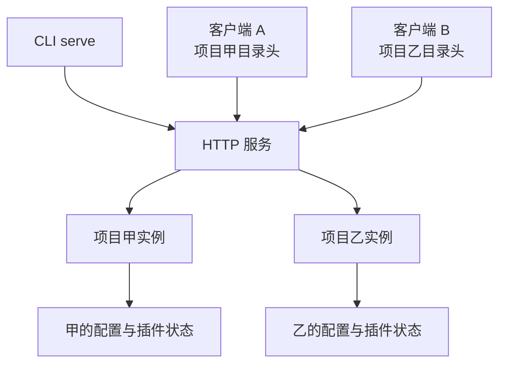
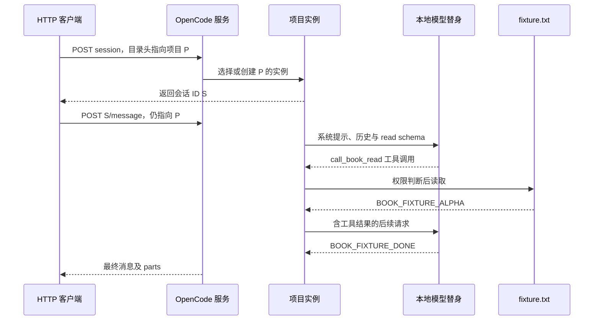

# 第 2 章：从终端到服务端

<!-- block: opencode-ch02.b-opening -->
屏幕上看到的一行工具输出，可能经过客户端、HTTP 服务、会话处理器、工具执行器和事件转换。分清这些层，能解释为什么界面断开后任务状态仍然存在，也能避免把客户端问题误判为模型问题。

## 2.1 serve 启动时并没有选定唯一项目

钉版 `ServeCommand` 将命令标记为 `instance: false`。它先解析网络选项，启动服务，然后保持运行；项目实例在请求到来时才按目录选择。代码注释明确指出使用 `x-opencode-directory`，而不是依赖服务启动时的环境项目。

因此，同一台服务收到两个不同目录的请求，可以进入不同项目实例。端口是服务身份，目录是实例选择的一部分，会话 ID 又是另一个层级。调试时只记录端口和会话标题，常常少了真正影响配置的目录。



图 2-1：服务器与项目实例的关系。图中没有承诺两个实例之间的所有底层资源都互不共享。

## 2.2 项目启动顺序为什么会影响插件

`InstanceBootstrap` 先读取配置，再初始化插件，随后初始化 LSP、格式化、版本控制、快照和项目信息等服务。源码给出的理由是插件能够修改配置，因此插件初始化需要先发生。

这个顺序解释了一类看似矛盾的现象：插件已经完成初始化，某个语言服务却还没准备好。初始化成功并不等于整个项目所有后台工作结束。需要语言诊断的功能，应观察相应服务状态，不能拿插件的 init 日志作为替代。

本书在隔离实验中关闭了语言服务下载和文件监听，减少无关变量。它证明了所测服务链，不证明完整桌面环境已经启动，也不对 TUI 的渲染或输入行为作结论。

## 2.3 请求结果和事件流回答不同问题

一次同步消息请求适合问“这次调用最后返回什么”。事件流则适合观察运行中的文本片段、工具状态或权限请求。它们不是两份完全相同的信息：事件可能需要按 ID 合并，最终查询则通常用来恢复当前状态。

本书驱动使用 `POST /session` 创建会话，随后向 `/session/{id}/message` 提交消息。它还查询 `/permission`，在需要时向对应审批请求回复。这些调用经过真实服务端，替身只负责模型协议。

如果要写自己的客户端，先保存服务返回的会话 ID，再把消息与工具事件关联到该 ID。不要用会话标题做主键：标题可变，也不保证唯一。发生重连时，可以重新查询会话和消息，再继续消费事件；是否能从某个位置重放，必须以所用端点的协议为准。

## 2.4 服务暴露范围与认证

实验只绑定 `127.0.0.1`，并为每次运行生成随机 `OPENCODE_SERVER_PASSWORD`。HTTP 客户端使用对应的 Basic 认证信息。密码不会写进公开摘要，服务日志也不需要包含它。

这里有两层独立问题：谁能调用服务，和服务里的工具允许做什么。认证解决前者，工具权限影响后者。把监听地址改为可从其他机器访问时，两层都要重新检查；不能因为配置了 read-only 工具就省略服务认证。

本书不提供把个人开发服务器直接暴露到公网的快捷配置。远程使用时应按自己的网络和身份系统部署，并验证目录选择不能让不相关的调用者进入另一个项目。源码阅读能够找到入口，但这种部署边界需要实际环境验证。

## 2.5 三种“停止”别混在一起

断开客户端，只说明连接结束；请求取消，意图停止某一次操作；实例 dispose 则释放项目实例持有的状态。进程退出又是更外层的生命周期。它们的范围不同，不能凭名字互相替换。

第九章已经观察到实例 dispose 会执行插件清理，但同一进程仍复用已导入模块。这个结果正好说明“某个实例被销毁”不等于“运行时所有状态清空”。第十四章会进一步讨论外部客户端怎样跟踪取消和恢复，而不是只把连接关掉就宣布任务结束。

## 2.6 两个请求怎样落到同一个会话
随书驱动的 HTTP 客户端有两个固定头：Authorization 和 x-opencode-directory。前者证明调用者可以进入服务，后者选择本次项目实例。创建会话和提交消息时都带同一个目录头，避免在两步之间无意切换实例。

一次最小请求的结构如下。这里用符号表示已建立的连接和认证头，实际可运行代码在 Host.request 中：

```text
POST /session
Authorization: Basic <临时凭据>
x-opencode-directory: <实验项目的绝对路径>
Content-Type: application/json

{}
```

服务返回会话对象，驱动取其中 id，再提交消息：

```json
{
  "model": {"providerID": "fixture", "modelID": "test"},
  "parts": [
    {"type": "text", "text": "Read fixture.txt and report the fixture marker."}
  ]
}
```

第二个请求的路径是 /session/{id}/message。这里的 parts 是客户端向 OpenCode 提交的消息结构，不是直接发给模型提供者的 chat-completions body。宿主还会加入系统指令、工具定义、历史和插件修改，随后才由模型适配器形成下游请求。

因此，客户端录到这份小 JSON，并不能据此断言模型只看到了这一句话。需要解释某个提示词为什么生效时，应继续查看 model-requests.json；需要解释界面为什么显示某个工具状态时，则回到会话消息和事件。

## 2.7 用一条时序把边界放在正确位置


图中的模型替身位于下游协议边界。项目选择、配置加载、插件 Hook 和真实工具执行都在 OpenCode 一侧。这是实验能够支持“宿主路径实际运行”的原因，也说明它为什么不能用来比较真实模型的推理质量。

假设最终 HTTP 请求超时，仍要先查看服务端和项目实例。客户端没有收到最后一个响应，不表示前面 read 未执行；若换成写文件工具，这个区别更关键。可以先查询当前会话消息，核对调用 ID 和工具状态，再决定是否重发任务。

## 2.8 实例重建与模块缓存的关系
第 9 章的真实实验在同一进程中调用 POST /instance/dispose，然后再次进入该项目。插件 init 再执行，模块级计数却从 1 变成 2；期间改过的模块源码没有立即生效。重启进程后，计数回到 1，新提示词才进入请求。

这个结果把三个对象区分开：项目实例持有的状态、已经导入的 JavaScript 模块、外层服务进程。dispose 释放第一类，并调用对应插件清理；同一进程的模块缓存仍可能保留。调试时反复清理实例却期待模块顶层代码像全新进程一样执行，便会误读这一行为。

本次关闭了文件监听，因此不能从结果外推“所有修改永远需要重启”，也不能据此宣称自动热重载已验证。对自己的开发流程，先明确采用哪种重新加载入口，再用一个可观察的版本标记检查实际加载内容。看到 init 日志，只能说明初始化函数再次运行，不能证明模块来自新源码。

## 2.9 根据故障所属层选择证据
客户端报 401，应先检查认证头；创建会话成功但模型请求报错，检查提供者与适配器；工具没有出现在请求里，检查工具集与权限筛选；工具已经运行但界面没有更新，再查事件消费与状态合并。不同层的失败可能都表现为“没有回复”，但它们不需要同一种修复。

服务端日志中的 app.log 是插件通过真实 SDK 写入的，可用于关联回调阶段。日志顺序仍不应替代消息 ID 或调用 ID，因为并发会话的行可能交错。客户端应以稳定标识组织状态，以时间帮助解释先后，而不是仅按最新一行文字覆盖整个会话。

写自己的客户端时，先完成创建、提交、查询和错误显示，再增加逐字动画。连接中断后可以重新取回当前消息状态；事件流能否按断点重放，要看实际端点契约。未经确认就把 SSE 当成持久事件日志，会在重连后重复执行 UI 动作或漏掉状态变化。

## 2.10 把驱动超时与产品限制分开
Host.request 给本次 HTTP 等待设置了 45 秒，启动检查也有自己的截止时间。这些值属于随书驱动，用来避免实验无限等待，不是 OpenCode 对所有任务的默认时限。若真实工程需要运行几分钟，不能据此说服务最多只能工作 45 秒；应该选择适合长任务的提交与观察方式。

超时错误出现时，记录它由谁产生：客户端等待、模型提供者、工具内部还是外层进程管理。然后查询已有会话和产物，再决定取消或重试。把四种超时都包装成“网络慢，请再试一次”，可能让已经执行过的动作重复发生。客户端的错误显示越能保留阶段，用户越容易作出正确下一步。

来源：[serve](https://github.com/anomalyco/opencode/blob/810c0eba1a7348036f8bdf61e6632d0c36c6876c/packages/opencode/src/cli/cmd/serve.ts)、[实例启动](https://github.com/anomalyco/opencode/blob/810c0eba1a7348036f8bdf61e6632d0c36c6876c/packages/opencode/src/project/bootstrap.ts)、[实例清理中间件](https://github.com/anomalyco/opencode/blob/810c0eba1a7348036f8bdf61e6632d0c36c6876c/packages/opencode/src/server/routes/instance/httpapi/lifecycle.ts)。
