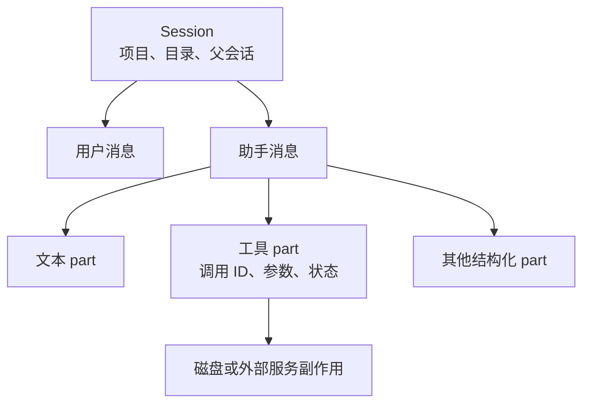
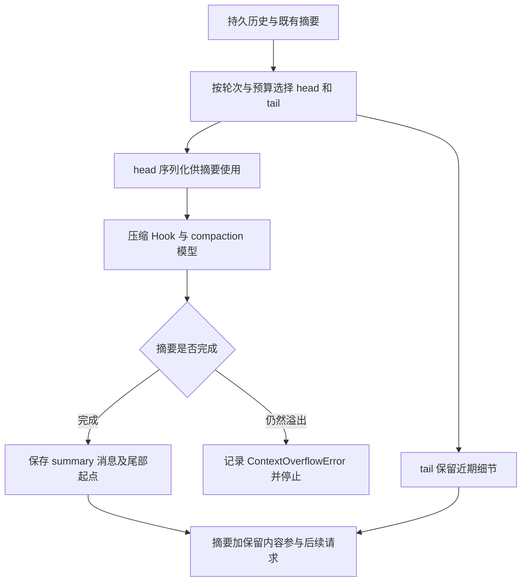

# 第 4 章：会话、消息与持久化

<!-- block: opencode-ch04.b-opening -->
恢复会话能让模型继续看到历史，却不会自动把工作目录退回历史时刻。OpenCode 同时管理会话记录、运行状态和磁盘文件；理解三者分别保存什么，才能在中断后正确继续。

## 4.1 会话不是一段聊天字符串

会话信息包含身份、项目、目录、标题、时间和父会话等字段；消息又包含不同类型的 parts。文本只是其中一种，工具调用、工具结果和其他处理状态也需要结构化保存。

这使宿主能够把一次 read 从开始、运行到完成关联起来，也让界面可以用工具卡片展示它。若把全部内容拼成普通字符串再存回去，可能保住可读文字，却丢掉调用 ID、状态和可恢复结构。



图 4-1：会话记录描述执行过程，磁盘副作用仍有自己的生命周期。

## 4.2 恢复之前先核对工作目录

假设昨天的会话读过 `src/config.ts`，今天另一个人改了这个文件。恢复会话时，旧工具结果可能仍在历史里，磁盘却已经不同。模型若依据昨天的片段作判断，回答可能看起来合理，却引用过时内容。

让继续任务的第一步重新读取关键文件，并比较 Git 状态。把文件改动视为任务外部输入，而不是默认会话历史和磁盘一直同步。特别是多人协作、切分支或切工作树之后，目录名字不变也不意味着内容没变。

恢复本身还可能涉及运行中的任务状态。错误处理必须区分“找到了历史会话”和“前一次工具已经停止”。仅凭客户端断线不能确定服务端任务取消；第十四章会说明如何查询状态。

## 4.3 分支历史与复制文件是两件事

会话 fork 关注从某个历史位置建立新的对话路径。源码中的 session 与 message 复制逻辑，不等于为项目创建独立 Git 工作树。若两个会话仍指向同一个目录，写操作仍可能碰到同一组文件。

一个可靠练习是：在临时项目里创建会话、记录 ID、分支出另一会话，然后分别检查目录与磁盘。即便两个会话的历史分开了，也应亲自确认文件是否分开。本书没有把这项完整 fork 实验列为已测，所以这里给出的是设计核对方法。

需要并行修改时，用明确的工作树或独立副本承担文件隔离，再让各会话绑定到正确目录。会话的父子关系适合追踪任务来源，不能代替文件系统隔离。

## 4.4 压缩会改变送给模型的历史

长会话不可能无限把所有原始工具输出塞进请求。钉版包含 compaction 和 prune 两类处理：生成概要、选择保留近期内容、标记或裁剪工具历史，最终服务于模型可用上下文预算。

压缩之后仍需要保留当前任务的约束、已经尝试的方案和未解决的问题。摘要若丢了一个失败条件，模型可能重走旧路。调试时同时看持久消息和当前模型请求，才能区分“记录根本没保存”与“保存了但这轮没送入”。

不要把压缩称为无损归档。它通常需要对信息取舍，甚至依赖模型生成摘要。关键事实最好保存在项目文档、测试或任务记录中，便于恢复后重新读取；会话概要适合继续工作，不适合充当唯一工程证据。

## 4.5 怎样保存一次可排查的中断

记录会话 ID、最后完成的工具调用 ID、当时的 Git 状态和错误阶段。若工具已经写文件后才失去响应，重试会不会重复副作用？答案由工具和业务操作决定，不能从模型说“继续”推断。

读文件可以重放；创建远端资源、发送消息或修改数据库需要幂等设计。对本地代码修改，也应先查看实际差异，再决定重做、补做还是撤回。第十三章会把快照撤销与 Git 提交边界接起来。

## 4.6 从一条工具 part 读出执行阶段
客户端创建消息时只提交文本 part，宿主在执行过程中生成助手消息及工具 part。下面是便于阅读的缩略结构，省略完整 schema 的其他字段：

```json
{
  "info": {"id": "msg_assistant", "sessionID": "ses_example", "role": "assistant"},
  "parts": [{
    "id": "prt_read",
    "type": "tool",
    "callID": "call_book_read",
    "tool": "read",
    "state": {
      "status": "completed",
      "input": {"filePath": "fixture.txt"},
      "output": "BOOK_FIXTURE_ALPHA",
      "time": {"start": 1, "end": 2}
    }
  }]
}
```

这里的 ID、时间和输出为教学值，不是公开的原始现场。callID 将模型调用与工具结果关联起来，part ID 标识宿主持久对象，sessionID 将消息归入会话。它们有不同用途，不能因为某次只有一个工具，就把三个标识简化成同一个计数器。

工具进入 completed 后，仍要观察结果是否进入下一次模型请求。随书宿主实验实际检查了这一点：它在下游 messages 中寻找 role 为 tool 且包含 ALPHA 的内容。单看 completed 可以证明工具状态，单看最终文本只能证明模型回复；两者与回喂证据一起才覆盖一次完整循环。

## 4.7 prune 实际标记了什么
compaction.ts 中的 prune 从较新的消息向前遍历，先跳过最近的用户轮次，只处理 completed 的工具 part，保护 skill 工具，并在遇到已有摘要或某些已压缩边界时停止。它累计工具输出的 token 估算，超过 PRUNE_PROTECT 后才收集更旧的候选。

钉版常量 PRUNE_PROTECT 为 40000，PRUNE_MINIMUM 为 20000；达到提交条件时，代码给候选工具结果的 time.compacted 写入时间，再 updatePart。这里的阈值是该剪裁算法的估算预算，不是所有模型共同的上下文窗口，也不能直接解释为删除了对应字节数的数据库文件。

尤其注意实现动作：它在这条路径中更新标记，没有直接把 state.output 字符串置空。后续模型消息转换或摘要序列化依据标记决定如何使用旧输出。于是你可能在持久记录中仍找到原文字段，却在本轮请求里看不到完整内容。调试“历史不见了”时，这个分界比搜索数据库里是否存在字符串更有用。

## 4.8 compaction 怎样保留近处的内容
摘要流程与 prune 不同。processCompaction 先确认 parentID 指向用户消息，再读取 compaction agent 和所用模型；显式配置了压缩模型时使用它，否则回到用户消息对应模型。它找出先前已完成的摘要，选取需要压缩的 head，并记录可保留尾部的起点。

select 按用户轮次组织近期消息，再用转成模型消息后的估算大小检查保留预算。tail_turns 可以限制候选轮数；若一个轮次太大，还可能尝试保留它的一部分。保留尾部的起点最终通过 tail_start_id 等信息连回消息结构。不能把“保留最近 N 轮”简单理解成总会把这 N 轮完整塞回去，实际还受模型预算影响。

摘要输入会经过 experimental.session.compacting 和消息 transform。前者允许插件增加 context 或提供替代 prompt；随后序列化历史，调用 compaction 处理器。该请求使用 tools:{}，目标是生成续接所需的摘要，不是在压缩期间继续执行原任务的工具动作。



图 4-2：压缩改变送给模型的材料组织。它不执行 Git 回退，也不把工程文件还原到摘要生成时的内容。

## 4.9 摘要本身也可能装不下
序列化工具输出时，钉版会对相关摘要输入作长度限制，避免一项巨大输出吞没全部空间；已经 compacted 的内容也按相应形式表示。即便如此，摘要处理器仍可能返回 compact，说明缩减后的输入依然无法完成。代码会记录 ContextOverflowError，设置错误结束并停止，而不是无限递归压缩。

这类故障需要看任务结构。若一开始就把巨大文件全文作为唯一输入，靠摘要不一定能修复。可以先提取相关范围、按文件分批检查、把稳定结论写进项目文档，再继续会话。这里的拆分应保留文件位置和测试条件，不能把关键错误信息一并删掉来换取“终于不超限”。

本书宿主实验的消息很短，没有触发真实模型摘要。因此，上述保留策略和错误分支来自固定源码阅读；我们没有把一个成功的 read 循环当作压缩验证。完整实验可用合成大输出触发边界，再分别保存原始消息、compacted 标记、摘要文本和下一次模型请求，逐层核对。

## 4.10 恢复后的第一项动作应当可撤销
继续一个旧会话时，可以先读取 Git 状态与关键文件，生成一份当前差异说明，再决定写入。若最后一个工具 part 仍是运行或错误状态，不要只凭最后一段自然语言推断副作用；查目标文件或服务的实际结果。

对于读操作，重新读取通常成本很低；对于写操作，检查实际 diff 可以判断已经完成、只完成一半还是根本未发生。会话 fork 也遵循同样原则：新的对话分支提供另一条推理路径，却不会自动提供另一个磁盘世界。让每个写入会话绑定到明确工作树，才能把历史分支与文件隔离接起来。

来源：[会话服务](https://github.com/anomalyco/opencode/blob/810c0eba1a7348036f8bdf61e6632d0c36c6876c/packages/opencode/src/session/session.ts)、[压缩与裁剪](https://github.com/anomalyco/opencode/blob/810c0eba1a7348036f8bdf61e6632d0c36c6876c/packages/opencode/src/session/compaction.ts)、[撤销服务](https://github.com/anomalyco/opencode/blob/810c0eba1a7348036f8bdf61e6632d0c36c6876c/packages/opencode/src/session/revert.ts)。
