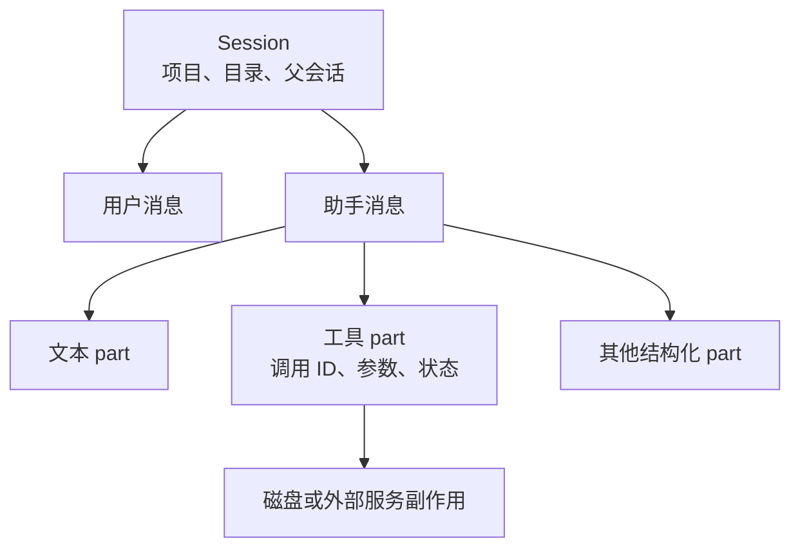

# 第 4 章：会话、消息与持久化

<!-- block: opencode-ch04.b-opening -->
恢复会话能让模型继续看到历史，却不会自动把工作目录退回历史时刻。OpenCode 同时管理会话记录、运行状态和磁盘文件；理解三者分别保存什么，才能在中断后正确继续。

## 4.1 会话不是一段聊天字符串

会话信息包含身份、项目、目录、标题、时间和父会话等字段；消息又包含不同类型的 parts。文本只是其中一种，工具调用、工具结果和其他处理状态也需要结构化保存。

这使宿主能够把一次 read 从开始、运行到完成关联起来，也让界面可以用工具卡片展示它。若把全部内容拼成普通字符串再存回去，可能保住可读文字，却丢掉调用 ID、状态和可恢复结构。

图 4-1：会话记录描述执行过程，磁盘副作用仍有自己的生命周期。

## 4.2 恢复之前先核对工作目录

假设昨天的会话读过 `src/config.ts`，今天另一个人改了这个文件。恢复会话时，旧工具结果可能仍在历史里，磁盘却已经不同。模型若依据昨天的片段作判断，回答可能看起来合理，却引用过时内容。

让继续任务的第一步重新读取关键文件，并比较 Git 状态。把文件改动视为任务外部输入，而不是默认会话历史和磁盘一直同步。特别是多人协作、切分支或切工作树之后，目录名字不变也不意味着内容没变。

恢复本身还可能涉及运行中的任务状态。错误处理必须区分“找到了历史会话”和“前一次工具已经停止”。仅凭客户端断线不能确定服务端任务取消；第十四章会说明如何查询状态。

## 4.3 分支历史与复制文件是两件事

会话 fork 关注从某个历史位置建立新的对话路径。源码中的 session 与 message 复制逻辑，不等于为项目创建独立 Git 工作树。若两个会话仍指向同一个目录，写操作仍可能碰到同一组文件。

一个可靠练习是：在临时项目里创建会话、记录 ID、分支出另一会话，然后分别检查目录与磁盘。即便两个会话的历史分开了，也应亲自确认文件是否分开。本书没有把这项完整 fork 实验列为已测，所以这里给出的是设计核对方法。

需要并行修改时，用明确的工作树或独立副本承担文件隔离，再让各会话绑定到正确目录。会话的父子关系适合追踪任务来源，不能代替文件系统隔离。

## 4.4 压缩会改变送给模型的历史

长会话不可能无限把所有原始工具输出塞进请求。钉版包含 compaction 和 prune 两类处理：生成概要、选择保留近期内容、标记或裁剪工具历史，最终服务于模型可用上下文预算。

压缩之后仍需要保留当前任务的约束、已经尝试的方案和未解决的问题。摘要若丢了一个失败条件，模型可能重走旧路。调试时同时看持久消息和当前模型请求，才能区分“记录根本没保存”与“保存了但这轮没送入”。

不要把压缩称为无损归档。它通常需要对信息取舍，甚至依赖模型生成摘要。关键事实最好保存在项目文档、测试或任务记录中，便于恢复后重新读取；会话概要适合继续工作，不适合充当唯一工程证据。

## 4.5 怎样保存一次可排查的中断

记录会话 ID、最后完成的工具调用 ID、当时的 Git 状态和错误阶段。若工具已经写文件后才失去响应，重试会不会重复副作用？答案由工具和业务操作决定，不能从模型说“继续”推断。

读文件可以重放；创建远端资源、发送消息或修改数据库需要幂等设计。对本地代码修改，也应先查看实际差异，再决定重做、补做还是撤回。第十三章会把快照撤销与 Git 提交边界接起来。

来源：[会话服务](https://github.com/anomalyco/opencode/blob/810c0eba1a7348036f8bdf61e6632d0c36c6876c/packages/opencode/src/session/session.ts)、[压缩与裁剪](https://github.com/anomalyco/opencode/blob/810c0eba1a7348036f8bdf61e6632d0c36c6876c/packages/opencode/src/session/compaction.ts)、[撤销服务](https://github.com/anomalyco/opencode/blob/810c0eba1a7348036f8bdf61e6632d0c36c6876c/packages/opencode/src/session/revert.ts)。
