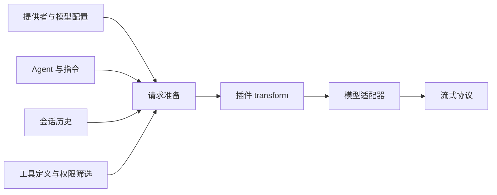

# 第 5 章：模型接口与流式响应

<!-- block: opencode-ch05.b-opening -->
模型接口决定宿主怎样表达消息、工具和流式结果。一个服务声称兼容 OpenAI，并不意味着所有字段、工具调用片段和错误行为都与当前适配器一致；验证时要看实际请求和响应。

## 5.1 模型 ID 只是请求配置的入口

在实验里，`fixture/test` 的前半段选择提供者，后半段选择其模型配置。提供者定义 SDK 包、请求地址和选项，模型定义则描述上下文、输出等能力。两者共同影响请求构造。

钉版请求准备代码还会结合 agent、系统指令、消息和工具，随后经过插件 transform。第八章追加的提示词是在这条路径里修改 system；它不是直接改远端服务的系统设置。



图 5-1：模型请求的几个主要输入。它们在程序里并非一个平面字符串。

## 5.2 为什么用本地替身研究协议

真实模型未必每次都调用同一个工具，模型版本还会变。要观察权限或插件，先让替身固定返回一次工具调用，可以把这些随机因素移开。它不会替你证明模型聪明，却能证明宿主接到某种响应后怎样执行。

本书服务接收 chat-completions 形状的请求，以 `text/event-stream` 返回 SSE。每个数据事件包含 choices、delta 和结束原因。工具调用的函数名及 JSON 参数由替身给出，宿主解析后再进入工具管线。

```json
{
  "choices": [{
    "index": 0,
    "delta": {
      "tool_calls": [{
        "index": 0,
        "id": "call_book_read",
        "type": "function",
        "function": {"name": "read", "arguments": "{\"filePath\":\"fixture.txt\"}"}
      }]
    },
    "finish_reason": null
  }]
}
```

这只是一个教学片段。完整事件还需要模型、响应 ID 等字段，结束时会发出工具调用结束原因和 `[DONE]`；可执行版本以 examples 下的驱动为准。不要把片段直接当成所有提供者的公共协议。

## 5.3 工具结果怎样回到下一轮

第一次请求中有工具定义，替身选择 read。宿主执行后，下一次请求出现工具结果消息。驱动查找其中的 `BOOK_FIXTURE_ALPHA`，而不是只看最终助手答复。

这个断言非常关键。假如工具根本没运行，替身仍可以随便回复“完成”；若只检查最后一句话，实验会产生假阳性。反过来，工具运行成功但下一轮没带上结果，也不能说明循环完整。

同样的方法适合调试真实模型：先看工具是否被提供、参数是否被解析、执行结果是否被保存，再看模型如何使用结果。把这些阶段混成一句“模型不听话”，很难找到可修复的位置。

## 5.4 流、取消与重试的组合

流式响应可能在文本中途断开，也可能在工具参数只收到一半时断开。宿主不能把半个 JSON 当成完整工具调用。网络重试还需要知道上一轮是否已经进入执行阶段，否则可能重复执行有副作用的动作。

本书已测场景返回完整、确定的 SSE，没有注入分片损坏、连接超时或半途断开。因此，本地替身实验并不覆盖所有流式错误。若你要做新的适配器，应专门补齐分片、结束原因、错误包、取消信号与重试的对照。

取消信号也需要一路传递。模型请求收到取消，不代表已经启动的子进程或文件操作会自动停止。工具执行器要支持信号，业务副作用还要单独处理；第六章的文件读取样例会显式传入 abort signal。

## 5.5 不从假用量推算真实成本

替身发出的 usage 数字只是为了让协议完整。它们没有经过真实 tokenizer，也没有账单意义。总成本需要真实提供者的计量规则、缓存收费和重试情况，不能从这组实验推出。

记录模型行为时，至少区分输入内容变化、请求次数变化、模型能力变化和宿主操作变化。换了提示词后修复成功，可能与采样、模型版本或工具输出有关；没有控制变量就不要把全部收益归给某一行 Hook。

来源：[模型调用服务](https://github.com/anomalyco/opencode/blob/810c0eba1a7348036f8bdf61e6632d0c36c6876c/packages/opencode/src/session/llm.ts)、[请求准备](https://github.com/anomalyco/opencode/blob/810c0eba1a7348036f8bdf61e6632d0c36c6876c/packages/opencode/src/session/llm/request.ts)、[本书宿主实验](examples/check-host-plugins.py)。
