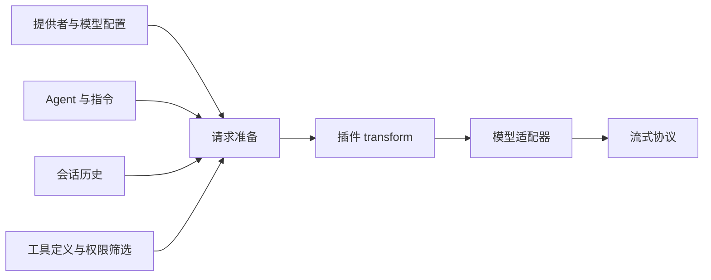

# 第 5 章：模型接口与流式响应

<!-- block: opencode-ch05.b-opening -->
模型接口决定宿主怎样表达消息、工具和流式结果。一个服务声称兼容 OpenAI，并不意味着所有字段、工具调用片段和错误行为都与当前适配器一致；验证时要看实际请求和响应。

## 5.1 模型 ID 只是请求配置的入口

在实验里，`fixture/test` 的前半段选择提供者，后半段选择其模型配置。提供者定义 SDK 包、请求地址和选项，模型定义则描述上下文、输出等能力。两者共同影响请求构造。

钉版请求准备代码还会结合 agent、系统指令、消息和工具，随后经过插件 transform。第八章追加的提示词是在这条路径里修改 system；它不是直接改远端服务的系统设置。



图 5-1：模型请求的几个主要输入。它们在程序里并非一个平面字符串。

## 5.2 为什么用本地替身研究协议

真实模型未必每次都调用同一个工具，模型版本还会变。要观察权限或插件，先让替身固定返回一次工具调用，可以把这些随机因素移开。它不会替你证明模型聪明，却能证明宿主接到某种响应后怎样执行。

本书服务接收 chat-completions 形状的请求，以 `text/event-stream` 返回 SSE。每个数据事件包含 choices、delta 和结束原因。工具调用的函数名及 JSON 参数由替身给出，宿主解析后再进入工具管线。

```json
{
  "choices": [{
    "index": 0,
    "delta": {
      "tool_calls": [{
        "index": 0,
        "id": "call_book_read",
        "type": "function",
        "function": {"name": "read", "arguments": "{\"filePath\":\"fixture.txt\"}"}
      }]
    },
    "finish_reason": null
  }]
}
```

这只是一个教学片段。完整事件还需要模型、响应 ID 等字段，结束时会发出工具调用结束原因和 `[DONE]`；可执行版本以 examples 下的驱动为准。不要把片段直接当成所有提供者的公共协议。

## 5.3 工具结果怎样回到下一轮

第一次请求中有工具定义，替身选择 read。宿主执行后，下一次请求出现工具结果消息。驱动查找其中的 `BOOK_FIXTURE_ALPHA`，而不是只看最终助手答复。

这个断言非常关键。假如工具根本没运行，替身仍可以随便回复“完成”；若只检查最后一句话，实验会产生假阳性。反过来，工具运行成功但下一轮没带上结果，也不能说明循环完整。

同样的方法适合调试真实模型：先看工具是否被提供、参数是否被解析、执行结果是否被保存，再看模型如何使用结果。把这些阶段混成一句“模型不听话”，很难找到可修复的位置。

## 5.4 流、取消与重试的组合

流式响应可能在文本中途断开，也可能在工具参数只收到一半时断开。宿主不能把半个 JSON 当成完整工具调用。网络重试还需要知道上一轮是否已经进入执行阶段，否则可能重复执行有副作用的动作。

本书已测场景返回完整、确定的 SSE，没有注入分片损坏、连接超时或半途断开。因此，本地替身实验并不覆盖所有流式错误。若你要做新的适配器，应专门补齐分片、结束原因、错误包、取消信号与重试的对照。

取消信号也需要一路传递。模型请求收到取消，不代表已经启动的子进程或文件操作会自动停止。工具执行器要支持信号，业务副作用还要单独处理；第六章的文件读取样例会显式传入 abort signal。

## 5.5 不从假用量推算真实成本

替身发出的 usage 数字只是为了让协议完整。它们没有经过真实 tokenizer，也没有账单意义。总成本需要真实提供者的计量规则、缓存收费和重试情况，不能从这组实验推出。

记录模型行为时，至少区分输入内容变化、请求次数变化、模型能力变化和宿主操作变化。换了提示词后修复成功，可能与采样、模型版本或工具输出有关；没有控制变量就不要把全部收益归给某一行 Hook。

## 5.6 先区分两条都叫流的连接
OpenCode 可以向客户端发布会话事件，也可以从模型提供者读取流式响应。两条连接各有消息格式：客户端事件围绕会话、消息和 part，模型 SSE 则遵循相应提供者协议。把模型的 choices.delta 直接交给 UI 当作完整会话事件，会丢失宿主执行工具和审批期间的状态。

本章研究的是下游 OpenAI-compatible chat-completions 流。第 2 章的同步 HTTP 消息请求即使最终只返回一份结果，宿主内部仍可以消费模型 SSE。流式模型不强迫所有外部客户端都采用同一种逐字显示方式。

调试代理服务器时也应分别检查这两条连接。模型流正常，客户端却卡在运行中，可能是事件消费或最终状态问题；客户端收到连接事件，模型请求却认证失败，也不能说明生成已经开始。为连接保留方向、会话 ID 和阶段，日志会清楚很多。

## 5.7 一次工具响应在传输线上长什么样
替身服务设置 Content-Type: text/event-stream，每个事件以 data: 开头，并用空行结束。下面省略重复的响应元信息，展示同一个工具调用的顺序：

```text
data: {"choices":[{"index":0,"delta":{"role":"assistant"},"finish_reason":null}]}

data: {"choices":[{"index":0,"delta":{"tool_calls":[{"index":0,"id":"call_book_read","type":"function","function":{"name":"read","arguments":"{\"filePath\":\"fixture.txt\"}"}}]},"finish_reason":null}]}

data: {"choices":[{"index":0,"delta":{},"finish_reason":"tool_calls"}]}

data: [DONE]
```

代码围栏中的参数字符串还嵌套了一层 JSON，实际生成时应使用 json.dumps 等编码器，不要手工拼接带反斜杠的路径。随书 emit 函数补齐 id、object、created、model，并将每个对象统一序列化，所以 Windows 路径中的反斜杠不会被误当作 JSON 转义控制字符。

finish_reason=tool_calls 说明这一轮以工具调用结束，后续由宿主执行工具；普通最终文本使用 stop。最后的 [DONE] 结束流传输，不等价于整个 Agent 任务已经完成。宿主可能随后发出另一轮模型请求，把工具结果交回去。

## 5.8 参数分片不是多个工具调用
真实服务可能把同一个 arguments 字符串拆成几个 delta。比如先发 `{"filePath":`，再发 `"fixture.txt"}`。适配器应依据 tool_calls 中的 index 和关联信息累积片段，在形成完整调用后再解析参数。每收到一个事件就尝试执行，会把半个 JSON 当作动作；每个片段都新建调用，又会重复读取或写入。

还要区分 SSE 事件与底层网络块。一个 data 行可能分在两次网络读取中，一个网络读取也可能包含多个事件。协议解析器必须先识别完整事件，再解析 JSON；把 socket 每次 read 的返回直接送给 JSON.parse，是常见的错误实现。

随书替身一次给出完整参数字符串，验证了完整 SSE 路径，没有注入上述分片。因此，对新适配器应额外准备分片、多个工具 index、空 delta 和中断等样本。这个测试范围不需要在每段重复提醒，但必须在把实验结论用于协议兼容性时记住。

## 5.9 请求准备会在哪些地方改变输入
LLMRequestPrep.prepare 先组织 agent.prompt 或提供者系统提示，再加入 input.system 与用户消息中的 system 字段。随后调用 experimental.chat.system.transform。对常见路径，处理后的 system 作为模型消息加入历史；OpenAI OAuth 等路径有另外的参数组织方式，不能只根据一种提供者的请求形状解释全部模型。

模型选项也有合并顺序：基础 provider transform 选项，再合入 model.options、agent.options 和适用的 variant。chat.params 还可以改变温度、输出限制和选项，chat.headers 负责附加请求头。最后工具经过 resolveTools 等处理进入适配器。源码在这些位置给插件不同的修改表面，不能把所有 Hook 都说成“修改提示词”。

一个诊断例子是：你在配置中降低温度，实际请求里却没有 temperature。先看模型是否声明支持该能力，再看 agent 或插件是否覆盖，最后才判断远端服务是否忽略。把配置文件的值直接视为网络请求中的值，会跳过宿主中间的转换。

## 5.10 用工具正文证明循环，别让替身替自己作证
随书替身检查当前请求是否已有 role=tool 的消息：没有时要求 read，有时返回最终文本。这个逻辑使流程确定，但它也意味着替身本身不会理解文件内容。真正的断言在驱动外侧：查找下一轮请求中的 BOOK_FIXTURE_ALPHA，确认它来自真实工具结果。

如果你把替身改成无条件返回 ALPHA，再检查最终答案包含 ALPHA，测试就失去价值。它只能证明服务发出了预先写好的字符串。有效检查应在不同边界寻找独立证据：模型请求声明 read，工具事件记录执行，文件正文进入后续请求，最终消息无错误。

权限实验也采用这个思路。拒绝和隐藏场景不能只看模型有没有说“无法读取”，还要确认没有出现 read-done 事件和真实文件正文。模型的自然语言可能与执行状态不一致，宿主测试应以实际行为约束它，而不是让它自行宣告成功。

## 5.11 断流之后先确认工具是否已经开始
若连接在参数尚未完整时断开，恢复重点是处理无效或未完成调用；若工具已经执行而最后文本丢失，重试整个模型请求可能导致重复动作。适配器、宿主和业务工具需要分别知道自己处于哪个阶段。

对于本书只读样本，重读临时文件通常无害；换成创建远程资源或写入数据库，应使用业务幂等标识或查询已完成结果。网络库自动重试只能解决传输尝试，不能决定业务动作是否可以重复。取消同理：终止模型流不会抹去此前已经保存的工具结果或磁盘修改。

最终报告应把协议兼容、宿主执行和模型表现分开。我们已有的真实宿主实验能够说明固定 SSE 输入触发了正确 read 和权限路径；真实服务的分片习惯、模型选择质量以及费用，需要用对应服务的数据验证。

来源：[模型调用服务](https://github.com/anomalyco/opencode/blob/810c0eba1a7348036f8bdf61e6632d0c36c6876c/packages/opencode/src/session/llm.ts)、[请求准备](https://github.com/anomalyco/opencode/blob/810c0eba1a7348036f8bdf61e6632d0c36c6876c/packages/opencode/src/session/llm/request.ts)、[本书宿主实验](examples/check-host-plugins.py)。
