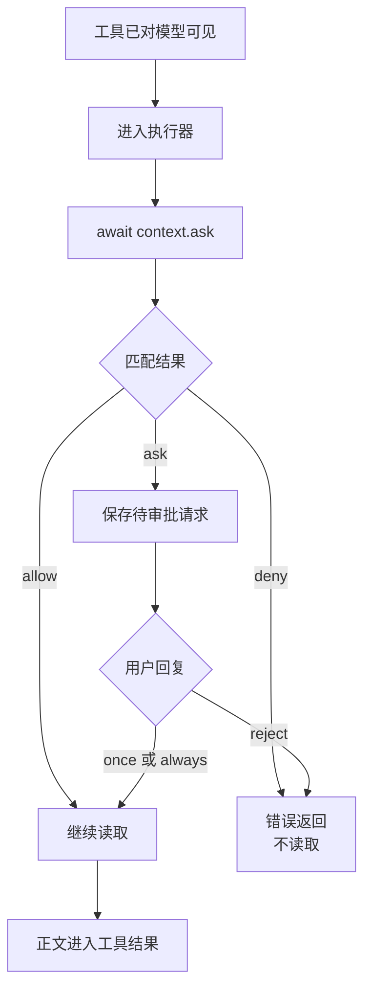

# 第 7 章：权限与审批

<!-- block: opencode-ch07.b-opening -->
权限配置可以让工具从模型列表里消失，也可以让已进入执行器的操作在某一步等待批准。两者发生的位置不同。本章用同一个真实工具分别触发允许、拒绝和询问，观察读取究竟有没有发生。

## 7.1 先分开工具名与操作权限

第六章工具名为 book_probe，内部调用 `context.ask` 申请 book_read。实验配置如下：

```json
{
  "permission": {
    "*": "deny",
    "book_probe": "allow",
    "book_read": "ask"
  }
}
```

book_probe 可以进入模型的可用工具列表；执行器开始后，book_read 再决定是否继续读取。若把 book_probe 本身设为全局 deny，宿主准备请求时可能直接把它隐藏，模型连调用它的机会都没有。

源码的 `Permission.disabled` 正是可见性筛选的一部分。具体操作则走 ask，按权限名和 pattern 匹配规则。后匹配的规则会覆盖前面的匹配，未找到时走询问。复杂规则应逐项检查顺序，不要凭 JSON 看起来的“更具体”自行推断优先级。

## 7.2 拒绝究竟发生在读取前还是后

本例的顺序是 entered → await ask → approved → readFile → read-done。若 ask 拒绝，后续读取不会发生。这个结论依赖样例把检查放在副作用之前；若开发者先 readFile 再 ask，拒绝自然无法让已经读出的信息消失。



图 7-1：操作权限在样例中的位置。操作之前已经执行的代码不属于回滚范围。

内置 read 也在读取内容前调用 ask，但它会先解析路径、检查文件状态和外部目录。权限拒绝不等于“程序连这个路径字符串都没处理过”。在需要严格隔离的场景，仍须使用操作系统或容器提供的限制。

## 7.3 五种情况的真实结果

使用官方 v1.19.5 Windows 宿主、同一份原创工具和本地模型替身，得到下面的结果。请求 ID 与目录是临时值，公开记录只保留事件名称。

| 配置与回复 | 工具进入执行器 | 产生审批请求 | 读取文件 | 下一轮含文件正文 |
| --- | --- | --- | --- | --- |
| book_read=allow | 是 | 否 | 是 | 是 |
| book_read=deny | 是 | 否 | 否 | 否 |
| book_read=ask，回复 once | 是 | 是 | 是 | 是 |
| book_read=ask，回复 reject | 是 | 是 | 否 | 否 |
| book_probe=deny | 否 | 否 | 否 | 否 |

驱动在等待审批时查询真实 `/permission`，确认 pending 请求的权限名和会话 ID；回复前还检查事件文件只有 entered。拒绝后下一轮请求不含已知文件标记，避免仅用“界面显示拒绝”作为证据。

这里的 hidden 场景没有强行向宿主提交一个被隐藏工具的伪造调用。它验证模型收到的能力范围与实际无执行；对于恶意客户端或非法工具调用，应另做协议边界测试，不能从这行结果推出所有绕过方式都被封堵。

## 7.4 once 与 always 保持多久

后五个场景保留同一个宿主进程，在指定位置才清理实例：

| 场景 | 本次是否询问 |
| --- | --- |
| 首次操作，回复 once | 是 |
| 同实例新建会话，再次读取 | 是 |
| 清理实例后首次操作，回复 always | 是 |
| 同实例新建会话，读取同一 pattern | 否 |
| 再清理实例后读取 | 是 |

这说明在本轮 V1 路径中，always 的已批准规则存在项目实例状态内，可以影响同实例的新会话；实例清理后不再沿用。它并不是写回项目配置的“永久允许”。once 则仅放行本次待审批请求。

实验只用同一 permission 和 `fixture.txt` pattern，没有测试所有并发待审批请求、不同目录或不同客户端。源码还包含处理同会话 pending 请求的逻辑，升级或扩展时应补相应对照，而不要把这张表扩大为全部审批语义。

## 7.5 插件代码不在这张权限表的沙箱里

本例的包装器直接使用 `appendFileSync` 写事件文件。它能够这样做，是因为插件作为 JavaScript 运行在宿主进程权限下；工具权限服务并没有拦截每一次 Node 文件系统调用。

因此，要审核一个未知插件，重点是可执行代码和依赖来源。设置 `"*": "deny"` 能约束走相应权限路径的工具，不会把恶意插件变成不能读写磁盘的纯文本。真正限制插件能碰到哪些文件，需要进程用户、容器或其他执行隔离配合。

正常插件也应主动缩小能力：路径固定或明确检查、读取前 ask、错误不伪装成功、日志不复制凭据。权限是代码需要遵守的一项协议，不是替开发者自动补上的全部安全实现。

## 7.6 用这组实验检查自己的工具

从 examples 的说明准备依赖后运行 `check-tool-permissions.py`。把自己的副作用放到同样的检查点后，至少验证允许、拒绝、等待、取消和重复调用。拒绝用例中检查真正的文件或服务状态，不只断言某个函数抛了异常。

本书这轮十场景通过，取消仍单列为未验证。这样的记录比把“支持权限”勾成一个总开关更有用：每个结果都有触发条件，出了问题也知道该沿哪条路径找。

来源：[规则匹配与审批状态](https://github.com/anomalyco/opencode/blob/810c0eba1a7348036f8bdf61e6632d0c36c6876c/packages/opencode/src/permission/index.ts)、[请求中的工具筛选](https://github.com/anomalyco/opencode/blob/810c0eba1a7348036f8bdf61e6632d0c36c6876c/packages/opencode/src/session/llm/request.ts)、[本书十场景驱动](examples/check-tool-permissions.py)。
