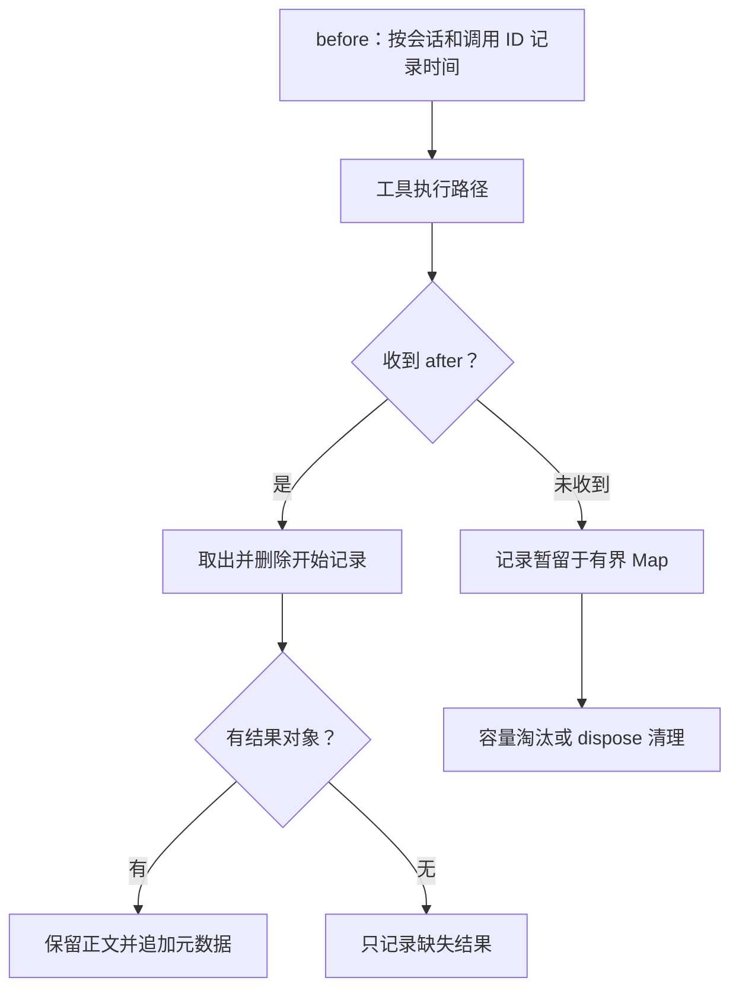

# 第 8 章：插件 Hook——从返回对象到实际调用

<!-- block: opencode-ch08.b-opening -->
你想给每次代码审查加一句提醒，再记录哪些工具被调用过。事情听起来很小：写一个插件，把提示词和日志塞进去。真正需要先弄清的是，宿主在哪个时刻调用你，哪个对象可以修改，以及插件报错会影响谁。

本章固定 OpenCode v1.19.5，提交 `810c0eba1a7348036f8bdf61e6632d0c36c6876c`。讲的是 V1 Plugin/Hooks；同一个仓库已包含 V2，不能看到新版文档里的接口就直接换进来。完整样例在 [review-trace.ts](examples/review-trace.ts)，实验范围见 [VERIFY](VERIFY.md)。

## 8.1 一个插件先返回一组能力

V1 的 Plugin 是异步初始化函数。宿主把 client、项目目录、工作树、serverUrl 和 shell 等上下文传给它，函数返回 Hooks 对象。这个对象既能含事件回调，也能提供自定义工具、认证等能力。[来源 1](#source-1)

因此，“插件已经加载”与“某个回调已经执行”是两个时刻。初始化阶段创建的变量可以活过多次工具调用；而工具调用的信息是在回调发生时才出现的。


图 8-1：V1 插件从初始化到回调的两个阶段。流程表达调用关系，不表示每种 Hook 都走同一条执行路径。

本例只做三件事：给系统提示词追加审查要求，在工具调用前记下时间，在收到结果回调后写一条摘要。插件不请求新工具，也不改变权限规则。

## 8.2 返回一个新对象，为什么没有生效

V1 的 `experimental.chat.system.transform` 接收两个参数。第一个包含 sessionID 和 model，第二个含 `system: string[]`。宿主希望你修改第二个参数。[来源 1](#source-1)

```typescript
// 教学片段：output 就是宿主传进来的可变对象。
"experimental.chat.system.transform": async (_input, output) => {
  const note = "Review correctness first.";
  if (!output.system.includes(note)) {
    output.system.push(note);
  }
}
```

这里不能改成 `return { system: [note] }`。固定版本的 trigger 按顺序调用各插件的处理器，等待它们结束，最后返回原来的 output；它没有接住各处理器的返回值。公开类型也把返回值写成 `Promise<void>`。[来源 2](#source-2)

两个插件拿到的是同一个 output。后一个能看到前一个的修改，也能覆盖它。如果两个插件都把整个 system 数组重建一遍，最后的结果就取决于调用顺序。只有在需要替换全部宿主内容时才考虑这种操作，并逐项检查会丢掉什么。

本例使用 push，保留已有内容；同一份数组重复经过回调时不会重复追加完全相同的句子。这个去重范围很窄：别的插件若改写或合并了该句，includes 无法判断语义重复。它也不是跨会话记忆。

请求准备代码先组装 system，再触发此 Hook；随后可能把额外片段合并。因此数组位置适合说明回调时的结构，不能当作最终请求必然保留的布局。[来源 3](#source-3)

## 8.3 工具前后事件分别给了什么

| Hook | input | 可修改的 output | 本例的动作 |
| --- | --- | --- | --- |
| tool.execute.before | tool、sessionID、callID | args | 记录调用开始时间，保持参数原样 |
| tool.execute.after | 前述身份及 args | title、output、metadata | 保留正文，追加 reviewTrace 元数据 |
| dispose | 无 | 无 | 清理内存，并停止后续观察 |

表中的 output 是回调第二参数；其中名为 output 的字段又是工具结果正文。读源码时要分清这两层，避免把结果对象和结果文字混为一谈。

要关联前后调用，不能只用工具名。同一个 read 可以并发读取两个文件；两个会话也可能出现相同的 callID。本例把 sessionID 与 callID 编成一个联合键，存在初始化函数内的 Map 里。



图 8-2：本例观察器如何处理未配对调用。Map 只属于当前插件实例，没有写入会话数据库。

Map 最多保留 128 条待配对记录，超过时淘汰最早插入的一条。这个数字是教学样例的容量选择，不是 OpenCode 限制。超过容量的长任务即使后来收到结果，也会标成 correlated=false、durationMs=null；不要把 null 换成 0，零耗时和缺失数据是不同情况。

计时包含两次回调之间经过的全部时间，可能还包括其他插件和调度开销。它适合关联排错，不是工具性能基准。遇到未收到 after 的情况，本例也不能据此判定工具已经取消或执行失败。

## 8.4 类型声明没有覆盖的失败路径

发布包把 after 的第二参数写成结果对象。继续看固定提交的子任务执行代码，会看到一个更具体的情况：执行失败被 catchCause 捕获并记录后，代码继续把 result 传给 after；这时 result 可能没有值。[来源 4](#source-4)

所以直接执行 `output.metadata = ...` 可能在原有失败之外再抛一个错误。本例先检查 output 是否存在。没有结果时清掉配对记录，写一条“回调没有结果”的摘要，不伪造成功正文。

这是特定子任务路径的源码观察，不代表所有工具失败都按同样方式通知插件，也不代表 after 是一个必达的 finally。实验显式传入 undefined 来验证本例防护；第 9 章虽已运行真实宿主，仍未重现这条子任务失败链。

另一类失败来自日志。客户端的 app.log 用来写服务端日志。记录器只提交工具名、会话/调用 ID 和计时信息，不把 args、提示词或工具正文原样复制过去。日志请求抛错时，本例捕获它，保留已完成的工具结果；SDK 返回错误响应时同样按尽力记录处理。

这里的取舍是允许丢日志。它不适合作为必须完整保存的审计系统。日志端点若迟迟不返回，await 也会拖慢回调；部署前要单独考虑传输超时或有界队列，不能因为处理了 reject 就宣称处理了全部网络故障。

## 8.5 清理属于谁

宿主 V1 初始化代码注册了两个清理动作：取消事件订阅，以及调用插件的 dispose。dispose 出错会被记录并忽略。[来源 2](#source-2)

本例在 dispose 中设置关闭标记并清空 Map。重复调用不会出错，之后到达的回调也不再新增记录。这个标记处理的是本例生命周期，不会撤销已发出的日志请求、已经执行的工具或磁盘修改。

本章处理器实验显式调用 dispose。[第 9 章](ch09.md)进一步向真实宿主请求实例清理，观察到了插件的 dispose，并比较了同进程重建实例和重启进程。两者对模块状态的影响不同；自动热重载和退出时序仍未验证。

## 8.6 现在就能运行的实验

在书仓根目录，使用 Node.js 22.19.0 或更新版：

```bash
node --test opencode/examples/check-review-trace.mjs
```

它导入真实的原创样例，把 SDK client 换成一个只记录参数的对象。无需模型凭据，也不会写个人 OpenCode 配置。

实验覆盖八类情况：保留宿主提示词、保持工具参数与正文、跨会话关联、缺失回调的容量控制、日志拒绝、缺失结果对象、重复清理，以及共享 output 的调用顺序。最后一项使用教学调度器演示从源码读到的语义，并没有运行上游的整个 Effect 服务。

读者可以做两个改动观察失败。先把 push 改成 return 新对象，检查宿主输出是否真的变化；再去掉缺失 output 的判断，运行同一组实验，看原本的工具失败怎样变成插件 TypeError。完成后恢复示例，保留失败日志用于理解，而不要把错误版本复制到常用项目。

严格类型核对命令见 [examples/README](examples/README.md)。它使用真实发布包的声明检查样例；类型通过与运行时防护都需要，前者没有覆盖本章发现的 undefined 路径。

## 8.7 把处理器放回宿主

第 9 章使用固定版本的 Windows 发布程序，验证了项目插件发现、顺序调用、初始化失败和实例清理，并检查提示词与真实 read 的结果是否进入模型请求。模型协议仍由本地替身提供；本章的八项处理器测试保留为更快的排错入口。

这次宿主实验走通了 V1 的 serve 路径。V2 与其他客户端的默认选择仍需独立核对，不能仅凭两个目录共存就判断用户启动的是哪套系统。

自定义工具、MCP 与权限各有不同入口。本章给系统提示词追加审查要求，不会撤销写文件工具，也不会替代权限检查。只读审查模式需要同时检查工具能力和执行规则，后续章节会沿着这两条线继续。

## 来源

<a id="source-1"></a>
1. [V1 PluginInput、Plugin 与 Hooks 类型](https://github.com/anomalyco/opencode/blob/810c0eba1a7348036f8bdf61e6632d0c36c6876c/packages/plugin/src/index.ts)。

<a id="source-2"></a>
2. [V1 插件初始化、trigger 与 finalizer](https://github.com/anomalyco/opencode/blob/810c0eba1a7348036f8bdf61e6632d0c36c6876c/packages/opencode/src/plugin/index.ts)。

<a id="source-3"></a>
3. [模型请求准备与 system transform](https://github.com/anomalyco/opencode/blob/810c0eba1a7348036f8bdf61e6632d0c36c6876c/packages/opencode/src/session/llm/request.ts)。

<a id="source-4"></a>
4. [子任务 taskTool.execute、catchCause 与 after](https://github.com/anomalyco/opencode/blob/810c0eba1a7348036f8bdf61e6632d0c36c6876c/packages/opencode/src/session/prompt.ts)。
