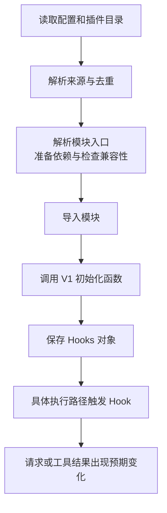
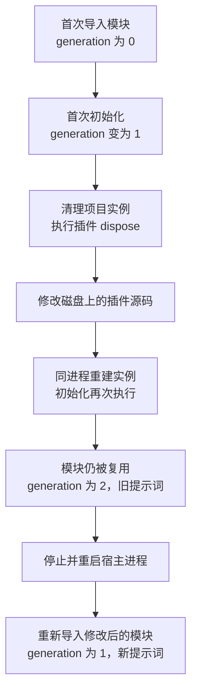

# 第 9 章：插件加载、状态与 V1/V2

<!-- block: opencode-ch09.b-opening -->
你改了插件里的一句话，清理实例，再开一个会话。日志说插件重新初始化了，请求里却还是旧句子。是文件放错了，还是 OpenCode 没有重载？

这两件事可以同时发生。本章用 OpenCode v1.19.5 的 Windows 发布程序跑一次完整实验：两个正常插件，一个初始化就报错的插件，一个只会要求读取文件的本地模型替身。我们沿着发现、初始化、调用和清理逐步观察，最后把“初始化又执行了一次”和“源码重新导入了一次”分开。

版本仍固定在提交 `810c0eba1a7348036f8bdf61e6632d0c36c6876c`。可运行脚本是 [check-host-plugins.py](examples/check-host-plugins.py)，准备命令见[示例说明](examples/README.md)。本章的运行结果来自 Windows 上的 `serve` 路径；文件监听被显式关闭，因此实验不回答自动热重载问题。

## 9.1 从文件存在到功能生效，中间还有几步

把文件放进插件目录，只完成了第一步。排查时可以顺着下面这条链查，而不要只盯着“有没有报错”。



图 9-1：插件从被发现到产生可见效果。npm 包与本地文件在依赖准备、兼容性检查上走的分支不同。

| 看到的证据 | 能说明什么 | 还不能说明什么 |
| --- | --- | --- |
| 包已装进 node_modules | 依赖文件在磁盘上 | 配置是否声明了它、模块能否导入 |
| 初始化函数写出日志 | 该入口被执行 | 是否成功返回 Hooks、某个 Hook 是否触发 |
| before/after 写出调用 ID | 工具路径经过了回调 | 提示词是否进入模型请求、结果是否被保留 |
| 下一次请求含真实 read 的正文 | 工具结果回到了模型请求链 | 真实模型是否理解、采纳了结果 |

固定版本的加载器把失败分为解析、安装、入口、兼容性、导入等阶段。本地文件跳过 npm 包的兼容性门槛，方便开发；这也意味着“本地能加载”不能替代发布包的兼容检查。[来源 1](#source-1)

## 9.2 两种发现方式，先放在同一个项目里

实验创建这样的临时项目：

```text
project/
  opencode.json
  b.ts
  fixture.txt
  .opencode/
    package.json
    package-lock.json
    node_modules/
    review-trace.ts
    plugins/
      a.ts
```

配置中只显式声明 B：

```json
{
  "plugin": ["./b.ts"]
}
```

这是插件字段的最小片段；实验脚本还会填入本地模型、权限和其他设置。`./b.ts` 相对于声明它的配置文件解析。以后把这项配置移到别处，要重新检查路径，不能以为它永远相对于启动终端的位置。[来源 2](#source-2)

A 则放在 `.opencode/plugins/a.ts`，由目录扫描发现。钉版扫描模式是 `{plugin,plugins}/*.{ts,js}`：支持单数、复数目录名，匹配其直接子文件。不要把插件藏进更深一层目录后，仍期待这个模式找到它。

`review-trace.ts` 放在扫描目录之外，供 A 导入。这样它只是 A 的依赖，不会又被当成另一个插件独立初始化。A 包装第 8 章的原创观察器，并额外写入实验事件；B 只写事件和一段提示词。两者都不重建整个系统提示词。

宿主会合并多个配置来源，并保留插件声明来自哪里。钉版去重时，npm 插件按包名识别，本地插件按完整 file URL 识别，后出现的相同身份保留。[来源 2](#source-2) 官网的滚动说明适合查用法；遇到版本冲突、路径冲突，仍应回到所用版本的实现。

本次最终顺序是 B → A：项目配置里的显式项在前，目录发现的项在后。它不是“所有插件永远按文件名字母排序”的证明。全局目录、额外配置和重复声明都可能改变最后的列表。[来源 3](#source-3)

## 9.3 让真正的 read 走过插件

本地模型替身收到第一轮请求后，返回一次 `read` 调用，要求读取临时项目的 `fixture.txt`。宿主执行内置工具，把正文送回下一轮请求，替身再回复固定的结束标记。

```text
模型替身要求 read
  → B.before → A.before
  → 宿主内置 read 读取 fixture.txt
  → B.after → A.after
  → 工具正文进入下一轮模型请求
```

文件内容只有 `BOOK_FIXTURE_ALPHA`。检查脚本要求下一轮请求确实包含这个标记；光收到一句“读取成功”不会算通过。A 的结果元数据还必须带有 `reviewTrace.correlated=true`，证明第 8 章的观察器配上了同一次调用的 before 和 after。

此外，脚本检查了两处容易混淆的输出：追加的 B、A 提示词确实进入模型请求；真实 SDK 的 `client.app.log` 确实让服务端日志出现 `Tool result observed`。第 8 章用替身客户端验证了参数，本章把这一段接到了真正的服务端。

本次观察到 init、config、工具 before/after 和 dispose 均按 B → A 出现；system transform 会被调用多次。除了任务本身，宿主还可能发起标题等请求，所以不能拿某次日志里的请求数量当作通用的“每轮固定调用几次”。

权限配置为：

```json
{
  "permission": {
    "*": "deny",
    "read": "allow"
  }
}
```

这次验证了允许读取的工具路径，没有构造拒绝和人工询问的对照实验。插件本身仍是宿主加载的 JavaScript：A、B 使用 `appendFileSync` 写实验事件文件。工具权限规则不能据此理解成插件代码的文件系统沙箱。

## 9.4 初始化失败，不会把已经发生的事倒回去

第二轮加进一个坏插件。它先写出 `broken:failed-init`，然后抛出 `BOOK_FIXTURE_INIT_ERROR`，不返回 Hooks。

宿主记录了初始化错误，继续初始化其他插件。B、A 的回调仍执行，read 的正文也仍进入下一次请求。固定版本的 V1 初始化代码对这个阶段的异常做了记录和忽略，实验与该路径一致。[来源 4](#source-4)

但坏插件已经写入的那一行事件还在。捕获异常不会撤销文件写入，也不会替你关闭初始化中途创建的连接。初始化函数若先开资源、后做可能失败的步骤，应在自己的失败分支释放资源；尚未返回的 dispose 没有机会进入宿主保存的 Hooks 列表。

还要分清报错发生在哪一层。V1 对初始化、config、dispose 分别有错误处理，普通 trigger 的调用路径没有同样的逐插件忽略逻辑。因此，这次结果只能说明“这个初始化失败没有阻断其他插件”，不能推出“任何 Hook 报错都不会影响任务”。第 8 章的日志回调自行捕获错误，正是为了限制自身的影响范围。

## 9.5 清理实例之后，为什么仍然是旧代码

A 在模块顶层放了一个计数器，在初始化函数中递增：

```typescript
// 教学片段：刻意把计数器放在模块顶层，观察模块是否重新导入。
let generation = 0;

export const Probe = async () => {
  const current = ++generation;
  console.log("plugin initialization", current);
  return {};
};
```

首次运行记录 `generation=1`。完成 read 后，驱动向真实宿主发送 `POST /instance/dispose`，等待 B、A 的 dispose 事件出现。然后把 A 的提示词从 `BOOK_PLUGIN_A` 改成 `BOOK_PLUGIN_A_EDITED`，再创建会话。

第二轮确实又执行了初始化，计数器变成 2；提示词却仍是旧的 `BOOK_PLUGIN_A`。本地加载器使用动态 import，同一进程内重建项目实例，并不意味着运行时丢弃已导入的模块。[来源 1](#source-1)

随后停止宿主进程，使用同一组临时文件重新启动。计数器回到 1，请求里出现了 `BOOK_PLUGIN_A_EDITED`。这时才观察到修改后的模块生效。



图 9-2：本次实验观察到的实例状态与模块状态。文件监听关闭，图中没有自动热重载步骤。

| 状态放在哪里 | 本次实例清理后的结果 | 设计时要考虑什么 |
| --- | --- | --- |
| 初始化函数内的 Map | 本例 dispose 主动清空，下一次初始化另建 Map | 在 dispose 释放本实例持有的资源 |
| 模块顶层变量 | 同一进程再次初始化仍保留计数 | 不要误当成每个会话或每个实例私有状态 |
| 磁盘事件文件 | 之前的记录仍在 | 清理内存不等于撤销磁盘副作用 |

普通的新建会话也不等于清理实例。本实验在两次会话之间专门请求了实例清理，不能省掉这个条件。服务端的生命周期端点与实例中间件负责这段衔接；检查脚本同时观察 HTTP 返回和实际 dispose 事件，没有只凭请求成功就认定清理已发生。[来源 5](#source-5)

开发插件时，如果确认文件已经被发现、初始化日志也出现了，仍看见旧逻辑，可以先重启固定版本的宿主验证模块缓存这个因素。不要把反复修改提示词当成重载机制。自动监听、TUI 退出和异常终止的清理时序需要另外实验。

## 9.6 为什么 --pure 不能用来验证插件加载

最后一轮给同一个 `serve` 命令加上 `--pure`。临时项目仍保留 A、B 和坏插件，read 也照常完成，但外部插件没有任何 init、Hook 或 dispose 事件，请求里也没有它们的提示词。

这与 V1 初始化代码把外部插件列表置空的分支一致。[来源 4](#source-4) 因此，排查“我的插件怎么没反应”时，要检查启动参数。`--pure` 适合做这次对照，不能拿它来证明插件能正常加载。

实验还单独关闭了默认内置插件。不要把这两项设置合成一个结论，写成“`--pure` 关闭宿主里所有插件”。本章确认的是外部插件被跳过。

## 9.7 V2 留在哪条边界之外

同一提交下确实有 `PluginV2.Service`。其接口包含 add、remove、wait，源码用 Scope 保存插件注册的生命周期；重新添加相同 ID 时会先关闭已有 Scope，失败时也有关闭新 Scope 的路径。[来源 6](#source-6)

这和本章 V1 的“初始化函数返回 Hooks，实例清理时调用 dispose”不是可以逐字替换的接口。我们追到的项目启动代码明确导入 V1 `Plugin.Service`，先读配置、初始化插件，再启动其他项目服务；本章发布程序的 `serve` 实验也实际调用了 V1 样例。[来源 7](#source-7)

目前的证据支持这一条具体路径。V2 的装载方式、不同客户端或启动选项的默认选择、Scope 中各类资源的清理效果，仍需独立运行后再下结论。尤其不能从 V2 的 remove 名称推断“磁盘改动也会回滚”，也不能把新版接口直接贴进第 8 章的 V1 示例。

## 9.8 自己跑一次时看什么

按[示例说明](examples/README.md)下载并校验固定版本程序、准备依赖，然后从书仓根目录执行：

```powershell
python opencode/examples/check-host-plugins.py --binary .scratch/opencode-bin/opencode.exe --dependency-dir .scratch/plugin-types
```

成功时会依次打印四项 PASS，并给出 `.scratch/agent-series/host-plugins-*` 证据目录。先看 `events.jsonl` 中初始化与清理的顺序，再看 `model-requests.json` 中的新旧提示词；服务端日志可以补上 SDK 写日志和坏插件报错的那一段。

这些都是临时项目的请求与文件。脚本隔离了用户目录、配置、缓存、数据库和临时目录，使用随机服务端密码，只保留必要的子进程环境变量。模型协议由本地替身提供，read、插件加载、Hook、SDK 和实例清理走真实宿主。预先复制的依赖来自实际安装的发布包，因此本轮也不包含首次在线安装的验证。

[脱敏结果](facts/host-plugins-20261110.json)记录了本机这次运行。它证明的是所列 Windows 场景，不包含真实模型的推理质量、费用、其他平台或外网流量审计。要改插件逻辑，可以先跑第 8 章的快速处理器实验；涉及发现、依赖、清理和重载时，再回到这里观察宿主。

## 来源

<a id="source-1"></a>
1. [插件加载阶段、兼容性检查与动态 import](https://github.com/anomalyco/opencode/blob/810c0eba1a7348036f8bdf61e6632d0c36c6876c/packages/opencode/src/plugin/loader.ts)。

<a id="source-2"></a>
2. [目录发现、相对路径解析与去重](https://github.com/anomalyco/opencode/blob/810c0eba1a7348036f8bdf61e6632d0c36c6876c/packages/opencode/src/config/plugin.ts)。

<a id="source-3"></a>
3. [配置合并与插件来源](https://github.com/anomalyco/opencode/blob/810c0eba1a7348036f8bdf61e6632d0c36c6876c/packages/opencode/src/config/config.ts)；[配置目录范围](https://github.com/anomalyco/opencode/blob/810c0eba1a7348036f8bdf61e6632d0c36c6876c/packages/opencode/src/config/paths.ts)。

<a id="source-4"></a>
4. [V1 初始化、错误处理、trigger、dispose 与 pure 分支](https://github.com/anomalyco/opencode/blob/810c0eba1a7348036f8bdf61e6632d0c36c6876c/packages/opencode/src/plugin/index.ts)。

<a id="source-5"></a>
5. [实例生命周期 HTTP 端点](https://github.com/anomalyco/opencode/blob/810c0eba1a7348036f8bdf61e6632d0c36c6876c/packages/opencode/src/server/routes/instance/httpapi/lifecycle.ts)。

<a id="source-6"></a>
6. [V2 add/remove/wait 与 Scope](https://github.com/anomalyco/opencode/blob/810c0eba1a7348036f8bdf61e6632d0c36c6876c/packages/core/src/plugin.ts)。

<a id="source-7"></a>
7. [项目启动使用的 V1 Plugin.Service](https://github.com/anomalyco/opencode/blob/810c0eba1a7348036f8bdf61e6632d0c36c6876c/packages/opencode/src/project/bootstrap.ts)。
