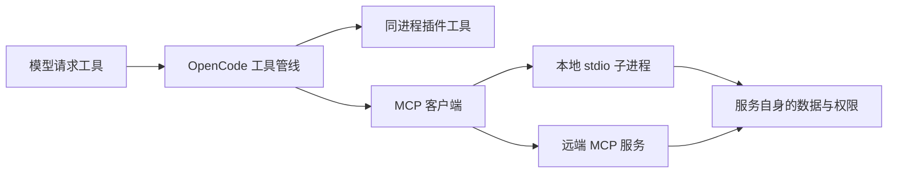

# 第 10 章：MCP 与外部工具

<!-- block: opencode-ch10.b-opening -->
本地插件与 MCP 都能增加工具，但执行位置不同。插件直接进入宿主进程，MCP 通过协议连接另一项服务。选择哪一种，要看你希望共享什么能力、在哪里保存凭据，以及故障该由谁处理。

## 10.1 先把进程边界画出来

本地插件能够访问 PluginInput、注册 Hook，修改宿主准备的提示词或工具输出。MCP 服务则公开协议能力，由客户端发现工具并调用。一个服务可以被多个支持 MCP 的客户端使用，不必把全部业务代码塞进 OpenCode 插件。



图 10-1：两种扩展的执行边界。远端服务的认证与宿主工具审批分别发生。

若你需要修改每轮 system，优先研究插件 Hook；若你已有一个独立检索服务，需要让多种 Agent 调用，MCP 通常更适合。两者也可以配合，但不要为了“架构完整”把一个读本地固定文件的小函数拆成多项服务。

## 10.2 本地与远端配置读法

钉版支持 local 和 remote 两类配置。以下是结构示例，命令和地址需换成你实际维护的服务，示例本身不声称该文件已存在：

```json
{
  "mcp": {
    "project_docs": {
      "type": "local",
      "command": ["python", "tools/docs_server.py"],
      "enabled": true
    },
    "team_docs": {
      "type": "remote",
      "url": "https://docs.example.com/mcp",
      "enabled": false
    }
  }
}
```

local 会启动一个进程，它可能继承环境并访问当前用户可访问的资源；remote 连接远端地址，可能还需要 headers 或 OAuth。示例将远端项关闭，避免把一个说明地址当成可用服务。

本地路径的解释、工作目录和运行环境要实际核对。配置里写 `python`，最终启动的可能是 PATH 中另一份 Python。服务依赖装在哪个虚拟环境、命令是否能在非交互环境运行，都属于集成的一部分。

## 10.3 连接成功之后还需要发现工具

MCP 客户端先连接 transport，再查看服务能力并读取工具定义。连接状态为 connected，并不保证服务一定提供工具：它可能只支持其他资源，或 tools/list 失败。

宿主会把服务名和工具名组合到自己的工具目录中。模型看到的是转换后的定义，所以出现命名冲突或参数差异时，要比较服务原始 schema 与宿主最后发出的 schema。不要只在服务器里打印“收到连接”就认为整个调用链通了。

钉版代码监听连接关闭和工具清单变化。断线后的状态、缓存清单和重新连接结果需要一并检查，否则界面上旧工具名还在，实际调用却已不可用。不同 transport 的失败方式也可能不同。

## 10.4 一次调用有两层失败

第一层是协议和连接：启动失败、握手失败、超时、断线或无效响应。第二层是业务操作：连接正常，工具却因为文件不存在、认证过期或请求参数不成立而失败。

把业务错误转换成普通成功文本，会让宿主误以为操作完成；把所有异常都变成连接错误，又会让排查者不断重连一个其实正常的服务。设计服务时应按协议返回明确状态，并保留适量可公开诊断信息。

重试也要看副作用。检索可以重试，创建工单或发送消息不能仅凭网络中断就盲目重发。服务端最好提供业务请求 ID 或幂等键，让调用者能查询前一次操作是否已完成。

## 10.5 权限不能只放在一端

OpenCode 可以决定是否调用某个 MCP 工具，服务仍需要执行自己的访问控制。一个授权读团队文档的令牌，不应因为客户端传了另一个用户 ID 就能读到所有内容。相反，远端令牌足够强，也不意味着客户端应该默认批准每一次调用。

本地 stdio 服务同样需要注意日志位置。协议消息通常走标准输入输出，诊断日志应走标准错误；把调试文字插进 stdout 可能破坏协议。凭据应从受控环境读取，不硬编码进共享配置。

## 10.6 怎样补一个可复现的集成实验

先写只返回固定文档的本地服务，记录 initialize、tools/list、tools/call；让宿主发现工具，再由本地模型替身调用。之后依次制造启动失败、工具业务失败和连接中断，比较服务状态、会话错误和下一轮消息。

本书本轮没有把这组 MCP 集成实验列为已测。前述机制来自钉版源码，配置是集成起点。把未运行的连接流程说清楚，比在书中贴一张“成功”截图却无法复现更重要。

来源：[MCP 连接、能力与状态](https://github.com/anomalyco/opencode/blob/810c0eba1a7348036f8bdf61e6632d0c36c6876c/packages/opencode/src/mcp/index.ts)、[MCP 与工具管线衔接](https://github.com/anomalyco/opencode/blob/810c0eba1a7348036f8bdf61e6632d0c36c6876c/packages/opencode/src/session/tools.ts)。
