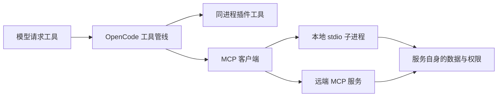
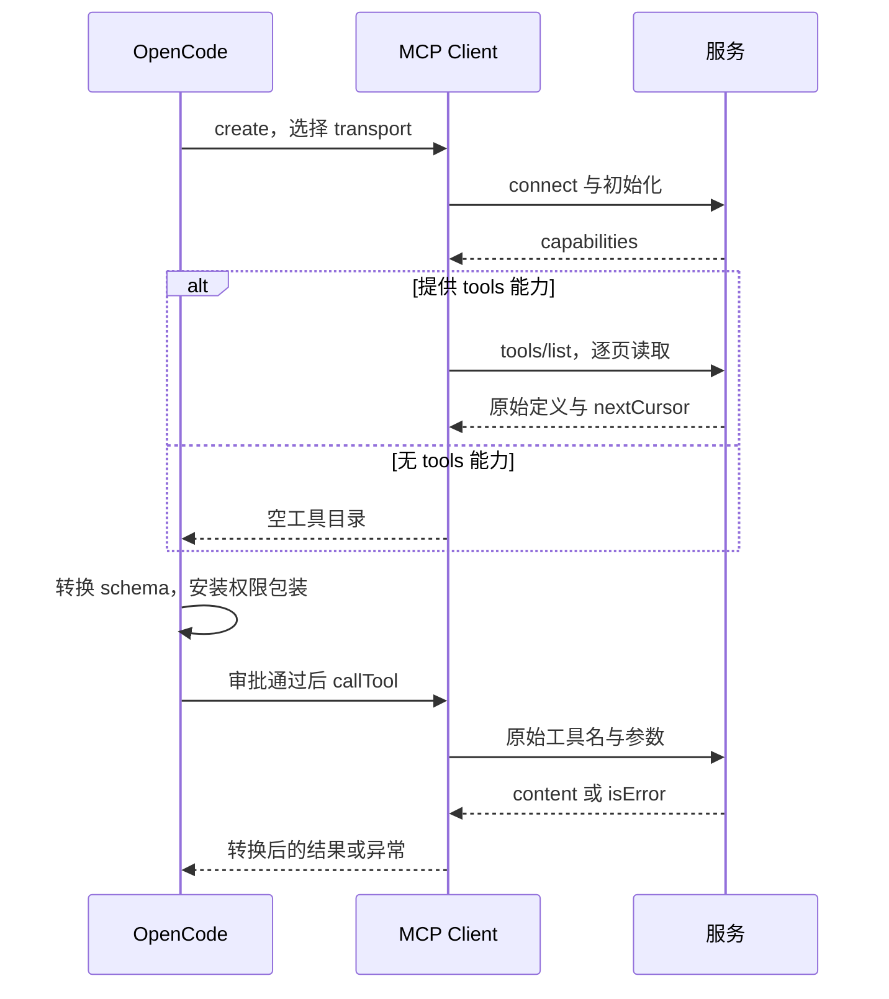

# 第 10 章：MCP 与外部工具

<!-- block: opencode-ch10.b-opening -->
本地插件与 MCP 都能增加工具，但执行位置不同。插件直接进入宿主进程，MCP 通过协议连接另一项服务。选择哪一种，要看你希望共享什么能力、在哪里保存凭据，以及故障该由谁处理。

## 10.1 先把进程边界画出来

本地插件能够访问 PluginInput、注册 Hook，修改宿主准备的提示词或工具输出。MCP 服务则公开协议能力，由客户端发现工具并调用。一个服务可以被多个支持 MCP 的客户端使用，不必把全部业务代码塞进 OpenCode 插件。



图 10-1：两种扩展的执行边界。远端服务的认证与宿主工具审批分别发生。

若你需要修改每轮 system，优先研究插件 Hook；若你已有一个独立检索服务，需要让多种 Agent 调用，MCP 通常更适合。两者也可以配合，但不要为了“架构完整”把一个读本地固定文件的小函数拆成多项服务。

## 10.2 本地与远端配置读法

钉版支持 local 和 remote 两类配置。以下是结构示例，命令和地址需换成你实际维护的服务，示例本身不声称该文件已存在：

```json
{
  "mcp": {
    "project_docs": {
      "type": "local",
      "command": ["python", "tools/docs_server.py"],
      "enabled": true
    },
    "team_docs": {
      "type": "remote",
      "url": "https://docs.example.com/mcp",
      "enabled": false
    }
  }
}
```

local 会启动一个进程，它可能继承环境并访问当前用户可访问的资源；remote 连接远端地址，可能还需要 headers 或 OAuth。示例将远端项关闭，避免把一个说明地址当成可用服务。

本地路径的解释、工作目录和运行环境要实际核对。配置里写 `python`，最终启动的可能是 PATH 中另一份 Python。服务依赖装在哪个虚拟环境、命令是否能在非交互环境运行，都属于集成的一部分。

## 10.3 连接成功之后还需要发现工具

MCP 客户端先连接 transport，再查看服务能力并读取工具定义。连接状态为 connected，并不保证服务一定提供工具：它可能只支持其他资源，或 tools/list 失败。

宿主会把服务名和工具名组合到自己的工具目录中。模型看到的是转换后的定义，所以出现命名冲突或参数差异时，要比较服务原始 schema 与宿主最后发出的 schema。不要只在服务器里打印“收到连接”就认为整个调用链通了。

钉版代码监听连接关闭和工具清单变化。断线后的状态、缓存清单和重新连接结果需要一并检查，否则界面上旧工具名还在，实际调用却已不可用。不同 transport 的失败方式也可能不同。

## 10.4 一次调用有两层失败

第一层是协议和连接：启动失败、握手失败、超时、断线或无效响应。第二层是业务操作：连接正常，工具却因为文件不存在、认证过期或请求参数不成立而失败。

把业务错误转换成普通成功文本，会让宿主误以为操作完成；把所有异常都变成连接错误，又会让排查者不断重连一个其实正常的服务。设计服务时应按协议返回明确状态，并保留适量可公开诊断信息。

重试也要看副作用。检索可以重试，创建工单或发送消息不能仅凭网络中断就盲目重发。服务端最好提供业务请求 ID 或幂等键，让调用者能查询前一次操作是否已完成。

## 10.5 权限不能只放在一端

OpenCode 可以决定是否调用某个 MCP 工具，服务仍需要执行自己的访问控制。一个授权读团队文档的令牌，不应因为客户端传了另一个用户 ID 就能读到所有内容。相反，远端令牌足够强，也不意味着客户端应该默认批准每一次调用。

本地 stdio 服务同样需要注意日志位置。协议消息通常走标准输入输出，诊断日志应走标准错误；把调试文字插进 stdout 可能破坏协议。凭据应从受控环境读取，不硬编码进共享配置。

## 10.6 怎样补一个可复现的集成实验

先写只返回固定文档的本地服务，记录 initialize、tools/list、tools/call；让宿主发现工具，再由本地模型替身调用。之后依次制造启动失败、工具业务失败和连接中断，比较服务状态、会话错误和下一轮消息。

本书本轮没有把这组 MCP 集成实验列为已测。前述机制来自钉版源码，配置是集成起点。把未运行的连接流程说清楚，比在书中贴一张“成功”截图却无法复现更重要。

## 10.7 从配置走到可用的客户端

沿 `MCP.create` 读代码，第一处分支是 `enabled === false`，这时直接得到 disabled，不启动进程。local 路径进入 `connectLocal`：command 数组的第一项成为可执行文件，剩余项成为参数，工作目录默认是当前 instance.directory；配置 cwd 时，用 `path.resolve(baseDir, mcp.cwd)` 解析。因此，把服务脚本放在 tools 目录，不意味着进程自动在那里启动。

假设项目在 `D:/work/catalog`，command 是 `["python", "docs_server.py"]`，cwd 是 `tools`，实际工作目录就是 `D:/work/catalog/tools`。只把 command 改为 `["python", "tools/docs_server.py"]` 而保留 cwd，会再拼出一层 tools。这种错误发生在协议握手之前；应该先核对进程命令，而不是调整模型提示词。环境按 process.env、特殊 opencode 启动设置、mcp.environment 的顺序组成，最后一层能覆盖同名变量。

remote 路径会先验证 URL，再准备 Streamable HTTP 与 SSE 两种 transport，按此顺序尝试。普通连接失败可走下一种；认证失败则停下来，状态区分 needs_auth 与 needs_client_registration。后者提示服务不能动态注册客户端，需要配置 clientId。认证还没准备好时不断换 transport，不会解决账户或注册问题。

`connectTransport` 用 acquireUseRelease 管理 transport：连接失败时关闭它，成功后交给调用者。后面如果 tools/list 失败，create 又会关闭已经连接的 client。握手和目录发现虽然分成两步，资源清理仍连在一起，不会因为“握手成功过”就永久保留一个不可用连接。



图 10-2：连接、目录发现与调用是三个不同关口。每个关口失败时，应查看对应的输入和状态。

## 10.8 工具清单怎样变成模型能调用的定义

具体转换在 `mcp/catalog.ts`。`paginate` 不只读第一页：它累计各页结果，记录 nextCursor，遇到重复 cursor 抛错，超过 1,000 页也停止。这避免异常服务器让目录发现无限循环。`listTools` 通常使用 SDK 的校验；若错误明确涉及 outputSchema 引用解析，再用省略 outputSchema 校验的结构重试。它没有把所有无效响应一律放行。

`toolName` 将客户端名和工具名各自清洗后，用下划线连接。清洗只保留字母、数字、下划线和连字符。例如服务器 `team.docs` 的工具 `find/page` 会成为 `team_docs_find_page`。这不是可逆编码：不同原名可能清洗成相同字符串。取名时应主动避免这类碰撞；排错时同时记录原始名称和宿主目录里的 key。

`convertTool` 把输入 schema 固定为 object，补上空 properties，并设 additionalProperties 为 false。随后 SessionTools.resolve 还经过 ProviderTransform.schema，为当前模型提供者调整 schema。若模型说缺字段，先比较这两次转换后的定义，不要只检查 MCP 服务原始 JSON。

实际执行仍调用原始 `mcpTool.name`，并没有把清洗后的名称发回服务。包装顺序是 before Hook、以目录 key 为权限名的 ask、原始 execute、after Hook。假设目录 key 是 team_docs_find_page，权限规则也需要匹配这个名字。服务端的文件名、客户端别名和宿主权限名分别参与不同步骤。

## 10.9 结果、进度和旧连接

`callTool` 收到的是参数对象、AbortSignal 和 timeout；它同时设置 resetTimeoutOnProgress，并提供空的 onprogress 回调，让 SDK 发出进度 token。因而这里的超时可以因进度而重新计时，不能简单理解为整个业务最多运行多少秒。长任务仍需有服务端自己的终止规则。

结果的 isError 为真时，convertTool 提取非空文本块，拼成异常消息；没有文本则使用默认错误。若 content 为空而 structuredContent 有值，它会补一段 JSON 文本，避免结构化结果在后续文本消费中消失。成功结果随后由 SessionTools 拆分文本和附件，并对文本截断。嵌入资源的二进制内容还有类型与 10 MiB 上限检查；超限会留下省略说明，不能假定服务返回的每个字节都进入模型上下文。

最后看 `watch` 的身份检查。onclose 只有发现 `s.clients[name] === client` 才删除缓存；工具清单变化处理则在异步 list 前后各检查一次。假设旧连接正在刷新列表，新连接已经替换它，旧请求稍后返回也不能覆盖新清单。这类判断保护的是连接代际，单看 connected 字符串不足以做到。

以上三节是 v1.19.5 固定源码的执行解释。本书已跑的 V1 插件实验可以说明宿主 Hook 和权限路径，但没有跨越本章的 MCP transport，不能替代这条链路的集成运行记录。

实际排错可以从模型没有看见工具这一现象反推：disabled 先看配置，needs_auth 先处理认证，failed 看连接或目录发现错误，connected 且清单为空则核对服务是否声明 tools 能力。已经看见工具却调用失败，再查清洗后的权限名、原始参数和 isError 内容。若调用成功但模型没看见附件，应检查结果转换与大小限制。这样一条链把问题落到具体层次，不会把每个异常都归咎于模型“不肯调用”。

来源：[MCP 连接、能力与状态](https://github.com/anomalyco/opencode/blob/810c0eba1a7348036f8bdf61e6632d0c36c6876c/packages/opencode/src/mcp/index.ts)、[目录分页与工具转换](https://github.com/anomalyco/opencode/blob/810c0eba1a7348036f8bdf61e6632d0c36c6876c/packages/opencode/src/mcp/catalog.ts)、[MCP 与工具管线衔接](https://github.com/anomalyco/opencode/blob/810c0eba1a7348036f8bdf61e6632d0c36c6876c/packages/opencode/src/session/tools.ts)。
