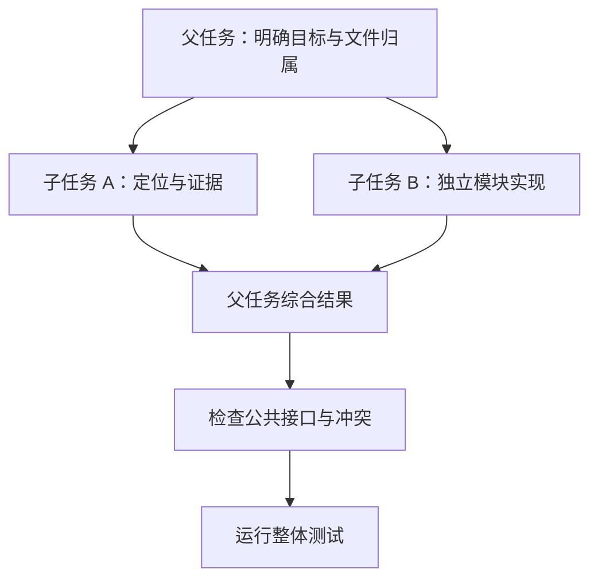

# 第 12 章：Agent 配置与任务委派

<!-- block: opencode-ch12.b-opening -->
把任务交给子 Agent，改变的是执行上下文、角色配置与结果回传方式，不会自动创建独立文件系统。要使用委派，先讲清子任务负责什么、能调用哪些工具，以及返回什么证据。

## 12.1 primary、subagent 与 all

钉版 Agent 类型包含 primary、subagent 和 all 等模式，配置还描述模型、提示词、权限和可见性。内置 build 面向执行任务，plan 用于规划，general 与 explore 面向不同的子任务用途。

名称本身不构成权限保证。plan 的默认编辑规则包含针对计划文件的例外，用户配置还会参与合并；不能只看到“plan”就写成整个进程绝对不能写文件。判断最终能力应读取生效规则，再检查实际执行路径。

```json
{
  "agent": {
    "reviewer": {
      "description": "Review project code and report evidence without editing it.",
      "mode": "subagent",
      "prompt": "Read relevant files and cite concrete locations before proposing changes.",
      "permission": {"*": "deny", "read": "allow", "grep": "allow", "glob": "allow"}
    }
  }
}
```

这是角色配置示例。可用字段、规则合并和工具名称仍应对照固定版本；它没有被列入本书的完整子任务宿主实测。

## 12.2 task 工具先检查什么

钉版 task 工具先读取父会话，沿 parentID 计算深度，检查子任务层数限制，再处理所请求的 agent 类型与权限。后台任务还受实验标志控制，不是传一个 background 参数就能在所有启动方式生效。

子会话会记录父会话 ID 和角色信息。权限由专门函数从父会话与子角色派生，并结合部分工具限制；因此，“子任务继承父任务全部权限”与“子任务完全独立”都过于简单。要看具体规则如何组成。

源码还支持依据已有 task_id 找回子会话的路径。它适合继续同一项研究，但调用者必须确认这是要继续的任务，不能拿一个旧 ID 当成随手复用的缓存键。

## 12.3 怎样分配一个能完成的子任务

给子任务写清范围和返回形式。例如：“只分析 parser.ts 与其测试，找出空字符串处理为何失败，返回涉及函数、最小复现和建议，不修改文件。”这比“看看项目有没有问题”更容易得到可验证结果。

需要并行修改时，明确文件归属。两个子任务同时改公共类型，最后即使没有 Git 文本冲突，也可能产生语义冲突。可以先让一个任务确定公共接口，再把实现分到独立模块；或者用独立工作树审阅后再合并。



图 12-1：委派后的验证责任仍在整项任务这一层。

## 12.4 返回文字不能替代文件状态

子 Agent 说“已修复”，父任务还应检查真实差异和测试输出。子任务可能只提出方案，可能修改了另一工作树，也可能在测试失败后仍给出乐观总结。结构化报告能帮助核对，但最终依据仍是实际文件和执行结果。

同样，取消一个子任务不意味着它写过的文件被撤销。父任务在重新分配前，应确定旧任务停止的位置，避免新任务与旧进程同时写同一目录。第十三章的快照与 Git 检查在这里同样适用。

## 12.5 什么时候不值得派子任务

只有一个小文件需要改一行，派子任务的初始化、上下文交接和复核可能比直接修改更贵。适合委派的是能够独立定义输入与输出的工作：某个模块的源码调查、另一套平台验证、独立章节或测试集。

并行数量也不是越多越好。多个任务争用磁盘、下载同一大仓库或生成同一份产物，可能降低速度。先拆清依赖，再决定并发；遇到共享文件修改，及时收回到主线处理。

来源：[Agent 配置](https://github.com/anomalyco/opencode/blob/810c0eba1a7348036f8bdf61e6632d0c36c6876c/packages/opencode/src/agent/agent.ts)、[task 工具](https://github.com/anomalyco/opencode/blob/810c0eba1a7348036f8bdf61e6632d0c36c6876c/packages/opencode/src/tool/task.ts)。
