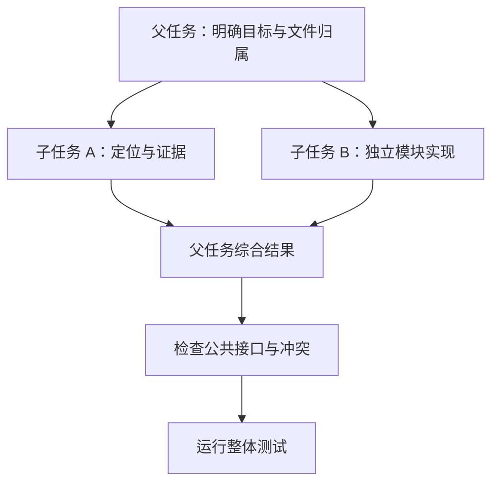

# 第 12 章：Agent 配置与任务委派

<!-- block: opencode-ch12.b-opening -->
把任务交给子 Agent，改变的是执行上下文、角色配置与结果回传方式，不会自动创建独立文件系统。要使用委派，先讲清子任务负责什么、能调用哪些工具，以及返回什么证据。

## 12.1 primary、subagent 与 all

钉版 Agent 类型包含 primary、subagent 和 all 等模式，配置还描述模型、提示词、权限和可见性。内置 build 面向执行任务，plan 用于规划，general 与 explore 面向不同的子任务用途。

名称本身不构成权限保证。plan 的默认编辑规则包含针对计划文件的例外，用户配置还会参与合并；不能只看到“plan”就写成整个进程绝对不能写文件。判断最终能力应读取生效规则，再检查实际执行路径。

```json
{
  "agent": {
    "reviewer": {
      "description": "Review project code and report evidence without editing it.",
      "mode": "subagent",
      "prompt": "Read relevant files and cite concrete locations before proposing changes.",
      "permission": {"*": "deny", "read": "allow", "grep": "allow", "glob": "allow"}
    }
  }
}
```

这是角色配置示例。可用字段、规则合并和工具名称仍应对照固定版本；它没有被列入本书的完整子任务宿主实测。

## 12.2 task 工具先检查什么

钉版 task 工具先读取父会话，沿 parentID 计算深度，检查子任务层数限制，再处理所请求的 agent 类型与权限。后台任务还受实验标志控制，不是传一个 background 参数就能在所有启动方式生效。

子会话会记录父会话 ID 和角色信息。权限由专门函数从父会话与子角色派生，并结合部分工具限制；因此，“子任务继承父任务全部权限”与“子任务完全独立”都过于简单。要看具体规则如何组成。

源码还支持依据已有 task_id 找回子会话的路径。它适合继续同一项研究，但调用者必须确认这是要继续的任务，不能拿一个旧 ID 当成随手复用的缓存键。

## 12.3 怎样分配一个能完成的子任务

给子任务写清范围和返回形式。例如：“只分析 parser.ts 与其测试，找出空字符串处理为何失败，返回涉及函数、最小复现和建议，不修改文件。”这比“看看项目有没有问题”更容易得到可验证结果。

需要并行修改时，明确文件归属。两个子任务同时改公共类型，最后即使没有 Git 文本冲突，也可能产生语义冲突。可以先让一个任务确定公共接口，再把实现分到独立模块；或者用独立工作树审阅后再合并。



图 12-1：委派后的验证责任仍在整项任务这一层。

## 12.4 返回文字不能替代文件状态

子 Agent 说“已修复”，父任务还应检查真实差异和测试输出。子任务可能只提出方案，可能修改了另一工作树，也可能在测试失败后仍给出乐观总结。结构化报告能帮助核对，但最终依据仍是实际文件和执行结果。

同样，取消一个子任务不意味着它写过的文件被撤销。父任务在重新分配前，应确定旧任务停止的位置，避免新任务与旧进程同时写同一目录。第十三章的快照与 Git 检查在这里同样适用。

## 12.5 什么时候不值得派子任务

只有一个小文件需要改一行，派子任务的初始化、上下文交接和复核可能比直接修改更贵。适合委派的是能够独立定义输入与输出的工作：某个模块的源码调查、另一套平台验证、独立章节或测试集。

并行数量也不是越多越好。多个任务争用磁盘、下载同一大仓库或生成同一份产物，可能降低速度。先拆清依赖，再决定并发；遇到共享文件修改，及时收回到主线处理。

## 12.6 一次 task 调用到底创建了什么

把“研究价格函数的边界”交给 reviewer 时，模型提出的参数包含 description、prompt、subagent_type，可选 task_id 与 command。description 用于短标题，prompt 才是子任务正文；二者都不会自动生成工作树。子会话由 sessions.create 建立，带 parentID、agent 和派生权限，标题附上角色名。它仍使用所在 instance 的目录与工作环境。

```json
{
  "description": "Review empty cart handling",
  "subagent_type": "reviewer",
  "prompt": "Read src/pricing.ts and its tests. Explain the empty-cart failure with file locations. Do not edit files."
}
```

运行路径不是直接调用另一个模型。TaskTool.execute 先从 ctx.sessionID 取得父会话，沿 parentID 向上数层数。默认 subagent_depth 为 1，根任务深度为 0，可以启动一层子任务；该子任务深度为 1，再委派就达到限制。增加深度允许更多层次，但不会给最内层自动补足缺失的工具权限。

接下来是 task 权限请求，patterns 使用所请求的 subagent_type。通过后才查找角色；不存在则抛 Unknown agent type。内部 bypassAgentCheck 可以跳过这次角色检查，但不代表所有后续业务工具免审批。真正执行工具时仍有自己的 Tool.Context.ask 与权限合并路径。

若传入 task_id，源码尝试读取对应会话，读取失败会回落为创建新会话。这个行为决定了客户端不能把“传过 ID”当作“肯定续上原会话”。应保存返回 metadata 中的 sessionId，并与期望身份比对。恢复一个有历史的子任务与重新开始可能产生不同回答，这不是模型随机性就能解释的。

## 12.7 权限派生不是复制整个父角色

核心规则在 `agent/subagent-permissions.ts`。它接收 parentSessionPermission 与 subagent；从父会话保留 action 为 deny 的规则，以及 permission 为 external_directory 的规则。父会话普通 allow、ask 不在这一步全部照搬，父 Agent 自身的角色限制也不作为参数直接复制。子角色有自己的能力定义。

例如父会话规则包含 read allow、bash deny、external_directory ask。派生结果保留后两项，read allow 不自动变成子会话规则。子角色本身允许 read 时仍可读，这是子角色与子会话规则共同决定的结果。若父会话明确 deny 某项能力，派生路径会把这个限制带过去。

另一个细节是默认 task 与 todowrite 限制。函数检查子角色规则中是否出现对应 permission 名；没有才添加全匹配 deny。这里是“是否声明过”的检查，不是逐条求值后判断最终 allow。一个显式声明 task deny 的角色不会因为出现过名字就获得委派能力，它仍由自己的 deny 控制。把源码里的 some 检查简写成“允许嵌套就放行”，会漏掉这个区别。

task.ts 还会把 experimental.primary_tools 指定的工具加为子会话 deny，并避免重复插入完全相同的限制。排查子任务工具缺失时，可以依次核对角色定义、父会话传播规则、默认禁止项、primary_tools。只看角色 prompt 中一句“你可以运行测试”，无法知道执行层实际允许什么。

## 12.8 模型、输入与返回结果如何传递

子任务优先使用 next.model；角色没有指定模型时，取父 assistant 消息上的 providerID 与 modelID。variant 也有明确分支：继承父模型时继续带 variant，子角色指定了自己的模型时不沿用父 variant。这样可以避免把一种模型的推理选项误传给另一种模型。

TaskPromptOps 将具体 prompt 执行接缝注入到 ctx.extra。runTask 先 resolvePromptParts，再创建新的 messageID，并向子会话调用 prompt。插件或测试想改变这条链，应找到这个依赖，而不是在 task 工具里另建一套请求客户端。缺少 promptOps 会明确失败。

返回时先检查 assistant 的 error，再查本次结果里最后一个处于 error 的工具 part；命中会把子任务 ID 和错误写进失败消息。正常时提取最后一个 text part，再用 task/result 标签包装。父任务拿到的是经过筛选的结果文字，不是子会话所有消息、全部工具输出或完整文件差异。

这解释了为什么子任务答复最好包含少量可定位证据。研究例中应返回函数位置、触发输入和相关测试，而不是假定父任务已经看过自己的整个上下文。需要进一步审查时，用 metadata 中的 sessionId 定位真实记录。

## 12.9 前台等待与后台通知共用一份任务身份

后台能力受 OPENCODE_EXPERIMENTAL_BACKGROUND_SUBAGENTS 控制。标志关闭时，暴露给模型的基础 schema 不包含 background；即使外部调用传入 true，执行阶段还会再拒绝。配置描述与运行时检查共同起作用。

TaskTool 把子会话 ID 作为后台 job ID。若同一任务仍在运行，background.extend 可追加执行内容；新任务由 background.start 管理。前台默认等待任务完成，也同时等待它是否被提升为后台；提升后返回 running 状态，并由通知路径继续处理。仅看一次 tool 返回，不能把 running 当成 completed。

后台完成或失败后，notify 等待任务结果，再向父会话注入 synthetic text，内容带任务身份和状态。前台路径则在父工具 abort 时调用子会话 cancel，并在释放阶段移除监听。取消接上运行控制，但不会因此恢复已写文件；文件副作用仍属于下一章的恢复问题。

本章沿固定源码解释这些分支，没有把已有插件权限实验扩大成子任务实测。真正接入时最值得保留的身份是父会话、子会话、角色、模型与返回状态；它们比“启动了几个 Agent”更能说明任务如何完成。

对于前面的 reviewer，父任务可以继续处理另一份文档，等审查返回再读取涉及函数与测试。若子任务指出空输入错误，父任务仍要确认它引用的文件属于当前工作树，并把修复后的测试结果连到同一个需求。若返回的是 running 标签，就应等待完成通知，不能把启动文字写成研究结论。若返回 error，则沿子会话 ID 查看失败工具。委派真正节约的是可独立研究的时间，接口、文件状态和最终结果仍要在父任务处重新接起来。

来源：[Agent 配置](https://github.com/anomalyco/opencode/blob/810c0eba1a7348036f8bdf61e6632d0c36c6876c/packages/opencode/src/agent/agent.ts)、[task 工具](https://github.com/anomalyco/opencode/blob/810c0eba1a7348036f8bdf61e6632d0c36c6876c/packages/opencode/src/tool/task.ts)、[子会话权限派生](https://github.com/anomalyco/opencode/blob/810c0eba1a7348036f8bdf61e6632d0c36c6876c/packages/opencode/src/agent/subagent-permissions.ts)。
