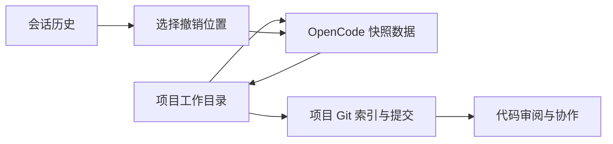

# 第 13 章：工作树、快照和撤销

<!-- block: opencode-ch13.b-opening -->
“回到上一步”可能指回退聊天、恢复文件、切回分支或撤销外部操作。OpenCode 的快照帮助处理部分文件变化，但它与 Git 提交、会话恢复各有边界，不能用一个撤销按钮概括全部副作用。

## 13.1 快照保存在另一处 Git 数据中

钉版 Snapshot 服务为项目工作树准备独立 gitdir，用当前工作树作为 work-tree。它通过 Git 跟踪文件状态，提供 track、patch、restore、revert 等操作；是否启用还取决于版本控制类型及 snapshot 配置。

独立 gitdir 的存在意味着会话快照不等于你平常看到的项目提交历史。它可以帮助记录 Agent 操作前后的变化，却不替你写有意义的提交信息、审查差异或把修改推送到远端。



图 13-1：快照、会话与 Git 协作分别承担的作用。

## 13.2 哪些文件会进入快照

源码会检查版本控制、忽略规则和候选路径，还包含对大型未跟踪文件等情况的处理。不要推断“目录里存在的一切都已备份”。构建缓存、被忽略的凭据、外部目录和远端服务都可能不在这套恢复范围内。

本书的宿主实验显式关闭快照，因此没有声称验证了文件撤销。读者要研究它，应在独立临时仓库里放入 tracked、untracked、ignored 三类文件，分别修改后观察快照与恢复结果，并保留原始副本。

这样的实验还应包含“执行前已有用户改动”。如果只用干净仓库，无法回答撤销会怎样对待原本就存在的修改。评估一个撤销功能，必须先定义要保留什么，不能只检查某个文件变回了旧内容。

## 13.3 会话 revert 具体连接了什么

SessionRevert 首先检查会话不处于忙碌状态，然后根据消息或 part 位置收集相关补丁，调用快照服务，更新会话撤销信息和差异。unrevert 则利用保存的快照恢复撤销前的状态，再清除相应标记。

这里的“消息位置”负责选择边界，真正处理文件的是快照服务。之后继续任务时，cleanup 还会处理被撤销的消息或 parts。聊天记录和文件状态都参与了这段流程，因此直接删数据库中的某条消息不等于执行同样的撤销。

不要在真实工作目录里用手工修改数据库来模拟撤销。除了引用关系和缓存，正在运行的服务可能仍持有旧状态。正常接口能维护的约束，直接改存储不一定会维护。

## 13.4 并行工作最好先隔离文件

如果两个 Agent 同时修改一个目录，快照可能捕获混在一起的变化。哪个文件属于哪个任务、哪个改动在快照前已存在，都需要更多证据。独立 Git 工作树能把任务的文件状态分开，通常比事后猜测更清楚。

```bash
git status --short
git worktree add ../feature-check -b feature-check
```

命令中的目录与分支只是示例，应在你有权限且不存在冲突的位置使用。进入新工作树后，重新确认依赖、配置和项目身份；同一仓库的不同工作树并不保证共享所有运行时缓存，也不保证配置完全一致。

## 13.5 提交前仍要做什么

查看差异，确认只包含任务相关修改；检查新增文件、被忽略文件和生成物；运行实际测试；再提交。快照能帮助恢复失误，但它不会判断一个修改是否符合需求。

外部副作用要单独记录。发出的请求、创建的资源、已经投递的消息，都不能靠恢复本地文件撤回。把这些操作从普通代码编辑里分出来，会让失败后的恢复路径更清楚。

来源：[快照实现](https://github.com/anomalyco/opencode/blob/810c0eba1a7348036f8bdf61e6632d0c36c6876c/packages/opencode/src/snapshot/index.ts)、[会话撤销](https://github.com/anomalyco/opencode/blob/810c0eba1a7348036f8bdf61e6632d0c36c6876c/packages/opencode/src/session/revert.ts)。
