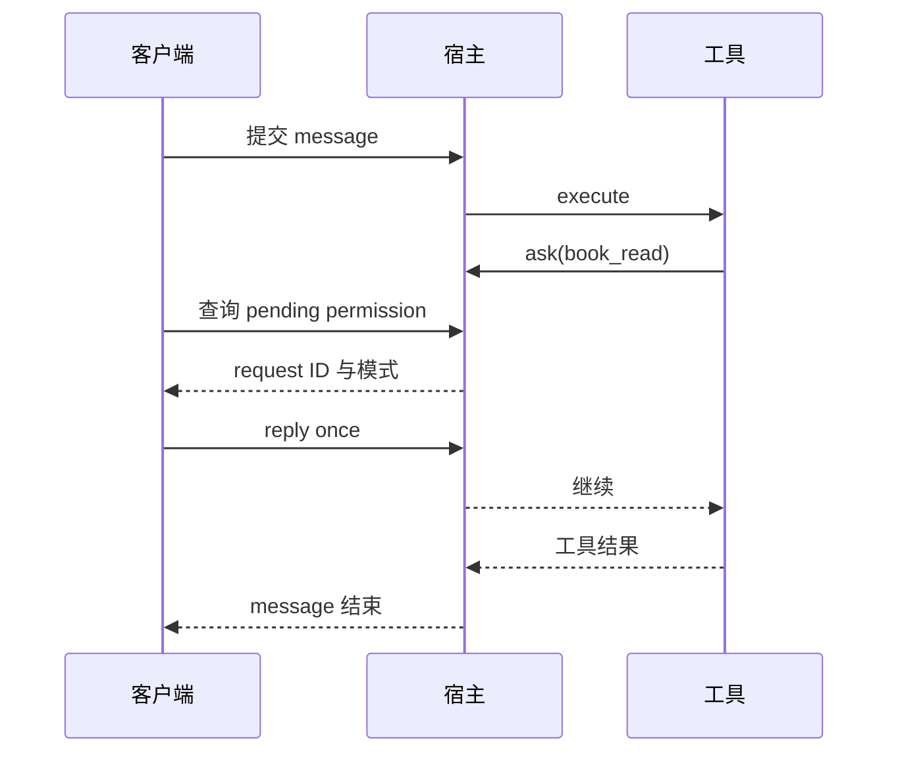

# 第 14 章：SDK、API 与自动化

<!-- block: opencode-ch14.b-opening -->
把 OpenCode 放进自己的工具或流水线时，需要一个能说明结果的客户端。HTTP 请求返回成功、模型发完最后一句话、文件修改通过测试，是三个不同的完成条件，自动化应明确自己检查哪一个。

## 14.1 从已有实验驱动学最小客户端

本书驱动先启动 serve，等待日志确认监听地址，再创建 session，提交 message，检查工具结果和最终状态。它还负责身份认证、目录头、请求超时与进程清理。这些工作比封装一个 `send(prompt)` 多一些，却是可靠自动化不可省的部分。

可以把流程写成下面的教学伪代码，具体字段以驱动和固定 SDK 类型为准：

```python
session = host.request("POST", "/session", {})
answer = host.request("POST", f"/session/{session['id']}/message", {
    "model": {"providerID": "fixture", "modelID": "test"},
    "parts": [{"type": "text", "text": "Read fixture.txt."}],
})
if answer["info"].get("error"):
    raise RuntimeError(answer["info"]["error"])
```

这段不包含完整服务管理，也不应直接用于真实模型费用统计。可执行的 Host 在 `check-host-plugins.py` 中，使用标准库 HTTP 客户端和本地随机认证信息。

## 14.2 为什么请求必须带项目身份

服务可以处理多个项目。客户端要明确传递目录，并验证返回的 session 属于预期项目；不能仅因为连接到正确端口，就认为任务在正确工作树运行。

为流水线设计接口时，可以把项目目录、允许的模型和工具范围作为调用参数中必须校验的部分。不要接受任意外部字符串就原样作为服务器目录。即便只有内部用户，也应该让错误目录容易被发现，而不是默默在另一份工程上运行。

SDK 的便利是类型、端点和事件结构集中在一个发布包里。SDK 版本仍应与宿主配套核对；包目录叫 v2 不足以证明本次宿主使用了 V2 插件运行时。第七章使用发布包中的审批端点类型，实验走的仍是 V1 插件路径。

## 14.3 等待审批时不能堵住处理审批的线程

同步 message 请求可能等待工具完成，而工具又在等待用户审批。如果客户端只串行执行“等待 message 返回，再查 permission”，就可能形成自己制造的等待。

本书权限驱动把 message 放到工作线程，主线程轮询待审批列表。找到本会话对应请求后，检查权限名，发送 once、always 或 reject，再等待消息返回。它只给测试文件的实验权限回复，不把未知请求自动批准。



图 14-1：审批与消息请求需要能够同时推进。

## 14.4 超时、取消与重连怎样记录

客户端超时只说明客户端没有在期限内收到结果。服务端可能仍在运行，工具也可能已经产生副作用。重试前先查询会话与工具状态；若需要取消，使用对应接口并验证状态变化，不要把关闭 socket 当作完成确认。

断线后可恢复的最小资料通常包括会话 ID、最近消息 ID、任务输入、工作目录和已观察到的工具结果。保存这些资料时应去掉凭据和不必要的正文，尤其是 CI 日志会被团队成员长期访问。

本书尚未运行完整取消/重连矩阵，因此没有给出某端点对所有工具“立即停止”的承诺。应用需要取消保证时，应对慢工具、子进程和外部写操作分别设计验证。

## 14.5 把业务完成条件放在模型外面

自动修复测试的流水线，最后应运行测试、检查差异和退出码。模型回复“测试已通过”只能作为一段输出，不能替代实际测试进程的返回值。生成文档的流水线，则应检查目标文件、链接和构建产物。

本书驱动对结果的检查也是如此：最终固定回复之外，还检查下一轮请求里的文件标记、事件顺序和文件是否改变。不同任务需要不同的断言，但都应能在模型说“完成”之外独立成立。

## 14.6 先分清连接身份、项目身份和任务身份

本书的 Host 保存 base、project 与 auth。base 指向本次启动的监听地址，auth 是随机生成的本地服务密码，project 则随每次请求进入 x-opencode-directory。三个值回答不同问题：连接哪一个进程、谁有权请求、请求进入哪个目录。创建会话后再得到 session ID，后续消息与审批都要挂在这个任务身份上。

启动器先向操作系统申请临时端口，释放后再传给 serve。这中间存在短暂交接窗口，所以驱动必须检查自己子进程的日志确实出现预期 listening 地址，也检查进程是否提前退出。仅仅发现端口能连通，不能证明连到刚启动的那一个宿主。随机认证又让误接其他同端口服务更容易失败。

服务端 Session.create 从 InstanceState.context 读取 directory，并计算相对 worktree 的 path；workspaceID 则取显式输入或实例工作区。由此可见，session 中的目录并非随便附加的显示文字，它参与会话所属环境。流水线恢复会话时，除了保留 ID，还应核对原目录和工作树仍对应当前任务。

Host.request 使用标准库构造 JSON 请求，带 Basic Authorization，明确关闭代理环境继承，并设置 45 秒客户端超时。Host.close 先 terminate、等待，超时后再 kill 并回收进程。这个例子同时展示了请求生命周期与进程生命周期：关闭一次请求不等于关闭宿主，宿主关闭也不等于删除实验文件。

## 14.7 SDK 怎样把目录写进真正发出的请求

固定源码中有两份 createOpencodeClient 入口：基础 client 与 v2/client。两者都会为 directory 设置经过 encodeURIComponent 的请求头，并安装请求拦截器。这个编码使带空格或中文的目录能够作为头值传递；读抓包时看到百分号转义，并不意味着路径在磁盘上真的变了名字。

对 GET、HEAD，请求拦截器把目录身份移到 URL 查询参数，再删除目录头；其他方法保留原请求。它会识别配置原值及其编码形式，避免把同一个目录再编码一遍；已有查询参数也不会被默认值覆盖。因此，使用者手工在 URL 填入另一个 directory 时，应知道显式请求参数可能与客户端默认目录不同。

v2 客户端还接受 experimental_workspaceID，放入 x-opencode-workspace。重写 GET/HEAD 时同时处理 directory 与 workspace；路径以 `/api/` 开头时，还补 `location[directory]`、`location[workspace]` 形式。抓包中看见两组位置参数，是这份兼容包装的具体行为，不应自行删掉一组来“简化”请求。

```typescript
const client = createOpencodeClient({
  baseUrl: "http://127.0.0.1:4096",
  directory: "D:/work/catalog",
  headers: { Authorization: authorizationHeader },
});
```

这里展示的是构造参数，authorizationHeader 由应用自己的本地认证配置产生。会话方法应使用与宿主版本匹配的生成类型。不要因为示例只需一个 client 对象，就省掉服务启动、身份核对和退出清理。

## 14.8 为什么 HTTP 成功仍可能是错误结果

v2 客户端的响应拦截器特意检查 Content-Type 等于 text/html 的情况，并抛出“此版本服务不支持请求”的错误。这通常能把错误端点落到网页回退的情况挡在 JSON 消费之前。但它是针对明确内容类型的保护，不能替代业务结果检查，更不能据此保证所有不兼容响应都会得到同样提示。

本书已运行的驱动先检查 `answer.info.error`，再检查 parts 中是否含固定完成标记。随后还检查模型替身收到的下一轮请求：其中必须真的带有读取工具返回的 fixture 标记。第一项防止会话带错返回，第二项确认结束内容，第三项才证明工具结果进入后续推理输入。只保留最后一句话，会遗漏工具没有执行却仍生成完成文字的情况。

权限实验又多检查了一层。工具在调用 ask 前写 entered，批准后写 approved，真实读取后写 read-done。deny 和 reject 场景只能留下 entered；工具被权限过滤、根本没有进入模型目录时，则连 entered 都没有。这些记录将“目录里不可见”“执行中被拒绝”“实际读到文件”区分开，HTTP 200 本身做不到。

## 14.9 消息请求和审批请求如何并行推进

`check-tool-permissions.py` 不是先等待消息结束再处理审批。它用单工作线程发 POST message，主线程读取 GET permission，选中 sessionID 匹配的请求，确认 permission 为 book_read，再向该请求 ID 回复。等待期间还检查事件只有 entered，证明业务尚未越过审批点。

这里至少有三种 ID，不能混用：session ID 选择本次任务，permission request ID 选择待处理请求，tool call ID 对应模型提出的某次调用。回复端点需要的是审批请求 ID。根据工具名直接批准列表第一项，在多会话服务里可能操作另一项任务。

实验分别比较 once 与 always，并通过新会话、instance dispose 后重建检验作用范围。自动化客户端不应把这些词翻译成自己想象的永久授权。它应记录实际回复与范围，读取后续 pending 列表，确认请求已经被消费。实验使用明确的固定权限和文件，正文没有把这个客户端描述成可对未知审批批量放行的机器人。

## 14.10 让 SDK 层保留可以追溯的事实

可靠的自动化输出可以很短：宿主版本、工作目录、会话 ID、最终错误状态、涉及文件和真实检查结果。完整提示词和每一段 token 不必都复制到日志；但若发生超时，至少要知道哪次会话可能仍在执行，不能丢掉身份后直接再创建一个相同任务。

客户端默认 fetch 包装还将请求 timeout 设为 false，这说明长运行请求的等待策略需要由调用应用明确承担。书中 Python 驱动另有自己的 45 秒截止，两者不能混为宿主统一的取消保证。要做更长的流水线，可把状态查询、审批处理与业务检查分开调度，并分别保留失败位置。

上述 HTTP、插件事件和权限场景来自已有本机运行；SDK 参数重写与响应拦截来自同一提交源码。二者互相解释，但证据范围不同。把正在请求的端点、目录、会话及检查条件写清楚，自动化才有机会在没有人在旁边盯着时准确报告结果。

来源：[服务入口](https://github.com/anomalyco/opencode/blob/810c0eba1a7348036f8bdf61e6632d0c36c6876c/packages/opencode/src/cli/cmd/serve.ts)、[会话服务](https://github.com/anomalyco/opencode/blob/810c0eba1a7348036f8bdf61e6632d0c36c6876c/packages/opencode/src/session/session.ts)、[基础 SDK 客户端](https://github.com/anomalyco/opencode/blob/810c0eba1a7348036f8bdf61e6632d0c36c6876c/packages/sdk/js/src/client.ts)、[v2 SDK 客户端](https://github.com/anomalyco/opencode/blob/810c0eba1a7348036f8bdf61e6632d0c36c6876c/packages/sdk/js/src/v2/client.ts)、[原创权限客户端](examples/check-tool-permissions.py)。
