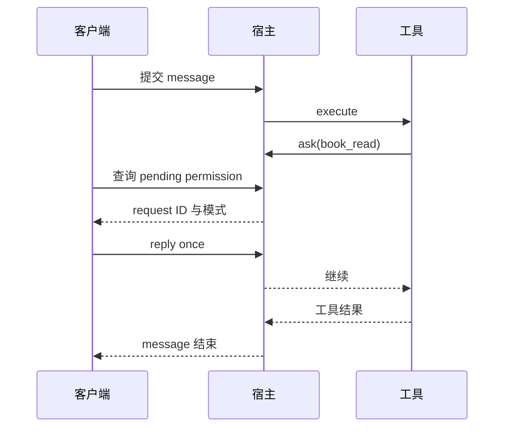

# 第 14 章：SDK、API 与自动化

<!-- block: opencode-ch14.b-opening -->
把 OpenCode 放进自己的工具或流水线时，需要一个能说明结果的客户端。HTTP 请求返回成功、模型发完最后一句话、文件修改通过测试，是三个不同的完成条件，自动化应明确自己检查哪一个。

## 14.1 从已有实验驱动学最小客户端

本书驱动先启动 serve，等待日志确认监听地址，再创建 session，提交 message，检查工具结果和最终状态。它还负责身份认证、目录头、请求超时与进程清理。这些工作比封装一个 `send(prompt)` 多一些，却是可靠自动化不可省的部分。

可以把流程写成下面的教学伪代码，具体字段以驱动和固定 SDK 类型为准：

```python
session = host.request("POST", "/session", {})
answer = host.request("POST", f"/session/{session['id']}/message", {
    "model": {"providerID": "fixture", "modelID": "test"},
    "parts": [{"type": "text", "text": "Read fixture.txt."}],
})
if answer["info"].get("error"):
    raise RuntimeError(answer["info"]["error"])
```

这段不包含完整服务管理，也不应直接用于真实模型费用统计。可执行的 Host 在 `check-host-plugins.py` 中，使用标准库 HTTP 客户端和本地随机认证信息。

## 14.2 为什么请求必须带项目身份

服务可以处理多个项目。客户端要明确传递目录，并验证返回的 session 属于预期项目；不能仅因为连接到正确端口，就认为任务在正确工作树运行。

为流水线设计接口时，可以把项目目录、允许的模型和工具范围作为调用参数中必须校验的部分。不要接受任意外部字符串就原样作为服务器目录。即便只有内部用户，也应该让错误目录容易被发现，而不是默默在另一份工程上运行。

SDK 的便利是类型、端点和事件结构集中在一个发布包里。SDK 版本仍应与宿主配套核对；包目录叫 v2 不足以证明本次宿主使用了 V2 插件运行时。第七章使用发布包中的审批端点类型，实验走的仍是 V1 插件路径。

## 14.3 等待审批时不能堵住处理审批的线程

同步 message 请求可能等待工具完成，而工具又在等待用户审批。如果客户端只串行执行“等待 message 返回，再查 permission”，就可能形成自己制造的等待。

本书权限驱动把 message 放到工作线程，主线程轮询待审批列表。找到本会话对应请求后，检查权限名，发送 once、always 或 reject，再等待消息返回。它只给测试文件的实验权限回复，不把未知请求自动批准。



图 14-1：审批与消息请求需要能够同时推进。

## 14.4 超时、取消与重连怎样记录

客户端超时只说明客户端没有在期限内收到结果。服务端可能仍在运行，工具也可能已经产生副作用。重试前先查询会话与工具状态；若需要取消，使用对应接口并验证状态变化，不要把关闭 socket 当作完成确认。

断线后可恢复的最小资料通常包括会话 ID、最近消息 ID、任务输入、工作目录和已观察到的工具结果。保存这些资料时应去掉凭据和不必要的正文，尤其是 CI 日志会被团队成员长期访问。

本书尚未运行完整取消/重连矩阵，因此没有给出某端点对所有工具“立即停止”的承诺。应用需要取消保证时，应对慢工具、子进程和外部写操作分别设计验证。

## 14.5 把业务完成条件放在模型外面

自动修复测试的流水线，最后应运行测试、检查差异和退出码。模型回复“测试已通过”只能作为一段输出，不能替代实际测试进程的返回值。生成文档的流水线，则应检查目标文件、链接和构建产物。

本书驱动对结果的检查也是如此：最终固定回复之外，还检查下一轮请求里的文件标记、事件顺序和文件是否改变。不同任务需要不同的断言，但都应能在模型说“完成”之外独立成立。

来源：[服务入口](https://github.com/anomalyco/opencode/blob/810c0eba1a7348036f8bdf61e6632d0c36c6876c/packages/opencode/src/cli/cmd/serve.ts)、[会话服务](https://github.com/anomalyco/opencode/blob/810c0eba1a7348036f8bdf61e6632d0c36c6876c/packages/opencode/src/session/session.ts)、[原创权限客户端](examples/check-tool-permissions.py)。
