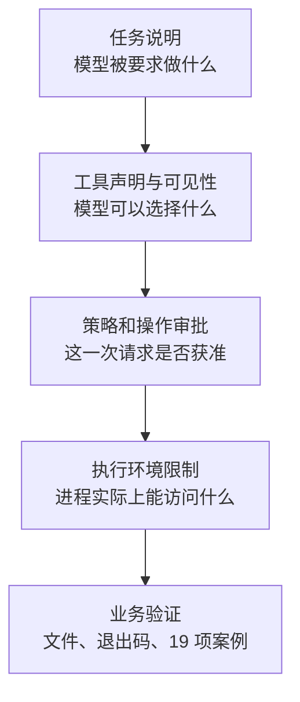

# 第 18 章：版本迁移与架构比较

<!-- block: opencode-ch18.b-opening -->
同一个价格修复任务，可以交给 OpenCode、Pi、DeepSeek Harness、Hermes 或 Codex CLI。业务上的正确答案仍是那 19 项案例，改变的是任务怎样进入系统、工具怎样执行、扩展怎样装配和状态怎样恢复。比较这些系统时，把价格函数留在原处，逐一替换外面的宿主，比列一张“谁支持更多功能”的表更能看见迁移成本。

## 18.1 先固定要比较的三件工作

第一件是第十七章的 `pricing-lab`：读规则、修复一个函数、运行检查、审阅 diff。它评价的是完整任务交付，使用真实模型时还要固定模型、预算和初始提交。不同模型带来的差异，不能全部归给宿主。

第二件是第七章的固定文件读取：工具只读 `fixture.txt`，在读取之前提出明确权限请求，并在执行入口、批准之后、读取完成时记录事件。它可以用确定的工具调用序列驱动，适合观察可见性、拒绝和授权寿命。

第三件是 `review-trace`：修改一段系统说明，关联工具前后事件，记录耗时，卸载时清理状态。它把扩展协议、生命周期和错误处理放在同一个小插件里。迁移这三个能力时，代码改动落在哪一层，就是架构差异的具体证据。

| 对照对象 | 保持不变 | 允许按宿主改写 |
| --- | --- | --- |
| 价格修复 | 业务规则、错误基线、检查预期 | 启动参数、任务入口、输出读取 |
| 文件读取 | 文件内容、拒绝条件、事件位置 | 工具注册和权限申请接口 |
| 观察器 | 关联目的、清理要求、日志字段含义 | Hook、事件、服务或子进程协议 |

本册固定 OpenCode 1.19.5，Pi 对照采用 1.5.0；DeepSeek Harness、Hermes 和 Codex CLI 的基线见系列来源表。比较结论应随这些基线保存，不能从“两个当前版本不同”推出某一种设计永远更强。

## 18.2 同样叫插件，装配方式并不相同

OpenCode V1 的插件函数返回 Hooks，宿主按次序把共享 output 交给回调。`review-trace` 追加 system 文本时修改 `output.system`，并不返回一份新请求让宿主自动替换。迁移到另一个事件系统，首先要查的是结果怎样传递：原地修改、返回新值，还是只供观察。

DeepSeek Harness 的固定实现建立在 Cordis 服务与事件之上。工具、提示词、Agent 工厂等能力分属服务；消费者的依赖和插件的清理与上下文关联。把观察器移过去，不能只把 Hook 名换成事件名，还要确定是监听最终结果，还是进入能改变决策的 waterfall。日志放错位置，可能意外成为策略参与者。

Pi 的扩展通过 `ExtensionAPI` 注册工具、命令和事件。`registerTool` 面向模型，`registerCommand` 面向用户；pi-purge 的模式开关由用户发起，所以不需要为了“做成插件”再给模型添一个工具。迁移 OpenCode 的观察器时，应先确定用户是否需要命令入口，以及状态应只在本次运行内存在，还是写进会话条目。

Codex CLI 的插件可以打包技能、Hook、MCP 等资源。其命令 Hook 通过结构化输入输出与宿主交互，并不是把一份 JavaScript Hooks 对象装进 OpenCode 式共享回调。若只是提供“怎样检查金额”的方法，技能文本就足够；若需要在工具前拒绝某个动作，才去核对对应 Hook 的输出语义。

这几种装配都能扩展系统，但运行位置和契约不同。将业务纯函数、日志格式和实验输入独立保存，迁移时通常只需重写宿主适配部分；把所有业务规则嵌进一段巨大的 Hook，则会把接口更换变成整项功能重写。

## 18.3 拒绝一次读取，要看拒绝发生在哪里

本书 `read-fixture` 在执行器内调用 `context.ask`。实验中的 deny 已进入工具，但未执行读文件；hidden 连执行器都没有进入。always 只在所测同实例、相同 permission/pattern 下跨新会话复用，dispose 后消失。这些事实分别属于操作授权、工具可见性和授权状态寿命。

DeepSeek Harness 的工具管线区分准备、执行与完成，前置策略、guard、审批、around-dispatch、后置策略和最终结果观察各有位置。迁移一个拒绝规则时，要先判断它是否允许被后续策略改写；若要求最终拒绝，不能随意塞进一个可继续修改的 waterfall 后就假定效果相同。

Codex CLI 又需要把审批政策与执行环境分开。提示词说“只读”、Hook 返回拒绝、沙箱限制进程写入，是不同层的机制。固定 Hook schema 允许表达的字段组合，也可能被运行时语义检查进一步限制；Codex 分册的 PreToolUse 例子就保留了这项区别。不能只做 JSON Schema 校验就宣称批准路径实测可用。

图中的层次是比较用的检查顺序，不表示每个宿主都原生提供全部机制。OpenCode 实验包装器可以直接用 Node API 写事件文件，工具拒绝没有拦截这些写入。所以把工具权限当成插件进程沙箱，会漏掉真实执行边界。外部 MCP 服务也有自己的进程、账号和资源范围，不能由一个本地只读目录自动约束。

## 18.4 卸载、恢复与遗忘分别动了哪份状态

OpenCode 的同进程实验中，实例重新初始化让模块级计数器从 1 到 2；只有重启进程才重新加载修改后的源码。这提示迁移者画出状态位置：插件工厂内的 Map、模块顶层变量、项目实例和磁盘文件各自属于不同寿命。

DeepSeek Harness 的 Cordis 组件实验则围绕服务依赖、作用域释放、旧调用晚到和重新挂载检查资源归属。它适合研究长期组合中“谁拥有这个服务、谁负责卸载”。但组件实验不能替代完整 Agent 与 Session 的恢复；会话写句柄、持久事件、输入队列仍有自己的契约。

Hermes 的长期记忆提供另一种对照。内置 MemoryStore 同时涉及磁盘条目、对象里的活列表和加载时形成的系统提示快照。文件已经修改，并不表示本轮旧快照也改变。把价格项目的规则入口保存成记忆，可以帮助下一次找到 `AGENTS.md`；每次任务仍应重读当前文件，避免把上一次规则当成永远有效。

| 动作 | 应检查的状态 | 不能顺手假设 |
| --- | --- | --- |
| 插件 dispose | 订阅、连接、Map 与注册 | 已写文件被撤销 |
| 进程重启 | 模块重载和重新装配 | 磁盘缓存与历史都消失 |
| 会话恢复 | 历史、临时资源重建、当前目录 | 工作区自动回到旧提交 |
| 删除记忆条目 | 磁盘、新加载快照、其他副本 | 当前对话立即忘记旧内容 |
| 取消工具 | 执行器停止与已有副作用 | 已完成的写入自动回滚 |

这样的表也能指导恢复实验。给每份状态放一个独立标记，逐个执行 dispose、重建实例、重启进程和新建会话，再读取标记。单独看一句“已恢复”无法解释哪些状态被恢复了。

## 18.5 外部程序怎样知道任务已经结束

人坐在终端前，可以根据界面和输出判断是否仍在工作；程序需要稳定协议。Pi 分册将 print 最终文本、JSON 事件流和双向 RPC 分开，并指出 `agent_end` 后仍可能发生重试或恢复，自动化应理解 `agent_settled` 的语义。这个事件名不能照搬给 OpenCode。

OpenCode 的客户端/服务端设计允许外部客户端围绕会话与事件工作。我们的宿主驱动没有把“请求被接受”当成完成，而是继续观察工具正文进入下一轮请求，并等待所需事件。Codex app-server 则有 thread、turn、item 身份，命令审批请求和完成通知属于结构化协议；单次请求成功也不等于整个业务任务通过。

迁移价格练习时，可以把客户端的最后一步统一写成“取得最终 diff，并在目标目录运行 `check_pricing.py`”。不同宿主的结束信号决定何时开始这一步，19 项业务结果决定这一步是否成功。若协议已经结束但检查失败，任务仍需修复；若模型输出一句成功但协议还有活动，也不应立即清理它的工作目录。

日志字段的名称同样需要适配。OpenCode 使用的 sessionID/callID，与其他协议中的 threadId/turnId/itemId 或 tool_use_id 不完全同义。给每套接口保留原始身份，再在自己的汇总记录里建立对应关系，比强行重命名所有字段更容易追查丢失事件。

## 18.6 从需求反推值得研究的实现

如果你正在做一个可远程控制的代码代理客户端，OpenCode 的会话、HTTP 服务和 SDK 链路值得先拆开；如果要把许多业务服务组合进 Agent 运行时，DeepSeek Harness 的依赖与作用域更接近问题本身。关注终端里的命令、工具和 UI 扩展，可以从 Pi 的注册入口和 pi-purge 的模式状态入手。

任务若跨越多次会话，重点是事实怎样保存、方法怎样复用、定时任务怎样沿用当前规则，Hermes 的记忆、技能与历史更有帮助。要理解命令执行审批、平台执行边界以及编辑器怎样控制任务，Codex CLI 的执行器、Hook 和 app-server 协议值得单独研究。

这些是研究入口，不是总分排名。只想修复一个价格函数时，最重的架构未必给你更多收益；真正影响当次结果的可能只是规则是否明确、工具能否读取文件、测试有没有覆盖舍入。等需求确实需要长期运行或外部控制，再把相应系统层次引进来。

## 18.7 升级比较时保留原实验的输入

升级记录至少保留源码提交、实际二进制版本、平台、依赖和输入样本。用旧脚本先跑新宿主，再解释差异。若模块缓存行为改变，应更新生命周期章节；若 always 授权开始持久化，应更新清理后的预期。不能只改书封上的版本号，让旧表格继续描述新实现。

不要在跨宿主实验中悄悄补上缺失能力。例如某系统没有原生操作审批，自己写一层审批器可以作为适配方案，但结果应写“应用补充了审批”，而不是“宿主原生支持”。某项本地组件通过，也不应扩大成完整真实模型任务通过。保留这两种区分，读者才能知道哪些结论可以直接复用，哪些还需要在自己的运行链上补证据。

下一次迁移可以从本章开头的三个小项目开始：先让固定文件读取满足拒绝条件，再让观察器在清理后不残留状态，最后把同一份价格基线交给真实模型。每项结果都能独立审阅，失败时也有明确的下一层可查。

来源：[系列固定来源表](../docs/agent-series/sources.lock.json)、[OpenCode V1 插件](https://github.com/anomalyco/opencode/blob/810c0eba1a7348036f8bdf61e6632d0c36c6876c/packages/opencode/src/plugin/index.ts)、[OpenCode 权限服务](https://github.com/anomalyco/opencode/blob/810c0eba1a7348036f8bdf61e6632d0c36c6876c/packages/opencode/src/permission/index.ts)、[Pi 扩展文档](https://github.com/earendil-works/pi/blob/f9a26365568127461c47a07a37dcb42c140a3ac5/packages/coding-agent/docs/extensions.md)、[Pi CLI 集成](https://github.com/earendil-works/pi/blob/f9a26365568127461c47a07a37dcb42c140a3ac5/packages/coding-agent/docs/cli-integration.md)、[DeepSeek 工具管线](https://github.com/deepseek-ai/deepseek-harness/blob/fcc0ad462172522aaf5c93a7b2e01f6b9f0b0159/packages/core/tools/src/pipeline.ts)、[Hermes 记忆存储](https://github.com/NousResearch/hermes-agent/blob/2bd378ed1b8d6bf2192cb26e0a55ff3091e6bd19/tools/memory_tool_store.py)、[Codex Hook 输出语义](https://github.com/openai/codex/blob/086ccc833bc9cf01024ad2dd6af7dbd421b6bf9a/codex-rs/hooks/src/engine/output_parser.rs)。
