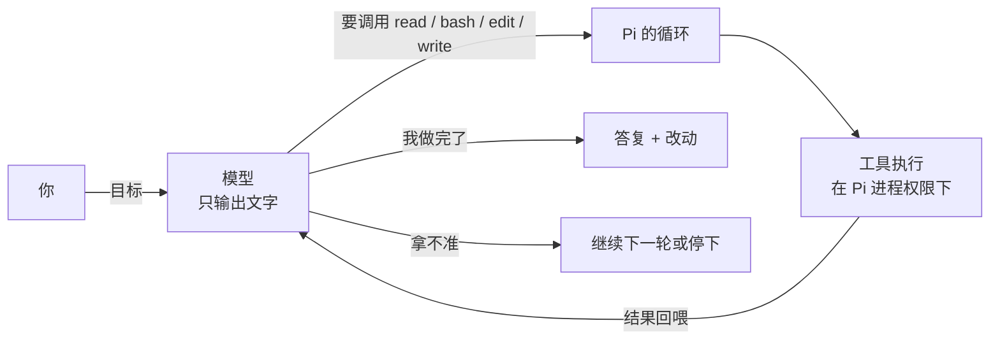

# 第1章 小而可改：Pi 到底是什么

设想一个对照：同一个模型、同一个任务，给一份 300 行的日志，找出其中重复的报错并按频率排序；
两台机器只有壳不同。

第一台装了"全家桶"式 agent：三十多个工具、子代理、计划模式、浏览器控制。模型看了半分钟工具清单，
选了浏览器，又回退，再选子代理，最后用 `bash` 跑了三行 `sort | uniq -c`，任务完成——花了四分钟，
账单上多出六次模型请求。

第二台只给了四个工具：读文件、执行命令、改文件、写文件。模型读了日志，跑了一条命令，给出结果。
一分半，两次请求。

两个 agent 都"对"了。差别不在模型，在**壳**——也就是这本书反复要讲的那一层：harness。

这一章要回答的问题是：**Pi 这个壳，砍掉了什么，为什么砍掉反而是它的卖点？**
答案会决定你后面每一章的读法：Pi 的很多"缺失"不是没做完，是设计选择；你需要判断的是，
这些选择对你的任务是不是合适。

## 1.1 先回到三分法：模型、工具、循环

不管哪个 agent，拆开都是三样东西：

```ill
pi-plate-p1
```


- **模型**：只能输出文字。它看不见你的硬盘，也不能执行命令。
- **工具**：程序提供给模型的一批有名字的动作。模型说"我要读 `src/app.ts`"，程序真去读，
  再把内容喂回去。
- **循环**：模型决定下一步 → 程序执行工具 → 结果回喂 → 模型再决定，直到它说做完了。



Pi 的内置工具很少。`pi --help` 末段列了 8 个名字：`read`、`bash`、`powershell`、`edit`、`write`、
`grep`、`find`、`ls`。默认启用的只有 4 个：`read`、`bash`、`edit`、`write`（`docs/cli.md` 与源码的 `DEFAULT_TOOL_NAMES`）。
`powershell` 只在原生 Windows 上可用，但**不在默认列表**；`grep`、`find`、`ls` 标着 `off by default`，
是只读的搜索/列目录工具，要用 `--tools` 显式打开。

这不是"少即是多"的口号，是**上下文预算**的算术。每个工具的定义都要进系统提示，模型每一轮都要读；
工具越多，留给任务本身的注意力越少，选错工具的概率越高。Pi 把默认值压到最小，把"要不要加"交给
运行它的人。

## 1.2 它有意不做的东西

Pi 的 README 有一句很直白的话：

> Pi ships with powerful defaults but skips features like sub-agents and plan mode.
> Ask Pi to build what you want, or install a package that does it your way.

翻译过来：**子代理和计划模式这类功能，Pi 不自带**。你需要就自己写扩展、装包，或者直接让 Pi 帮你做。

这句话信息量很大。对从 Claude Code 或 Omp 过来的读者，它意味着：

- 你在别处习惯的"派一个子代理去搜""先出计划再执行"，在 Pi 里默认不存在；
- 不存在不等于做不到——扩展可以在同一进程里注册工具、命令、事件处理器，甚至自己的 UI；
- 但**默认没有**这件事本身是设计：Pi 不替你决定工作流。

同样值得先记住的是安全边界。README 的 Permissions 段写得很清楚：Pi **不包含**限制文件系统、
进程、网络或凭据访问的内置权限系统；默认就用启动它的那个用户的权限运行。`docs/security.md` 进一步说明，
project trust 只管"要不要加载这个目录里的设置和可执行资源"，**不限制工具调用能碰什么**。
工具和扩展都在 Pi 进程内执行。

所以"Pi 怎么保证安全"的正确答案不是"它会问你"，而是"它不保证，你要用容器或操作系统边界"。
第 22 章会把这条展开；现在只要记住：**不要把 Pi 的极简误解成有一层隐形的护栏**。

## 1.3 五个扩展点，各管一段

Pi 把"让你改成自己的样子"拆成五个层次，从轻到重：

| 你想做的事 | 用哪个 | 形态 | 生效范围 |
| --- | --- | --- | --- |
| 给某个目录定长期规矩 | 上下文文件 `AGENTS.md` / `CLAUDE.md` | 一段 Markdown | 该目录及其子目录 |
| 把一段常用提示变成斜杠命令 | 提示模板 | 一个带 frontmatter 的 Markdown | `/` 菜单 |
| 给任务补专门指令和附属文件 | 技能 | 一个目录，按需加载 | 模型判断需要时 |
| 加工具、命令、快捷键、事件处理器、UI | 扩展 | 一个 TypeScript 模块 | 进程内 |
| 把上面几样打包分发 | Pi 包 | npm / git 源 | 安装到用户或项目 |

这五层不是随便并列的，它们回答的是不同的问题：**"模型该一直记得什么"（上下文文件）、
"我不想每次重打这段提示"（模板）、"这类任务的说明书和脚本"（技能）、"程序要长出新能力"（扩展）、
"怎么把这一套装给别人"（包）**。`docs/quickstart.md` 末尾给了一张"从最轻的机制开始"的选择表，
顺序也是这个。

新手最常见的错误是：明明一句话能写进 `AGENTS.md`，却先写了一个扩展。扩展是代码，代码要维护、
要调试、要处理版本升级；先问"有没有更轻的一层能做"。

## 1.4 一个进程，四种进入方式

Pi 不只是给你一个终端界面。同一套 agent、会话、资源和工具，可以从四个口进去：

| 方式 | 接口 | 生命周期 | 什么时候用 |
| --- | --- | --- | --- |
| 交互模式 | 终端 UI | 直到你退出 | 人坐在终端前干活 |
| Print | 最终文本打到 stdout | 一次调用 | 脚本里要"跑完给结果" |
| JSON | stdout 上逐行事件（JSONL） | 一次调用 | 程序要结构化进度 |
| RPC | stdin/stdout 双向 JSONL | 常驻 | 外部程序要持续控制 |

`docs/cli-integration.md` 特别说明：**SDK 不是 CLI 模式**，它把 agent 直接嵌进 Node.js 或 Bun 进程。
四种模式共享同一套 agent 与会话机制，模式只决定"输入怎么进、输出怎么出、进程活多久"。

这一点对后面很重要：你在交互模式里看到的工具卡片、上下文占用、会话分支，不是 TUI 特有的魔法，
而是 agent 与 session 层的状态被渲染出来。理解这一层，第 9 章和第 13 章才不会读成两个故事。

## 1.5 本章小实验：把"小"量出来

不需要写代码，三条命令就能把这一章的说法核实一遍。本机（Windows，Pi 1.5.0）已跑过，
原始输出见书稿目录的 `VERIFY.md`。

**第一步：确认版本与帮助。**

```bash
pi --version
pi --help
```

`--version` 应当打出一行版本号（本机 `1.5.0`）。`--help` 退出码 0，末尾有一段
`Built-in Tool Names:`——数一下，8 行，前 5 个没有标注，后 3 个写着 `off by default`。
这就是 1.1 节的算术：**默认 4 个，平台可选 1 个，藏起来 3 个**，不是"三十个"。

**第二步：跑最短的一圈。**

```bash
pi --print --no-tools --no-session "只回复两个字：在线"
```

本机实测：stdout 只有一行 `在线`，stderr 为空，退出码 0。`--no-tools` 把工具全关了，
所以这一圈只有"提示 → 模型 → 文本"；`--no-session` 让它不落盘。你可以加 `--no-session` 前后各数一次
sessions 目录里的文件数，确认它真的没写。

**第三步：看模型目录。**

```bash
pi --offline --list-models nvidia | head
```

本机打出 `nvidia` 名下的一串模型和它们的上下文长度、最大输出、是否支持 thinking / 图片。
`--offline` 表示不发起网络请求，读本地模型数据；这对"到底有哪些模型可用"是个安全的查法。

三步做完，你对 Pi 的第一印象应该是：**能跑、能查、默认很克制**。至于"克制"值不值，要看你接下来
怎么用它——这就是第二篇的内容。

## 1.6 翻车对照：命令行不会替你猜

Pi 的参数解析比较严格，但错误信息不是每处都同样友好。下面几条都是本机 1.5.0 实测：

| 翻车做法 | 会看到什么 | 正确做法 |
| --- | --- | --- |
| `pi --nope` | `Error: Unknown option: --nope`，退出码 **1** | 旗标拼错就是硬错，照 `pi --help` 抄原文 |
| `pi --model`（漏了值） | 同样报 `Error: Unknown option: --model`，退出码 1——缺值被解析器当成未知选项 | 写全 `--model <pattern>`；`--model` 只跟 `--provider` 搭配时要先给 provider |
| `pi --provider nvidia "hi"` | `Error: --provider requires --model`，退出码 1 | 要么两个都给，要么都别给 |
| `--model not-a-model` | `Error: Model "not-a-model" not found. Use --list-models ...`，退出码 1 | 先用 `--list-models` 查可用 ID，注意 provider 前缀 |
| `pi --list-models zzzz` | `No models matching "zzzz"`，但退出码是 **0** | 脚本里不能只看退出码；要判断 stdout 是否为空 |
| 以为 Pi 每次工具调用前都会问 | 不会。Pi 没有内置权限系统，工具按进程权限直接跑 | 用容器 / 独立用户 / 受限凭据；见第 22 章 |

最后一行不是命令行问题，是整套设计里最容易踩的坑：把"没弹窗"当成"它检查过了"。
Pi 的文档在 Permissions 与 Security 两处都写了同一件事，读的时候不要跳过去。

## 1.7 与御舆、Omp 的同构点

三册拆的是同一个循环：模型出文字、程序执行、结果回喂、直到任务结束。你在 1.1 建立的三分法，
在御舆里叫"对话循环 + 工具系统"，在 Omp 里叫"agent 循环 + 三十多个内置工具"，在 Pi 里是
`agent` 包加 `coding-agent` 的 turn。名字不同，问的问题一样：**这一轮谁在决定、谁在执行、什么时候退出。**

但边界不同，而且差异很关键：

- 御舆那台车有完整的权限管线；Pi 明确没有内置权限系统。
- Omp 默认给三十多个工具、子代理、LSP；Pi 默认 5 个工具，子代理要自己装。
- 三册的会话格式、配置文件路径、旗标都不一样，不能互换。

所以对照只搬**问题清单**，不搬数字。第 25 章会把这张对照表补成逐项、带证据的版本；在那之前，
遇到"Omp 里是这样，Pi 应该也差不多"的念头，先停下来查文档。

下一章从"装"开始：三条安装路径、Node 版本这道硬门槛、工作目录为什么重要，以及装好之后
第一圈该怎么跑、跑完该看哪里。

---

**版本核对清单**（写作钉 `pi/1.5.0`，提交 `f9a2636`；本机 2026-11-08 复验）

- [ ] `pi --version` 是否为 `1.5.0`；不是的话先看附录 E，不要直接套用本章数字。
- [ ] `pi --help` 末段 `Built-in Tool Names` 是否仍是 8 个名字（4 默认 + 1 平台可选 + 3 `off by default`）；
      上游增删工具时，1.1 与 1.5 两处要一起改。
- [ ] `docs/security.md` 是否仍明确写"project trust 不限制工具调用"；这条若改，1.2 与第 22 章都要重写。
- [ ] `--model` 漏值是否仍报 `Unknown option`（退出 1）；若上游改成更友好的报错，1.6 表要更新。
- [ ] `pi --list-models <无匹配>` 是否仍退出 0；这条是"退出码不等于结果"的教学例子，别删。
