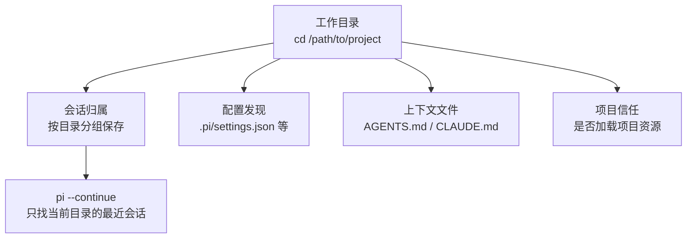

# 第2章 装好，跑通第一圈

装一个命令行工具，最容易出事的从来不是"下载失败"，而是**装对了版本、跑错了目录**。

有个读者在 `C:\Users\me` 下装了 Pi，随手在家目录启动，让 Pi"看一下这个项目"。Pi 读到了整个用户目录，
把一堆无关文件塞进上下文，还顺手在 `~` 下建了一个会话。第二天他 `cd` 到项目里跑 `pi --continue`，
发现昨天那段对话"不见了"——其实没丢，只是 `--continue` 只找**当前目录**的最近会话。

这一章解决三件事：用哪条路装、装完怎么确认、第一圈在哪里跑。顺序不能反：先选目录，再启动。

## 2.1 三条安装路径，四种命令

`docs/quickstart.md` 给了三种装法（安装器按操作系统分成两条命令），选一种就好，不要叠着装：

| 路径 | 命令 | 特点 |
| --- | --- | --- |
| 官方安装器（macOS / Linux） | `curl -fsSL https://pi.dev/install.sh \| sh` | 依赖全部钉版本，用 `pi update` 更新自己 |
| 官方安装器（Windows） | `powershell -c "irm https://pi.dev/install.ps1 \| iex"` | 同上，装成原生 Windows 进程 |
| npm 全局 | `npm install -g --ignore-scripts @earendil-works/pi-coding-agent` | 简单，但**不钉**传递依赖；要求 Node.js >= 22.19.0 |
| Nix（macOS / Linux） | `nix profile add github:earendil-works/pi/stable` | 从源码构建；`pi update` **不能**更新 Nix 安装 |

两个细节值得先记住：

- **安装器 vs npm**：安装器把依赖钉死，npm 不钉。想要可复现的环境，用安装器或 Nix；
  只是想在某个容器里快速试一下，npm 也行，但要接受"下次装可能拿到不同的传递依赖"。
- **卸载不清理配置**：三条路径卸载后，`~/.pi/agent/` 里的配置、凭据、会话、已装包都还在。
  这是刻意留的（重装不用重配），也意味着**别把卸载当成"清理干净"**。

## 2.2 Node 版本是硬门槛

`package.json` 的 `engines` 写的是 `node >= 22.19.0`。低于这个版本，别指望"也许能跑"——
上游把下限写在这里，就是不给兼容承诺。两个安装器会自己处理 Node；用 npm 装的话，先查：

```bash
node --version
```

本机是 `v24.14.0`，在门槛之上。如果你的是 20.x 或更早，先升级 Node（或改用安装器），再谈下一步。

## 2.3 先选目录，再启动

Pi 的"工作目录"不是一个可选参数，它同时决定四件事：



所以正确顺序永远是：

```bash
cd /path/to/project
pi
```

而不是"先在家目录打开，再让 Pi 自己找"。后者不会报错，但会让你后面每一步都对不上：
信任决定记在了错误的目录、会话存到了别处、`@文件` 的相对路径也不是你以为的那个。

`docs/sessions.md` 把几条入口的目录行为列得很清楚：

| 入口 | 实际用的工作目录 |
| --- | --- |
| `--continue` | 当前目录 |
| `--resume`、`/resume`、`--session`、`/import` | 会话自己记录的目录，可能不是当前目录 |
| `--fork` | 当前目录，新会话 |

换句话说：**`--continue` 是"这个目录上次聊到哪"，`--resume` 是"打开某个会话，它原来在哪就在哪"**。
两个词长得像，行为不一样。

## 2.4 接上模型：`/login` 与 `/model`

Pi 本身不含模型。第一次用要在交互模式里跑 `/login`，选 provider，按提示走 OAuth 或存 API key；
凭据默认存进 `~/.pi/agent/auth.json`。之后 `/model` 选模型，`/thinking` 调推理档位。

在 CI 或不想落盘凭据的场合，用环境变量（例如 `ANTHROPIC_API_KEY`、`OPENAI_API_KEY`、
`NVIDIA_API_KEY`），或者启动时给 `--api-key`。`docs/providers.md` 提醒：`/logout` 只删 `auth.json`
里的凭据，**不会**清环境变量、不会改 `models.json`、也不会去 provider 那边吊销密钥。

想先看看有哪些模型，不必登录也可以：

```bash
pi --offline --list-models
```

本机实测能打出表格（provider、model、context、max-out、thinking、images 六列）。
`--offline` 关掉启动时的网络操作，读的是本地模型数据；它不代表模型一定可用，只代表**目录里有这一项**。

## 2.5 本章小实验：三圈，从最短到带会话

以下命令都在**一个你愿意让它读写的项目目录**里跑，不要在家目录。本机（Windows，Pi 1.5.0）已跑过，
原始输出见书稿目录的 `VERIFY.md`。

**第一圈：确认身份。**

```bash
node --version
pi --version
```

期望：Node `>= v22.19.0`；`pi` 打出 `1.5.0`（或你装的其他版本）。两条都不对，先解决安装，别往下走。

**第二圈：最短的一次请求，不落盘。**

```bash
pi --print --no-tools --no-session "只回复两个字：在线"
```

本机实测：stdout 一行 `在线`，stderr 空，退出码 0。三个旗标各管一件事：`--print` 跑一次就退出、
`--no-tools` 不给工具、`--no-session` 不写会话文件。跑完去 sessions 目录数文件，数量应该没变。

**第三圈：同样一次请求，看 JSON 长什么样。**

```bash
pi --mode json --no-session --no-tools "只回复两个字：在线" | head -3
```

本机前三行是：

```json
{"type":"session","version":3,"id":"...","timestamp":"...","cwd":"D:\\Temp\\User"}
{"type":"agent_start"}
{"type":"turn_start"}
```

注意：即使加了 `--no-session`，**会话头这条协议记录仍然会打出来**——它是 JSON 模式的开场，
不等于"已经写盘"。后面才是 `message_start`、`message_update`、`message_end` 这些事件。
第 8 章会把这条流拆开讲；现在只要确认：同一圈请求，文本模式和 JSON 模式共享同一个 agent，
只是输出的形状不同。

**第四圈（可选）：让它真的落一次盘。**

去掉 `--no-session` 再跑一次，然后：

```bash
ls ~/.pi/agent/sessions/
```

你会看到一个按工作目录命名的子目录（形如 `--D--Temp-User--`），里面是
`<时间戳>_<会话 ID>.jsonl`。`head -2` 看前两行：第一行是会话头，第二行通常是 `model_change`。
这就是第 5 章要拆的"会话树"的最外层。

## 2.6 翻车对照：装和跑阶段的六个坑

| 翻车做法 | 会看到什么 | 正确做法 |
| --- | --- | --- |
| Node 低于 22.19 还用 npm 装 | 安装或启动阶段报引擎不满足；具体信息随 npm 版本不同，别指望它一定友好 | 先 `node --version`，升级或改用官方安装器 |
| 在家目录启动，第二天 `cd` 到项目里 `pi --continue` | 找不到昨天那段对话——`--continue` 只找**当前目录** | `pi --resume` 选会话，或养成"先 cd 再启动"的习惯 |
| npm 和安装器各装了一份，终端里跑的是哪份说不清 | `pi --version` 可能和你以为的不一致 | `which pi`（Windows 用 `where pi`）看实际路径；只留一份 |
| 用 Nix 装的，却跑 `pi update` | 上游文档明确写了：Nix 安装不能用 `pi update` 更新 | 用 `nix profile upgrade pi`；要钉版本就写 tag |
| 用安装器卸载后以为清干净了 | `~/.pi/agent/` 里的凭据、会话、包都还在 | 卸载只删程序；要清配置得手动处理那个目录 |
| Windows 上直接让模型跑 `bash`，但没装 Git Bash | Pi 会报告它检查过的几个路径，然后失败 | 装 Git for Windows，或在 settings 里配 `shellPath`；也可改用 `powershell` 工具 |

Windows 还有一条容易忽略：`!` 开头的编辑器命令**始终走 Bash**，即使你把模型工具换成了 `powershell`。
原生 Windows 默认用 Git Bash 跑 `bash` 工具；`powershell` 工具只在原生 Windows 进程下可用。
（`docs/windows.md`）

## 2.7 与另两册的装法差异

- **Omp** 是 Bun 全局安装的单文件二进制，命令叫 `omp`，配置在 `~/.omp/agent`。
- **Pi** 是 Node 程序，要求 Node >= 22.19.0，命令叫 `pi`，配置在 `~/.pi/agent`。
- **御舆那册**讲的是闭源产品 Claude Code，安装方式与这两册都不同。

三条线不要混：`pi update` 不会更新 `omp`，`omp` 的旗标也不认。第 25 章会把这张表补全。

下一章讲模型与凭据的细节：provider 有哪几类、OAuth 和 API key 各适合谁、`models.json` 里能改什么，
以及"模型明明可用，为什么 Pi 说找不到"。

---

**版本核对清单**（写作钉 `pi/1.5.0`，提交 `f9a2636`；本机 2026-11-08 复验）

- [ ] `package.json` 的 `engines.node` 是否仍为 `>=22.19.0`；门槛一变，2.2 与整章前提都要改。
- [ ] `docs/quickstart.md` 的三条安装路径是否仍是 installer / npm / Nix；新增路径要补进 2.1 表。
- [ ] `--no-session` 下 JSON 模式是否仍先输出 `{"type":"session",...}` 协议头（本机 1.5.0 是）。
- [ ] `--continue` 是否仍只匹配当前目录、`--resume` 是否仍能跨目录打开（`docs/sessions.md`）。
- [ ] `pi update` 对 Nix 安装是否仍无效；若上游补上支持，2.1 与 2.6 两处都要改。
- [ ] Windows 的 `!` 命令是否仍固定走 Bash（`docs/windows.md`），以及 `powershell` 工具是否仍限原生进程。
