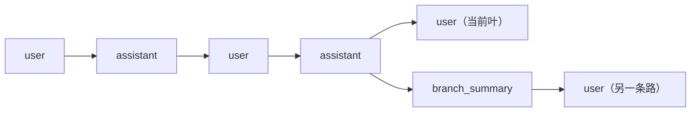

# 第5章 会话是一棵可以回退的树

改到一半，你发现思路错了。你往回翻到第三条消息，把当时那句需求改了，重新发出去。

在大多数聊天工具里，这一改等于**覆盖**：后面的对话没了。Pi 不覆盖，它在同一个会话文件里长出一条新分支，
旧分支原样保留。你可以来回切，比较两条路的结果。

这一章讲清"会话"到底是什么：不是一个滚动的聊天记录，而是一棵有父子的树。先看这棵树：

```ill
pi-plate-ch05-tree
```


## 5.1 一条会话，一棵树

Pi 把会话存成 JSONL，每行一个条目。除第一行的会话头外，每个条目都有 `id` 和 `parentId`：

```json
{"type":"message","id":"a1b2c3d4","parentId":"prev1234","timestamp":"...","message":{"role":"user","content":"..."}}
```

- `parentId` 指向上一条，形成树。
- **当前叶**（leaf）是你现在的位置；从叶往根走，就是"活动分支"。
- 模型只看到活动分支，不是整个文件的所有分支。



`/tree` 在**同一个会话文件**里移动叶；`/fork` 从某条用户消息长出一个**新会话**；`/clone` 把当前活动分支
复制成一个新会话。三者都在"不删旧路"的前提下工作，区别是结果落在哪个文件里。

## 5.2 三个动作，什么时候用哪个

| 动作 | 结果 | 什么时候用 |
| --- | --- | --- |
| `/tree` | 在当前文件里移动叶，旧分支还在 | 同一件事的几个方案，想放在一起比较 |
| `/fork` | 从某条用户消息创建新会话 | 这个方向要独立成一项工作 |
| `/clone` | 复制当前活动分支到新会话 | 想留一个"从现在开始"的副本 |

在 `/tree` 里选中一条用户消息，它的文本会回到编辑器；改完提交，就从那里长出新分支。
离开一条分支时，Pi 可以让模型给被放弃的那段做**分支摘要**，附到你进入的分支上——这样旧路上的结论不会全丢，
但也不会把每条消息都带回来。

## 5.3 磁盘上长什么样

默认在 `~/.pi/agent/sessions/`，按工作目录分组：

```text
~/.pi/agent/sessions/--D--Temp-User--/2026-11-08T12-41-25-629Z_01a1bb2d-....jsonl
```

- 目录名来自工作目录：去掉开头的分隔符，把 `/`、`\`、`:` 换成 `-`。
- 文件名是 `<时间戳>_<会话 ID>.jsonl`。
- 首行是会话头：`{"type":"session","version":3,"id":"...","timestamp":"...","cwd":"..."}`。
- 当前的会话格式版本是 **3**；旧版本在加载时自动迁移。

会话头不属于树（没有 `id`/`parentId`）。之后的条目类型很多：`message`、`model_change`、
`thinking_level_change`、`compaction`、`branch_summary`、`custom`、`custom_message`、`label`、
`session_info`、`usage`、`context_edit`。第 12 章会逐个拆。

## 5.4 本章小实验：自己造一个会话文件

**第一步：跑一次会落盘的请求。**

```bash
cd /tmp && pi --print --no-tools "只回复：会话测试"
```

去掉 `--no-session` 后，`~/.pi/agent/sessions/--D--Temp-User--/` 下会多一个 `.jsonl`。

**第二步：看头两行。**

```bash
f=$(ls -t ~/.pi/agent/sessions/--D--Temp-User--/*.jsonl | head -1)
head -2 "$f"
```

本机实测：第一行是 `{"type":"session","version":3,...}`，第二行是 `model_change`（如果你切换过模型，
还会有 `thinking_level_change`）。每条都带 `id`/`parentId`，只有会话头没有。

**第三步：数条目类型。**

```bash
python - "$f" <<'PY'
import json,sys,collections
c=collections.Counter(json.loads(l)["type"] for l in open(sys.argv[1],encoding="utf-8"))
print(c)
PY
```

你会看到 `message` 占多数。把这份文件复制一份、改几个 `parentId` 做实验，比在 TUI 里点来点去更容易理解树。

## 5.5 翻车对照：会话层的五个坑

| 翻车做法 | 会看到什么 | 正确做法 |
| --- | --- | --- |
| 在家目录跑 `pi`，之后在项目里 `--continue` | 找不到那段对话 | `--continue` 只找**当前目录**；用 `--resume` 选会话 |
| 以为 `/tree` 会删掉旧分支 | 文件反而变长（多出分支条目） | `/tree` 只移动叶；不想要的分支用会话选择器删除 |
| 用 `/fork` 想"合并回原会话" | 新会话是独立文件，不自动合并 | 分支比较用 `/tree`；独立工作用 `/fork` |
| 直接删 `.jsonl` 当"清理" | 会话选择器里消失，无法恢复 | 交互式删除（`/resume` 里 `Ctrl+D`）才会走回收站（有 `trash` 时） |
| 把 `--resume` 当成"继续当前目录" | 打开了另一个目录的会话 | `--resume` 用会话自己的 cwd；`--continue` 才用当前目录 |

最后两条经常一起出现：**`--continue` 看目录，`--resume` 看会话**。记住这一句，能省掉很多"我的会话去哪了"。

## 5.6 与另两册的同构点

御舆那册把会话当成"对话循环的持久化"；Omp 有会话恢复与分支。Pi 的特别之处是把树直接写进 JSONL，
`id`/`parentId` 是公开契约，所以你能用脚本读、能用 SDK 建、能自己算活动分支。
对照时只借"活动分支决定上下文"这条，不要假设三边的文件格式一样。

下一章回答一个更根本的问题：模型每次请求，到底看到了什么？

---

**版本核对清单**（写作钉 `pi/1.5.0`，提交 `f9a2636`；本机 2026-11-08 复验）

- [ ] `docs/session-format.md` 的当前版本是否仍是 `3`；条目类型清单是否增删。
- [ ] 会话目录 slug 规则（替换 `/`、`\`、`:`）是否未变。
- [ ] `/tree`、`/fork`、`/clone` 的落盘差异是否仍如 5.2 表。
- [ ] `--continue` 是否仍只匹配当前目录，`--resume` 是否仍按会话 cwd 打开。
- [ ] `/resume` 里删除会话是否仍优先走 `trash`。
