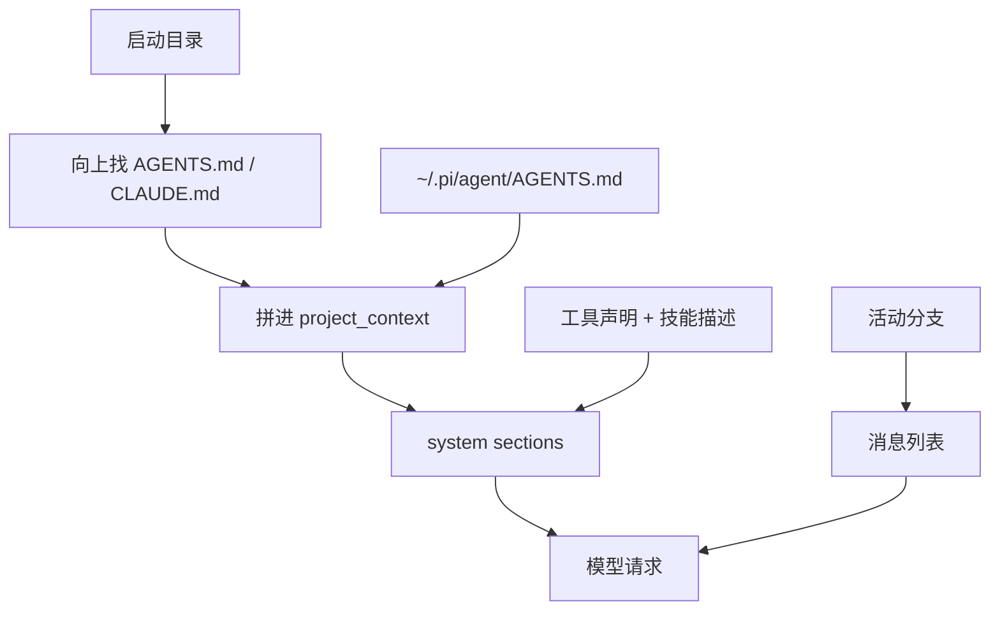

# 第6章 上下文从哪来：系统提示、AGENTS.md、技能描述

"我明明在 `AGENTS.md` 里写了用 pnpm，它还是跑了 `npm install`。"

先别怪模型。打开一次 JSON 模式的请求，看 system 消息里到底装了什么：

```bash
pi --mode json --no-session --no-tools "暗号是什么？" | head -2
```

你会在 `message.sections` 里看到 `preamble`、`tools`、`rules`、`docs`、`project_context`、`cwd` 这些段。
`project_context` 就是你的 `AGENTS.md`。它**确实**在里面——如果不在，多半是文件放错了目录。

这一章拆开"模型每次看到什么"，以及哪些东西**不**受项目信任保护。

## 6.1 一次请求的六个来源

`docs/how-pi-works.md` 把请求拆成：系统提示、活动分支、可用工具、模型设置，再加上技能描述与上下文文件。
落到 Pi 的实现，system 消息的 sections 至少有：

| 段 | 内容 | 来自哪 |
| --- | --- | --- |
| `preamble` | 基础身份与行为规则 | Pi 内置 |
| `tools` | 工具声明 | 当前启用的工具 |
| `rules` | 行为约束 | 内置 + 配置 |
| `docs` | 文档路径提示 | 内置 |
| `project_context` | 项目指令 | `AGENTS.md` / `CLAUDE.md` |
| `cwd` | 当前工作目录 | 启动目录 |

模型请求 = 这些段 + 活动分支（第 5 章）+ 本轮工具结果。**不在活动分支上的消息不会进入请求**，
不在这些段里的文件也不会。

## 6.2 上下文文件：位置比内容更重要

Pi 从 agent 目录、工作目录及其父目录找这些文件：`AGENTS.override.md`、`AGENTS.md`、`AGENTS.MD`、
`CLAUDE.md`、`CLAUDE.MD`。规则有三条：

1. 文件对**它所在目录及其所有子目录**生效。
2. `AGENTS.override.md` 只替换**同一目录**的 `AGENTS.md`/`CLAUDE.md`，不会压掉上层或 agent 目录的文件。
3. 上下文文件**不需要项目信任**就会加载。

第 3 条最容易误解：项目信任（project trust）管的是 `.pi/settings.json`、`.pi/extensions`、
`.pi/skills` 这些**可执行/可配置资源**；`AGENTS.md` 只是一段文本，Pi 在信任决定之前就会读它。
`docs/security.md` 的原话是：即使拒绝信任，上下文文件仍会加载，除非你显式关闭。



推论：想让它"永远记得"某条规则，放在**正确的目录**比写得更长有用；想让它只对某个子项目生效，
把 `AGENTS.md` 放进那个子目录，而不是根目录。

## 6.3 技能、模板与扩展各自改哪一段

- **上下文文件**：进 `project_context`，每轮都在。
- **技能**：启动时只把 `name`、`description`、路径放进系统提示；模型需要时才读 `SKILL.md` 全文。
- **提示模板**：在进入 agent 之前展开成用户消息，不改系统提示。
- **扩展**：可以监听 `context` / `context_with_system` 事件，改消息甚至改整段 transcript；也能注册工具，
  让 `tools` 段变化。

这四层不是替代关系。规则用上下文文件，重复提示用模板，专门流程用技能，要写代码才用扩展。

## 6.4 本章小实验：证明 AGENTS.md 真的进了请求

**第一步：造一个带暗号的目录。**

```bash
mkdir -p /tmp/pi-lab && cd /tmp/pi-lab
printf '项目暗号：青隼。回答时只输出暗号本身。\n' > AGENTS.md
```

**第二步：用 JSON 模式跑一次，不启用工具。**

```bash
pi --mode json --no-session --no-tools "暗号是什么？" > events.jsonl
```

**第三步：在事件流里找暗号。**

```bash
python - <<'PY'
import json
for line in open('events.jsonl', encoding='utf-8'):
    o = json.loads(line)
    if o.get('type') == 'message_start' and o['message'].get('role') == 'system':
        secs = o['message'].get('sections') or {}
        print(list(secs))
        print('青隼' in str(secs.get('project_context')))
PY
```

本机实测：sections 是 `['preamble','tools','rules','docs','project_context','cwd']`，
`project_context` 里能找到 `青隼`，路径指向 `/tmp/pi-lab/AGENTS.md`。模型也按要求只回了暗号。

**第四步：把文件挪走再跑一次。**

```bash
mv AGENTS.md AGENTS.md.bak
```

同样命令，`project_context` 段里就没有暗号了。这一进一出，比读十遍文档更能说明"位置决定上下文"。

## 6.5 翻车对照：上下文层的五个坑

| 翻车做法 | 会看到什么 | 正确做法 |
| --- | --- | --- |
| 把 `AGENTS.md` 放在家目录，却在项目里启动 | 规则没生效（除非项目在 home 之下且文件层级对） | 放进项目根，或 `cd` 到项目再启动 |
| 以为拒绝项目信任就不会加载 `AGENTS.md` | 文本仍然进了请求 | 规则文件本身不受信任门禁；要禁用得显式关闭上下文加载 |
| 用 `AGENTS.override.md` 想压掉上层规则 | 只压同目录，上层仍然生效 | 把要覆盖的规则写在**同一目录**的 override 里 |
| 在根 `AGENTS.md` 写子项目专用命令 | 所有子目录都受影响 | 下沉到子项目目录 |
| 把几千行文档全塞进 `AGENTS.md` | 每轮都占上下文，模型反而忽略重点 | 规则留短句，细节放技能或普通文件，需要时再读 |

## 6.6 与另两册的同构点

三册都有"项目指令文件"：御舆那册叫 `CLAUDE.md`，Omp 也认 `AGENTS.md`/`CLAUDE.md`，Pi 同名。
差别在加载时机与信任边界：Pi 把上下文文件明确排除在项目信任之外，并写进了安全文档。
对照时借"位置决定作用域"这条，不要借对方的加载顺序。

下一章讲上下文满了以后发生什么：压缩、分支摘要，以及为什么"它忘事"有时是设计。

---

**版本核对清单**（写作钉 `pi/1.5.0`，提交 `f9a2636`；本机 2026-11-08 复验）

- [ ] `docs/configuration.md` 的上下文文件名与 override 语义是否未变。
- [ ] `docs/security.md` 是否仍明确写"上下文文件不受项目信任保护"。
- [ ] 本机 JSON 模式的 system `sections` 是否仍含 `project_context` 与 `cwd`。
- [ ] 技能是否仍只把 name/description/path 放进系统提示，全文按需加载。
- [ ] 提示模板是否仍在进入 agent 前展开。
