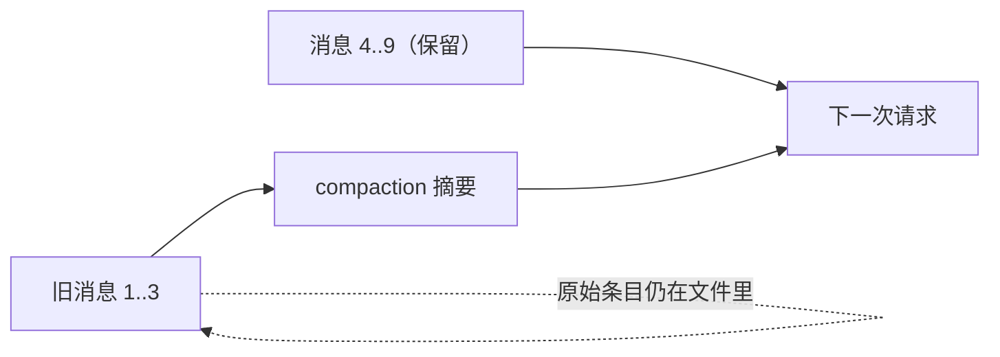

# 第7章 压缩、分支摘要与"忘事"

一段会话跑了两个小时。你问它"我们一开始定的接口是什么"，它答得似是而非，甚至把后来讨论的方案当成最初的约定。

它不一定在胡说。上下文窗口是有限的，Pi 在接近上限时会把旧消息压成摘要，摘要里保留什么、丢掉什么，
决定了它"记得"什么。这一章讲两种摘要：**压缩**（compaction）和**分支摘要**（branch summarization）。

## 7.1 两种摘要，两个触发点

| 机制 | 触发 | 目的 |
| --- | --- | --- |
| 压缩 | 上下文超过阈值，或 `/compact` | 把旧消息总结掉，给新消息腾位置 |
| 分支摘要 | `/tree` 切换分支 | 把被放弃那条路上的工作保留成一段摘要 |

两者都用结构化的摘要格式，都会累计文件操作（读过哪些、改过哪些）。区别是压缩发生在**同一条分支**上，
分支摘要发生在**两条分支之间**。

## 7.2 压缩：不是删记录，是换视角

自动压缩的条件是：

```text
contextTokens > contextWindow - reserveTokens
```

`reserveTokens` 默认 **16384**，`keepRecentTokens` 默认 **20000**，都能在
`~/.pi/agent/settings.json` 或项目的 `.pi/settings.json` 里改。前者只决定"什么时候开始压"，
后者决定"最近多少 token 原样保留"。

压缩时 Pi 会：

1. 在最终会话投影上往回走，累计到 `keepRecentTokens`，找到切点；
2. 把切点之前的消息交给模型，生成结构化摘要；
3. 追加一条 `compaction` 条目，带 `summary` 和 `firstKeptEntryId`；
4. 下一次请求用"摘要 + 从 `firstKeptEntryId` 起的消息"重建上下文。



关键点：**原始条目不会被删**。压缩只改变"未来请求看到什么"，文件里的历史、导出、UI 里的记录都还在。
`firstKeptEntryId` 指向被保留的第一条；如果一条都不保留，就存压缩条目自己的 ID。

Pi 在几个位置检查阈值：工具结果追加后、下一次助手回复前、新用户提示前，以及低层 run 结束后的
溢出恢复。provider 报上下文溢出或提前 `stopReason: length` 时，还可能触发一次"压缩后重试"。

## 7.3 分支摘要：离开一条路，留下它的结论

在 `/tree` 里切到另一条分支时，Pi 可以让模型给刚离开的那段做摘要，生成 `branch_summary` 条目，
`fromId` 指向被放弃的叶。它不会把旧路上的每条消息都带回来，只留下结论、约束和未完成的事。

这对"试了两个方案，最后选一个"特别有用：另一条路的失败原因还在，但不会占满上下文。

## 7.4 本章小实验：看默认值，不强行触发压缩

压缩需要长会话才触发，本章不为了演示去烧 token。可以验证三件事：

**第一步：确认本机没有显式配置。**

```bash
grep -E 'compaction|reserveTokens|keepRecentTokens' ~/.pi/agent/settings.json
```

本机 `settings.json` 存在，但上面这条没有任何输出——说明用的是文档默认值（16384 / 20000），
不是某次实验留下的自定义值。

**第二步：确认条目字段。**

```bash
grep -n "firstKeptEntryId" -A 2 -B 2 node_modules/@earendil-works/pi-coding-agent/docs/session-format.md 2>/dev/null | head
```

如果你没装 npm 包，用 `pi --help` 查不到这段；直接看钉版文档的 `Session File Format` 一节。

**第三步：在真实长会话里观察。**

跑一段足够长的会话，等页脚上下文接近上限，或手动 `/compact`；然后看会话文件里是否多出
`{"type":"compaction",...}`。这一步**本章未验证**（没有为写书制造长会话），你复验时以实际条目为准。

## 7.5 翻车对照：摘要层的五个坑

| 翻车做法 | 会看到什么 | 正确做法 |
| --- | --- | --- |
| 关掉自动压缩，以为 `/compact` 也不能用 | 手动压缩仍然可用 | 两者独立；自动关掉不代表手动禁用 |
| 以为压缩删了历史 | 会话文件条目没少，反而多了一条 `compaction` | 要删历史得删会话文件或用选择器删除 |
| 摘要后继续问早期细节 | 模型答不准——早期原文已不在请求里 | 把关键约束重新贴一遍，或从 `firstKeptEntryId` 之前的条目里找原文 |
| provider 不可用时 `/compact` | 摘要请求失败 | 修好 provider 再压；禁用自动压缩不会禁用错误提示 |
| 在 `/tree` 里频繁切换 | 每次都生成分支摘要，花 token | 比较方案时先想好切几次；不需要摘要可关掉相关设置 |

## 7.6 与另两册的同构点

御舆那册把压缩写成"四级渐进压缩"，Omp 有上下文管理与自动压缩。三家都在做同一件事：
**用有损摘要换窗口**。差别在触发公式、保留边界和条目格式。对照时只借"摘要替换上下文、原文仍落盘"
这条，不要拿别家的阈值当 Pi 的默认值。

下一章离开会话内部，看怎么把结果带出去：文本、JSON、RPC，以及导出。

---

**版本核对清单**（写作钉 `pi/1.5.0`，提交 `f9a2636`；本机 2026-11-08 复验）

- [ ] `docs/compaction.md` 的默认值是否仍是 `reserveTokens=16384`、`keepRecentTokens=20000`。
- [ ] 触发条件是否仍是 `contextTokens > contextWindow - reserveTokens`。
- [ ] `CompactionEntry` 是否仍要求 `firstKeptEntryId`，是否仍保留原始条目。
- [ ] `/tree` 的分支摘要是否仍写 `branch_summary` 条目并带 `fromId`。
- [ ] 关闭自动压缩是否仍不影响手动 `/compact`。
