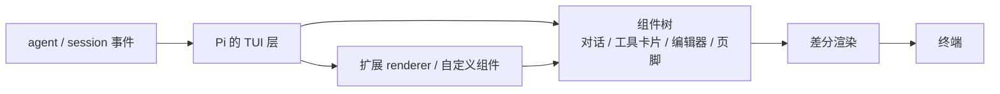

# 第13章 TUI：差分渲染、事件与主题

同一个会话，在终端里是滚动的工具卡片，导出成 HTML 后是另一种排版。变的是渲染器，不变的是事件。

这一章讲 Pi 的终端界面：它怎么把事件变成画面、主题怎么跟终端走，以及扩展能改到哪一层。

## 13.1 终端 UI 是一层库

Pi 的 TUI 来自 `@earendil-works/pi-tui`：一个带差分渲染的终端 UI 库。差分的意思是——
每帧只重写变化的行，而不是清屏重画。长会话滚动时不闪，靠的就是这个。

`docs/tui.md` 把扩展能用的部分拆成：组件模型、内置组件组合、键盘与焦点、鼠标、自定义屏幕/浮层、
主题、渲染响应性。你写扩展 UI 时面对的是这些，不是"直接往 stdout 打印"。

## 13.2 事件怎么变成画面



- 对话、工具调用、错误、状态都来自事件（第 8、9 章）。
- 工具卡片默认折叠，`Ctrl+O` 展开；thinking 块 `Ctrl+T` 切换。
- 启动头列出加载的指令与资源；页脚显示目录、模型、会话、上下文与花费。
- 扩展可以注册 entry renderer、tool renderer，或用 `ctx.ui.custom()` 接管一块屏幕。

## 13.3 主题：跟着终端走，而不是自带一套

默认主题是 `system`：Pi 启动时问终端要前景色、背景色和 16 个 ANSI 色，再按背景明暗放置颜色。
正文对背景至少 4.5:1 的对比度；终端不回答时退回 ANSI 索引色。终端切明暗，主题会重建。

设置里可以写：

```json
{ "theme": "dark" }
{ "theme": "light/dark" }
```

`light/dark` 表示"亮色终端用 light，暗色终端用 dark"。`--use-theme` 只改这一次运行，不写设置。
主题名不能含 `/`，因为它是自动模式的分隔符。

## 13.4 键位与模式

- 全屏模式（`fullscreen`，默认）：编辑器与状态区固定，对话在窗口内滚动。
- 常规模式（`regular`）：走终端自己的回滚缓冲。
- `--tui-mode` 选模式；`/settings` 里也能改。
- 键位在 `~/.pi/agent/keybindings.json` 覆盖；`/hotkeys` 看当前生效的绑定。

鼠标、快捷键、内联图片的支持程度取决于终端；`docs/terminal-setup.md` 按平台给了配置。

## 13.5 本章小实验：确认主题与模式

**第一步：看随包发布的主题文件。**

```bash
ls "$(dirname "$(which pi)")/../install/releases/1.5.0/node_modules/@earendil-works/pi-coding-agent/dist/modes/interactive/theme"
```

本机能看到 `dark.json`、`light.json` 和 `system-theme.*`；`system` 是运行时构建的，不是一份固定 JSON。
路径随安装方式变化，找不到就 `find` 一下 `pi-coding-agent/dist`。

**第二步：确认旗标。**

```bash
pi --help | grep -E -- '--tui-mode|--use-theme'
```

本机打出 `--tui-mode <mode>`（`fullscreen` / `regular`）和 `--use-theme <name[/name]>`。
键位、鼠标与浮层的实际行为需要交互终端，本章**未逐一验证**；以 `docs/tui.md` 与 `/hotkeys` 为准。

## 13.6 翻车对照：TUI 层的五个坑

| 翻车做法 | 会看到什么 | 正确做法 |
| --- | --- | --- |
| 在扩展里直接 `console.log` 画界面 | 画面被写花，差分渲染失效 | 用 `ctx.ui.custom()` 或内置组件 |
| 假设所有终端都支持鼠标/内联图片 | 部分终端无反应 | 查 `docs/terminal-setup.md`；提供键盘路径 |
| 自定义主题名用 `system` | 被忽略（保留名） | 换一个名字 |
| 主题写成 `light/dark` 却想要固定亮色 | 暗色终端会切成 dark | 固定用 `light` |
| 在全屏模式下找滚动历史 | 历史在 Pi 的滚动区，不在终端回滚里 | 切 `regular`，或用 `/export` |

## 13.7 与另两册的同构点

三册都有终端界面：御舆那册讲渲染与流式，Omp 有 TUI 与主题，Pi 把 TUI 拆成独立包并允许扩展接管组件。
对照时只借"事件 → 组件 → 差分渲染"这条，不要假设键位和主题名一样。

第三篇到这里结束。第四篇开始动手改：扩展、技能、模板与主题、包、SDK 与 RPC。

---

**版本核对清单**（写作钉 `pi/1.5.0`，提交 `f9a2636`；本机 2026-11-08 复验）

- [ ] `@earendil-works/pi-tui` 是否仍是独立包；TUI 文档的组件模型是否未变。
- [ ] 默认主题是否仍是 `system`；`light/dark` 语义是否未变。
- [ ] `--tui-mode` 的取值是否仍是 `fullscreen` / `regular`。
- [ ] 主题名是否仍不能含 `/`；`system` 是否仍是保留名。
- [ ] 扩展自定义 UI 的入口是否仍是 `ctx.ui.custom()`。
