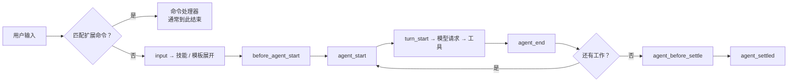

# 第14章 扩展基础：加载、生命周期与事件

Pi 默认启用四个工具。想加一个任务命令、在调用工具前询问，或按任务切换系统提示词，可以通过扩展接入。

扩展是 TypeScript 模块，跑在 **Pi 进程内**，拥有和 Pi 相同的操作系统权限。它能读 prompt、改工具调用、
注入上下文、注册命令，也能读文件和凭据。项目信任控制是否加载这些代码，加载后的代码仍使用当前账号的权限。

## 14.1 放哪里，怎么加载

| 位置 | 范围 | 说明 |
| --- | --- | --- |
| `~/.pi/agent/extensions/` | 用户级 | 自动发现，可 `/reload` 热重载 |
| `.pi/extensions/` | 项目级 | **要项目信任**；信任后才加载 |
| `-e ./path.ts` | 单次 | 快速测试；也可以 `-e npm:包名` |

`pi -ne` 关掉所有自动发现的内置/配置扩展，但显式 `-e` 的路径仍然加载。

```ill
pi-plate-p4
```

`/reload` 会重新加载资源。Pi 1.5.0 的资源加载器也重新解析显式 `-e` 来源；临时包还会检查缓存与版本。这里的“一次性”指不把来源加入设置，不是说当前进程里只加载一次。开发时把扩展放进自动发现目录，或明确传入 `-e`，都应在重载后重新检查状态。

### 先分清安装成功、加载成功和功能生效

这三个动作分别发生在不同位置。包管理器把文件取到本机，资源加载器发现入口，模块的默认导出再通过 `pi.on()`、`pi.registerCommand()` 等登记功能。模型工具还要进入活动工具集合，模型才看得见。

例如 `pi-purge` 安装成功后，`/purge` 命令出现，说明命令已经注册；`/purge status` 显示关闭时，它不会改系统提示词。第 18 章将用这个真实插件把整条路径走完。遇到“装了没反应”，先找出停在哪一步，别只重装包。

## 14.2 一个最小的扩展

```typescript
import { type ExtensionAPI, isToolCallEventType } from "@earendil-works/pi-coding-agent";

export default function (pi: ExtensionAPI) {
  pi.on("session_start", async (_event, ctx) => {
    if (ctx.hasUI) ctx.ui.notify("扩展已加载", "info");
  });

  pi.on("tool_call", async (event, ctx) => {
    if (isToolCallEventType("bash", event) && event.input.command.includes("rm -rf")) {
      if (!ctx.hasUI) return { block: true, reason: "此规则需要交互确认" };
      const ok = await ctx.ui.confirm("危险命令", "允许执行 rm -rf？");
      if (!ok) return { block: true, reason: "用户拒绝" };
    }
  });
}
```

这段代码做了两件事：启动时发一条提示；在 `bash` 工具真正执行前，匹配到 `rm -rf` 就问一次。
`return { block: true }` 会跳过执行，但仍产生一个错误结果（第 11 章的五段生命周期）。

`isToolCallEventType()` 先收窄输入类型，避免直接假定每种工具都有 `command`。没有 UI 时显式阻止，使这个示例的行为可预期。不过字符串包含检查只演示事件拦截：命令可以换参数顺序，也可以通过其他程序删除文件，不能拿它当完整的 shell 权限系统。

## 14.3 生命周期：从输入到 settled

`docs/extensions.md` 的图可以压缩成这条链：



`agent_end` 后可能继续重试或处理排队输入，`agent_settled` 表示这一轮工作已经安定下来。它并不表示退出会话；关闭会话资源应处理 `session_shutdown`。

事件分几组：启动/信任（`project_trust`、`session_start`）、资源（扩展/技能/模板/主题加载）、
会话（切换、fork、压缩）、agent（start/end/settled）、模型（请求头、payload、响应、流事件）、
工具（五段）、用户 bash、输入。`docs/extensions.md` 有完整表。

### 按要改变的东西选事件

| 想做的事 | 接入点 | 需要注意 |
| --- | --- | --- |
| 初始化本会话状态 | `session_start` | `startup`、`new`、`resume`、`fork`、`reload` 都可能触发 |
| 改本轮系统提示词 | `before_agent_start` | 后续处理器还可以改；返回 `systemPrompt` 会替换当前文本 |
| 调整送给模型的消息 | `context` | 操作消息视图，与删除会话文件不同 |
| 检查或阻止工具调用 | `tool_call` | 核对工具名、参数，明确无 UI 时的策略 |
| 改工具返回给模型的结果 | `tool_result` | 保留错误语义和模型完成任务需要的证据 |
| 本轮忙碌工作完成后处理 | `agent_settled` | 与会话退出区分，避免重复触发跟进任务 |
| 关闭定时器、连接或监听 | `session_shutdown` | 清理应能重复调用；随后可能重载或切换会话 |

不要在模块顶层就启动文件监听或连接。工厂函数执行时先登记处理器，等 `session_start` 或命令真正需要时再启动资源。重载会创建新实例，旧实例没有清理的定时器就可能继续工作，表现成“一条通知弹两遍”。

### 多个扩展修改提示词时发生什么

Pi 1.5.0 按处理器顺序运行 `before_agent_start`。后一个处理器读取的 `event.systemPrompt` 已包含前一个的返回值：

```text
Pi 原提示词 H
  → 扩展 A 返回 H + 附加规则
  → 扩展 B 返回 自定义文本 + 工作目录
  → 扩展 C 返回 当前文本 + 审查要求
```

在这个顺序里，B 已丢掉 A 写入 H 的规则，C 的内容又进入最终结果。pi-purge 的 `strict` 正是 B 这类行为。只看 A 的“已加载”提示，或只看 B 的状态栏，都无法知道最终请求包含哪些文字。

这个钩子还提供可变的 `systemPromptOptions`，可以修改工具指导、项目上下文等结构化选项。但一旦处理器返回完整 `systemPrompt`，运行器就把它设为 `forceSystemPrompt`；后续只改结构化选项的处理器未必能影响这段强制文本。需要合作的插件应约定修改方式，排错时先只启用其中一个，再逐个加回。

`ctx.getSystemPrompt()` 在这个事件里反映当前处理到的位置，不包含未来处理器和后续请求体改写。调试时可以记录长度或不敏感的标记，不要顺手把整个项目提示词写进公共日志。

## 14.4 本章小实验：证明扩展真的加载了

**第一步：写一个只打标记的扩展。**

把下面这段存成 `/tmp/pi-ext/hello.ts`：

```typescript
export default function (pi: any) {
  pi.on("session_start", async () => {
    console.error("PI_EXT_LOADED");
  });
}
```

**第二步：用 `-e` 加载，跑一次最短请求。**

```bash
cd /tmp/pi-ext
pi -e ./hello.ts --print --no-session --no-tools "只回复：OK"
```

本机实测：stdout 是 `OK`，stderr 第一行是 `PI_EXT_LOADED`，退出码 0。说明 `-e` 路径被加载，
`session_start` 事件被触发。扩展把标记写到 stderr，是为了不污染 stdout（第 8 章）。

**第三步：确认项目扩展要信任。**

把同一个文件放到 `.pi/extensions/`，在未信任的项目里启动，启动头不会列出它；`/trust` 之后才会。
这一步涉及信任交互，本章**未在本机验证**。

## 14.5 翻车对照：扩展层的六个坑

| 翻车做法 | 会看到什么 | 正确做法 |
| --- | --- | --- |
| 从网上随便装扩展 | 它和 Pi 同权限，能读凭据/文件 | 先读源码；只装可信来源 |
| 以为 `.pi/extensions` 会自动加载 | 项目未信任时不加载 | 先 `/trust`，或用 `--approve` 做一次性决定 |
| 重载后还假设内存状态存在 | 实例重建，开关或缓存回到初始状态 | 重载后查状态；需要恢复的状态另行持久化 |
| 在 `agent_end` 做收尾 | 重试/排队还会继续 | 用 `agent_settled` |
| 扩展里 `console.log` 当输出 | stdout 可能被协议占用（JSON/RPC） | 日志写 stderr；面向用户的提示用 `ctx.ui` |
| 在 `project_trust` 里用项目资源 | 信任决定发生在资源加载之前 | 信任处理器只做判断，不要依赖项目扩展 |

## 14.6 与另两册的同构点

御舆那册有 hooks 与插件，Omp 有扩展与事件。Pi 的扩展是"进程内 TypeScript 模块 + 事件 + 注册表"，
可以直接调用 Node.js 能力。对照时只借"生命周期事件"这条，不要假设三家的信任模型一样——
Pi 的项目信任只管加载，不管执行。

下一章把扩展写到能用：自定义工具、命令、快捷键与 UI。

---

**版本核对清单**（写作钉 `pi/1.5.0`，提交 `f9a2636`；本机 2026-11-08 复验）

- [ ] 扩展的三个加载位置与 `-e` 语义是否未变。
- [ ] 项目 `.pi/extensions` 是否仍要项目信任。
- [ ] `agent_end` / `agent_settled` 的区别是否仍未变。
- [ ] `tool_call` 返回 `{ block: true, reason }` 的行为是否未变。
- [ ] `-ne` 是否仍只关自动发现、不禁显式 `-e`。
