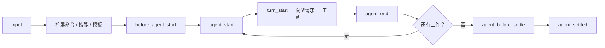

# 第14章 扩展基础：加载、生命周期与事件

Pi 默认只给四个工具。想要"每次 `rm -rf` 前确认一下"，你得自己写——或者让 Pi 帮你写——一个扩展。

扩展是 TypeScript 模块，跑在 **Pi 进程内**，拥有和 Pi 相同的操作系统权限。它能读 prompt、改工具调用、
注入上下文、注册命令，也能读文件和凭据。所以第一句话要说三遍：**只加载你信得过的扩展。**

## 14.1 放哪里，怎么加载

| 位置 | 范围 | 说明 |
| --- | --- | --- |
| `~/.pi/agent/extensions/` | 用户级 | 自动发现，可 `/reload` 热重载 |
| `.pi/extensions/` | 项目级 | **要项目信任**；信任后才加载 |
| `-e ./path.ts` | 单次 | 快速测试；也可以 `-e npm:包名` |

`pi -ne` 关掉所有自动发现的内置/配置扩展，但显式 `-e` 的路径仍然加载。

```ill
pi-plate-p4
```

`/reload` 会重新加载自动发现位置的扩展；`-e` 的一次性扩展不参与热重载。

## 14.2 一个最小的扩展

```typescript
import type { ExtensionAPI } from "@earendil-works/pi-coding-agent";

export default function (pi: ExtensionAPI) {
  pi.on("session_start", async (_event, ctx) => {
    ctx.ui.notify("扩展已加载", "info");
  });

  pi.on("tool_call", async (event, ctx) => {
    if (event.toolName === "bash" && event.input.command.includes("rm -rf")) {
      const ok = await ctx.ui.confirm("危险命令", "允许执行 rm -rf？");
      if (!ok) return { block: true, reason: "用户拒绝" };
    }
  });
}
```

这段代码做了两件事：启动时发一条提示；在 `bash` 工具真正执行前，匹配到 `rm -rf` 就问一次。
`return { block: true }` 会跳过执行，但仍产生一个错误结果（第 11 章的五段生命周期）。

## 14.3 生命周期：从输入到 settled

`docs/extensions.md` 的图可以压缩成这条链：



关键区别还是那个：`agent_end` 不是终点，`agent_settled` 才是。扩展要"会话结束时做点什么"，
应该挂 `agent_settled`，而不是 `agent_end`。

事件分几组：启动/信任（`project_trust`、`session_start`）、资源（扩展/技能/模板/主题加载）、
会话（切换、fork、压缩）、agent（start/end/settled）、模型（请求头、payload、响应、流事件）、
工具（五段）、用户 bash、输入。`docs/extensions.md` 有完整表。

## 14.4 本章小实验：证明扩展真的加载了

**第一步：写一个只打标记的扩展。**

把下面这段存成 `/tmp/pi-ext/hello.ts`：

```typescript
export default function (pi: any) {
  pi.on("session_start", async () => {
    console.error("PI_EXT_LOADED");
  });
}
```

**第二步：用 `-e` 加载，跑一次最短请求。**

```bash
cd /tmp/pi-ext
pi -e ./hello.ts --print --no-session --no-tools "只回复：OK"
```

本机实测：stdout 是 `OK`，stderr 第一行是 `PI_EXT_LOADED`，退出码 0。说明 `-e` 路径被加载，
`session_start` 事件被触发。扩展把标记写到 stderr，是为了不污染 stdout（第 8 章）。

**第三步：确认项目扩展要信任。**

把同一个文件放到 `.pi/extensions/`，在未信任的项目里启动，启动头不会列出它；`/trust` 之后才会。
这一步涉及信任交互，本章**未在本机验证**。

## 14.5 翻车对照：扩展层的六个坑

| 翻车做法 | 会看到什么 | 正确做法 |
| --- | --- | --- |
| 从网上随便装扩展 | 它和 Pi 同权限，能读凭据/文件 | 先读源码；只装可信来源 |
| 以为 `.pi/extensions` 会自动加载 | 项目未信任时不加载 | 先 `/trust`，或用 `--approve` 做一次性决定 |
| 把热重载当万能 | `-e` 的一次性扩展不参与 `/reload` | 开发时放自动发现目录，或用 `-e` 重启 |
| 在 `agent_end` 做收尾 | 重试/排队还会继续 | 用 `agent_settled` |
| 扩展里 `console.log` 当输出 | stdout 可能被协议占用（JSON/RPC） | 日志写 stderr；面向用户的提示用 `ctx.ui` |
| 在 `project_trust` 里用项目资源 | 信任决定发生在资源加载之前 | 信任处理器只做判断，不要依赖项目扩展 |

## 14.6 与另两册的同构点

御舆那册有 hooks 与插件，Omp 有扩展与事件。Pi 的扩展是"进程内 TypeScript 模块 + 事件 + 注册表"，
权限边界最弱、能力最直接。对照时只借"生命周期事件"这条，不要假设三家的信任模型一样——
Pi 的项目信任只管加载，不管执行。

下一章把扩展写到能用：自定义工具、命令、快捷键与 UI。

---

**版本核对清单**（写作钉 `pi/1.5.0`，提交 `f9a2636`；本机 2026-11-08 复验）

- [ ] 扩展的三个加载位置与 `-e` 语义是否未变。
- [ ] 项目 `.pi/extensions` 是否仍要项目信任。
- [ ] `agent_end` / `agent_settled` 的区别是否仍未变。
- [ ] `tool_call` 返回 `{ block: true, reason }` 的行为是否未变。
- [ ] `-ne` 是否仍只关自动发现、不禁显式 `-e`。
