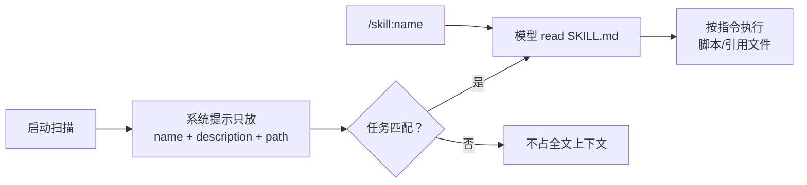

# 第16章 技能：按需加载的指令包

Pi 的上下文很贵。你不会希望每次请求都带上"如何从 PDF 抽表格"的五千字说明——除非这次真的要用。

技能（Skill）就是为这件事设计的：启动时只告诉模型"有这么一本说明书，叫什么、什么时候用"，
真正需要时再读全文。

## 16.1 一个目录，一个 `SKILL.md`

```text
pdf-tools/
├── SKILL.md
├── scripts/extract.sh
├── references/formats.md
└── assets/template.json
```

`SKILL.md` 以 frontmatter 开头，至少要有 `name` 和 `description`：

```markdown
---
name: pdf-tools
description: Extract text and tables from PDF files. Use when reading, converting, or inspecting PDFs.
---
# PDF tools
Read `references/formats.md` before converting. Run scripts relative to this skill directory.
```

`description` 决定模型什么时候考虑加载它。写"Helps with PDFs"没用；要写"做什么 + 什么时候用"。
文件名/目录名与 `name` 不一致时 Pi 不报错，但别的 Agent Skills 实现可能要求一致，所以最好对齐。

## 16.2 加载与触发

- 启动时扫描技能目录，把 `name`、`description`、路径放进系统提示的 `skills` 段。
- 模型判断任务匹配时，自己读 `SKILL.md` 全文（需要 `read` 工具）。
- 你也可以强制：`/skill:pdf-tools extract report.pdf`，后面的参数会附加成用户请求。
- `disable-model-invocation: true` 让它只显式可用；`enableSkillCommands` 控制是否出现在命令菜单。
- 目录可以是 `~/.pi/agent/skills/`、`.pi/skills/`、`~/.agents/skills/`、`.agents/skills/`，
  也可以用 `--skill` 指定。项目 `.agents/skills` 会从工作目录向上找到仓库根。
- 项目技能受项目信任约束；`/reload` 重新加载。



## 16.3 本章小实验：看技能进没进系统提示

**第一步：造一个技能。**

把下面的内容存成 `/tmp/pi-skill/echo/SKILL.md`：

```markdown
---
name: echo
description: Use when the user asks for the codeword ECHO-SKILL.
---
Reply with exactly ECHO-SKILL.
```

**第二步：用 `--skill` 加载，开 `read` 工具，跑 JSON 模式。**

```bash
cd /tmp/pi-skill
pi --mode json --no-session --tools read --skill ./echo "只回复：OK" > s.jsonl
```

**第三步：看 system sections。**

```bash
python - <<'PY'
import json
for line in open("s.jsonl", encoding="utf-8"):
    o = json.loads(line)
    if o.get("type") == "message_start" and o["message"].get("role") == "system":
        secs = o["message"].get("sections") or {}
        print(list(secs))
        print("echo" in str(secs.get("skills", "")).lower())
PY
```

本机实测：sections 里有 `skills`，且包含 `echo` 的 name/description；换回 `--no-tools` 时 `skills` 段消失——
没有 `read` 工具，模型也读不了全文，Pi 就不浪费位置去广告它。

## 16.4 翻车对照：技能层的五个坑

| 翻车做法 | 会看到什么 | 正确做法 |
| --- | --- | --- |
| 描述写"帮助处理 PDF" | 模型不知道何时该加载 | 写清"做什么 + 什么时候用" |
| 技能里用相对路径但没按技能目录解析 | 脚本找不到文件 | 以 `SKILL.md` 所在目录为基准；Pi 会告诉模型路径 |
| 把技能当扩展用 | 技能不能注册工具/命令 | 要新能力写扩展；技能只给指令与文件 |
| 项目技能没生效 | 项目未信任，或目录不在发现范围 | `/trust`；检查 `.pi/skills` / `.agents/skills` |
| 改了技能没反应 | 全文是模型按需读的，已读的旧内容还在上下文 | `/reload`，必要时新开会话 |

## 16.5 与另两册的同构点

御舆那册有 Skills 与插件，Omp 也有 Skills。Pi 的实现遵循 Agent Skills 规范，特点是把"广告"和"全文"
分开：启动只放描述，全文按需读。对照时只借"按需加载省上下文"这条，不要假设三家的目录与 frontmatter 一样。

下一章讲另外两个更轻的扩展点：提示模板与主题。

---

**版本核对清单**（写作钉 `pi/1.5.0`，提交 `f9a2636`；本机 2026-11-08 复验）

- [ ] 技能是否仍只把 name/description/path 放进 `skills` 段，全文按需读。
- [ ] `--skill`、`/skill:name`、`disable-model-invocation` 的语义是否未变。
- [ ] 技能目录（`~/.pi/agent/skills`、`.pi/skills`、`.agents/skills`）是否未变。
- [ ] 无 `read` 工具时 `skills` 段是否仍不出现。
- [ ] 项目技能是否仍受项目信任约束。
