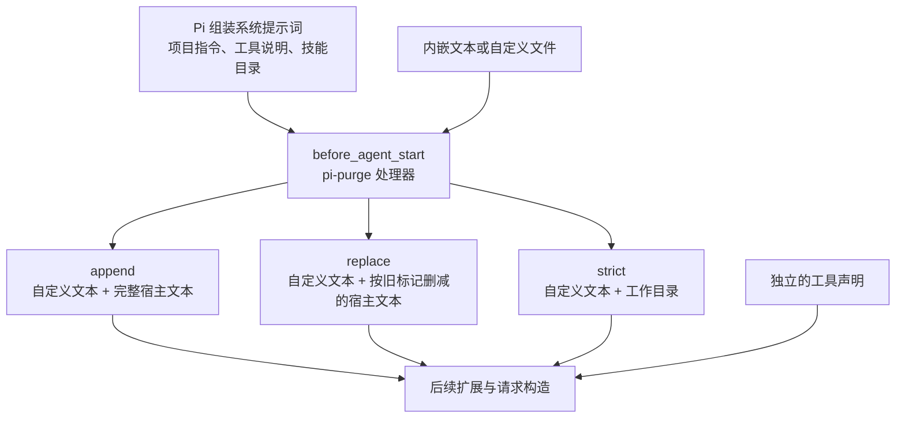

# 第18章 Pi 包：打包、安装与 pi-purge 实战

装完一个插件，菜单里出现了命令，并不代表你已经知道它改了什么。它可能只换颜色，也可能在每次模型请求前重写系统提示词。

本章先讲包的安装与管理，再完整拆开 `pi-purge`：从选定版本、准备提示词，到比较三种模式、排查失效、关闭与移除。读完应当能回答两个问题：这个包把什么代码装进了 Pi，以及这段代码怎样影响下一轮请求。

本章依据 Pi **1.5.0** 和 [pi-purge **0.2.1** 的固定源码](https://github.com/ZiChuanLan/pi-purge/tree/ffafeb940339d59fc6af4a05dc754019cef3a1ac)，后者的完整提交为 `ffafeb940339d59fc6af4a05dc754019cef3a1ac`。插件 README 与实际行为有差异的地方，下文会明确指出。来源与离线复现见书仓的 `pi/PIN.md` 和 `pi/VERIFY.md`。

## 18.1 一个包长什么样

日常说的“插件”在 Pi 里通常由两层组成：**包负责分发，extension 负责执行**。一个包可以带多种资源，并不要求每种都有。

| 资源 | 由谁使用 | 实际改变什么 |
| --- | --- | --- |
| extension | Pi 加载的 TypeScript / JavaScript 模块 | 注册命令、工具、事件处理器，或改 UI、请求 |
| skill | 模型按需读取 `SKILL.md` | 给出完成某类任务的方法与资料 |
| prompt template | 用户输入斜杠命令时展开 | 把 Markdown 模板变成一条输入 |
| theme | TUI 渲染器 | 改颜色与显示样式 |

`/purge` 是 extension 注册的命令。把同名 Markdown 放进 `prompts/`，只能展开文本，做不到拦截 `before_agent_start`。同样，安装一个只带主题的包，也不会凭空增加模型工具。

最简形式靠约定目录：

```text
my-pi-package/
├── package.json
├── extensions/
├── skills/
├── prompts/
└── themes/
```

没有 `pi` 字段时，Pi 从这些目录里发现 TypeScript/JavaScript 扩展、技能目录、Markdown 模板、JSON 主题。

资源放在别处，就写显式清单：

```json
{
  "name": "my-pi-package",
  "version": "1.0.0",
  "keywords": ["pi-package"],
  "pi": {
    "extensions": ["./src/extension.ts"],
    "skills": ["./resources/skills"],
    "prompts": ["./resources/prompts/*.md"],
    "themes": ["./resources/themes/*.json"]
  }
}
```

路径相对包根；数组支持 glob 和排除。`pi-package` 关键字让 npm 包进入 Pi 的包画廊（`pi.dev/packages`）。
`pi.image` / `pi.video` 可以给画廊加预览。

## 18.2 安装、列表、移除

下面的 `@example` 是包结构示意，实际安装 pi-purge 的命令在 18.3。先分清几个操作各自的作用：

```bash
pi install npm:@example/pi-tools@1.0.0
pi install git:github.com/example/pi-tools@v1
pi install ./local-package
pi list
pi remove <source>
pi update --extensions
```

- 默认写进 `~/.pi/agent/settings.json`；加 `-l`/`--local` 写进 `.pi/settings.json`。
- 项目包要项目信任才加载；项目里的包声明也要信任后才读。
- `-e` 可以临时装一个包，不写设置：`pi -e npm:@example/pi-tools`。缓存在 `~/.pi/agent/tmp/extensions/`。
- npm 精确版本（`@1.2.3`）不检查更新；git 的 tag/commit 是钉住的，更新只做 checkout 协调，不移动 ref。
- 启动时安装失败（比如断网）：Pi 警告、跳过该包资源、继续运行；`pi install` / `pi update --extensions`
  会返回非零。

### 只装到当前项目，还是所有项目都用

用户级声明会随你进入不同仓库。项目级声明适合团队共同维护的工具，不过只有信任项目后才读取。`-l` 改变的是声明范围，并没有把 extension 放进隔离进程。试用包时用 `-e`，确定要长期使用后再安装。

如果包里有多个扩展，可以在设置中选择要加载的资源。以下是配置片段，应合并进已有的 `packages`，不要覆盖其他设置：

```json
{
  "packages": [{
    "source": "npm:@example/pi-tools@1.0.0",
    "extensions": ["extensions/*.ts", "!extensions/legacy.ts"],
    "skills": [],
    "prompts": ["prompts/review.md"]
  }]
}
```

省略某种资源键表示按包清单加载，空数组表示不加载该类资源。筛选只能缩小包公开的范围。也可以用 `pi config` 选择资源；`pi config --local` 从项目范围开始。

本地包不会被复制，也不会由 Pi 替你安装依赖。设置里的相对路径以**包含它的设置文件**为基准。开发机能加载、同事机器找不到时，先检查这个路径，再检查依赖。宿主提供的 `typebox`、`@earendil-works/pi-coding-agent` 等应放在 `peerDependencies`，避免包里带另一套宿主实例。

### 停用、更新和移除是三个动作

`/reload` 让正在运行的 Pi 重新加载资源；`pi update --extensions` 协调已配置包的安装状态；`pi remove <source>` 移除对应包声明。更新不会把写死的提交自动换成新提交。要试新版，先记录旧的 source，再显式更换版本。

排查某个包时，先用 `pi -ne -e ./待测包` 缩小扩展集合。`-ne` 只控制扩展，项目上下文、技能、提示模板等还要分别考虑；它并不等于“完全空白的 Pi”。同一个包的 npm、git 和本地路径也可能被识别为不同来源，避免一份通过 npm 加载、另一份通过本地路径重复加载。

## 18.3 从本地包到 pi-purge：完整操作与源码拆解

**第一步：造一个最小包。**

`/tmp/pi-pkg/package.json`：

```json
{"name":"pi-demo-pkg","version":"0.0.1","pi":{"extensions":["./ext.ts"]}}
```

`/tmp/pi-pkg/ext.ts`：

```typescript
export default function (pi: any) {
  pi.on("session_start", async () => { console.error("PKG_LOADED"); });
}
```

**第二步：用 `-e` 指向包目录。**

```bash
cd /tmp/pi-pkg
pi -e ./ --print --no-session --no-tools "只回复：OK"
```

本机实测：stdout 是 `OK`，stderr 有 `PKG_LOADED`，退出码 0。说明 `pi` 字段里的扩展被解析并加载。
`pi install` 的网络安装本章未跑；本地包路径与 `-e` 的解析已验证。

### pi-purge：先明确它处理的是哪一层

pi-purge 在 `before_agent_start` 返回新的 `systemPrompt`，改变本轮的系统提示词。它没有注册压缩处理器，也不删会话 JSONL。第 7 章的 `/compact` 处理历史消息，`/purge` 处理宿主系统提示词；名字里的 purge 很容易让人把两者混淆。

这个包的 `package.json` 只声明一个扩展入口：

```json
{
  "name": "pi-purge",
  "version": "0.2.1",
  "pi": { "extensions": ["./extensions/pi-purge.ts"] }
}
```

入口注册两个事件和一个命令：`session_start`、`before_agent_start`、`purge`。没有新增模型工具，没有后台任务，也没有写状态文件的代码。包声明支持 `@earendil-works/pi-coding-agent >=0.80.0 <2`，但这个范围只能说明作者声明的兼容范围；不能据此认定它的字符串匹配适配了每个 Pi 版本。

### 固定版本，先做一次临时加载

本书使用 git 的完整提交，便于对照正文和源码：

```bash
pi -ne -e git:github.com/ZiChuanLan/pi-purge@ffafeb940339d59fc6af4a05dc754019cef3a1ac
```

进入交互界面后先输入：

```text
/purge status
```

刚加载时应为关闭，模式为 `strict`，来源为内嵌。只看见 `/purge` 命令不代表它已经启用。决定长期使用后退出 Pi，在终端执行：

```bash
pi install git:github.com/ZiChuanLan/pi-purge@ffafeb940339d59fc6af4a05dc754019cef3a1ac
pi list
```

项目级安装在 `install` 后加 `-l`。上游还提供 `npm:pi-purge@0.2.1`，但本书的源码核对对象是上述 git 提交，不把 npm 同版本号当成两份文件逐字相同的证明。安装器会写包和设置；后文的“不写状态文件”只描述扩展自身。

### 先用一份能看懂的提示词

这个版本自带一大段人设，包含强制角色、输出用语和“不拒绝”等要求。它是作者写进包里的普通提示文本，不代表服务商能力发生了变化。分析插件机制时，用自己的短文本更容易判断到底是哪条指令起了作用。

在练习目录新建 `review-style.md`：

```markdown
你负责解释代码差异。用简体中文。
先说明最可能影响用户的变化，再给出相应文件和函数。
没有证据的推断要标明；不要宣称已经运行未运行的测试。
```

假设其绝对路径为 `C:/pi-lab/review-style.md`，在 Pi 中逐行输入：

```text
/purge source C:/pi-lab/review-style.md
/purge mode append
/purge on
/purge status
```

Linux 和 macOS 换成自己的绝对路径。普通含空格路径可用引号，例如 `/purge source "C:/pi lab/review-style.md"`。该版参数解析会先按空白拆分再拼接，文件名里有连续空格时可能改变路径，练习文件尽量避开这种名字。

`source` 与 `mode` 只选来源和模式，**不会自动开启**。`on` 会重读当前来源并开启；`off` 停止后续改写；不带参数的 `/purge` 是开关切换，写操作步骤时使用显式 `on` / `off` 更清楚。

### 三种模式到底保留什么

把自定义提示记作 P，进入当前处理器的宿主提示记作 H，工作目录记作 cwd：

| 模式 | 处理器返回的内容 | 项目指令与工具文字 |
| --- | --- | --- |
| `append` | P + 空行 + H | H 原样保留；P 实际放在前面 |
| `replace` | P + 空行 + 删除匹配段后的 H | 保留未匹配部分；只尝试删除旧身份行、旧文档段 |
| `strict` | P + 空行 + `Current working directory: cwd` | 丢弃 H；没有结构化 cwd 时只返回 P |



`strict` 会丢掉 H 中的 `AGENTS.md` 项目指令、skills 目录、工具使用说明，以及先前扩展加进 H 的文字。工具 schema 走独立的工具声明通道，插件没有因此撤销工具，也没有撤销文件或 shell 权限。模型仍可能调用工具，但少了原来的使用指导；不能把“工具仍注册着”推成“所有任务照常完成”。

另一方面，历史消息不属于这个 H。过去的回复、工具结果、已经读进会话的技能内容，不会因为这次 `strict` 自动消失。若另一个扩展随后改写系统提示词或请求体，它仍能影响最终请求。因此 `strict` 也不能保证整次请求只有这一个变量。

### 本书钉版的关键差异：replace 匹配不到 Pi 1.5.0

插件要找的旧身份句以 `You are an expert coding assistant operating inside pi` 开头；Pi 1.5.0 的默认身份句改成了 `You are a coding assistant running inside pi`。文档段的起点和末尾标记也已经改变。

本书用安装包里的 `buildSystemPrompt()` 生成真实格式的提示词，再交给插件处理：两处均未匹配，`replace` 返回的结果与 `append` 相同。`/purge status` 对应显示：

```text
上轮切除: 身份段 未匹配 / pi 文档段 未匹配
```

这不是插件没加载，而是它依赖的文字标记过时了。遇到这个结果，应当按“前置追加”理解当前行为。不要为了让状态显示成功，在自己的项目指令里塞一段旧身份句：插件会从匹配点切到该行结尾，可能删掉你自己的文字。

还有一种情况是只匹配上一处。两次删除是独立执行的，身份行能删、文档段匹配失败时，结果就是只删身份行；并非任一匹配失败都会整体回滚。本书的离线示例同时覆盖这条分支。

### 完整走一遍对照实验

用同一份小代码差异作为任务，例如把同步读文件改成异步读文件，请它解释行为变化。先准备固定的输入文本，再分别做以下几轮：

| 轮次 | 开始时设置 | 看什么 |
| --- | --- | --- |
| 基线 | `/purge off` | 默认系统提示词下的回答与工具调用 |
| 前置追加 | `source` 指向同一文件，`mode append`，`on` | 输出是否遵循短提示，项目规则是否仍在 |
| 选择性删减 | 同一来源，`mode replace`，`on` | 先看切除状态；在本书版本中预期匹配失败 |
| 全段替换 | 同一来源，`mode strict`，`on` | 丢掉项目指导后，解释和工具使用有何变化 |

每组从新的会话开始，重新设置来源、模式、开关，并保持模型、thinking 档位、可用工具、输入文件一致。在同一会话里连问四次，后一次会看见前一次答案，比较就掺进了历史消息的影响。控制其他扩展、模型自身随机性和提供方差异也同样重要；一轮回答不能证明哪种模式普遍更好。

记录插件提交、Pi 版本、提示词文件内容、模式和回答，附上请求之后的 `/purge status`。这里的“字符数”来自 JavaScript 字符串的 `length`，不是模型 token 数，也不能直接换算省了多少钱。本书验证了提示词变换与命令逻辑，没有把这组模型行为实验写成已经跑出的效果数据。

### 命令速查，以及 README 没说准的地方

| 命令 | 0.2.1 钉版实际行为 |
| --- | --- |
| `/purge` | 开关切换；关闭状态下调用开启逻辑 |
| `/purge on` / `off` | 显式开启、关闭；也接受 `enable` / `disable` |
| `/purge status` | 显示开关、模式、来源、字符数和保存的切除诊断 |
| `/purge mode append` | 设置前置追加；另可选 `replace`、`strict` |
| `/purge source <绝对路径>` | 同步读取并去掉首尾空白；非空才接受 |
| `/purge source embedded` | 切回包内自带文本；不自动开启 |
| `/purge reload` | **未实现**，会提示“未知子命令: reload” |

上游 README 列了 `/purge reload`，但命令分派里没有这个分支。修改外部文件后，重新执行 `/purge source <同一路径>` 可以读取；也可以再次 `/purge on`，它同样会读取，但同时会开启插件。`before_agent_start` 使用缓存的正文，不会每轮读盘，也没有文件监听。

状态里的“上轮切除”也有局限：`append` 不更新它，可能还显示先前 `replace` 的结果，或者一直显示“尚未运行过一轮”。`strict` 虽然整段丢弃 H，仍借旧标记匹配结果填写这两个布尔值，所以“未匹配”不表示 H 被保留。它是一份有限的匹配诊断，不是最终发给提供方的完整请求记录。

### 状态、失败和恢复

开关、模式、来源和正文都保存在模块内存中。`session_start` 明确把开关关掉、清掉切除诊断并重新读取来源；Pi 1.5.0 在切换、新建、恢复或重载时还会重新加载并绑定扩展。无论如何，都不要假设恢复会话会恢复启用状态，进入后先看 `/purge status`。重启进程会回到代码中的初始值：关闭、`strict`、内嵌文本。

有三种失败值得区分：

1. **换到不存在或空的文件。** `source` 保存旧路径，读取失败后恢复旧路径并重新读取，随后报告错误。如果旧文件此时也已不可读，就无法恢复原正文；“回滚”并不保证磁盘上的旧文件还在。
2. **开启时当前来源读不到。** `on` 报错；读取函数把正文清空，钩子会因正文为空跳过改写。如果此前已经开启，开关变量不一定同步关掉，别只看页脚的 `PURGE ON`，还要看正文是否加载。修好来源后重新 `on`，或显式 `off`。
3. **改了文件但回复没变。** 先显式重读，再核对模式。若请求前还有其他扩展修改提示词，要进一步缩小扩展集合；若只有模型输出没体现风格，也不能据此断定钩子没有执行。

结束实验时执行：

```text
/purge off
/purge status
```

这会让后续轮次不再由该扩展替换系统提示词。已经产生的回复和工具副作用不会撤销；想重新做干净的比较，另开会话。要移除长期安装的版本，退出后执行与安装来源对应的命令：

```bash
pi remove git:github.com/ZiChuanLan/pi-purge@ffafeb940339d59fc6af4a05dc754019cef3a1ac
```

项目级安装用对应的 `-l` 范围；下一次启动用 `pi list` 检查。只通过 `-e` 试用的，下一次不传它即可。0.2.x 不读取旧版 `pi-purge.json`，不必为了找“永久开启配置”去修改该文件。

### 顺着源码读，不需要先读完整个人设

把 `extensions/pi-purge.ts` 分成五块看，就能跟上数据流：

| 代码位置 | 阅读问题 |
| --- | --- |
| `enabled`、`mode`、`source`、`body` | 哪些值只在进程内，哪些来自文件？ |
| `reload()` | 成功时如何替换正文，失败时是否清空旧正文？ |
| `stripHostPersona()` | 固定起止标记在哪里，缺少一端时保留什么？ |
| `before_agent_start` | 三条分支怎样组成返回的 `systemPrompt`？ |
| `registerCommand("purge", ...)` | 每条命令改哪些值，是否同时开启？ |

特别留意 `strict` 从 `event.systemPromptOptions.cwd` 取得目录，没有从旧 H 里搜索目录字符串。相反，`replace` 对 H 做 `indexOf()` 匹配，无法自动理解 Pi 的 `<rules>`、`<docs>` 等结构。这解释了为什么两种模式面对宿主升级时表现不同。

插件也展示了第 14、15 章的分工：命令负责让人选状态，事件负责在正确时刻应用状态，页脚负责反馈。它没有 `registerTool`，所以模型没有一个叫 `purge` 的工具可以直接调用。要写类似扩展，可以沿用这种命令与事件分离的结构，并为会话切换、来源失败和宿主格式变化单独保留用例。

### 不调用模型的复现方法

书仓提供 `pi/examples/check-purge.mjs`，它直接加载指定版本的插件，给它传入最小的事件注册接口，再用 Pi 1.5.0 的真实 `buildSystemPrompt()` 生成输入。临时文件只含 `REVIEW_FIXTURE` 这类无业务数据的标记，不访问真实会话或凭据。

```bash
node pi/examples/check-purge.mjs /path/to/pi-purge /path/to/pi-coding-agent
```

第二个参数是含 `package.json`、`dist/` 的 Pi **安装包目录**，不是整个 monorepo 的根。需要 Node.js 22.19.0 或更新版。本机 Node 24.14.0 跑通 12 组检查：关闭时不改写、三种模式、1.5.0 匹配失败、旧文案匹配、部分匹配、换源回滚、文件重读、过期诊断、缺少 cwd、会话重置和临时目录文件集合不变。脚本没有模拟网络或 TUI，也没有证明内嵌人设能得到某种模型回答。

## 18.4 翻车对照：包层的五个坑

| 翻车做法 | 会看到什么 | 正确做法 |
| --- | --- | --- |
| 项目包没生效 | 项目未信任，声明没读 | `/trust`；或先 `-e` 试 |
| npm 版本写 `^1.0.0` 却想复现 | 每次可能拿到不同小版本 | 钉精确版本 `@1.0.0` |
| git 源写分支名 | 更新会跟随分支移动 | 写 tag 或 commit |
| 包安装失败后以为 Pi 一定会退出 | Pi 可能跳过该包继续跑 | 看启动警告和 `pi list`，修好源再更新 |
| 把包当"沙箱" | 扩展仍在 Pi 进程内、同权限 | 只装可信包；不可信代码进容器 |

## 18.5 与另两册的同构点

御舆那册有插件/技能分发，Omp 也有扩展与包。Pi 的包把四种资源合成一个 npm/git 单元，且**没有独立权限模型**。
对照时只借"资源打包 + 版本钉"这条，不要把别家的市场审核当成安全边界。

pi-purge 还提醒我们，插件能改变的是宿主这一侧的输入。系统提示词变短、项目规范被移除、工具声明仍在，是三件不同的事。它既不能证明模型服务的规则改变，也不构成执行隔离。第 22 章讨论如何把文件权限和运行环境作为另一层约束。

下一章把 Pi 嵌进你自己的程序：SDK 与 RPC。

---

**版本核对清单**（写作钉 `pi/1.5.0`，提交 `f9a2636`；本机 2026-11-08 复验）

- [ ] `pi` 字段的四个资源键（extensions/skills/prompts/themes）是否未变。
- [ ] 约定目录发现规则是否未变。
- [ ] `install` / `list` / `remove` / `update --extensions` 的语义是否未变。
- [ ] `-l` 是否仍写项目设置；项目包是否仍要项目信任。
- [ ] npm 精确版本与 git tag/commit 的钉住行为是否未变。
- [ ] pi-purge 是否仍为本章固定的 0.2.1 提交；`replace` 的匹配标记、`reload` 子命令和诊断更新行为是否改变。
