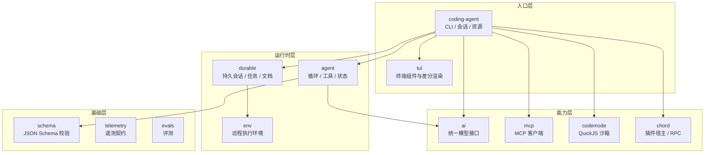

# 第24章 源码地图：12 个包怎么分工

读源码最怕"打开仓库，几十个目录，不知道从哪进"。

Pi 是 monorepo，v1.5.0 的 `packages/` 下有 12 个包。它们不是并列的 12 个功能，而是分层的：

```ill
pi-plate-p6
```

底层是协议与运行时，中间是模型与 agent，顶层是 CLI 与 TUI。这一章给一张地图，读完你知道该打开哪个目录。

## 24.1 四层地图



## 24.2 12 个包，一句话

| 目录 | 包名 | 一句话 |
| --- | --- | --- |
| `ai` | `@earendil-works/pi-ai` | 多 provider 统一接口与模型发现 |
| `agent` | `@earendil-works/pi-agent-core` | agent 运行时：工具调用、状态、transport |
| `coding-agent` | `@earendil-works/pi-coding-agent` | 本书主角：CLI、会话、资源、四种接口 |
| `tui` | `@earendil-works/pi-tui` | 终端 UI 库，差分渲染 |
| `durable` | `@earendil-works/pi-durable` | 持久化的会话、任务、文档运行时 |
| `env` | `@earendil-works/pi-env` | 给 Durable 用的远程执行环境守护进程 |
| `mcp` | `@earendil-works/pi-mcp` | 独立的 MCP 客户端 |
| `codemode` | `@earendil-works/pi-codemode` | 沙箱里跑 JS，唯一能力是调用注入的函数 |
| `chord` | `@earendil-works/chord` | 插件宿主：契约、复制状态、JSON RPC |
| `schema` | `@earendil-works/pi-schema` | 不用 eval 的 JSON Schema 校验 |
| `telemetry` | `@earendil-works/pi-telemetry` | 与厂商无关的遥测契约 |
| `evals` | `@earendil-works/pi-evals` | 评测工具（`package.json` 无 description） |

## 24.3 三条阅读路线

1. **只想懂 CLI 行为**：`packages/coding-agent/src/cli` → `core/session-manager.ts` →
   `core/agent-session.ts` → `core/extensions`。
2. **想懂 agent 循环**：`packages/agent/src` → `packages/ai/src` → 回到 `coding-agent` 的 turn 调度。
3. **想写扩展/UI**：`docs/extensions.md` + `packages/coding-agent/src/core/extensions/types.ts` +
   `packages/tui/src`。

## 24.4 本章小实验：不进 GitHub 也能看包地图

如果你本地装了 npm 包：

```bash
ls ~/.pi/agent/install/releases/*/node_modules/@earendil-works/
```

本机会列出 `pi-coding-agent` 与它的依赖（`pi-ai`、`pi-agent-core`、`pi-tui` 等）。
要看完整 monorepo，用 `PIN.md` 里的命令拉钉版：

```bash
git clone --depth 1 --branch v1.5.0 --filter=blob:none --no-checkout \
  https://github.com/earendil-works/pi.git
cd pi && git ls-tree --name-only HEAD packages/
```

本机实测：`packages/` 下正好这 12 个目录（见 `PIN.md` 第 4 节）。这一步不需要构建，也不需要 API key。

## 24.5 翻车对照：读源码的四个坑

| 翻车做法 | 会看到什么 | 正确做法 |
| --- | --- | --- |
| 读 `main` 的最新代码，却按书里的行为理解 | 行为对不上 | 按 `PIN.md` 的 tag/SHA checkout |
| 从 `dist/` 反推源码结构 | 打包产物和源码目录不是一一对应 | 读 `packages/*/src` |
| 把 `coding-agent` 当全部 | 模型/循环的实现在 `ai`/`agent` | 按 24.3 的路线分层读 |
| 忽略 `evals`/`telemetry` | 以为它们是运行时依赖 | 先看 `package.json` 的 `dependencies` |

## 24.6 与另两册的同构点

御舆那册解剖的是 Claude Code 的源码，Omp 那册也给源码地图。Pi 的地图更容易切分：包边界就是模块边界，
`coding-agent` 之外的包可以被别的程序复用。对照时只借"入口层 → 运行时层 → 能力层"这条，不要假设目录名一样。

下一章是三册对照，也是本书的收束。

---

**版本核对清单**（写作钉 `pi/1.5.0`，提交 `f9a2636`；本机 2026-11-08 复验）

- [ ] `packages/` 是否仍是 12 个目录；包名是否未变。
- [ ] `coding-agent` 的 `cli` / `core` 结构是否未变。
- [ ] `DEFAULT_TOOL_NAMES` 是否仍在 `core/settings-manager.ts`。
- [ ] `PIN.md` 的 clone 命令是否仍能取到 `packages/` 列表。
